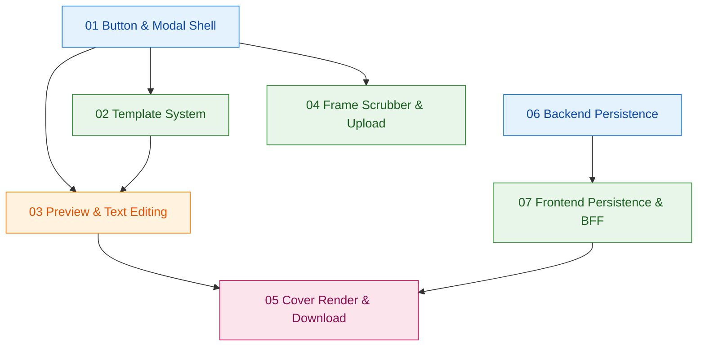

# Task Orchestration — Video Cover Template

> 父：`master-plan.md`、`specs/01..07.md`、`todos/01..07.md`
> 用途：汇总依赖关系、并行执行阶段、关键路径与代理分配建议

## 1. Dependency Graph



> Group A（蓝）= phase 1（无依赖）；B（绿）= phase 2；C（橙）= phase 3；D（粉）= phase 4。

## 2. Execution Phases

### Phase 1 — 并行 2 路（基础壳 + 后端）

| Task | parallel_group | 主要产出 |
|------|----------------|---------|
| 01 Button & Modal Shell | A | `VideoCoverModal/`（壳）、`CoverButton`、接入 `VideoPlayerPanel` |
| 06 Backend Persistence | A | `project_covers` 表、Alembic 迁移、router、service、tests |

完成判据：

- 01 验收清单全部勾选；新按钮可在浏览器看到，弹窗能开关
- 06 alembic 上下迁移可跑，pytest 全绿

### Phase 2 — 并行 3 路（模板 + 抽帧/上传 + BFF）

| Task | depends_on | 并行性 |
|------|------------|--------|
| 02 Template System | 01 | 完全独立 |
| 04 Frame Scrubber & Upload | 01 | 不消费 02/03 类型，可独立推进 |
| 07 Frontend Persistence & BFF | 06 | 后端契约已就绪 |

完成判据：

- 02 模板切换 + applyTemplate 单测全绿
- 04 算法 + Hook + 组件全部单测全绿，跨域抽帧手测通过
- 07 BFF 一行代理工作，端到端 GET/PUT/POST 通

### Phase 3 — 单路（预览 & 文字编辑）

| Task | depends_on | 说明 |
|------|------------|------|
| 03 Preview & Text Editing | 01, 02 | 消费 `CoverConfig` 数据模型 + 容器 |

完成判据：

- 5 比例预览 + 双击编辑 / IME / Esc 撤销 / blur 提交 全部通过
- TextStyleToolbar 联动正确

### Phase 4 — 单路（渲染 & 下载）

| Task | depends_on | 说明 |
|------|------------|------|
| 05 Cover Render & Download | 03, 07 | 需要 `previewRef` 与 `uploadPng` |

完成判据：

- 5 比例 PNG 下载全部尺寸正确
- 字体不回退；后台缓存上传走通

## 3. Critical Path

```
01 → 02 → 03 → 05    （4 阶段，前端主线）
06 → 07 → 05         （3 阶段，后端 + 持久化分支）
01 → 04 → 05         （3 阶段，抽帧分支）
```

**关键路径** = 01 → 02 → 03 → 05（**4 阶段，长度 4**）。

瓶颈分析：

- **03 Preview & Text Editing** 是最长的中段任务。其工作量受文字编辑器（contentEditable + IME 兼容 + 工具栏受控）决定，建议预留较高估时
- **05 Cover Render & Download** 是收尾，依赖前端三条线全部完成
- **06 Backend** 在 Phase 1 与 01 并行，不在关键路径上；可延后启动到 Phase 1 后期，只要在 07 启动前完成即可

## 4. Agent Assignments

> 推荐 5-6 个开发代理（小团队；可全程并行 + 收敛）。命名沿用 `master-plan` 的占位 `{team}-eng-NN`。

### 分配

| Agent | 任务 | 阶段 |
|-------|------|------|
| `{team}-eng-01` | TODO 01（前端壳） → TODO 03（预览/文字） | Phase 1 → Phase 3 |
| `{team}-eng-02` | TODO 06（后端）→ TODO 07（BFF + 持久化 hook）| Phase 1 → Phase 2 |
| `{team}-eng-03` | TODO 02（模板系统） | Phase 2 |
| `{team}-eng-04` | TODO 04（抽帧与上传） | Phase 2 |
| `{team}-eng-05` | TODO 05（渲染 & 下载） | Phase 4 |

### Coordination Notes

- **接口契约 1（CoverState 类型）**：`{team}-eng-01` 在 todo-01 阶段建立 `types.ts` 骨架（仅占位），`{team}-eng-03` 在 todo-02 扩展为完整类型；其他代理统一从这个文件 import，避免类型分散
- **接口契约 2（templates 默认配置 + makeDefaultState）**：`{team}-eng-03` 在 todo-02 内同时落地 `COVER_TEMPLATES.title.defaultConfig` 与 `utils/makeDefaultState.ts`；`{team}-eng-02` 的 todo-07 D 只消费 `makeDefaultState`（不重复定义）。建议 todo-02 优先做 `titleTemplate.ts` + `makeDefaultState.ts`，其余三个模板可后续补
- **接口契约 3（VirtualTimeline）**：`{team}-eng-04` 在 todo-04 完成 `buildVirtualSegments` 与 `useFrameExtraction` 后，把签名同步给 `{team}-eng-01`，确保 `VideoCoverModal.tsx` 能正确传 props
- **接口契约 4（useCoverPersistence）**：`{team}-eng-02` 完成 todo-07 后，把 `initialState / save / flush / uploadPng` 签名同步给 `{team}-eng-01` 与 `{team}-eng-05`
- **接口契约 5（previewRef）**：`{team}-eng-01`/`{team}-eng-05` 约定 `previewRef` 指向 `.layers` 容器；写 `CoverPreview.tsx` 时显式 forward ref 或顶层 useRef 共享
- **依赖文件 cross-watch**：`VideoCoverModal/types.ts` 是多代理共写文件；建议 todo-01 阶段冻结一个最小骨架版本，后续仅追加，不删改 → 避免合并冲突
- **后端 schema 迁移**：`{team}-eng-02` 的 todo-06 在 Phase 1 末必须把 alembic 跑通；本地与生产部署都要验证一次（沿用 memory：production deploy 注意 `.env` 不被覆盖）
- **html-to-image 安装时机**：`{team}-eng-05` 在 todo-05 启动时 `npm install`；安装命令一定要进 `package-lock.json` 提交，避免 CI 缺包

### 阶段交接 checkpoint

每个 Phase 结束需验证：

- 类型一致性（`tsc --noEmit` 不报错）
- 单测全绿（前端 `npm run test`、后端 `pytest`）
- ESLint 无新增 error
- 阶段产物可在浏览器中合成感知（如 Phase 1 后能开关空壳弹窗）

## 5. Context Files

每个代理在开始任务前必读：

| 代理 | 必读 |
|------|------|
| 任何代理 | `master-plan.md`（总体方案） |
| `{team}-eng-01` | `specs/01-button-and-modal-shell.md`、`todos/01-...md`、`specs/03-...md`、`todos/03-...md` |
| `{team}-eng-02` | `specs/06-backend-cover-persistence.md`、`todos/06-...md`、`specs/07-...md`、`todos/07-...md` |
| `{team}-eng-03` | `specs/02-template-system.md`、`todos/02-...md`、`specs/01.types.ts` 骨架（实际由 01 完成） |
| `{team}-eng-04` | `specs/04-frame-scrubber-and-upload.md`、`todos/04-...md`、existing `extractVideoThumbnail.ts` |
| `{team}-eng-05` | `specs/05-cover-render-and-download.md`、`todos/05-...md` |

### 项目级共享上下文

- `CLAUDE.md`（项目约定）
- `.claude-index/index.md`（代码导航）
- `src/components/video/components/VideoPlayerPanel/VideoPlayerPanel.tsx`（行 2300-2342 改造目标）
- `src/components/video/utils/extractVideoThumbnail.ts`（todo-04 复用 + 微改）
- `backend-services/basic-service/app/models/db_models.py`（行 188 `cover_url` 字段、行 171 `VideoProject`）
- `src/lib/api/server/backend-proxy.ts`（todo-07 BFF 一行包装）
- `src/components/ui/ConfirmationDialog.tsx`（参考写自建 Modal）

### 接口契约速查

```ts
// 一处声明，多处消费（VideoCoverModal/types.ts）
export type CoverTemplateId = 'title' | 'tutorial' | 'click' | 'minimal';
export type ImageSource = 'frame' | 'upload';
export type CoverAspectRatio = '16:9' | '9:16' | '1:1' | '4:3' | '21:9';
// CoverTextLayer / CoverDecoration / CoverConfig / CoverState 见 spec 02 §3.1
```

```ts
// VideoCoverModal.tsx props（spec 01 §3.2）
interface VideoCoverModalProps {
  isOpen: boolean;
  onClose: () => void;
  projectId: string;
  aspectRatio: CoverAspectRatio;
  timelineItems: TimelineItemData[];
  materials: MaterialItem[];
}
```

```ts
// useCoverPersistence return（spec 07 §5.1）
interface UseCoverPersistenceResult {
  initialState: CoverState | null;
  isLoading: boolean;
  loadError: Error | null;
  save: (state: CoverState) => void;
  flush: () => Promise<void>;
  uploadPng: (blob: Blob) => Promise<string>;
}
```

```ts
// useFrameExtraction return（spec 04 §5.1）
interface UseFrameExtractionResult {
  extractAt: (virtualTimeSec: number) => Promise<string | null>;
}
```

```ts
// useCoverRender return（spec 05 §6.1）
interface UseCoverRenderResult {
  render: () => Promise<{ blob: Blob; dataUrl: string; width: number; height: number }>;
  isRendering: boolean;
  lastError: Error | null;
}
```

## 6. 可选：单代理顺序方案

若仅由 1 个代理串行实施（个人项目场景），推荐顺序：

1. todo-06（后端）→ 2. todo-01（前端壳）→ 3. todo-07（BFF + persistence hook）→ 4. todo-02（模板）→ 5. todo-04（抽帧 + 上传）→ 6. todo-03（预览 + 文字编辑）→ 7. todo-05（渲染 + 下载）

这个顺序保证每一步都有可交付的可见进度（壳 → 持久化 → 模板 → 帧 → 编辑器 → 下载）。

## 7. 全局风险与缓解汇总

| 类别 | 风险 | 缓解 |
|------|------|------|
| 跨代理并行 | `types.ts` 多代理共写冲突 | Phase 1 末冻结骨架，后续仅 add；用 PR review 把关 |
| 字体 | Inter 在 PNG 中回退 | 默认字体改 `system-ui` 栈（spec 05 推荐方案 1） |
| 后端 | 生产 alembic 漏跑 | 部署脚本明确 `alembic upgrade head` 一步；CI 加自检 |
| 跨域 | 视频 URL canvas tainted | 复用 `/api/video-proxy`；fallback 到上传图模式 |
| 性能 | 1080p 渲染卡顿 | 单实例 isRendering 锁 + 失败降到 720p |
| 主题 | 弹窗在切换主题时闪烁 | 全 CSS 变量、不用 inline style 写颜色 |
| 数据 | 多设备并发改同一封面 | upsert 最后写赢，前端 toast 提醒 |
| 部署 | `.env` 被部署脚本覆盖 | 沿用 memory：deploy 时保留 `.env`；BACKEND_URL 严格无 fallback |
