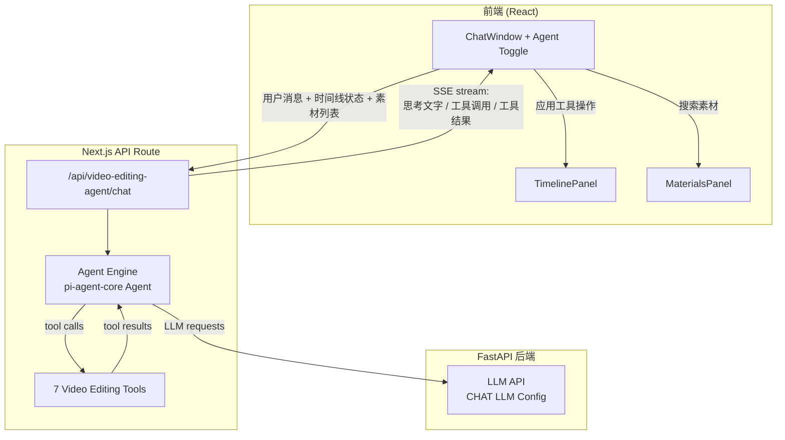

# Video Editing Agent - Master Plan

## 1. 项目概述

为 Ecliptrix 的视频编辑任务添加 **Agent 模式**，用户可以通过自然语言对话，指挥 AI Agent 自动完成视频剪辑操作。Agent 基于 `@mariozechner/pi-agent-core` 构建，拥有 7 个专用工具，能够搜索素材、操作时间线片段，实现"对话即剪辑"的体验。

### 目标

- 用户通过对话指令完成视频剪辑，无需手动操作时间线
- Agent 能理解上下文，支持多轮对话记忆
- 每次 Agent 回复的操作可一键撤销
- 实时流式反馈 Agent 的思考和操作过程

## 2. 范围定义

### 包含（In Scope）

- Agent 模式 Toggle 开关 UI（输入框上方，默认开启）
- 7 个视频编辑工具的定义和实现
- Agent 执行引擎（Next.js API Route + SSE 流式推送）
- pi-agent-core 集成（npm 依赖）
- Agent 对话历史持久化（复用现有对话系统）
- 一键撤销（撤销最近一次 Agent 回复的所有操作）
- 实时流式文字反馈 + 时间线操作动画
- System prompt（角色 + 工具说明 + 基本规则，英文）

### 不包含（Out of Scope）

- 视频导出工具（不在工具集中）
- PI Agent 的 web-ui 组件（仅用 agent-core）
- 其他任务类型的 Agent 支持（仅视频编辑）
- Agent 对话的独立存储系统
- 工具调用次数限制
- 可自定义 system prompt

## 3. 高层架构

### 数据流

1. **用户发送消息** → 前端收集当前时间线状态 + 素材列表，连同消息一起发送到 API Route
2. **API Route 创建 Agent** → 使用 pi-agent-core 的 Agent 类，注册 7 个工具，设置 system prompt
3. **Agent 循环** → Agent 调用 LLM，LLM 决定调用哪个工具，Agent 执行工具并将结果返回 LLM，循环直到 LLM 给出最终回复
4. **SSE 流式推送** → 每一步（思考、工具调用、工具结果、最终回复）都通过 SSE 实时推送到前端
5. **前端应用操作** → 前端接收到工具调用结果后，实际执行时间线操作（添加片段、裁剪等），并播放动画

### 关键设计决策

| 决策 | 选择 | 理由 |
|------|------|------|
| Agent 框架 | pi-agent-core (npm) | 用户指定，TypeScript 原生，事件驱动 |
| UI 组件 | 自定义（不用 pi-web-ui） | 保持与现有 ChatWindow 风格一致 |
| 执行位置 | Next.js API Route | 服务端执行，安全访问 LLM API Key |
| LLM 配置 | 复用 CHAT LLM | 避免额外配置，降低使用门槛 |
| 素材搜索范围 | 仅本地素材库 | 简化实现，避免外部 API 调用 |
| 工具操作执行 | 前端执行（非服务端） | 时间线状态在前端，避免状态同步问题 |
| 对话持久化 | 复用现有 Conversation 系统 | 统一架构，减少重复代码 |
| 撤销机制 | 时间线快照恢复 | Agent 开始前保存快照，撤销时恢复 |

## 4. 7 个工具定义

所有工具的 name、description、parameters 均为英文。

| # | Tool Name | 描述 | 输入参数 | 输出 |
|---|-----------|------|----------|------|
| 1 | `get_timeline` | 查看当前时间线状态 | 无 | 所有轨道、片段、素材信息 |
| 2 | `search_materials` | 搜索素材库 | query, type? | 匹配的素材列表 |
| 3 | `add_to_track` | 添加素材到轨道 | materialId, trackId?, startTime? | 新片段信息 |
| 4 | `trim_clip` | 裁剪片段 | clipId, clipStart?, clipEnd? | 更新后的片段信息 |
| 5 | `delete_clip` | 删除片段 | clipId | 确认删除 |
| 6 | `move_clip` | 移动片段位置 | clipId, newStartTime, newTrackId? | 更新后的片段信息 |
| 7 | `resize_clip` | 拉伸/压缩片段时长 | clipId, newDuration | 更新后的片段信息 |

## 5. 前端 UI 变更

### Agent Toggle 开关

- **位置**: 聊天输入框上方
- **样式**: Toggle 滑动开关 + "Agent" 标签
- **默认状态**: 开启
- **行为**:
  - 开启 → Agent 模式，消息发送到 `/api/video-editing-agent/chat`
  - 关闭 → 普通对话模式，保留对话历史，LLM 不调用工具

### Agent 消息渲染

- **思考过程**: 流式文字，可折叠
- **工具调用**: 卡片式展示，显示工具名 + 参数 + 结果
- **操作动画**: 时间线上对应片段高亮闪烁
- **最终回复**: 普通 assistant 消息
- **撤销按钮**: 每条 Agent 回复底部，点击撤销该回复的所有操作

## 6. 依赖与假设

### 依赖

- `@mariozechner/pi-agent-core` npm 包可正常安装和使用
- pi-agent-core 支持 OpenAI 兼容的 API 格式（通过 pi-ai）
- 现有 CHAT LLM 模型支持 function calling / tool use

### 假设

- 时间线状态可以序列化为 JSON 传递给 API Route
- 素材库数据量不会太大（可在 system prompt context 中传递）
- pi-agent-core 可在 Node.js 环境（Next.js API Route）中运行

## 7. 风险评估

| 风险 | 影响 | 缓解措施 |
|------|------|----------|
| pi-agent-core 与项目依赖冲突 | 高 | 提前在独立分支测试安装 |
| LLM 不支持 tool calling | 高 | pi-agent-core 内部处理格式转换 |
| 时间线状态序列化过大 | 中 | get_timeline 工具返回精简摘要 |
| Agent 无限循环调用工具 | 中 | pi-agent-core 有 turn 机制，可设最大 turn 数 |
| SSE 连接断开 | 低 | 前端重连机制 + 操作幂等性 |
| 工具操作与手动操作冲突 | 低 | Agent 执行期间禁用手动编辑 |

## 8. Spec 文件目录

| 文件 | 内容 |
|------|------|
| `specs/01-agent-engine.md` | Agent 引擎：pi-agent-core 集成、工具注册、Agent 循环、SSE 流式推送 |
| `specs/02-tools-definition.md` | 7 个工具的详细定义：参数 schema、执行逻辑、返回格式 |
| `specs/03-frontend-integration.md` | 前端集成：Toggle UI、消息渲染、操作应用、撤销机制、动画效果 |
| `specs/04-api-route.md` | API Route 设计：请求/响应格式、SSE 协议、对话历史管理 |
