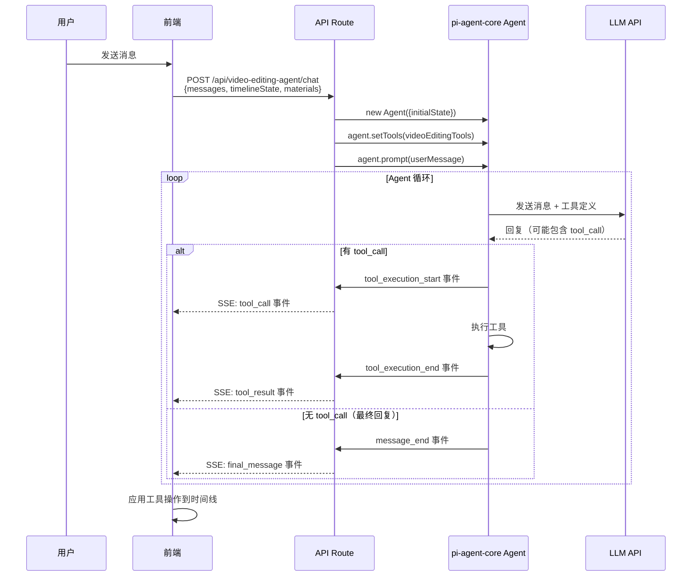

# Spec 01: Agent 引擎

## 1. 概述

本文档描述如何将 `@mariozechner/pi-agent-core` 集成到 Ecliptrix 项目中，构建视频编辑 Agent 的执行引擎。Agent 引擎运行在 Next.js API Route 中，接收用户消息和时间线上下文，通过 LLM + 工具循环完成视频编辑任务，并通过 SSE 实时推送进度。

## 2. pi-agent-core 集成

### 2.1 安装依赖

```bash
npm install @mariozechner/pi-agent-core @mariozechner/pi-ai
```

`pi-agent-core` 依赖 `pi-ai` 作为 LLM 抽象层。`pi-ai` 支持 OpenAI 兼容 API，可直接使用项目现有的 `LLM_API_URL` 和 `LLM_API_KEY`。

### 2.2 核心概念映射

| pi-agent-core 概念 | Ecliptrix 对应 |
|---------------------|----------------|
| `Agent` | VideoEditingAgent 实例（每次请求创建） |
| `AgentTool` | 7 个视频编辑工具 |
| `AgentState` | 对话历史 + 时间线上下文 |
| `AgentEvent` | SSE 事件类型映射 |
| `getModel()` | 使用 pi-ai 配置 OpenAI 兼容模型 |

### 2.3 TypeBox 依赖

pi-agent-core 使用 `@sinclair/typebox` 定义工具参数 schema。项目需要安装此依赖（通常作为 pi-agent-core 的 peer dependency 自动安装）。

## 3. Agent 生命周期

### 3.1 请求级 Agent 实例

每次用户发送消息时，在 API Route 中创建一个新的 Agent 实例。Agent 不持久化，对话历史通过前端传递。



### 3.2 Agent 初始化配置

```
伪代码:

function createVideoEditingAgent(config):
    model = getModel("openai-compatible", {
        apiUrl: process.env.LLM_API_URL,
        apiKey: process.env.LLM_API_KEY,
        model: process.env.LLM_MODEL || "default-model"
    })

    agent = new Agent({
        initialState: {
            systemPrompt: buildSystemPrompt(config.timelineState),
            model: model,
            thinkingLevel: "none",  // 不使用 extended thinking
            tools: buildVideoEditingTools(config),
            messages: convertHistoryToAgentMessages(config.conversationHistory)
        }
    })

    return agent
```

### 3.3 System Prompt 构建

System prompt 使用英文，包含三部分：

```
伪代码:

function buildSystemPrompt(timelineState):
    return `
You are a video editing assistant. You help users edit videos by using the available tools.

## Your Role
- Analyze user requests and determine which editing operations to perform
- Use tools step by step to accomplish the user's goal
- Explain what you're doing as you work
- If a request is ambiguous, ask for clarification before making changes

## Rules
- Always use get_timeline first if you need to understand the current state
- When adding materials, search the material library first
- Place clips at appropriate positions to avoid overlapping
- Provide a brief summary of what you did after completing operations
- If you cannot fulfill a request with the available tools, explain why

## Current Timeline Summary
${formatTimelineSummary(timelineState)}
`
```

注意：`timelineState` 的精简摘要会注入到 system prompt 中，提供基本上下文。Agent 如需详细信息可调用 `get_timeline` 工具。

## 4. 事件处理与 SSE 映射

### 4.1 pi-agent-core 事件类型

pi-agent-core 的 Agent 通过 `agent.subscribe(callback)` 发出以下事件：

| pi-agent-core 事件 | 触发时机 | SSE 映射 |
|---------------------|----------|----------|
| `agent_start` | Agent 开始处理 | `{ type: "agent_start" }` |
| `turn_start` | 一轮 LLM 调用开始 | `{ type: "turn_start" }` |
| `message_start` | LLM 开始回复 | `{ type: "message_start" }` |
| `message_update` | LLM 流式文字片段 | `{ type: "text_delta", content: "..." }` |
| `message_end` | LLM 回复完成 | `{ type: "message_end" }` |
| `tool_execution_start` | 工具开始执行 | `{ type: "tool_call", toolName, params }` |
| `tool_execution_update` | 工具执行中间更新 | `{ type: "tool_update", toolName, update }` |
| `tool_execution_end` | 工具执行完成 | `{ type: "tool_result", toolName, result }` |
| `turn_end` | 一轮 LLM 调用结束 | `{ type: "turn_end" }` |
| `agent_end` | Agent 完成所有工作 | `{ type: "agent_end" }` |

### 4.2 SSE 编码格式

```
伪代码:

每条 SSE 消息格式:
data: {"type": "<event_type>", ...payload}\n\n

流结束标志:
data: [DONE]\n\n
```

### 4.3 事件订阅伪代码

```
伪代码:

function streamAgentEvents(agent, sseController):
    encoder = new TextEncoder()

    agent.subscribe((event) => {
        switch event.type:
            case "message_update":
                // 流式文字
                send({ type: "text_delta", content: event.content })

            case "tool_execution_start":
                // 工具开始执行
                send({
                    type: "tool_call",
                    toolCallId: event.toolCallId,
                    toolName: event.toolName,
                    params: event.params
                })

            case "tool_execution_end":
                // 工具执行完成
                send({
                    type: "tool_result",
                    toolCallId: event.toolCallId,
                    toolName: event.toolName,
                    result: event.result,
                    error: event.error
                })

            case "agent_end":
                send({ type: "agent_end" })
                send("[DONE]")
                sseController.close()
    })

    function send(payload):
        data = JSON.stringify(payload)
        sseController.enqueue(encoder.encode(`data: ${data}\n\n`))
```

## 5. 对话历史管理

### 5.1 消息格式转换

前端使用 `ChatMessage` 类型，pi-agent-core 使用 `AgentMessage` 类型。需要双向转换：

```
伪代码:

function convertToAgentMessages(chatMessages: ChatMessage[]):
    return chatMessages
        .filter(msg => msg.role === 'user' || msg.role === 'assistant')
        .map(msg => ({
            role: msg.role,
            content: msg.content,
            // 如果 assistant 消息包含工具调用记录，也需要转换
            toolCalls: msg.agentToolCalls || undefined
        }))

function convertToAppMessage(agentEvent, toolCalls):
    return {
        id: generateId(),
        role: 'assistant',
        content: agentEvent.textContent,
        timestamp: new Date(),
        agentToolCalls: toolCalls,  // 新字段：记录工具调用
        isAgentMessage: true        // 新字段：标记为 Agent 消息
    }
```

### 5.2 历史传递策略

- 前端每次请求时发送完整对话历史（`ChatMessage[]`）
- API Route 将历史转换为 `AgentMessage[]` 注入 Agent
- Agent 的完整回复（包括工具调用）作为新的 `ChatMessage` 存储在前端
- 支持完整历史记忆，不截断

## 6. 错误处理

### 6.1 Agent 级别错误

- **LLM API 不可达**: 返回 SSE 错误事件 `{ type: "error", message: "..." }`
- **工具执行失败**: 工具返回错误信息，Agent 自行决定是否重试或换方案
- **超时**: API Route 设置最大执行时间（如 120 秒），超时后终止 Agent

### 6.2 工具级别错误

工具执行失败时，返回错误描述给 Agent，让 Agent 决定下一步：

```
伪代码:

// 工具执行失败时的返回格式
{
    success: false,
    error: "Clip with id 'xxx' not found on the timeline"
}
```

Agent 可以根据错误信息：
- 调用 `get_timeline` 重新获取状态
- 尝试使用不同参数
- 向用户说明无法完成的原因

## 7. 并发控制

- 同一用户同一时间只能有一个 Agent 请求在执行
- 如果用户在 Agent 执行期间发送新消息，前端应排队等待
- Agent 执行期间，前端禁用手动时间线编辑操作
- Agent 完成后，解锁手动编辑
