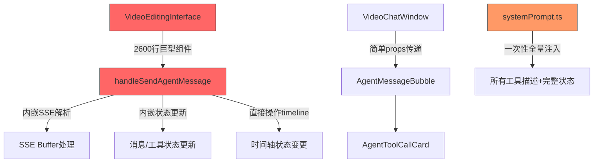
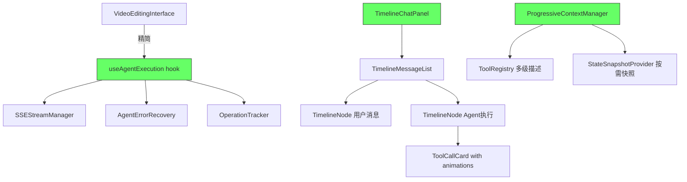
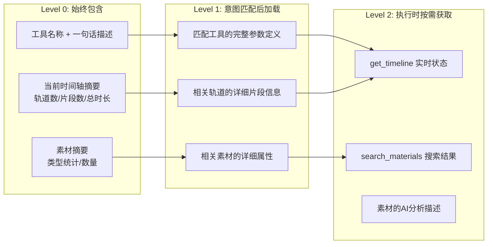
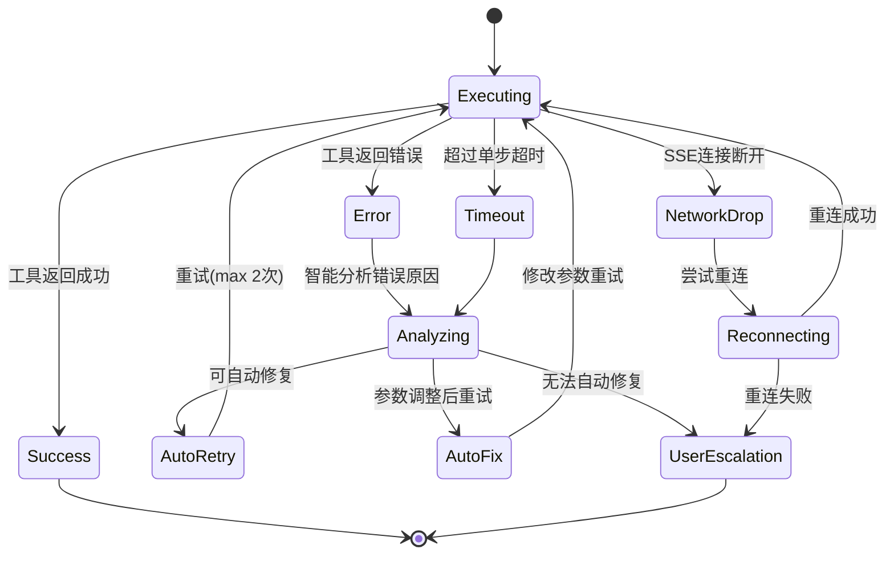
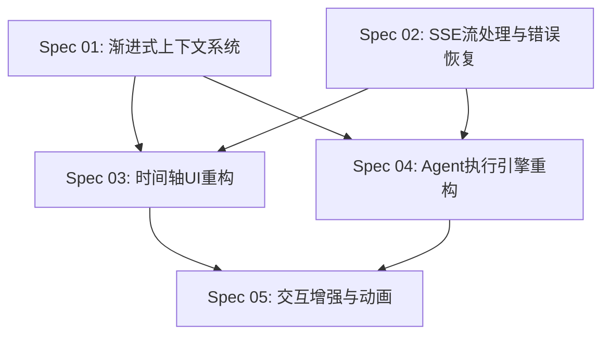

# Master Plan: 视频编辑左侧面板优化

## 概述

对 Ecliptrix 视频编辑器左侧面板（VideoChatWindow）进行全面优化，涵盖四大核心目标：稳健性加固、渐进式上下文策略、时间轴式交互UI重构、以及代码架构治理。

## 目标

1. **稳健性**: 消除流式消息中断/丢失、Agent工具调用失败无恢复、状态同步不一致等问题，建立完善的错误处理和自动恢复机制
2. **渐进式上下文**: 实现多级工具描述体系，Agent按需加载工具详情和面板信息，避免上下文爆炸和Token浪费
3. **时间轴式UI**: 将对话和执行进度重构为垂直时间轴+节点卡片的交互形态，支持展开/收起、撤销/重做、状态动画
4. **架构治理**: 清理不合理的代码结构，理顺状态管理，提升可维护性和可扩展性

## 范围

### In Scope

- `VideoChatWindow` 组件及其子组件（AgentMessageBubble、AgentToolCallCard）重构
- Agent SSE 流处理的稳健性加固（前端 + API route）
- 多级工具描述系统的设计与实现（systemPrompt.ts + agent.ts）
- 时间轴式消息展示组件开发
- Agent 操作的错误恢复与智能重试机制
- 单个操作的撤销/重做功能增强
- 操作状态动画系统

### Out of Scope

- 后端 FastAPI 服务的修改（仅涉及 Next.js API routes）
- 时间轴编辑器（底部 TimelinePanel）本身的功能
- 素材管理面板（MaterialsPanel）的重构
- 新增 Agent 工具/能力
- 移动端适配

## 架构设计

### 当前架构问题

**核心问题:**
1. `VideoEditingInterface.tsx` 是 3000+ 行巨型组件，Agent 消息处理逻辑(lines 2392-2638)直接内嵌
2. SSE 流解析、状态更新、错误处理全部耦合在一个函数中
3. 系统提示一次性注入所有工具描述和完整时间轴/素材状态
4. 错误处理仅在 finally 块中设置 `isStreaming: false`，没有分级恢复
5. `agentIsExecuting` 状态没有超时保护，无进度反馈
6. 工具调用的 executing/completed/error 状态转换没有动画

### 目标架构

### 渐进式上下文策略

**三级上下文体系:**
- **L0（始终注入）**: 工具名+一句话、时间轴/素材统计摘要 → ~200 tokens
- **L1（意图匹配后）**: 匹配工具的完整schema、相关轨道/素材详情 → ~500-1500 tokens
- **L2（Agent主动调用）**: get_timeline、search_materials等工具获取实时详细数据 → 按需

### 错误恢复策略

## 设计决策

| 决策 | 选择 | 理由 |
|------|------|------|
| 状态管理 | 自定义 hooks + Context | 与现有架构一致，不引入新依赖 |
| SSE 解析 | 独立 StreamManager 类 | 解耦流处理与UI更新，便于测试和重试 |
| 渐进式上下文 | 多级注入 + function calling | Agent通过工具获取详情，减少初始上下文 |
| 时间轴UI | 新组件 TimelineChatPanel | 替换现有 VideoChatWindow 的消息列表 |
| 动画方案 | CSS transitions + framer-motion | 项目已有 framer-motion 依赖 |
| 错误恢复 | 策略模式 + 自动分析 | 不同错误类型有不同最佳恢复方案 |

## 依赖关系

## 风险

| 风险 | 影响 | 缓解措施 |
|------|------|----------|
| 巨型组件重构可能引入回归 | 高 | 逐步提取，每步验证功能完整性 |
| 渐进式上下文可能影响Agent响应质量 | 中 | L0摘要需要足够信息让Agent做出正确工具选择 |
| 时间轴UI动画可能影响性能 | 低 | 使用CSS transforms和will-change优化 |
| SSE重连可能导致消息重复 | 中 | 使用事件ID去重机制 |

## Spec 文件目录

| 文件 | 主题 |
|------|------|
| `specs/01-progressive-context-system.md` | 渐进式上下文系统 |
| `specs/02-sse-stream-and-error-recovery.md` | SSE流处理与错误恢复引擎 |
| `specs/03-timeline-chat-ui.md` | 时间轴式对话UI重构 |
| `specs/04-agent-execution-engine.md` | Agent执行引擎重构 |
| `specs/05-interaction-enhancement.md` | 交互增强与动画系统 |
