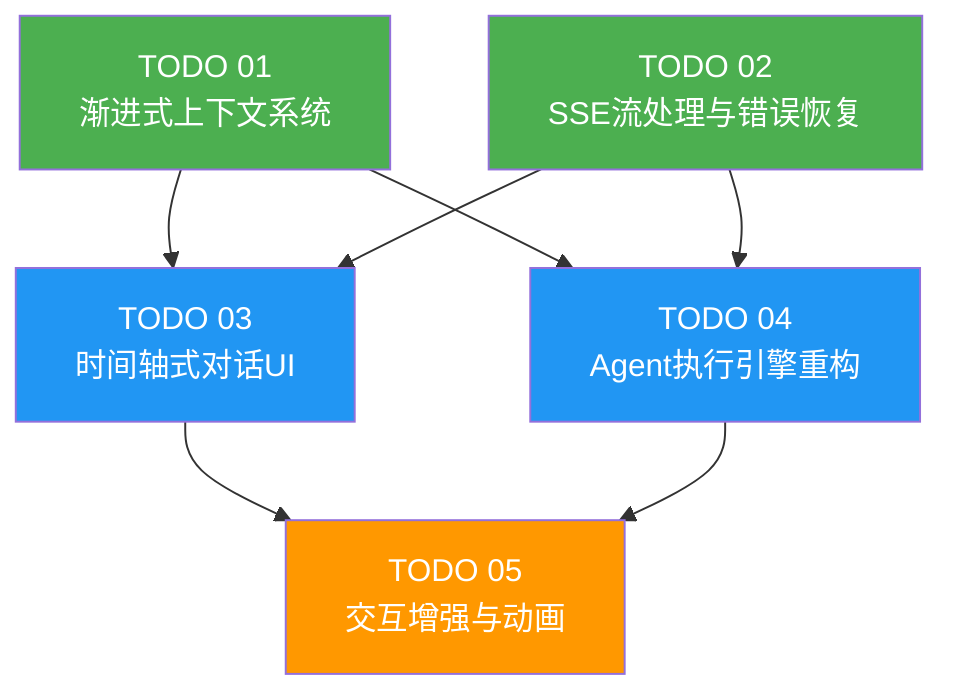

# Task Orchestration: 视频编辑左侧面板优化

## 1. Dependency Graph



**图例:** 🟢 Phase 1（无依赖） | 🔵 Phase 2（依赖 Phase 1） | 🟠 Phase 3（依赖 Phase 2）

## 2. Execution Phases

### Phase 1: 基础设施（并行）

| Agent | 任务 | 依赖 |
|-------|------|------|
| Agent-01 | TODO 01: 渐进式上下文系统 | 无 |
| Agent-02 | TODO 02: SSE流处理与错误恢复 | 无 |

**预计交付物:**
- Agent-01: 重构后的 `systemPrompt.ts`，新的 `formatCompactSummary()` + `formatToolOverview()` 函数
- Agent-02: `SSEStreamManager.ts`, `errorRecovery.ts`, `useAgentExecutionState.ts`，修改后的 API route

**阶段门控:** 两个 Agent 都完成后才进入 Phase 2

### Phase 2: 核心重构（并行）

| Agent | 任务 | 依赖 |
|-------|------|------|
| Agent-03 | TODO 03: 时间轴式对话UI | TODO 01, 02 完成 |
| Agent-04 | TODO 04: Agent执行引擎重构 | TODO 01, 02 完成 |

**预计交付物:**
- Agent-03: `TimelineChatPanel.tsx`, `TimelineNode.tsx`, `ToolStep.tsx`, `TimelineConnector.tsx`，重构后的 `VideoChatWindow.tsx`
- Agent-04: `AgentEventRouter.ts`, `AgentStateManager.ts`, `OperationApplier.ts`, `useAgentExecution.ts`，重构后的 `VideoEditingInterface.tsx`

**协调说明:** Agent-03 和 Agent-04 都会修改 `VideoChatWindow.tsx` 和 `VideoEditingInterface.tsx`。Agent-04 负责提取逻辑层（hook），Agent-03 负责 UI 层。需要先确定接口契约再并行开发：
- `useAgentExecution` hook 的返回类型（Agent-04 定义，Agent-03 消费）
- `TimelineChatPanel` 的 props 接口（Agent-03 定义，Agent-04 通过 hook 提供数据）

**阶段门控:** 两个 Agent 都完成 + 集成验证后进入 Phase 3

### Phase 3: 交互增强

| Agent | 任务 | 依赖 |
|-------|------|------|
| Agent-05 | TODO 05: 交互增强与动画 | TODO 03, 04 完成 |

**预计交付物:** 动画配置、所有组件的交互增强、暗色模式适配、性能优化

## 3. Critical Path

```
TODO 02 (SSE流处理) → TODO 04 (Agent引擎) → TODO 05 (交互增强)
```

**瓶颈分析:**
- TODO 02 是关键路径起点：SSEStreamManager 是执行引擎的核心依赖
- TODO 04 是中间关键节点：同时被 TODO 03 和 TODO 05 依赖
- TODO 01 虽然也在 Phase 1，但相对简单，不太可能成为瓶颈

**风险缓解:**
- Phase 2 的两个 Agent 可能在修改同一文件时产生冲突 → 需要明确文件所有权
- Agent-04 的重构影响面最大（从巨型组件提取逻辑）→ 需要最细致的 review

## 4. Agent Assignments

### 推荐配置: 5 个 Agent，3 个执行阶段

| Agent ID | 阶段 | 主要任务 | 技能重点 |
|----------|------|----------|----------|
| eng-01 | Phase 1 | TODO 01 渐进式上下文 | LLM prompt engineering, API 设计 |
| eng-02 | Phase 1 | TODO 02 SSE流处理 | 网络编程, 流处理, 错误恢复 |
| eng-03 | Phase 2 | TODO 03 时间轴UI | React 组件开发, UI/UX |
| eng-04 | Phase 2 | TODO 04 Agent引擎 | 状态管理, 架构重构 |
| eng-05 | Phase 3 | TODO 05 交互增强 | 动画, CSS, 性能优化 |

### 协调规则

1. **Phase 1 → Phase 2 过渡:**
   - eng-01 完成后，输出的接口定义（新的 buildSystemPrompt 签名）交给 eng-04
   - eng-02 完成后，输出的 SSEStreamManager 类交给 eng-03 和 eng-04

2. **Phase 2 并行协调:**
   - eng-03 和 eng-04 在开始前先定义共享接口（TypeScript interface）
   - eng-04 负责 `VideoEditingInterface.tsx` 的逻辑层修改
   - eng-03 负责 `VideoChatWindow.tsx` 的 UI 层修改
   - 如果产生文件冲突，eng-04 优先（逻辑层决定数据流向）

3. **Phase 2 → Phase 3 过渡:**
   - eng-05 在 Phase 2 开始时可以先开发独立的动画配置（`animations.ts`）
   - Phase 2 完成后 eng-05 将动画应用到实际组件

## 5. Context Files (Required Reading Per Agent)

### All Agents — 公共必读

| 文件 | 用途 |
|------|------|
| `docs/plans/video-editing-left-panel-optimization/master-plan.md` | 整体架构和设计决策 |
| `docs/plans/video-editing-left-panel-optimization/task-orchestration.md` | 本编排文件 |
| `CLAUDE.md` | 项目约定和开发规范 |

### Agent eng-01 (渐进式上下文)

| 文件 | 用途 |
|------|------|
| `docs/plans/video-editing-left-panel-optimization/specs/01-progressive-context-system.md` | 本任务 Spec |
| `docs/plans/video-editing-left-panel-optimization/todos/01-progressive-context-system.md` | 本任务 TODO |
| `src/lib/video-editing-agent/systemPrompt.ts` | 当前系统提示实现 |
| `src/lib/video-editing-agent/agent.ts` | Agent 工厂函数 |
| `src/lib/video-editing-agent/types.ts` | 类型定义 |

### Agent eng-02 (SSE流处理)

| 文件 | 用途 |
|------|------|
| `docs/plans/video-editing-left-panel-optimization/specs/02-sse-stream-and-error-recovery.md` | 本任务 Spec |
| `docs/plans/video-editing-left-panel-optimization/todos/02-sse-stream-and-error-recovery.md` | 本任务 TODO |
| `src/app/api/video-editing-agent/chat/route.ts` | 当前 SSE API route |
| `src/lib/video-editing-agent/agent.ts` | 当前事件订阅和转发 |
| `src/lib/video-editing-agent/types.ts` | SSE 事件类型定义 |
| `src/components/video/VideoEditingInterface.tsx` (lines 2392-2638) | 当前 SSE 客户端处理 |

### Agent eng-03 (时间轴UI)

| 文件 | 用途 |
|------|------|
| `docs/plans/video-editing-left-panel-optimization/specs/03-timeline-chat-ui.md` | 本任务 Spec |
| `docs/plans/video-editing-left-panel-optimization/todos/03-timeline-chat-ui.md` | 本任务 TODO |
| `src/components/video/components/VideoChatWindow/VideoChatWindow.tsx` | 当前聊天窗口 |
| `src/components/video/components/VideoChatWindow/AgentMessageBubble.tsx` | 当前消息气泡（将被替代） |
| `src/components/video/components/VideoChatWindow/AgentToolCallCard.tsx` | 当前工具卡片（将被替代） |
| `src/types/index.ts` | ChatMessage 类型定义 |

### Agent eng-04 (Agent引擎)

| 文件 | 用途 |
|------|------|
| `docs/plans/video-editing-left-panel-optimization/specs/04-agent-execution-engine.md` | 本任务 Spec |
| `docs/plans/video-editing-left-panel-optimization/todos/04-agent-execution-engine.md` | 本任务 TODO |
| `src/components/video/VideoEditingInterface.tsx` | 巨型组件（重构目标） |
| `src/lib/video-editing-agent/agent.ts` | Agent 工厂函数 |
| `src/lib/video-editing-agent/types.ts` | 类型定义 |
| Phase 1 产出: `SSEStreamManager.ts`, 重构后的 `systemPrompt.ts` | 依赖模块 |

### Agent eng-05 (交互增强)

| 文件 | 用途 |
|------|------|
| `docs/plans/video-editing-left-panel-optimization/specs/05-interaction-enhancement.md` | 本任务 Spec |
| `docs/plans/video-editing-left-panel-optimization/todos/05-interaction-enhancement.md` | 本任务 TODO |
| Phase 2 产出: TimelineChatPanel, TimelineNode, ToolStep 等组件 | 增强目标 |
| `src/components/video/components/VideoChatWindow/` 目录 | 所有新旧组件 |
