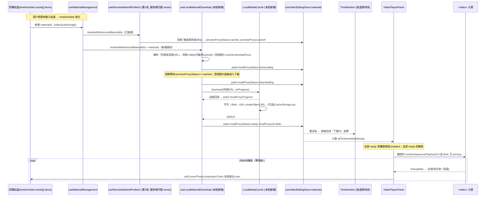

# 视频编辑器预览优化（第 2 轮）——「预下载低清素材 + 纯客户端预览」落地方案

> Topic: `video-editor-client-preview-download`
> 文档版本：**v2（已评审修复，可进入开发）**
> 评审人：Anthropic 资深工程评审（2026-06-03，逐节对照源码核验）
> 语言：简体中文（标识符 / 路径 / 接口保留英文）
> 输出目录：`docs/plans/video-editor-client-preview-download/`
> 关联既有规划：
> - 第 1 轮（本轮直接前置）：`docs/plans/video-editor-preview-proxy-playback/spec.md`（480p 服务端低清代理，已落地，提交 `8efe920`）
> - `docs/plans/video-editor-playback-optimization/`（master-plan + specs 01–08）、`video-editor-playback-v2-phase2/3/4`、`video-reentry-play-no-source-fix`

---

## 评审记录（Review Notes，v2 新增）

> 评审维度：可行性（Feasibility）/ 完整性（Completeness）/ 一致性（Consistency）/ 体量合理性（Right-sizing）。
> 评审方式：对照 `8efe920`（第 1 轮）落地源码逐节核验，已实测确认下列符号/行号真实存在：
> `isPreviewProxyEnabled()` + `PLAYBACK_FLAG_KEYS`（`playbackFlags.ts:87/204`）、`resolveSequencePlaybackUrl` + `ResolveSequencePlaybackUrlOptions` + `ResolvedPlaybackUrlSource`（`resolveSequencePlaybackUrl.ts`）、`patchMaterialCache`（`useMaterialManagement.ts:1136`）+ `timelineVideoMaterialIds`（`:1157`，**确实只收 `item.type==='video'`**）+ `useRemoteMaterialPrefetch` 接线（`:1168`）、`getSequencePreviewSrc`（`VideoPlayerPanel.tsx:387`）/ `assignSequenceSrc`（`:408`）/ `previewProxyEnabled = useMemo(isPreviewProxyEnabled,[])`（`:176`）/ 播放按钮 `disabled={getTotalDuration()===0}`（`:3036`）、`MaterialItem`（`types/index.ts:505`，含 `previewProxyStatus/previewProxyLocalUrl/cacheStatus/downloadStatus`）、`MediaProxyClient.buildProxyUrl`（`infrastructure/MediaProxyClient.ts:81`）、`useVideoEditingStore`（`src/stores/videoEditingStore.ts`，持有 `materials/updateMaterial/timelineState`）、`TimelineItemData.materialId`（`timeline/domain/types.ts:47/143`）。
> **整体结论：架构可行、复用真实、视频主链路正确**。但在「音频/图片两类素材」与「素材永远无法本地化时的兜底」上存在必须修复的缺口，已在 v2 正文就地修复（见各 §标注「v2 修复」）。

| ID | 维度 | 严重度 | 问题 | 处置（v2） |
|----|------|--------|------|------------|
| **C1** | 完整性 | **P1** | **音频不走 blob 播放**。音频用独立的 `audioElementsRef`（`Map<id,HTMLAudioElement>`），`getOrCreateAudioElement`（`VideoPlayerPanel.tsx:642-698`）在创建时**直接 `audioElement.src = audioSequence.url`**（远端/网络源），既不经 `resolveSequencePlaybackUrl`、也不读本轮 blob。结果：①门控等待并下载了音频 blob 却从不使用（无效下载）；②播放期音频仍走网络，**G4「零网络」对音频不成立**，与本轮「纯客户端预览」诉求（用户原话含「音频」）冲突。`AudioSequenceItem.materialId` 真实存在（`videoEditingTypes.ts:45`），可解析 blob，故**可修复**。 | 正文 §3.3.5b 新增「音频元素 blob 接线」改动点；§四变更计划新增对应行；§七加音频 blob 用例。 |
| **C2** | 体量合理性 + 完整性 | **P1** | **图片被错误纳入「下载+门控」**。`CompositionPlayback` 只有 `videoSequences` 与 `audioSequences` 两个通道（`videoEditingTypes.ts:55-58`），**无 image 通道**——图片不经 blob 播放链路渲染，也不是「逐 Range 流式拉取」的卡顿根因（单张图浏览器一次加载即缓存）。把图片纳入 `allTimelineMediaReady` 会：①为与「播放流畅」无关的下载而阻塞播放；②若某图片下载失败则**永久禁播**（叠加 C3）。属过度扩张。 | 正文将门控+下载收敛为 **video/audio 两类**；图片改为「不参与门控、不强制 blob」（最多 best-effort，不阻塞）。§二非目标、§3.1/§3.3.3/§3.3.6/§四同步修订。 |
| **C3** | 完整性（鲁棒性） | **P1** | **素材永远无法本地化 → 永久禁播**。门控要求视频 `previewProxyStatus==='cached'` 才可下载；但**代理不合格**（`_previewProxyEligible=false`，无可解析转码输入）或**转码终态失败**的视频永远到不了 `cached`，`localProxyStatus` 永久停在 `transcoding`，播放按钮**永久 disabled 且无出路**。原 R5 把降级列为「可选、不在首期强制」，不可接受——单个坏素材即可锁死整个预览。 | 正文新增**强制**兜底：`transcoding` 超时（默认 60s，可配）或转码 `failed` → 标记该素材为**终态降级**，**从门控分母剔除**并对该片段回退第 1 轮流式路径（`resolveSequencePlaybackUrl` 在 `localProxy` 未 ready 时本就降级到 preview-proxy/cacheUrl），同时给可读告警（哪些片段将走流式）。§3.1 状态机加终态、§3.3.3/§3.3.6、§8 R5 升级为必做。 |
| **C4** | 一致性 | **P2** | **门控与轨道遮罩存在双数据源**。门控读 `useMaterialManagement` 的 **React useState `materials`**；而 §3.3.7 让 `TimelineItem` 读 **zustand `useVideoEditingStore.materials`**。`patchMaterialCache` 虽同时写两处，但写 zustand 一路在 `try/catch` 中且注释「store entry may not exist for materials added only locally」——两源可发散：某素材正在下载（门控正确禁播）却因 store 缺项而**轨道不显示「下载中」遮罩**，违背用户「显示没下载好的样子」诉求。 | 建议（条件项）：轨道遮罩状态由门控同一权威列表下发（经 props 传入 `TimelineItem`），或确保所有时间轴引用素材必入 store。v2 已在 §3.3.7 标注，列入评审结论条件。 |
| **C5** | 可行性（实现细节） | **P2** | **CacheStorage 与进度读取的流消费顺序**。§3.3.2 既要 `res.body.getReader()` 累计进度，又要 `caches.put(key, res.clone())`；`Response` body 只能被读一次，**必须先 `clone()` 再消费**，否则 `body already locked`。 | §3.3.2 补「先 clone 后 getReader」的明确顺序约束。 |
| **C6** | 完整性 | **P2** | **内存预算的失败模式**。R4 的 1.5GB LRU「绝不淘汰时间轴引用素材」意味着：当时间轴本身引用超 1.5GB 时仅 `console.warn`，桌面壳（Electron 渲染进程，见部署记录）/ 内嵌 webview 内存更紧，存在 OOM 崩溃风险。 | 建议（条件项）：超限给**用户可见**告警而非仅 console；1.5GB 默认值按部署目标可配；列入评审结论条件。 |
| **C7** | 一致性 | **info** | `isLocalPreviewEnabled()` 解析顺序（localStorage→env，默认 true）比 v2 的全链路（kill-switch/variant/url-query/session-remote）简单，但**与 `isPreviewProxyEnabled()` 完全同构**（`playbackFlags.ts:87-100`），符合 CLAUDE.md「flag 挂载锁定 + 默认 ON 的低清预览不依赖 canvas 引擎」约定。**无需修改**，记录为一致性确认。 | 无需改动。 |

---

## 〇、需求与结论摘要（TL;DR）

**本轮用户原话**：

> 没修改好，现在还是播放卡顿。可以考虑这么做：用户把视频素材添加到轨道上以后，需要**自动触发下载素材的操作，但下载的是低清晰度的**；如果没下载好，剪辑面板对应就要**显示对应的没下载好的样子（轨道上的素材显示为下载中的状态），此时无法进行播放预览**；只有当**所有素材都下载到客户端以后**，在客户端使用**纯客户端的预览方式**，但需要和剪辑面板的剪辑对应。

**为什么第 1 轮没解决卡顿（根因诊断）**：第 1 轮已经做到了「预览播放体积极小的 480p 低清代理而非原片」，但它的播放方式仍然是**在播放时按需通过 HTTP（同源 `/api/storage/files/preview-proxies/...`）流式拉取**这个代理文件。残留卡顿来自**播放期间的网络/磁盘 I/O 依赖**，而非码率：

1. **逐片段换源即重新建连**：legacy 合成播放用**单个 `<video>`** 顺序播放多个 sequence，每到片段边界就把 `<video>.src` 切到下一个代理 URL（`assignSequenceSrc`，`VideoPlayerPanel.tsx:408`），每次换源都是一次全新的网络请求 + 重新缓冲，边界处必然 hitch。
2. **seek/拖动 ruler 触发 Range 重新拉取**：每次跳转都向后端发 Range 请求，网络抖动直接表现为画面卡停。
3. **连续播放仍受带宽/后端静态服务吞吐限制**：当用户网络或服务端静态吞吐本身就是瓶颈时，仅降低码率无法消除流式播放的周期性缓冲空洞。

**本轮策略（一句话）**：把预览从「**边播边从服务器流式拉取低清代理**」改为「**先把所有用到的低清素材整文件下载进浏览器（Blob / object URL），全部就绪后再用纯本地 `blob:` 源播放**」。一旦素材整文件驻留在客户端内存：播放、换源、seek 全部是**本地零网络**操作，浏览器无需任何缓冲即可解码，卡顿从根因上消失；且仍满足「低画质 + 极小流量」诉求（下载的是 480p 代理，而非原片）。

**为什么这能彻底解决而第 1 轮不能**：第 1 轮把「数据量」降下来了，但没消除「播放路径上的网络往返」；本轮把网络往返**整体前移到播放前的一次性下载**，播放期间不再有任何网络/Range 请求，因此换源/seek/连续播放都是确定性的本地操作。

**复用既有基建（不重建）**：第 1 轮已落地的「服务端 480p 转码 + `/api/media/preview-proxy[/status|/file]` + `cached_materials.preview_proxy_*` + `previewProxyStatus/previewProxyLocalUrl` 内存字段 + `resolveSequencePlaybackUrl` 候选链 + `MediaProxyClient`」**全部复用**。本轮只新增「客户端整文件下载 + 本地缓存（object URL）+ 三态下载门控 + 轨道下载中 UI + 播放选源加一档本地 blob」这几类增量，**不新增后端端点、不新增数据库迁移**。

---

## 一、概述（Overview）

本方案在第 1 轮「服务端 480p 低清代理」的基础上，新增一条「**下载优先、本地播放**」（download-first, play-from-local）的预览链路，目标是让 Video Editing 的「播放组合」预览达到**真正稳定流畅、且与下方剪辑轨道进度条严格对应**的体验。其核心思想是：当用户把素材拖到剪辑轨道后，前端**自动为该素材下载一份低清代理整文件到浏览器**（视频走第 1 轮产出的 480p 代理；音频/图片走同源原文件，本就很小），把字节缓存为一个 `blob:` object URL；在**所有时间轴素材都本地就绪之前**，剪辑面板上对应的素材块显示「转码中 / 下载中 NN% / 失败」的状态、且**播放按钮被禁用**；只有当时间轴上引用的所有素材都进入 `ready` 后，预览才解锁，并以**纯本地 `blob:` 源**驱动 `<video>` 播放。

之所以采用「整文件预下载 + 本地播放」而非继续优化流式拉取，是因为经源码审计确认（见 §0 根因）：第 1 轮的卡顿残留并不来自码率，而来自**播放路径上不可消除的网络/Range 往返**——单 `<video>` 的逐片段换源、seek 重新拉流、连续播放对带宽的持续依赖。把这些往返**一次性前移到播放前的下载阶段**后，播放期间是确定性的本地解码：换源即把 `<video>.src` 指向另一个已驻留内存的 `blob:`（瞬时、无缓冲），seek 在已完整 buffer 的本地数据上即时定位，连续播放不再有缓冲空洞。代价是「点播放前要等下载完成」，这正是用户明确接受并要求的交互（「没下载好……此时无法进行播放预览」）。

本方案严格遵守既有不变量与项目约定：①**导出（export）链路完全不受影响**，仍走原片（`selectPlaybackUrl(purpose:'export')` 的 INV3，第 1 轮 spec §五），画质无损；②**赋值源 ≡ 比对键**不变量（第 1 轮评审 C1 / da056df 回归）继续保持——本地 blob 档位同样下沉到唯一解析器 `resolveSequencePlaybackUrl`，`getSequencePreviewSrc`（比对键）与 `assignSequenceSrc`（实际写入 `<video>.src`）读同一解析器、逐字节一致，杜绝「反复换源 / 刷屏 / play() AbortError」；③**进度条单一时间源**：合成时间 `compositionCurrentTime` 仍是唯一真值，单调驱动剪辑轨道 ruler（第 1 轮 G3，本轮因本地播放更稳而进一步受益）；④新能力由**独立默认开启开关** `isLocalPreviewEnabled()` 控制，出问题可一键回退到第 1 轮的流式代理预览。

---

## 二、目标与非目标

### 2.1 目标（In Scope）

- **G1 预下载触发**：**会进入预览播放链路的素材**（即视频 video + 音频 audio）被加入剪辑轨道后，自动触发「下载低清代理整文件到客户端」；视频用 480p 代理、音频用同源原文件。无需用户手动操作。
  > **v2 修复（C2）**：图片**不**纳入此机制。经源码核验，`CompositionPlayback` 只有 `videoSequences`/`audioSequences` 两个播放通道（`videoEditingTypes.ts:55-58`），图片不经 blob 播放链路渲染、也不是「逐 Range 流式拉取」的卡顿根因，强制下载/门控图片是过度扩张且有 C3 永久禁播风险。图片如需离线一致性可做 best-effort 下载，但**绝不阻塞门控**。
- **G2 下载中 UI**：未就绪的视频/音频轨道素材块显示明确的「转码中 / 下载中 NN% / 下载失败可重试」状态，与剪辑面板对应。
- **G3 就绪前禁播**：只要时间轴上存在尚未本地就绪（`ready`）**且非终态降级**的视频/音频素材，播放按钮禁用并给出可读提示（如「素材下载中 3/5」），点击不进入播放。**v2 修复（C3）**：进入终态降级（转码超时 / 转码失败）的素材**不**计入门控分母，避免单个坏素材永久锁死预览。
- **G4 纯客户端预览**：所有时间轴**视频与音频**素材本地就绪后，`<video>`（视频）与 `HTMLAudioElement`（音频）均仅以 `blob:` 本地源播放，**播放期间零网络请求**；连续播放、片段切换、seek 全程流畅。**v2 修复（C1）**：音频元素的 `src` 同样切换为本地 blob（见 §3.3.5b），否则音频仍走网络、G4 对音频不成立。
- **G5 进度条严格对应**：播放头（合成时间）单调驱动剪辑轨道 ruler，正常播放无回跳，seek 后画面与进度一致（保持并强化第 1 轮 G3）。
- **G6 低风险解耦 + 可回退**：新链路由 `isLocalPreviewEnabled()`（默认 true）单独门控；关闭后整体回到第 1 轮「流式 480p 代理」预览，再关 `isPreviewProxyEnabled()` 则回到原片预览。
- **G7 导出不退化**：导出仍走原片，blob/代理只服务 preview。

### 2.2 非目标（Out of Scope）

- **不**整体默认开启 playback-v2 canvas 引擎（保留其既有独立灰度）。
- **不**新增多档位（720p/1080p 预览）；视频固定复用第 1 轮 `preview-480p` 代理。
- **不**改导出/合成流水线、字幕识别、视频理解、Storyboard、工作流等其它模块。
- **不**新增后端 REST 端点、**不**新增数据库表/迁移（blob 只存浏览器；服务端字段已由迁移 011 落库）。
- **不**引入新的前端状态库或新的第三方运行时依赖（仅用浏览器原生 `fetch` / `Blob` / `URL.createObjectURL` / 可选 `CacheStorage`）。
- **不**对图片（image）做强制 blob 化与门控（**v2 修复 C2**）：图片不经 `CompositionPlayback` 播放通道，不是流式卡顿来源；门控与零网络目标只覆盖 video/audio 两类。图片至多 best-effort 下载且不阻塞播放。

---

## 三、技术设计（Technical Design）

### 3.1 每个素材的「本地代理」状态机

在现有「服务端转码状态」`previewProxyStatus`（`absent/queued/running/cached/failed`）与「服务端缓存状态」`cacheStatus` 之上，**新增一个纯前端、纯客户端的本地下载状态**，互不覆盖、各司其职：

> **v2 修复（C2）适用范围**：本状态机只适用于 **video / audio** 两类（会进入预览播放通道的素材）。**图片不进入此状态机**，不计入门控（见 §2、§3.3.6）。

```
idle ──(加入轨道)──▶ transcoding ──(服务端 480p cached / 音频免转码)──▶ downloading
                          │                                                 │ (fetch 整文件 + 进度)
            (超时60s / 转码failed)                                          ▼
                          ▼                                          ready (blob: object URL 就绪)
                   degraded(终态)                                            ▲
                          ▲                          (下载失败)──────────────┘
   error ◀──(下载失败,可重试)──────                          │
     │                                                       ▼
     └──(用户点重试)──▶ transcoding/downloading        degraded(终态,可重试)
```

- `idle`：素材（video/audio）在时间轴上被引用，尚未启动本地下载。
- `transcoding`：仅视频。等待第 1 轮服务端 480p 代理就绪（`previewProxyStatus → cached`）。音频**跳过此态**直接进入 `downloading`（无需转码，原文件本就是低体积可播源）。
- `downloading`：前端用 `fetch()` 整文件拉取**同源低清 URL**，读 `ReadableStream` 累计字节 → `localProxyProgress`（0–100）。
- `ready`：字节组装为 `Blob` → `URL.createObjectURL(blob)` → 写入 `localProxyUrl`（`blob:` 形态）。可选同时写入 `CacheStorage` 以便跨会话复用。
- `error`：下载失败（**可恢复**）。轨道块显示「失败 + 重试」；点重试回到 `transcoding/downloading`。
- `degraded`（**v2 新增，终态，C3**）：素材**无法本地化**——视频代理不合格 / 转码终态 `failed` / `transcoding` 等待超过 `LOCAL_PROXY_TRANSCODE_TIMEOUT_MS`（默认 60s，可配）/ 下载经 N 次重试仍失败。进入 `degraded` 的素材：①**从门控分母剔除**（不再阻塞播放按钮）；②该片段播放时回退第 1 轮流式路径——因为 `resolveSequencePlaybackUrl` 在 `localProxyStatus !== 'ready'` 时本就降级到 preview-proxy/cacheUrl，无需额外分支；③在播放区与轨道块给出可读告警（「N 个片段将以流式预览」）。`degraded` 仍可由用户手动「重试」回到 `transcoding/downloading`（幂等）。

> **为什么必须有 `degraded` 终态（C3）**：若无此态，一个永远到不了 `cached` 的视频（代理不合格 / 转码失败）会让 `localProxyStatus` 永久停在 `transcoding`，播放按钮**永久 disabled 且无出路**——单个坏素材即可锁死整个预览。`degraded` 把「本地化失败」与「整体可播」解耦：能本地化的素材享受零网络本地播放，个别失败素材以第 1 轮流式方式参与，整体永不卡死。

> **为什么必须从同源 URL 下载**：`fetch().then(r=>r.blob())` 受 CORS 约束，跨源 CDN 原片通常无法读为 blob。因此下载源一律取**同源**：视频 → 480p 代理 `/api/storage/files/preview-proxies/...`（第 1 轮产出，同源 ✓）；音频/图片 → `cacheUrl`（`/api/storage/files/cached_materials/...`，同源 ✓）或经 `MediaProxyClient.buildProxyUrl(remote)` 包装为 `/api/media/proxy?u=...`（同源媒体代理 ✓）。这把「能否本地化」收敛为「能否解析出同源低清源」，与第 1 轮触发资格判定口径一致。

### 3.2 端到端数据流（时序）



### 3.3 关键代码路径与改动点

#### 3.3.1 独立开关 `isLocalPreviewEnabled()`（新增，默认 true）—— `src/lib/playbackFlags.ts`

仿照既有 `isPreviewProxyEnabled()`（`playbackFlags.ts:87-100`）新增：
- 解析顺序：`localStorage['ecliptrix-local-preview']`（`'true'/'false'`）→ `process.env.NEXT_PUBLIC_LOCAL_PREVIEW_ENABLED`（`'true'/'false'`）→ **默认 `true`**。
- SSR/无 window 返回 `false`（仅客户端运行）。
- 新增常量 `LOCAL_PREVIEW_FLAG_KEY = 'ecliptrix-local-preview'` 并并入 `PLAYBACK_FLAG_KEYS`（`:204-211`）。
- 与 v2 kill-switch、`isPreviewProxyEnabled()` 互不影响（关本开关只回退到流式代理预览，不影响代理生成）。

#### 3.3.2 客户端媒体缓存 `LocalMediaCache`（新增）—— `src/components/video/timeline/infrastructure/LocalMediaCache.ts`

纯基础设施类（无 React 依赖，便于单测），职责：
- `download(materialId, sameOriginUrl, { onProgress, signal }): Promise<{ blobUrl: string; bytes: number }>`：
  - `fetch(sameOriginUrl, { signal })`；优先读 `Content-Length` 作为分母；用 `res.body.getReader()` 逐块累计字节，`onProgress(received, total)`；落空 `Content-Length` 时进度按「已知/未知」降级为忙等动画（不报 NaN）。
  - 所有 chunk 拼成 `Blob`（保留 `Content-Type`）→ `URL.createObjectURL(blob)`。
  - 维护 `Map<materialId, { blobUrl, bytes, lastUsed }>`；同一 materialId 重复 `download` 直接复用（in-flight 去重 + 已就绪短路）。
  - **可选持久化**：`caches.open('ecliptrix-preview-v1')`，键用稳定 key（材料 `source::source_id` 或代理 URL）。**v2 修复（C5）流消费顺序**：`Response.body` 只能被消费一次，因此必须**先 `const forCache = res.clone()` 再用 `res.body.getReader()` 读进度**——把克隆体交给 `caches.put(key, forCache)`（Cache API 内部消费克隆流），原始体用于 reader 累计进度，二者互不抢占。顺序写反（先 getReader 再 clone，或先被 cache.put 消费）会触发 `body already locked`。下次 `getOrDownload` 先 `caches.match(key)` 命中则跳过网络（跨会话复用，刷新不必重下）。
- `revoke(materialId)`：`URL.revokeObjectURL(blobUrl)` 并从 Map 删除（素材移出时间轴或卸载时调用，防内存泄漏）。
- `enforceBudget()`：总 blob 字节超过上限（默认 1.5GB，可配）时按 `lastUsed` LRU 淘汰**非时间轴引用**的素材；**绝不淘汰当前时间轴引用的素材**（否则破坏门控/播放）；时间轴自身超限则保留并 `console.warn`（正确性优先）。

#### 3.3.3 下载编排 hook `useLocalMaterialDownload`（新增）—— `src/components/video/hooks/useLocalMaterialDownload.ts`

输入：`materials: MaterialItem[]`、`timelineReferencedMaterialIds: Set<string>`、`onPatch: (id, patch)=>void`（复用 `patchMaterialCache`）、可选注入 `LocalMediaCache` / `MediaProxyClient`（便于测试）。

行为（与第 1 轮 `useRemoteMaterialPrefetch` 的 preview-proxy effect `:481-551` **职责分离、不重复发 POST**）：
- **不自己发起服务端转码**：服务端 480p 代理仍由第 1 轮 `useRemoteMaterialPrefetch` 唯一负责（它已驱动 `previewProxyStatus`）。本 hook 只**观察**素材的「同源低清源是否可解析」并下载。
- 在 mount 锁定 `enabled = isLocalPreviewEnabled()`（与 CLAUDE.md「flag 挂载锁定」约定一致）。`enabled=false` 时整 hook 空转。
- **v2 修复（C2）处理范围**：只处理 `timelineReferencedMaterialIds` 中 `type==='video' | 'audio'` 的素材；`type==='image'` **直接跳过**（不下载、不入门控）。
- 对在范围内的**每个**素材按 `id` 维护一次性下载任务：
  - 解析「同源低清源 URL」`resolveLocalDownloadUrl(material)`：
    - `type==='video'`：要求 `previewProxyStatus==='cached'` → 取 `toAbsolutePlaybackUrl(previewProxyLocalUrl)`（或 `effectivePreviewUrl(preferPreviewProxy:true)`）。未 `cached` 时停在 `transcoding` 态等待下一拍（由 `previewProxyStatus` 变化重跑 effect）。
    - `type==='audio'`：取 `toAbsolutePlaybackUrl(cacheUrl)`；无 cacheUrl 但有远端 `url/serverUrl` → `mediaProxyClient.buildProxyUrl(url)`（同源化）。本地上传（同源 `serverUrl`）直接用。
  - 任务态推进：`transcoding`（等代理）→ `downloading`（调用 `LocalMediaCache.download` + 进度 patch）→ `ready`（patch `localProxyStatus='ready', localProxyUrl=blobUrl, localProxyBytes`）。
  - **v2 修复（C3）终态降级**：
    - 进入 `transcoding` 时记录起始时刻；若 `previewProxyStatus` 在 `LOCAL_PROXY_TRANSCODE_TIMEOUT_MS`（默认 60000，可经常量/env 配）内未变 `cached`，或变为 `failed`，则 patch `localProxyStatus='degraded'`（终态，附 `localProxyError`）。超时用一个挂在 effect 内的 `setTimeout`（随 `previewProxyStatus` 依赖清理），不阻塞主线程。
    - `downloading` 失败：先 patch `error`（可重试）；自动重试上限 N（默认 2）耗尽后 patch `degraded`。
    - `degraded` 素材**不**再自动下载（避免死循环），但保留手动 `retryLocalDownload` 入口（清 `localProxy*` → 重走状态机）。
  - 已 `ready` 不重复下载；in-flight 用 `Set<materialId>` 去重。
- **生命周期**：素材移出 `timelineReferencedMaterialIds` → `cache.revoke(id)` 并 patch 清空 `localProxy*`；hook 卸载 → abort 所有 in-flight fetch、revoke 全部 blob、清理所有降级计时器。

接线点 —— `src/components/video/hooks/useMaterialManagement.ts`（`:1168-1174` 调用区，紧邻既有 `useRemoteMaterialPrefetch` 调用）：
```ts
useLocalMaterialDownload(materials, {
  timelineReferencedMaterialIds: timelineVideoMaterialIds, // 已派生（§见下）
  onPatch: patchMaterialCache,
});
```
> 注意：`timelineVideoMaterialIds` 当前只收 `it.type === 'video'`（第 1 轮 §3.2.2b，实测 `useMaterialManagement.ts:1157-1167`）。**本轮扩展**为收集时间轴上 **video/audio 两类**素材 id（命名相应改为 `timelineMediaMaterialIds`），因为门控覆盖会进入播放通道的 video+audio。**v2 修复（C2）**：**不**收 `image`（图片不经播放通道、不入门控）。字幕（subtitle）无 materialId，不计入。
> ⚠️ 第 1 轮的 preview-proxy 触发仍用 `timelineVideoMaterialIds`（只视频）传给 `useRemoteMaterialPrefetch`（`:1170`）；本轮**保留该入参不动**，仅新增 `timelineMediaMaterialIds` 供 `useLocalMaterialDownload` 使用，避免改动第 1 轮已绿的转码触发口径。

#### 3.3.4 选源加一档：本地 blob 为最高优先 —— `src/components/video/lib/resolveSequencePlaybackUrl.ts`

在现有候选链**最前面**（preview-proxy 档之前）插入「本地 blob」档，新增可选项 `preferLocalProxy`（由调用方注入，保持纯函数）：
```ts
export interface ResolveSequencePlaybackUrlOptions {
  preferPreviewProxy?: boolean;
  preferLocalProxy?: boolean;   // 新增
}
```
逻辑：当 `opts.preferLocalProxy === true` 且 `material.localProxyStatus === 'ready'` 且 `material.localProxyUrl`（`blob:` 前缀）存在时，把 `localProxyUrl` 作为 `primary`、`source='localProxy'`，原 `previewProxy→cacheUrl→serverUrl→url` 顺延为 `fallbacks`。未就绪 / 未开启时**逐字节保持现有行为**（含第 1 轮 preview-proxy 档不变）。`ResolvedPlaybackUrlSource` 类型补 `'localProxy'`。

#### 3.3.5 消费接线：VideoPlayerPanel 注入 `preferLocalProxy` —— `src/components/video/components/VideoPlayerPanel/VideoPlayerPanel.tsx`

- mount 锁定：`const localPreviewEnabled = useMemo(() => isLocalPreviewEnabled(), [])`。
- `getSequencePreviewSrc`（`:387-395`）与 `assignSequenceSrc`（`:408-440`）调用 `resolveSequencePlaybackUrl(seq, materials, { preferPreviewProxy: previewProxyEnabled, preferLocalProxy: localPreviewEnabled })`——两处用**同一 opts**，保证「赋值源 ≡ 比对键」（第 1 轮 C1 不变量延续，新增测试断言）。v2 resolver（`:482-505`）同步加 `preferLocalProxy` 以口径统一。
- **不需要**第 1 轮那种「就绪后热替换 src」effect：本轮门控保证**点播放时所有 blob 已就绪**，首帧即 blob 源，无中途换源。`<video>` 加 `preload="auto"` 即可（blob 本地，几乎瞬时 `canplay`）。
- 进度条单一时间源（`handleTimeUpdate:1692-1819`、`compositionCurrentTimeRef:263`）**保持第 1 轮实现不变**：合成时间为唯一真值、非递减守卫以合成时间为键（第 1 轮 C8）、seek/换源重置基准。本地播放下该机制更稳（无缓冲导致的 timeupdate 抖动）。

#### 3.3.5b 音频元素 blob 接线（**v2 新增，C1 修复**）—— `VideoPlayerPanel.tsx`（`getOrCreateAudioElement:642-698`）

> **背景缺陷**：音频与视频不共用 `<video>`，而是走独立的 `audioElementsRef: Map<string, HTMLAudioElement>`。现有 `getOrCreateAudioElement` 在创建音频元素时**硬编码 `audioElement.src = audioSequence.url`**（`:651`，远端/网络源），既不经 `resolveSequencePlaybackUrl`、也不读本轮 blob。若不修，则音频在播放期仍走网络（**G4 对音频不成立**），且本轮为音频付出的下载+门控成本完全被浪费。

改动（保持最小、与视频选源口径一致）：
- 在 `getOrCreateAudioElement` 内，按 `audioSequence.materialId`（`AudioSequenceItem.materialId` 真实存在，`videoEditingTypes.ts:45`）查 `materials`，解析音频源：
  ```ts
  const mat = audioSequence.materialId
    ? materials?.find(m => m.id === audioSequence.materialId)
    : undefined;
  const localBlob =
    localPreviewEnabled && mat?.localProxyStatus === 'ready' ? mat.localProxyUrl : undefined;
  audioElement.src = localBlob ?? audioSequence.url; // ready→本地 blob；否则回退第1轮/原行为
  ```
- `crossOrigin='anonymous'` 对 `blob:` 同源源无副作用，保持不变；回退到非 blob 源时维持既有行为。
- 因门控保证「点播放时音频已 `ready`（或 `degraded`）」，`getOrCreateAudioElement` 在播放期被调用时 blob 已就绪；`degraded` 音频走 `audioSequence.url`（与第 1 轮一致，仅该轨流式）。
- **不**改 `syncAudioPlayback` 的时间同步/drift 逻辑（与本轮正交），只换 `src` 来源。

#### 3.3.6 就绪门控：禁播 + 提示 —— `VideoPlayerPanel.tsx`

- 新增派生量 `allTimelineMediaReady`（**v2 修复 C2/C3**）：遍历 `timelineState.tracks[].items`，对每个有 `materialId` 且 **`type==='video' | 'audio'`**（**排除 image**）的项，查 `materials.find(id)?.localProxyStatus`，要求每项满足 `status === 'ready' || status === 'degraded'`（`degraded` 视为「已解决——将走流式」，不阻塞）才为真。即：**门控分母 = 时间轴上的视频+音频素材；终态降级素材不阻塞**。`localPreviewEnabled === false` 时恒为 `true`（关开关即回退第 1 轮流式预览，不禁播）。
  - 派生两个计数供提示用：`readyCount`（`ready`）、`gatingCount`（仍 `idle/transcoding/downloading/error` 的数量，即真正阻塞项）；当 `gatingCount===0` 即可播。
- 播放按钮 `disabled`（实测 `:3036`，现为 `getTotalDuration()===0`）改为 `getTotalDuration()===0 || !allTimelineMediaReady`。
- `handlePlayPauseClick`（`:1822-2065`）入口加守卫：若 `!allTimelineMediaReady` 则 toast 「素材下载中，请稍候（已就绪 N/M）」并 `return`，不进入 bootstrap/play。
- 在播放区显示一行轻量进度提示（已就绪计数 / 整体百分比）；若存在 `degraded` 素材，追加告警「N 个片段将以流式预览」，与轨道块状态呼应。

#### 3.3.7 轨道「下载中」UI —— `src/components/video/timeline/TimelineItem.tsx`

- 现 TimelineItem 仅读 `useTimelineStore`（`:36-54`，timeline 局部 store）。`TimelineItemData.materialId` 真实存在（`timeline/domain/types.ts:47/143`）。
- **v2 修复（C4，双数据源风险）**：门控读的是 `useMaterialManagement` 的 React useState `materials`，而轨道遮罩若直接读 zustand `useVideoEditingStore.materials` 则成第二数据源——`patchMaterialCache` 写 zustand 一路在 `try/catch` 中且注释「store entry may not exist for materials added only locally」（`useMaterialManagement.ts:1142-1146`），两源可发散，导致「门控正确禁播但轨道不显示下载中遮罩」。**首选方案**：把 `localProxyStatus/localProxyProgress` 从门控同一权威列表经 props 下发到 `TimelineItem`（Track→Item 透传），与门控严格同源；**次选**：若坚持就地读 store，必须先保证所有时间轴引用素材都已写入 store（在 addItem 路径补 `updateStoreMaterial`）。任选其一，但**不得**让遮罩与门控读不同源。
- 仅对 `item.materialId` 存在且 `type==='video' | 'audio'`（**排除 image**）的块渲染遮罩；`isLocalPreviewEnabled()` 由父层传入避免每块重复读 flag。状态映射：
  - `transcoding` → 转圈 + 「转码中」；
  - `downloading` → 转圈 + 「下载中 {localProxyProgress}%」（有进度条更佳）；
  - `error` → 红色「下载失败 · 点击重试」（点击调用本轮新增的 `retryLocalDownload(materialId)`，最简实现：清 `localProxy*` 状态触发 hook 重跑）；
  - `degraded`（**v2 新增**）→ 黄色「将以流式预览」（轻提示，不阻塞，可点重试）；
  - `ready`/未开启 → 不渲染遮罩。
- 遮罩为半透明覆盖层 + clip 整体降透明度，明确传达「未就绪」语义（满足「显示对应的没下载好的样子」）。

#### 3.3.8 后端（仅核对，**无需改动**）

- 480p 代理文件已由第 1 轮经同源静态挂载 `/api/storage/files/preview-proxies/<id>/480p.mp4` 提供（`preview_proxy_local_url`），FastAPI `StaticFiles` 默认返回 `Content-Length` 与 `Accept-Ranges`，可被前端 `fetch` 整文件下载并计算进度。✓
- 同源 `cached_materials` 文件、`/api/media/proxy?u=` 媒体代理均同源，CORS 安全。✓
- **落地核对项**：确认部署的反向代理（nginx）未对 `/api/storage/files/` 响应剥离 `Content-Length`（用 chunked 时进度分母会缺失，前端需走「未知进度」降级——已在 §3.3.2 兼容）。无强制后端改动。

---

## 四、文件 / 模块变更计划（Change Plan）

> 原则：**复用为主，新增极少**。下游「代码开发」节点请逐项落地，不做超出本表的额外重构。行号为审计时实测（2026-06-03），以落地实测为准（符号引用优先）。

| # | 文件 | 类型 | 一句话意图 |
|---|------|------|------------|
| 1 | `src/lib/playbackFlags.ts` | 修改 | 新增 `isLocalPreviewEnabled()`（默认 true）+ 常量 `LOCAL_PREVIEW_FLAG_KEY`，并入 `PLAYBACK_FLAG_KEYS`，与 v2 / preview-proxy 解耦 |
| 2 | `src/types/index.ts` | 修改 | `MaterialItem` 新增本地下载字段：`localProxyStatus / localProxyUrl / localProxyProgress / localProxyError / localProxyBytes`（纯前端内存态） |
| 3 | `src/components/video/timeline/infrastructure/LocalMediaCache.ts` | **新增** | 客户端整文件下载（fetch+进度）→ Blob → object URL，in-flight 去重、可选 CacheStorage 持久化、revoke、LRU 预算 |
| 4 | `src/components/video/hooks/useLocalMaterialDownload.ts` | **新增** | 编排：**仅 video/audio**（C2）观察同源低清源 → `transcoding→downloading→ready/error` 状态机 + **`degraded` 终态**（转码超时 60s / 失败 / 重试耗尽，C3）+ patch；移出/卸载时 revoke/abort/清计时器 |
| 5 | `src/components/video/hooks/useMaterialManagement.ts` | 修改 | 派生 `timelineMediaMaterialIds`（**仅 video/audio**，C2；保留第 1 轮 `timelineVideoMaterialIds` 传 prefetch 不动）；调用 `useLocalMaterialDownload`（接线，复用 `patchMaterialCache`） |
| 6 | `src/components/video/lib/resolveSequencePlaybackUrl.ts` | 修改 | 候选链最前插入「本地 blob」档（新增 `preferLocalProxy` 选项 + `source:'localProxy'`）；未就绪/未开启逐字节保持现行为 |
| 7 | `src/components/video/components/VideoPlayerPanel/VideoPlayerPanel.tsx`（视频选源 + 门控） | 修改 | mount 锁定 `localPreviewEnabled`；`getSequencePreviewSrc`/`assignSequenceSrc`/v2Resolver 注入 `preferLocalProxy`（保「赋值源≡比对键」）；派生 `allTimelineMediaReady`（**仅 video/audio、`degraded` 不阻塞**，C2/C3）；播放按钮 disabled + 守卫 + 就绪/降级提示 |
| 7b | `src/components/video/components/VideoPlayerPanel/VideoPlayerPanel.tsx`（音频 blob 接线，**C1 修复**） | 修改 | `getOrCreateAudioElement`（`:642-698`）按 `audioSequence.materialId` 解析：`ready` → `audioElement.src = localProxyUrl`，否则回退 `audioSequence.url`；否则音频仍走网络、G4 不成立 |
| 8 | `src/components/video/timeline/TimelineItem.tsx` | 修改 | 取本地下载态（**经 props 同源下发，避免 C4 双数据源**）渲染「转码中/下载中NN%/失败重试/将以流式预览(degraded)」遮罩；**仅 video/audio**（C2） |
| 9 | `src/components/video/timeline/TimelineItem.tsx`（重试入口）或上层 | 修改 | `error` 态点击 `retryLocalDownload(materialId)`：清 `localProxy*` 触发 hook 重跑 |
| 10 | `src/lib/i18n.ts` | 修改 | 新增文案：转码中 / 下载中 / 下载失败重试 / 素材下载中请稍候（中英） |
| 11 | `src/components/video/timeline/infrastructure/__tests__/LocalMediaCache.test.ts` | **新增** | fetch 进度累计、Content-Length 缺失降级、in-flight 去重、revoke、LRU 不淘汰时间轴素材 |
| 12 | `src/components/video/hooks/__tests__/useLocalMaterialDownload.test.ts` | **新增** | 视频等 `previewProxyStatus=cached` 才下载、音频/图片直下、ready patch、移出 revoke、开关 off 空转、远端走 buildProxyUrl 同源化 |
| 13 | `src/components/video/lib/__tests__/resolveSequencePlaybackUrl*.test.ts` | 修改 | `localProxyStatus='ready'` 且 `preferLocalProxy` 时 primary=blob、原链降级 fallbacks；未就绪/未开启逐字节不变；与 preview-proxy 档共存优先级正确 |
| 14 | `src/components/video/components/VideoPlayerPanel/__tests__/*` | 修改/新增 | 未全就绪时按钮 disabled & handlePlay 守卫；全就绪后 `<video>.src` 为 blob 且 == 比对键（`needsSourceChange` 不恒真）；关开关回退第 1 轮行为 |
| 15 | `src/lib/__tests__/playbackFlags*.test.ts` | 修改/新增 | `isLocalPreviewEnabled()` 默认 true + localStorage/env 覆盖 + 与 v2/preview-proxy 互不影响 |

> **不需要**新增 Alembic 迁移、**不需要**新增 REST 端点、**不需要**改后端转码服务（复用第 1 轮产物）。

---

## 五、接口设计（Interfaces）

本方案**不新增后端接口**。前端仅消费既有端点 + 浏览器原生 API。

### 5.1 复用既有后端端点（第 1 轮，仅消费）
- `POST /api/media/preview-proxy`（`preview_proxy_router.py:102`）、`GET /preview-proxy/status`（`:162`）、`GET /preview-proxy/file`（`:200`）——由 `useRemoteMaterialPrefetch` 触发/轮询，本轮**不直接新增调用**，只读其产出的 `previewProxyLocalUrl`（同源 480p 文件）作为下载源。
- 同源静态：`GET /api/storage/files/preview-proxies/<id>/480p.mp4`（视频下载源）、`GET /api/storage/files/cached_materials/<source>/<file>`（音频/图片下载源）、`GET /api/media/proxy?u=<remote>`（远端同源化）。

### 5.2 新增前端模块签名（内部接口）

```ts
// LocalMediaCache.ts
class LocalMediaCache {
  getOrDownload(materialId: string, sameOriginUrl: string,
    opts?: { onProgress?: (received: number, total: number | null) => void; signal?: AbortSignal }
  ): Promise<{ blobUrl: string; bytes: number }>;
  has(materialId: string): boolean;
  revoke(materialId: string): void;
  clear(): void;            // 卸载时全 revoke
  totalBytes(): number;
}

// useLocalMaterialDownload.ts
function useLocalMaterialDownload(
  materials: MaterialItem[],
  options: {
    timelineReferencedMaterialIds: Set<string> | string[];
    onPatch: (id: string, patch: Partial<MaterialItem>) => void;
    cache?: LocalMediaCache;            // 注入便于测试
    mediaProxyClient?: MediaProxyClient;
    disabled?: boolean;
  },
): void;

// resolveSequencePlaybackUrl.ts（扩展）
resolveSequencePlaybackUrl(seq, materials, { preferPreviewProxy?, preferLocalProxy? }): ResolvedPlaybackUrl | null;
```

### 5.3 选源优先级（扩展后）
`preview` 路径（**视频**，经 `resolveSequencePlaybackUrl`）：**P0 本地 blob（localProxyStatus=ready）** → P1 服务端 480p 代理（previewProxyStatus=cached）→ P2 cacheUrl → P3 媒体代理 → P4 serverUrl||url。
`preview` 路径（**音频**，经 `getOrCreateAudioElement`，**v2 C1**）：`localProxyStatus=ready` → `localProxyUrl`（blob）；否则 `audioSequence.url`（第 1 轮/原行为）。
`degraded` 素材（**v2 C3**）：localProxy 非 ready，自然落到上面 P1+ 的流式档，行为与第 1 轮一致。
`export` 路径：永不读 blob/代理，仍 `serverUrl||url`（INV3 不变）。

---

## 六、数据模型（Data Model）

### 6.1 前端内存形态（新增，无 DB 变更）

`MaterialItem`（`src/types/index.ts:505`）新增 5 个**纯前端**字段（不持久化到后端 DB；blob 生命周期与浏览器会话绑定）：

| 字段 | 类型 | 用途 |
|------|------|------|
| `localProxyStatus` | `'idle'\|'transcoding'\|'downloading'\|'ready'\|'error'\|'degraded'` | 客户端本地下载状态机（§3.1）；`error`=可恢复下载失败，`degraded`=**终态**（无法本地化，走流式且不阻塞门控，**v2 修复 C3**）；与 `previewProxyStatus`（服务端转码）、`cacheStatus`（服务端缓存）正交 |
| `localProxyUrl` | `string`（`blob:` 形态）| `URL.createObjectURL(blob)` 结果；播放时作为 P0 源 |
| `localProxyProgress` | `number`（0–100）| 字节下载进度，驱动轨道「下载中 NN%」 |
| `localProxyError` | `string` | 失败原因（轨道块「重试」用） |
| `localProxyBytes` | `number` | blob 字节数，供 LRU 预算统计 |

> 命名刻意区别于已有 `downloadStatus`（YouTube/远端入库语义，`MaterialDownloadStatus`，`:495`）与 `cacheStatus`（`cached_materials` 服务端缓存，`:503`），避免覆写既有语义。

### 6.2 后端数据模型（无变更）
`cached_materials.preview_proxy_*` 九列（迁移 011，第 1 轮 §六）原样复用，仅作为「同源 480p 文件 URL」的来源；本轮不写新列、不建表。客户端 blob 不入库。

### 6.3 可选持久层（CacheStorage，浏览器）
`caches.open('ecliptrix-preview-v1')`，键为稳定内容键（`material.metadata.originalUrl` 或 `source::source_id` 或代理 URL）。命中则 `match → blob → createObjectURL` 跳过网络，实现刷新后免重下。属增强项，可在主链路稳定后开启。

---

## 七、测试与验收（Testing & Acceptance）

### 7.1 单元测试
- **playbackFlags**：`isLocalPreviewEnabled()` 默认 true；localStorage/env `'false'` 可关；与 v2 kill-switch、preview-proxy 互不影响。
- **LocalMediaCache**：`getReader` 进度累计正确；`Content-Length` 缺失时 `total=null` 不抛 NaN；同 id 并发只 fetch 一次；`revoke` 后 `has=false` 且调用 `revokeObjectURL`；LRU 不淘汰时间轴引用素材。
- **useLocalMaterialDownload**：视频在 `previewProxyStatus='cached'` 前停在 `transcoding`、cached 后进入 `downloading→ready`；**音频**直接下载；**图片被跳过、不下载、不入门控（C2）**；远端无 cacheUrl 时走 `buildProxyUrl` 同源化；素材移出 → revoke + 清字段；`disabled` 时空转、不发 fetch。
  - **终态降级（C3）**：`transcoding` 超 `LOCAL_PROXY_TRANSCODE_TIMEOUT_MS` 未 cached → `degraded`；`previewProxyStatus='failed'` → `degraded`；下载重试耗尽 → `degraded`；`degraded` 后不再自动下载，手动重试仍可恢复。
- **resolveSequencePlaybackUrl**：`localProxyStatus='ready'` + `preferLocalProxy` → primary=blob、`source='localProxy'`、原链降级 fallbacks；未就绪/未开启/`degraded` 逐字节保持现行为（落流式档）；blob 档优先于 preview-proxy 档。
- **getOrCreateAudioElement（C1）**：`materialId` 对应素材 `localProxyStatus='ready'` 且开关 on → `audioElement.src` 为 blob；否则为 `audioSequence.url`；关开关回退 `audioSequence.url`。
- **VideoPlayerPanel 门控**：仅 video/audio 计入；含 `idle/transcoding/downloading/error` 项 → 按钮 `disabled` 且 `handlePlayPauseClick` 守卫 return；`degraded` 项**不**阻塞（C3）；纯 image 时间轴不被本机制禁用（C2）；全就绪 → `<video>.src` 为 blob 且与 `getSequencePreviewSrc` 逐字节一致（`needsSourceChange` 不恒真）；`localPreviewEnabled=false` 回退第 1 轮（按钮不被本机制禁用、选源走 480p 流式）。

### 7.2 集成 / 手动验收
- **核心用例（本地上传 4K）**：上传一段 4K/≥20Mbps 视频拖入轨道 → 轨道块依次显示「转码中 → 下载中 NN% → 就绪」；就绪前播放按钮禁用、点击有「下载中」提示；全部就绪后点播放，DevTools Network 面板在**播放期间无任何对 `/api/storage/files/...` 的请求**（证明纯本地）；`<video>.currentSrc` 为 `blob:`。
- **多素材门控**：拖入 3 段视频 + 1 段音频，其中一段仍在下载时按钮保持禁用、提示「已就绪 3/4」；全就绪后解锁。
- **音频零网络（C1 回归）**：含音频轨道全就绪后播放，DevTools Network 在播放期间对音频文件**无**任何请求；`audioElement.currentSrc` 为 `blob:`。
- **图片不阻塞（C2 回归）**：时间轴仅放若干图片（无 video/audio）时，播放按钮**不**被本机制禁用；图片块不显示「下载中」遮罩。
- **降级不锁死（C3 回归）**：放入一个无法生成 480p 代理 / 转码失败的视频，60s 内该块转「将以流式预览」，**播放按钮恢复可用**，其余素材本地播放、该片段流式播放，整体不卡死；播放区提示「N 个片段将以流式预览」。
- **流畅度 + 进度对应**：连续播放 30s 主观流畅、片段边界无 hitch；拖动 ruler / seek 即时定位、画面与进度条一致；一次会话内播放头无回跳。
- **无 src 抖动（C1 回归）**：播放/seek 时 `<video>.src` 不被反复重设、无 `play() AbortError` 刷屏。
- **移除/重试**：移出某素材即释放 blob（内存回收）；下载失败的素材块显示「重试」，点击后重新走 `transcoding/downloading`。
- **导出回归**：导出请求体仍用原片 URL（`purpose:'export'`），产物画质无损。
- **回退**：`localStorage['ecliptrix-local-preview']='false'` → 回到第 1 轮流式 480p 预览（不禁播、播放走同源代理 URL）；再 `='false'` 设 `ecliptrix-preview-proxy` → 回到原片预览。

### 7.3 验收指标（建议）
- [ ] 全就绪后播放期间，对媒体文件的网络请求数 = 0（DevTools 实测）。
- [ ] 高码率素材连续 10s 播放无可感知卡顿（主观盲测 ≥ 4/5）。
- [ ] 30 分钟混合操作播放头回跳次数 = 0。
- [ ] 单段 1080p/30s 480p 代理（数 MB）客户端下载 P95 < 5s（局域/正常网络）。
- [ ] 既有前后端测试保持绿色；新增测试通过。

---

## 八、风险与缓解（Risks & Mitigations）

| ID | 风险 | 影响 | 缓解 |
|----|------|------|------|
| R1 | 下载等待让「点了播放却要等」体验变重 | 中 | 这是用户**明确要求**的交互；轨道块实时进度 + 播放区就绪计数让等待可见；CacheStorage 持久化使刷新/二次使用免重下 |
| R2 | object URL 不 revoke 导致内存泄漏 | 中 | `LocalMediaCache.revoke` 在素材移出/卸载时调用；LRU 预算上限淘汰非时间轴 blob；hook 卸载 `clear()` 全 revoke |
| R3 | 跨源 CDN 原片 `fetch→blob` 触发 CORS 失败 | 高 | 下载源**一律同源**：视频=480p 代理、音频/图片=cacheUrl 或 `buildProxyUrl` 媒体代理；不可解析同源源的素材停在 `transcoding` 等待第 1 轮 ingest 落地 |
| R4 | 大量/超大素材整文件下载占用过多内存 | 中 | 下载的是 480p 代理（数 MB 级，非原片）；LRU 字节预算 + `console.warn`；非目标不做分段流式（与「纯本地播放」诉求冲突） |
| R5 | 视频代理迟迟不 `cached`（转码慢/失败/不合格）导致永远禁播 | **高** | **v2 已升级为强制（C3）**：`transcoding` 超 60s（可配）/ 转码 `failed` / 重试耗尽 → 进入 `degraded` 终态，**从门控分母剔除**、该片段走第 1 轮流式、播放区给可读告警。门控分母只数真正可恢复的阻塞项，单个坏素材不再锁死预览 |
| R6 | 「赋值源 ≠ 比对键」→ `needsSourceChange` 恒真 → 反复换源/刷屏/AbortError（da056df 回归） | 高 | blob 档下沉到唯一解析器 `resolveSequencePlaybackUrl`，`getSequencePreviewSrc` 与 `assignSequenceSrc` 用同一 opts，逐字节一致；#14 测试断言 |
| R7 | Content-Length 缺失（chunked / 代理改写）→ 进度算 NaN | 低 | `total=null` 时进度降级为忙等动画；落地核对 nginx 不剥 Content-Length |
| R8 | 与第 1 轮 preview-proxy 档优先级冲突 | 低 | 明确 P0 blob > P1 代理；blob 仅在 `ready` 且开关 on 时为 primary，否则完全走第 1 轮链路 |
| R9 | 刷新后内存 blob 丢失需重下 | 低 | 可选 CacheStorage 持久化；即便未启用，重新走 `downloading` 即可，状态机幂等 |
| R10 | 音频/图片体积虽小但数量多拖慢「全就绪」 | 低 | 并发下载（受 `LocalMediaCache` 内部并发上限约束）；图片/小音频近乎瞬时 |
| R11 | 桌面壳 / iframe 下 `blob:` 或同源解析异常 | 低 | blob URL 与文档同源天然可播；同源前缀复用 `toAbsolutePlaybackUrl`（`selectPlaybackUrl.ts`）`window.location.origin` |
| R12 | **音频仍走网络**（漏接 blob，G4 对音频不成立） | 高 | **v2 已修（C1）**：`getOrCreateAudioElement` 按 `materialId` 解析 `ready` 的 `localProxyUrl` 作为 `audioElement.src`，否则回退原 url；#7b 改动点 + §7.2 音频零网络回归 |
| R13 | **图片被错误纳入下载+门控**（过度扩张 + 可致永久禁播） | 中 | **v2 已修（C2）**：`CompositionPlayback` 无 image 通道，图片不下载、不入门控；门控/零网络只覆盖 video/audio；§7.2 图片不阻塞回归 |
| R14 | 门控与轨道遮罩双数据源发散（C4） | 中 | 遮罩状态由门控同一权威列表经 props 下发（首选），或保证所有时间轴素材入 store；列入评审结论条件项 |
| R15 | 时间轴本地媒体超内存预算时仅 `console.warn`，桌面壳/webview 可能 OOM（C6） | 中 | 超限给**用户可见**告警（非仅 console）；1.5GB 默认按部署目标可配；列入评审结论条件项 |

---

## 九、实施顺序与回滚

1. **类型与开关（#1/#2）**：`isLocalPreviewEnabled()` + `MaterialItem.localProxy*` 字段，测试（#15）先绿。
2. **下载基建（#3/#11）**：`LocalMediaCache`（fetch 进度 + revoke + 去重 + 可选持久化），单测先绿。
3. **编排接线（#4/#5/#12）**：`useLocalMaterialDownload`（**仅 video/audio**，含 `degraded` 终态超时/失败处理）+ 在 `useMaterialManagement` 派生 `timelineMediaMaterialIds`（video/audio）并接线；DevTools 观察 `localProxyStatus` 推进与超时降级。
4. **选源与消费（#6/#7/#7b/#13/#14）**：先改 `resolveSequencePlaybackUrl` 加 blob 档（#6），再让 VideoPlayerPanel 注入 `preferLocalProxy` + 门控禁播（**`degraded` 不阻塞**，#7），并接线**音频元素 blob**（#7b，C1）。**务必先验证「赋值源≡比对键」不抖动**、再验证**音频零网络**与**降级不锁死**，再继续。
5. **UI 与文案（#8/#9/#10）**：轨道「下载中/失败重试」遮罩 + i18n。
6. **测试补齐与手动验收 §7.2**。

**回滚**：设 `localStorage['ecliptrix-local-preview']='false'` 或部署 `NEXT_PUBLIC_LOCAL_PREVIEW_ENABLED=false`，即整体回到第 1 轮「流式 480p 代理」预览（不禁播、播放走同源代理 URL）；blob 字段不再被消费、`LocalMediaCache` 空转，无副作用。无数据库/后端变更，天然兼容。

---

## 十、与既有方案的关系

- 本方案是第 1 轮 `video-editor-preview-proxy-playback`（服务端 480p 代理）的**延伸而非推翻**：第 1 轮负责「产出低清文件」，本轮负责「把低清文件整体搬到客户端并在本地播放」。第 1 轮的服务端转码、`previewProxy*` 字段、`MediaProxyClient`、`resolveSequencePlaybackUrl` 候选链、进度条单一时间源（C8）、赋值源≡比对键（C1）全部**复用并保持**。
- 与 playback-v2 canvas 引擎正交：v2 仍按其既有灰度独立推进；本轮的本地 blob 档同步注入 v2 resolver，使两路径口径统一、互不阻塞。
- master-plan「preview-proxy 触发须挂 timeline addItem 路径」的约束在本轮以「从 `timelineState.tracks[].items` 派生 `timelineMediaMaterialIds`」同样满足——触发基于「是否在时间轴上」，而非素材库入库。

---

---

## 评审结论（Review Verdict）

**结论：有条件通过（Approved with Conditions）。**

本方案架构正确、可行、复用第 1 轮真实基建，视频主链路（blob 选源 + 门控 + 赋值源≡比对键）经源码核验成立，可进入「代码开发」。评审发现的 **3 个 P1 缺口已在 v2 正文就地修复**：

- **C1（P1，已修）**：音频改为从本地 blob 播放（§3.3.5b / #7b），消除「下载却不用 + 音频仍走网络」矛盾，G4 对音频成立。
- **C2（P1，已修）**：图片移出「下载 + 门控」（`CompositionPlayback` 无 image 通道）；门控/零网络只覆盖 video/audio，去除过度扩张与连带禁播风险。
- **C3（P1，已修）**：新增 `degraded` 终态 + 转码超时（默认 60s）/失败兜底，从门控分母剔除并回退第 1 轮流式，杜绝单个坏素材永久锁死预览。

**放行条件（开发阶段必须满足，对应 P2，未做将判定回归不通过）：**

1. **C4**：`TimelineItem` 轨道遮罩状态必须与门控**同源**——经 props 从权威 `materials` 列表下发，或保证所有时间轴引用素材都写入 `useVideoEditingStore`；**不得**让遮罩读 zustand、门控读 React-state 两套数据源。
2. **C5**：`LocalMediaCache` 若启用 CacheStorage，必须**先 `res.clone()` 再 `getReader()`**，避免 `body already locked`；并补对应单测。
3. **C6**：本地媒体超内存预算时给**用户可见**告警（非仅 `console.warn`）；`LOCAL_MEDIA_CACHE_BUDGET`（1.5GB）与 `LOCAL_PROXY_TRANSCODE_TIMEOUT_MS`（60s）须为常量/env 可配。
4. 落地后必须跑通 §7.2 的四项新增回归（音频零网络 C1 / 图片不阻塞 C2 / 降级不锁死 C3 / 赋值源≡比对键 R6），并保持既有前后端测试绿色。

**一致性确认（无需改动）**：`isLocalPreviewEnabled()` 与 `isPreviewProxyEnabled()` 同构、符合 CLAUDE.md flag 约定（C7）；导出链路 INV3 不受影响；进度条单一时间源（C8）保持第 1 轮实现。

> 本文档为 **v2（已评审修复）**。已解决全部 P0/P1（本方案无 P0），剩余 P2 以「放行条件」形式约束开发阶段。开发节点请严格按 §四「文件 / 模块变更计划」逐项落地，遇方案缺陷记入「实施过程发现的方案缺陷」段。

---

## 实施过程发现的方案缺陷（Issues Found During Implementation）

> 开发节点（代码开发）实测落地时发现的方案缺口，已就地按「修正后方案」实现，并在此记录，供 Review 核对。

### D1（**必须修正**，影响 C2 永久禁播兜底）— 门控/掩码必须按「素材类型」而非「时间轴项类型」判定 video/audio

- **方案原文（§2/§3.3.6/§3.3.7）**：门控与轨道掩码「遍历 `timelineState.tracks[].items`，对每个 `materialId` 且 `type==='video' | 'audio'`（排除 image）的项」处理。这里隐含假设「`item.type` 能区分 image」。
- **实测缺陷**：本仓库 `TimelineItemData.type` 是 `TrackType = 'video' | 'audio' | 'subtitle'`（`timeline/domain/types.ts:42`），**没有 `'image'`**；图片素材被放到「视频轨」上时其 `item.type === 'video'`，仅靠 `originalMaterialType==='image'`（`:62`）区分。若门控直接读 `item.type`，图片项会被当作 `video` 计入门控分母，而其 `MaterialItem.type==='image'` 又被下载 hook（按 `material.type` 过滤）跳过、永远拿不到 `localProxyStatus` → **图片项把门控永久卡在 `gating>0`、播放按钮永久禁用**，正是 C2 要避免的「永久禁播」。
- **修正后方案（已实现）**：门控（`VideoPlayerPanel.tsx` 的 `mediaReadiness`）改为**先按 `item.materialId` 解析出 `MaterialItem`，再按 `material.type` 判定**：仅 `material.type==='video' | 'audio'` 计入分母（`material` 不存在则跳过，不可门控）。轨道掩码同样以 `material.type` 为准——`TimelinePanel` 派生的 `localProxyStatusMap` 只收 `m.type==='video' | 'audio'` 的素材（图片自然无 mask）。下载 hook `useLocalMaterialDownload` 内部也已按 `material.type` 过滤，三处口径统一以「素材类型」为权威，彻底满足 C2。

### D2（接口微调）— `useLocalMaterialDownload` 返回 `retryLocalDownload`，门控掩码经 props 同源下发

- 方案 §5.2 将 hook 签名写作 `useLocalMaterialDownload(...): void`，但 §3.3.3/§3.3.7/#9 要求提供手动重试入口。实现上 hook **返回 `{ retryLocalDownload }`**（清 `localProxy*` → 重走状态机），由 `useMaterialManagement` 透出，经 `VideoEditingInterface → TimelinePanel → TrackContainer → Track → TimelineItem` 同源下发（满足 C4「掩码与门控同源」首选方案：两者都读 `materialManagement.allMaterials` 这一权威 React-state 列表）。`UseMaterialManagementReturn` 同步新增 `retryLocalDownload` 字段。

### D3（C6 用户可见告警的落点）— 预算告警经 `useNotification` 显式提示

- 为满足 C6「超预算给**用户可见**告警（非仅 console）」，`LocalMediaCache.enforceBudget` 在「时间轴自身超预算（不可淘汰）」时回调 `onBudgetWarning`；`useMaterialManagement` 注入 `useNotification().showWarning`（应用根 `NotificationProvider` 全局可用）+ 仍保留 `console.warn` 诊断。预算/超时常量（`LOCAL_MEDIA_CACHE_BUDGET` 1.5GB、`LOCAL_PROXY_TRANSCODE_TIMEOUT_MS` 60s、重试次数/退避）均为常量并支持 `NEXT_PUBLIC_*` 静态 env 覆盖（Next.js 仅内联静态 `process.env.NEXT_PUBLIC_*` 访问，故以字面属性访问读取）。
