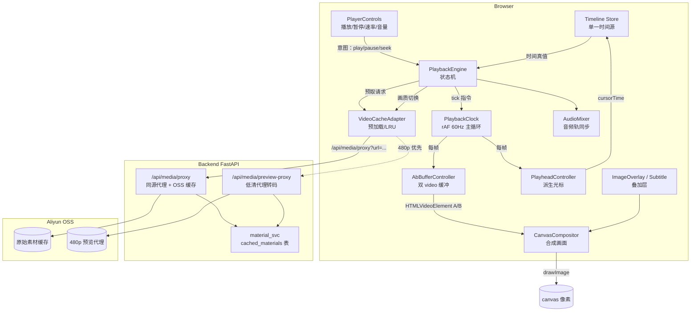
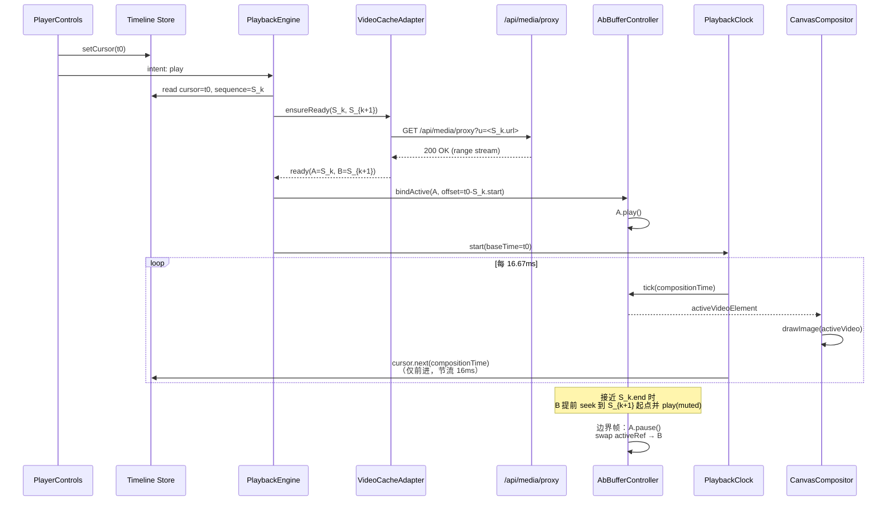
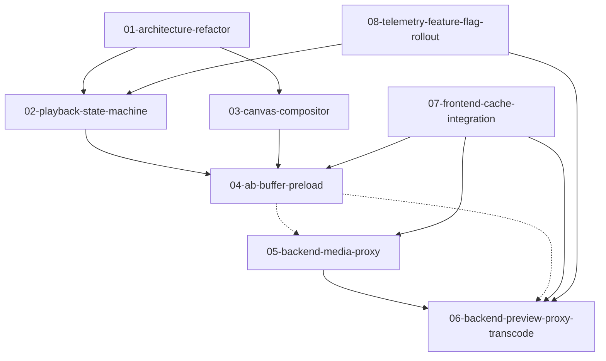

# 视频编辑器播放流畅度优化 — 主规划

> Topic: `video-editor-playback-optimization`
> 状态：**v2（评审后）**
> 语言：中文
> 输出目录：`docs/plans/video-editor-playback-optimization/`

---

## 〇、评审记录（Review Notes）

> 本节由设计评审节点写入。评审范围：本 `master-plan.md` 与 `specs/01-08`。
> 上游生成的"设计文档"为多文件形态（master-plan + specs/），本评审把 `master-plan.md` 视为该文档集的入口（即任务模板里所说的 `spec.md`）。P0/P1 项已在本评审中直接修复：本文件 §六 与 §五 D2 已更新；同时对 `specs/02-playback-state-machine.md` §4.4 与 `specs/07-frontend-cache-integration.md` §六 做了 v2 同步修订（修订条目记录于各 spec 文末"评审修订"段）。源码未被修改，符合本节点边界。

### 0.1 已修复项

| # | 严重度 | 维度 | 问题 | 修复位置 |
|---|--------|------|------|----------|
| F1 | **P1** | Consistency | master-plan §6.1 宣称 "OSS_ENABLED=true 必须"，与 `CLAUDE.md` 中 "OSS 为 Optional / 启用受 `OSS_ENABLED=true` 控制" 冲突；且 Phase 1（spec 05 远端代理）在仅本地 FS（`STORAGE_ROOT/cached_materials/`，沿用 `material_svc` 现状）下即可工作，OSS 仅是优化加速层而非阻塞依赖。 | 本文 §6.1（OSS 改为 "推荐但非必需，Phase 1 可仅依赖本地 FS；Phase 2 预览代理在多机部署下推荐 OSS"） |
| F2 | **P1** | Consistency | spec 02 §4.4 把 `cursorCompositionTime` 当作"新增"字段加进 timeline store，但现状 `src/components/video/timeline/store/slices/timelineSlice.ts` 已存在 `currentTime: number`（见 timelineSlice.ts:40 / :105）。两者关系（替换 / 重命名 / 并存）未交代，落地极易出现"双时间源"，与 D2 单一时间源原则正面冲突。 | `specs/02-playback-state-machine.md` §4.4 收紧为"复用现有 `currentTime` 字段并语义升级为合成时间真值；不新增字段；写入权限收敛到 PlayheadController + ruler 拖动两条路径"，并补强测试用例 |
| F3 | **P1** | Consistency | spec 07 §一 与 §6.2 自相矛盾：开头说"用户首次把素材加入 **timeline** 时触发后端 preview-proxy 转码"；§6.2 却把触发点接到 `useMaterialManagement.addMaterials`（素材库入库回调，见 `useMaterialManagement.ts:683`）。会对未使用的素材浪费转码配额并冲击 §四 队列。 | `specs/07-frontend-cache-integration.md` §6.2 改为：触发点为 timeline `addItem` action（即素材首次进入 timeline 时），`addMaterials` 仅做元数据 hydrate 不触发转码 |

### 0.2 已记录但本评审不强制修改（P2）

| # | 维度 | 问题 | 处理建议 |
|---|------|------|----------|
| N1 | Right-sizing | `VideoPlayerPanel.tsx` 实际行数 **2853**（实测，2026-05-15），master-plan §2.2 写作 "2638"、spec 01 §一 写作 "约 2650"。属于陈旧 stat，不影响方案。 | 实施时以落地实测为准；spec 01 §一已附"以落地实测为准"说明 |
| N2 | Feasibility | spec 05 §4.6 DNS-rebinding 防护要求"解析后传 IP 给 httpx，Host 头保留原始"。httpx 默认不支持，需自定义 `httpx.AsyncHTTPTransport` + 解析钩子，复杂度未估算。 | 实施时若过重可降级为"白名单域名 + 私有网段拦截"二段防护，TODO 05 中体现 |
| N3 | Completeness | Alembic 迁移依赖：spec 05 加 `proxy_*` 字段、spec 06 加 `preview_proxy_*` 字段。两个迁移独立但都写 `cached_materials` 表；多人并行实施时可能产生 down_revision 冲突。 | TODO 05 / 06 中约定 spec 05 先合入，spec 06 的 `down_revision` 指向 spec 05 的 revision |
| N4 | Completeness | `useMaterialManagement.ts:683` 这类绝对行号引用会随代码演进失效。 | 落地时改为"符号引用 + 文件路径"，行号仅作辅助 |
| N5 | Completeness | spec 08 §4.1 远端 flag "sessionStorage 10 分钟复用" 无 TTL 字段，需手动写入 `{value, expiresAt}` 结构。 | 实施细节，落 TODO 08 |
| N6 | Right-sizing | spec 02 §5.6 / §5.7 关于 visibilitychange 恢复策略陈述不一致：5.6 强调"continuous"，5.7 又说"wall delta > 10s 回 paused"。需在落地时按"小 delta 续播、大 delta 进 paused"统一。 | 实施时以 spec 02 §5.7 为最终策略，spec 02 §5.6 解释为"小 delta 路径" |
| N7 | Feasibility | spec 02 §4.4 "禁止其他模块调用 setCursorCompositionTime" 用 CI grep 锁定脆弱（重命名易绕过、IDE 重构友好度差）。 | TODO 02 中追加"补 eslint 自定义规则"为可选优化项 |

### 0.3 P0 项

无。本评审认定主路径方案（D1–D12）与项目栈（Next.js 15 / FastAPI / OSS / FFmpeg / Zustand timeline / cached_materials 表 / require_admin 鉴权）兼容且边界明确。

---

## 一、概述（Overview）

视频编辑器（`src/components/video/`）的播放预览面板存在严重的体验问题：

1. **播放卡顿**：本地与在线（Pexels、ARK 生成、用户上传）视频在剪辑轨道播放时帧率不稳，单视频与多片段连续播放均会出现可感知的卡顿。
2. **光标乱跳**：播放头光标频繁出现"前进 → 突然回跳 → 再次前进"的路径回归现象。
3. **片段切换闪屏**：同一轨道上多个 clip 在 sequence 边界切换时出现卷帘 / 黑屏 / 抖动。
4. **首帧迟滞**：点击轨道任意位置或拖动播放头后，起始播放需要等待数百毫秒甚至秒级才显示首帧。

本项目要求将体验拉齐**专业剪辑软件级别**：接近原生播放流畅度（持续 60fps）、片段切换零感知、播放头与画面严格同步、跨远端/本地素材一致体验。

---

## 二、目标（Goals）

### 2.1 用户体验目标

| 维度 | 现状（估计） | 目标 |
|------|--------------|------|
| 点击播放后首帧时间（P50） | 500ms+ | < 100ms |
| 点击播放后首帧时间（P95） | 1500ms+ | < 300ms |
| 拖动播放头后画面同步（P95） | 600ms+ | < 150ms |
| 持续播放帧率 | 抖动、< 30fps 感知 | 稳定 ≥ 60fps |
| 片段切换可见闪屏时长 | 80–400ms | < 16ms（不可见） |
| 一次会话内光标路径回跳次数 | 频繁 | 0（硬性指标） |

### 2.2 工程目标

- 拆解 `VideoPlayerPanel.tsx`（2638 行）为职责清晰的模块组。
- 建立**单一时间源（single source of truth）**：Timeline store 是唯一时间真值；React state、`<video>.currentTime` 均为派生表示，禁止双向回写。
- 引入 **Canvas 预览合成器**：由 timeline 通过 `requestAnimationFrame` 主循环驱动；多个隐藏 `<video>` 通过双缓冲（A/B Buffer）解码，画面贴到统一 `<canvas>`。
- 后端补齐 **OSS 远端素材代理 + 低清预览代理（preview proxy）转码**接口，解决跨域 / 首字节延迟 / 大码率拖慢预览的问题。
- 全链路埋点 + Feature flag 灰度切换，可回退。

### 2.3 非目标（Out of scope）

- 不涉及导出（export）链路渲染流水线的变更——导出仍走 FFmpeg 服务端合成。
- 不引入 WebCodecs / WebAssembly 解码器（保持浏览器原生 `<video>` 解码以兼容主流浏览器）。
- 不修改字幕、特效、AI 脚本生成等剪辑器其他子模块的功能行为，仅在合成器中接入它们的渲染输出。

---

## 三、范围（Scope）

### 3.1 范围内（In scope）

**前端（`src/components/video/`）**

- `components/VideoPlayerPanel/VideoPlayerPanel.tsx`：拆解为 `<PlayerShell>` + `<PreviewSurface>`（Canvas 合成器）+ `<PlayerControls>` + `<PlayerOverlays>`。
- `hooks/useVideoPlayback.ts`：替换 mock 模拟为基于 timeline store 的派生状态。
- `hooks/useVideoCache.ts` / `timeline/infrastructure/VideoCacheAdapter.ts`：扩展为支持远端素材代理与 A/B 缓冲策略。
- 新增 `playback/` 子模块：`PlaybackEngine`、`PlaybackClock`（rAF 主循环）、`AbBufferController`、`CanvasCompositor`、`PlayheadController`。
- `timeline/store/`：暴露纯派生 selector，禁止由 `<video>.timeupdate` 回写。

**后端（`backend-services/basic-service/`）**

- 新增路由 `app/routers/media_proxy_router.py`：远端素材（Pexels / ARK / 任意 HTTPS）的同源代理 + OSS 缓存层。
- 新增 `app/services/preview_proxy_service.py`：低清预览代理（fragmented MP4，480p / 1Mbps / H.264 baseline / fastStart）按需转码 + OSS 存储。
- 扩展 `cached_materials` 表与 `material_svc`，增加 `preview_proxy_url`、`preview_proxy_status` 字段。
- 新增 `config/preview-proxy-config.yaml`：转码并发、超时、码率档位、保留天数。

**遥测与灰度**

- 前端 / 后端关键指标埋点（首帧时间、sequence 切换耗时、播放头回跳事件、缓冲事件、转码耗时）。
- Feature flag：`NEXT_PUBLIC_PLAYBACK_V2_ENABLED` 与后端 `PLAYBACK_V2_ENABLED`，灰度开关独立。

### 3.2 范围外（Out of scope）

- 视频导出（`useVideoExport`、`useTimelineExport`、`video_export_router`）保持现状。
- 工作流（`src/components/workflow/`）、AI Chat、TTS 等其他模块不动。
- 字幕识别 / 视频理解 / Storyboard 生成等离线任务不动。
- 不引入新的前端状态管理库；继续使用 Zustand timeline store。

---

## 四、架构（Architecture）

### 4.1 整体数据流（C4 — 容器视图）



### 4.2 关键组件职责

| 组件 | 职责 | 替代/扩展自 |
|------|------|-------------|
| `PlaybackEngine` | 全局播放状态机：`idle / preparing / playing / seeking / paused / stalled / ended`。是 UI 意图 → 资源调度的唯一入口。 | 当前散落在 `VideoPlayerPanel` 内的多个 ref / state |
| `PlaybackClock` | 唯一的 rAF 循环。以 `performance.now()` 与基准时刻计算 `compositionTime`，避免 `<video>.timeupdate` 的低频 + 抖动。 | 替代 `setInterval(1000ms)` 与 `timeupdate` 回写 |
| `AbBufferController` | 维护 A/B 两个隐藏 `<video>` 元素：A 播当前 sequence，B 预热下一 sequence；boundary 到达时 1-frame 切换。 | 替代当前"单 video 动态换 src" |
| `CanvasCompositor` | 每帧从活动 `<video>` `drawImage` 到 `<canvas>`；叠加 `ImageOverlay`、字幕、effect。 | 新建，部分逻辑迁移自 `VideoPlayerPanel.captureFrameToCanvas` |
| `PlayheadController` | 派生游标 React 状态；以 16ms 节流写回，且仅在 `compositionTime` 单调递增时写入，禁止回退。 | 替代当前 `setCurrentTime` 双向同步 |
| `VideoCacheAdapter`（扩展） | 远端 URL 自动重写为 `/api/media/proxy?u=...`；按 timeline 顺序的窗口式预取；同时维护原清/低清两份。 | 扩展现有 LRU 与 sameOrigin 限制 |
| `media_proxy_router`（后端） | 跨域 → 同源；流式转发；首请求触发 OSS 缓存；带 Range 支持。 | 新建 |
| `preview_proxy_service`（后端） | 异步任务：按需 ffmpeg 转码 480p faststart fMP4；写 OSS；幂等键 = `materialId+档位`。 | 新建 |

### 4.3 关键序列图：点击轨道空白处播放



### 4.4 文件夹结构（建议）

```
src/components/video/
  playback/                    # 新增模块
    PlaybackEngine.ts          # 状态机（XState 或纯 reducer）
    PlaybackClock.ts           # rAF 主循环
    AbBufferController.ts      # A/B <video> 双缓冲
    CanvasCompositor.ts        # 画面合成
    PlayheadController.ts      # 派生光标 + 单调写回
    types.ts
    __tests__/

  components/
    VideoPlayerPanel/
      VideoPlayerPanel.tsx     # 仅保留布局壳，调用 playback/*
      PreviewSurface.tsx       # <canvas> + 隐藏 <video> 池
      PlayerControls.tsx       # 按钮 / 滑块 / 比例切换（已存在分支拆出）
      PlayerOverlays.tsx       # 图片、字幕、cover 等
      __tests__/

  hooks/
    useVideoPlayback.ts        # 重写：纯 timeline 派生
    useVideoCache.ts           # 扩展：远端代理重写 + 预热窗口

  timeline/
    infrastructure/
      VideoCacheAdapter.ts     # 扩展：proxyUrl 支持
      MediaProxyClient.ts      # 新增：URL 重写器

backend-services/basic-service/
  app/routers/
    media_proxy_router.py      # /api/media/proxy
    preview_proxy_router.py    # /api/media/preview-proxy
  app/services/
    media_proxy_service.py
    preview_proxy_service.py   # ffmpeg + OSS
  config/
    preview-proxy-config.yaml
  alembic/versions/
    xxxx_add_preview_proxy_fields.py
```

---

## 五、设计决策（Design Decisions）

| ID | 决策 | 备选 | 理由 |
|----|------|------|------|
| D1 | 采用 **Canvas 合成器**（多隐藏 `<video>` → `<canvas>`）作为主预览渲染路径 | A. 单 `<video>` 动态换 src（现状） B. 双 `<video>` 不上 canvas | 用户明确选择 Canvas 方案；只有 canvas 能实现帧级 cross-sequence 平滑切换、叠加层与画面统一裁切 |
| D2 | **Timeline store 为单一时间源**，禁止 `<video>.timeupdate → setState → setCursor` 回写链路 | 维持当前双向同步 | 直接根治"光标路径回跳"（用户首要痛点） |
| D3 | **rAF 主循环**（`PlaybackClock`）替代 `timeupdate` / `setInterval` 驱动游标 | 继续依赖 `timeupdate` | `timeupdate` 频率 4–66Hz 不稳定且非单调；rAF 与浏览器渲染对齐，60Hz 稳定 |
| D4 | **A/B Buffer**：第二个 `<video>` 预热下一个 sequence | 仅靠 `VideoCacheAdapter` 预创建 video element | 仅缓存元素不够，需要"已经 seek 到目标 offset 并 buffered ≥1s"的 ready 状态才能零延迟切换 |
| D5 | 后端 **OSS 同源代理**所有远端素材 URL | 直接前端跨域加载 | 远端 CDN 跨域常无 `Accept-Ranges`、首字节延迟高、`<video>` 无法稳定 range request；OSS 同区 + 边缘缓存解决 |
| D6 | **预览专用低清代理（480p / ~1Mbps / fMP4 + faststart）** | 直接用原片预览 | 4K/高码率原片解码会被显卡瓶颈拖慢；低清代理可瞬间起播 |
| D7 | **预览代理按需异步生成**（任务队列），导出仍用原片 | 入库时即转码 | 减少不必要转码；用户只看预览时才触发；导出需要原始质量 |
| D8 | 状态机用**纯 reducer + 显式状态枚举**，不引入 XState | 引入 XState | 项目已有 `timeline/domain/machines` 用法但偏轻量；额外依赖收益不足 |
| D9 | **Feature flag 灰度**：`PLAYBACK_V2_ENABLED`，可一键回退到旧 `VideoPlayerPanel` | 直接替换 | 旧路径完成稳定迁移前保留回退；分阶段释放风险 |
| D10 | 不引入 WebCodecs / WASM 解码 | WebCodecs API | 浏览器兼容性参差；项目当前定位以主流浏览器为主；收益不明显 |
| D11 | **音频走独立 `<audio>` 池**，时间由 `PlaybackClock` 同步 | 全部走 canvas + WebAudio mixer | 简化首期实现；WebAudio mixer 可作为后续 Phase 2 |
| D12 | 预览代理与原片同存于 OSS，路径 `oss://.../preview-proxies/<materialId>/480p.mp4`，由 `cached_materials` 表统一索引 | 单独服务 | 复用现有缓存域，单一表查询 |

---

## 六、依赖（Dependencies）

### 6.1 系统依赖

- **FFmpeg**（已要求，见 CLAUDE.md）：预览代理转码核心；Phase 2（spec 06）必需。
- **Aliyun OSS**（已接入）：**推荐但非必需**。
  - Phase 1（spec 05 同源代理）：OSS_ENABLED=false 时仍可工作，所有字节落本地 FS `STORAGE_ROOT/cached_materials/`（沿用 `MaterialDownloadService` 现状）；OSS_ENABLED=true 时仅作为二级缓存 / 边缘加速。
  - Phase 2（spec 06 预览代理）：单机部署下可仅用本地 FS；多机部署或需要 CDN 时强烈推荐启用，bucket 子前缀 `preview-proxies/`。
  - 切换不要求 schema 变更；`preview_proxy_local_url` 与 `preview_proxy_oss_url` 字段独立，按可用性兜底。
- **PostgreSQL 13+**：扩展 `cached_materials` 表（新字段 + 索引）。详见 spec 05 §六、spec 06 §六；spec 05 的迁移须先于 spec 06（见 §0.2 N3）。

### 6.2 前端依赖（无新增三方库）

- 复用 React 19、Zustand、现有 timeline domain types。
- Canvas 2D 上下文（`drawImage`）即可，不需要 WebGL/WebGPU。

### 6.3 后端依赖

- 新增 Python 库：`aiofiles`（已用）、`httpx`（已用）、`asyncio.Queue`（标准库），无额外 PyPI 依赖。
- 转码任务可复用现有 `QueueManager` 与 `@with_simple_queue` 装饰器范式。

### 6.4 模块间依赖



实线 = 强依赖；虚线 = 可在 mock 后端下并行开发。

---

## 七、风险与缓解（Risks & Mitigations）

| ID | 风险 | 影响 | 概率 | 缓解 |
|----|------|------|------|------|
| R1 | Canvas 合成在低端设备上 CPU 占用高 | 中 | 中 | rAF 帧自适应（落到 30fps）+ FPS 探测 + 自动降级回 `<video>` 直显路径 |
| R2 | A/B Buffer 在 sequence 长度 < 1s 时来不及预热 | 中 | 中 | 检测短 clip 直接走串行 prepareNext；同时在 PlaybackEngine 增加 `stalled` 显态展示 |
| R3 | 后端转码队列堆积，导致预览代理生成不及时 | 中 | 中 | Phase 1 先上线 media-proxy（不转码），Phase 2 再上 preview-proxy；先按需触发，第一次回退到原片直显 |
| R4 | 跨域素材本身禁用 Range，代理后字节流被全量下载 | 中 | 低 | OSS 缓存完成后 OSS 出口必带 Range；首次请求允许串行流式播 |
| R5 | Feature flag 切换导致用户编辑中数据丢失 | 高 | 低 | flag 只在 player 内部切换，不影响 timeline state；切换前自动 pause |
| R6 | 重构周期内主分支主功能回归 | 高 | 中 | 强 Feature flag 隔离；旧组件保留至少 2 个发布版本；CI 增加 playhead-regression 集成测试 |
| R7 | 预览代理与原片帧不严格对齐（导出阶段位移） | 中 | 低 | 预览代理仅用于 preview，导出阶段 `selectPlaybackUrl({purpose:'export'})` 仍取原 URL（已有逻辑） |
| R8 | rAF 在 tab 不可见时被节流（1Hz），重新可见时大跳 | 低 | 中 | `visibilitychange` 监听：隐藏即 pause（不仅暂停 video，也停 PlaybackClock） |
| R9 | OSS 出口流量与转码成本超预算 | 中 | 中 | 默认仅对"用户已添加到 timeline 的素材"代理；非 timeline 内的搜索预览仍走原 CDN |
| R10 | 现有 `seek-lock` 机制与新状态机概念冲突，迁移期 bug | 中 | 中 | 状态机内吸收 seek 锁概念；旧代码路径仅在 flag off 时运行，避免双系统并行 |

---

## 八、验收指标（Acceptance Metrics）

定量指标（必须满足）：

- [ ] **P50 click-to-first-frame**：< 100ms（实验机型 MacBook Pro 14" M1 / Chrome 125）
- [ ] **P95 click-to-first-frame**：< 300ms
- [ ] **P95 seek-to-frame**：< 150ms
- [ ] **稳定播放帧率**：连续 10 秒播放期间 `requestAnimationFrame` 平均周期 16.67ms ± 1ms，丢帧率 < 1%
- [ ] **Sequence 切换可见闪屏**：< 16ms（一帧）
- [ ] **光标回跳事件**：在 30 分钟混合操作（播放、seek、剪辑）样本中为 0 次
- [ ] **远端素材首次代理 RTT**：P95 < 800ms（OSS 同区域）

定性指标：

- [ ] 用户主观顺滑度评级（5 人小组盲测）≥ 4.5 / 5
- [ ] 与对照（DaVinci Resolve / CapCut Web）感知差异 ≤ 一档

---

## 九、阶段划分（Phasing）

| 阶段 | 内容 | 验收 |
|------|------|------|
| **Phase 1（必做）** | spec 01 / 02 / 03 / 04 / 05 / 07 / 08 | 单视频与多 sequence 播放全部达到 P50 / P95 指标；远端素材通过代理同源加载；旧路径保留并通过 flag 关闭 |
| **Phase 2（推荐）** | spec 06（preview proxy 转码） | 高码率素材也达到稳定 60fps；OSS 预览代理覆盖率 ≥ 80% |
| **Phase 3（可选 / 后续）** | WebAudio mixer、WebCodecs 探索、滚动缩略图（filmstrip）预览 | 体验进一步对标专业 NLE；暂不纳入本规划 |

---

## 十、Spec 文件目录（Table of Contents）

> 文件清单与一句话描述。每个 spec 在批准后会链回此处。

| # | 文件 | 标题 | 一句话描述 |
|---|------|------|------------|
| 01 | [`specs/01-architecture-refactor.md`](specs/01-architecture-refactor.md) | 架构重构与模块拆分 | 拆解 2638 行的 `VideoPlayerPanel`，建立 `playback/` 子模块结构 |
| 02 | [`specs/02-playback-state-machine.md`](specs/02-playback-state-machine.md) | 播放状态机与时间源 | 引入 `PlaybackEngine` + `PlaybackClock`，时间单向流动，根治光标回跳 |
| 03 | [`specs/03-canvas-compositor.md`](specs/03-canvas-compositor.md) | Canvas 预览合成器 | `<canvas>` + 隐藏 `<video>` 池，叠加层统一渲染 |
| 04 | [`specs/04-ab-buffer-preload.md`](specs/04-ab-buffer-preload.md) | A/B 双缓冲与预加载策略 | 当前/下一 sequence 双 `<video>` 预热，零感知切换 |
| 05 | [`specs/05-backend-media-proxy.md`](specs/05-backend-media-proxy.md) | 后端远端素材同源代理 | `/api/media/proxy` 端点 + OSS 缓存 + Range 支持 |
| 06 | [`specs/06-backend-preview-proxy-transcode.md`](specs/06-backend-preview-proxy-transcode.md) | 后端低清预览代理转码 | 按需 ffmpeg 转 480p faststart fMP4，OSS 存储 |
| 07 | [`specs/07-frontend-cache-integration.md`](specs/07-frontend-cache-integration.md) | 前端缓存与代理 URL 集成 | `VideoCacheAdapter` 扩展 + URL 重写 + 预热窗口 |
| 08 | [`specs/08-telemetry-feature-flag-rollout.md`](specs/08-telemetry-feature-flag-rollout.md) | 遥测、灰度与回滚 | 关键指标埋点、Feature flag、回退方案 |

---

## 十一、变更与回滚（Change Management）

- **入场标准**：Phase 1 所有 spec 完成实现 + 通过验收指标 + 内部 dogfood 一周后方可默认开启 flag。
- **回滚策略**：`PLAYBACK_V2_ENABLED=false` 即可瞬间回到旧路径；后端代理端点保留（旧路径不会调用）。
- **数据兼容**：`cached_materials` 仅新增字段不修改已有字段；旧版前端忽略新字段。

---

## 十二、评审结论（Review Verdict）

**结论：有条件通过（Approved with conditions）**

设计方案在可行性（Feasibility）、完整性（Completeness）、一致性（Consistency）与合规规模（Right-sizing）四维上整体合格，核心决策 D1–D12 与本项目当前技术栈（Next.js 15 + Zustand timeline、FastAPI + async SQLAlchemy、`cached_materials` 表、`material_svc.store_external_download_async`、`require_admin` 鉴权、FFmpeg、可选 OSS）兼容；P0 项无。本评审已直接修复 F1–F3 三条 P1 项（详见 §〇），文档版次升级为 **v2**。

**通过条件**（实施阶段必须满足，由后续节点 / 实施 PR 承接）：

1. **统一时间字段**：spec 02 落地必须复用既有 `timelineSlice.currentTime`，不允许引入并存的 `cursorCompositionTime` 新字段；写入权限收敛到 `PlayheadController` 与 timeline ruler 拖动两条路径，CI 检查（grep / eslint，二选一）必须落地，否则 D2 单一时间源不成立。
2. **preview-proxy 触发点**：spec 07 实施 PR 中必须把 `requestPreviewProxy` 调用挂在 timeline `addItem` action 路径上，不得挂在 `useMaterialManagement.addMaterials`；并在 TODO 07 中显式说明。
3. **OSS 兜底验证**：CI / dogfood 至少包含一次 `OSS_ENABLED=false` 全链路验证，确保 Phase 1 不静默依赖 OSS。
4. **迁移依赖顺序**：spec 06 的 Alembic 迁移 `down_revision` 必须指向 spec 05 的迁移；CI 校验通过即可。
5. **P2 项 N1–N7**：实施 PR review 时检查，本评审不阻断合入。

> 后续节点（TODO 拆分 / 实施）可直接以 v2 master-plan 与同步修订的 spec 02、spec 07 为基准开工。
