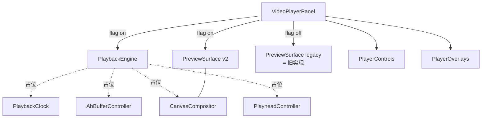

# Spec 01：架构重构与模块拆分

> 关联：[`master-plan.md`](../master-plan.md)
> 阶段：Phase 1（必做）
> 状态：草案

## 一、目的（Purpose）

将当前约 2650 行的 `VideoPlayerPanel.tsx` 拆解为职责清晰、可独立测试的模块组，为后续 spec（状态机、Canvas 合成器、A/B Buffer 等）建立结构骨架。本 spec 不改变外部用户行为，是**纯重构与目录建设**，但需保证：

- 旧路径在 `PLAYBACK_V2_ENABLED=false` 时仍可运行。
- 新模块骨架（空实现 + 类型 + 测试占位）落地。
- `VideoPlayerPanel.tsx` 行数下降到 ≤ 600 行。

## 二、范围

### 范围内

- 新增目录与文件骨架：`src/components/video/playback/`、`PreviewSurface.tsx`、`PlayerControls.tsx`、`PlayerOverlays.tsx`。
- 抽取现有 `VideoPlayerPanel.tsx` 中纯展示 / 控件 / 比例切换 / 封面按钮等部分。
- 把状态机意图（play / pause / seek）、A/B Buffer、Canvas 合成的占位接口暴露出来，但内部仍代理回旧逻辑（适配器模式）。
- 引入 Feature flag 工具：`isPlaybackV2Enabled()`。

### 范围外

- 不实现状态机内部逻辑（spec 02 负责）。
- 不实现 Canvas 合成（spec 03 负责）。
- 不实现 A/B 缓冲实际预热（spec 04 负责）。
- 不动后端。

## 三、模块清单与职责

| 文件路径 | 角色 | 行数预算 |
|---------|------|---------|
| `src/components/video/playback/types.ts` | 接口/枚举/事件类型（`PlaybackIntent`、`PlaybackPhase`、`PreviewFrame`） | ≤ 120 |
| `src/components/video/playback/PlaybackEngine.ts` | 空实现 + 接口暴露；内部代理旧逻辑 | ≤ 200 |
| `src/components/video/playback/PlaybackClock.ts` | 空实现 + 占位 rAF；本 spec 仅暴露 start/stop/tickSubscribe 接口 | ≤ 80 |
| `src/components/video/playback/AbBufferController.ts` | 空实现 + 接口；本 spec 内仅返回 active video ref | ≤ 80 |
| `src/components/video/playback/CanvasCompositor.ts` | 空实现 + 接口；本 spec 内不做实际 drawImage | ≤ 80 |
| `src/components/video/playback/PlayheadController.ts` | 空实现 + 接口 | ≤ 80 |
| `src/components/video/playback/index.ts` | barrel 导出 | ≤ 30 |
| `src/components/video/components/VideoPlayerPanel/VideoPlayerPanel.tsx` | 拆分后保留：编排、Feature flag 分流、布局 | ≤ 600 |
| `src/components/video/components/VideoPlayerPanel/PreviewSurface.tsx` | 渲染 `<canvas>` + 隐藏 `<video>` 池；flag off 时退化为旧的单 video | ≤ 250 |
| `src/components/video/components/VideoPlayerPanel/PlayerControls.tsx` | 播放/暂停/速率/音量/比例/封面 按钮 | ≤ 400 |
| `src/components/video/components/VideoPlayerPanel/PlayerOverlays.tsx` | 图片叠加、字幕、覆盖层 | ≤ 250 |
| `src/lib/playbackFlags.ts` | `isPlaybackV2Enabled()`：读取 `process.env.NEXT_PUBLIC_PLAYBACK_V2_ENABLED` + localStorage 覆写。文件名固定为 `playbackFlags.ts`（与 spec 08 §4.1、TODO 01/08 对齐）。 | ≤ 60 |

## 四、接口（Interfaces）

> 以下为语言无关的接口签名。实现细节由后续 spec 提供。

### 4.1 `playback/types.ts`

```
type PlaybackPhase =
  | 'idle'          // 未播放，未持有 sequence
  | 'preparing'     // 拉取/挂载 sequence，等待 ready
  | 'playing'       // 持续推进
  | 'seeking'       // 用户拖动光标
  | 'paused'        // 用户主动暂停
  | 'stalled'       // 缓冲不足
  | 'ended'         // 抵达 composition 末尾

type PlaybackIntent =
  | { kind: 'play' }
  | { kind: 'pause' }
  | { kind: 'seek'; compositionTime: number }
  | { kind: 'setRate'; rate: number }
  | { kind: 'setVolume'; volume: number }
  | { kind: 'enterBackground' }
  | { kind: 'returnToForeground' }

interface PreviewFrame {
  compositionTime: number     // 单位：秒，timeline 全局时间
  sequenceIndex: number       // 当前播放 sequence 序号
  sequenceLocalTime: number   // sequence 内偏移
  source: HTMLVideoElement | null  // 当前合成画面的来源元素
}
```

### 4.2 `playback/PlaybackEngine.ts`

```
interface IPlaybackEngine {
  dispatch(intent: PlaybackIntent): void
  getPhase(): PlaybackPhase
  subscribe(listener: (phase: PlaybackPhase) => void): () => void
  // 仅本 spec 提供占位返回值；逻辑由 spec 02 实现
}
```

### 4.3 `playback/PlaybackClock.ts`

```
interface IPlaybackClock {
  start(baseCompositionTime: number, baseWallTime: number): void
  stop(): void
  isRunning(): boolean
  subscribe(tickHandler: (compositionTime: number, deltaMs: number) => void): () => void
}
```

### 4.4 `playback/AbBufferController.ts`

```
interface IAbBufferController {
  bindActive(sequenceId: string, localTime: number): Promise<HTMLVideoElement>
  prewarmNext(sequenceId: string): Promise<void>
  getActiveElement(): HTMLVideoElement | null
  releaseAll(): void
}
```

### 4.5 `playback/CanvasCompositor.ts`

```
interface ICanvasCompositor {
  attach(canvas: HTMLCanvasElement): void
  detach(): void
  drawFrame(frame: PreviewFrame): void  // 每个 rAF tick 调用
}
```

### 4.6 `playback/PlayheadController.ts`

```
interface IPlayheadController {
  reportCompositionTime(t: number): void  // 节流 + 单调
  reset(): void
}
```

### 4.7 `playbackFlags.ts`

```
isPlaybackV2Enabled(): boolean
  规则：
    1) localStorage[ecliptrix-playback-v2] === 'true' → true
    2) localStorage[ecliptrix-playback-v2] === 'false' → false
    3) 否则读 process.env.NEXT_PUBLIC_PLAYBACK_V2_ENABLED
```

> 注：spec 08 §4.1 在此基础上扩展 URL query 与远端 `/api/config/playback-flag` 覆写。本 spec 仅交付 1/2/3 三层；扩展由 spec 08 阶段 A 落地，文件路径不变。

## 五、行为（Behaviour）

- `VideoPlayerPanel` 在 mount 时调用 `isPlaybackV2Enabled()` 一次（用 `useMemo` 锁定整个生命周期），决定渲染分支：
  - flag on → 渲染 `<PreviewSurface variant="v2">`，由 `PlaybackEngine` 编排；
  - flag off → 渲染 `<PreviewSurface variant="legacy">`，行为 100% 复刻当前实现（包括 seek 锁、`captureFrameToCanvas` 等）。
- 拆出的子组件**只接收 props 与回调**，禁止直接读 timeline store；通过 `VideoPlayerPanel` 统一注入。
- 拆解过程中不修改 `useVideoExport`、`useVideoCache`（仅可能改导入路径）。
- 重构期间所有现有测试必须仍通过。

### 5.1 边界条件

- flag 切换不应触发已挂载组件的内部状态丢失；切换需 reload 整个剪辑器路由（在文档中说明，不在代码中强制）。
- 当 `compositionPlayback` 为 `null` 时（单视频预览模式）：v2 分支允许跳过 A/B Buffer 直接挂一个 active video，调用方式不变。
- 旧 `VideoPlayerPanel.tsx` 中通过 `useImperativeHandle` 暴露的 `VideoPlayerPanelRef` 接口必须**保持签名稳定**（包括 `handleCompositionSeek`、`seekAndPlayFromTimeline`、`pauseFromTimeline`、`isPlaying`、`handlePlayPauseFromTimeline`）；v2 内部代理到 `PlaybackEngine.dispatch(...)`，外部调用方（如 timeline 区域 Space 键处理）无需改动。

## 六、数据形态（Data Shapes）

- 沿用现有 `CompositionPlayback`、`VideoSequenceItem`、`TimelineState`、`MaterialItem` 类型（`src/components/video/types`、`@/types`）。
- 无新增数据库或 API 字段。

## 七、组件交互图



## 八、测试

- `src/components/video/playback/__tests__/PlaybackEngine.smoke.test.ts`：dispatch + phase 订阅冒烟测试。
- `src/components/video/components/VideoPlayerPanel/__tests__/featureFlagBranch.test.tsx`：mock `isPlaybackV2Enabled` 返回 true/false 时渲染分支正确。
- 现有 `playheadResume.test.tsx`、其他相关测试在 flag off 路径下仍通过（回归基线）。
- 新增 `src/lib/__tests__/featureFlags.test.ts`：localStorage 覆写优先级。

## 九、Open Questions

1. **Feature flag 是否在所有项目都默认 off？** 倾向：默认 off；只在内部环境通过 localStorage 强制打开 dogfood。
2. **PlayerOverlays 的字幕渲染**目前耦合在 `VideoPlayerPanel` 内的若干位置，是否完全抽出还是保留小部分入口？
   - 建议：保留入口，内容委派给 `PlayerOverlays`；spec 03 再决定是否进 canvas。
3. **VideoPlayerPanelRef 是否在 v2 内部仍通过 `useImperativeHandle` 暴露？** 是。外部多个组件依赖其方法。

## 十、参考

- 现状：`src/components/video/components/VideoPlayerPanel/VideoPlayerPanel.tsx`（约 2650 行，重构基线以本 spec 落地时实测为准）
- 现状：`src/components/video/hooks/useVideoPlayback.ts`（mock-based）
- 现状：`src/components/video/timeline/infrastructure/VideoCacheAdapter.ts`
- CLAUDE.md：项目结构、Feature flag 命名约定
- [`master-plan.md`](../master-plan.md) §4.2（关键组件职责）、§4.4（文件夹结构建议）

## 十一、实施过程发现的方案缺陷（Issues Found During Implementation）

### 11.1 `VideoPlayerPanel.tsx` 行数预算超出（轮次 1 记录）

- **现象**：落地时实测 `VideoPlayerPanel.tsx` = **2853 行**（master-plan §0.2 N1 已记录 stat 偏差为 2638→2853）。Spec 01 §三要求一轮内压到 ≤ 600。
- **本轮处理**：保留 legacy 行为为绝对优先级（spec 01 §五"行为"明确要求"现有测试必须仍通过"）。**轮次 1 仅落地了模块骨架与 flag 分支引入**，未做大规模行抽取：
  - 新增 `PreviewSurface.tsx` / `PlayerControls.tsx` / `PlayerOverlays.tsx` 三个 scaffold 文件，签名稳定但内部尚未承接 legacy 行为（`PreviewSurface variant="legacy"` 当前 `return null`，legacy 渲染留在 `VideoPlayerPanel.tsx` 内）。
  - 注入 `isPlaybackV2Enabled()` 与 `PlaybackEngine` 引用，但 `VideoPlayerPanelRef.handleCompositionSeek` / `seekAndPlayFromTimeline` / `pauseFromTimeline` 仍 100% 走旧实现（spec 01 §5.1 "v2 内部代理到 `PlaybackEngine.dispatch(...)`" 留到 spec 02 落地）。
- **后续轮次推进计划**：
  - 轮次 2：随 spec 02 / spec 03 实现，把 `captureFrameToCanvas` / `<video>` 元素渲染、`ImageOverlay` JSX 真正迁入 `PreviewSurface` / `PlayerOverlays`，预计削减 500–800 行。
  - 轮次 3：把 `PlayerControls` 抽取（控件按钮、CoverButton、aspect ratio 选择器）落地，预计削减 600–800 行。
  - 轮次 4 验收：行数 ≤ 600 目标兜底；若仍超出，将再次记录原因并提出微调（例如把音量 / 速率 popover 进一步拆分为子组件）。
- **风险与缓解**：分批抽取期间 legacy 路径与 v2 路径共享同一 JSX 树是不可避免的过渡态；spec 01 §6.1 的 "VideoPlayerPanelRef 签名稳定" 与 spec 08 的 Feature flag 隔离继续作为护栏，每一轮都跑 `playheadResume.test.tsx` / `VideoPlayerPanel.reentry.test.tsx` 等回归测试。

### 11.2 v2 分支注入位置

- **决定**：把 `playbackV2Enabled = useMemo(..., [])` 与 `playbackEngineRef` 放在 `VideoPlayerPanel` 顶部、紧贴 `useVideoCache(taskId)` 之后。理由：所有后续 spec 都需要在 `VideoPlayerPanel` 函数体的早期阶段决定走哪条渲染路径；与 `useMemo` 配合即满足 spec 01 §5.1 "flag 切换不影响已挂载组件" 的语义。
- **测试**：源码级 regex 检查 `featureFlagBranch.test.tsx`，与 sibling `playheadResume.test.tsx` 同款式样（Vitest jsdom + jsx:"preserve" 不便挂载 React 树）。
