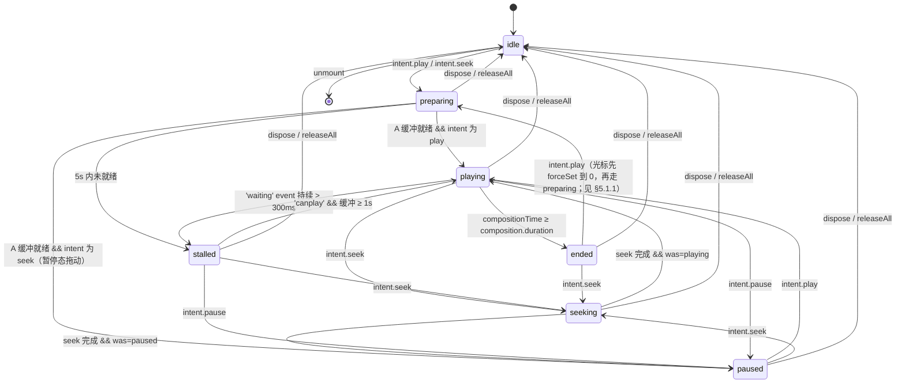
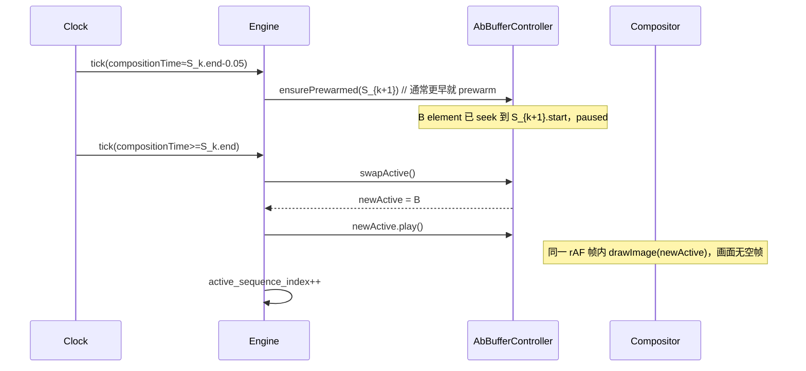
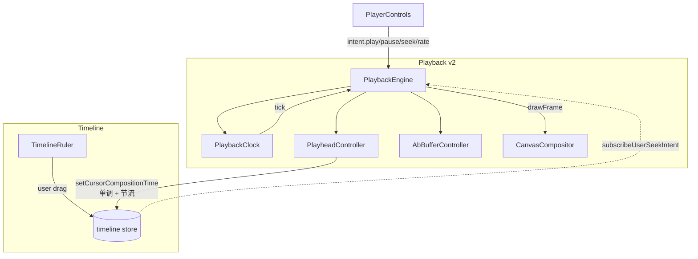

# Spec 02：播放状态机与时间源

> 关联：[`master-plan.md`](../master-plan.md)、[`01-architecture-refactor.md`](01-architecture-refactor.md)
> 阶段：Phase 1（必做）
> 状态：**v2（评审修订，2026-05-15）**

## 一、目的（Purpose）

本 spec 是根治"光标乱跳"与"卡顿"两大痛点的**核心**模块。两个目标：

1. **唯一时间源**：以 timeline store 内的 `cursorCompositionTime` 为单调真值，禁止 `<video>.timeupdate` 回写。
2. **rAF 主循环**：以 `PlaybackClock` 在 `requestAnimationFrame` 中按墙钟推进 `compositionTime`，画面与光标在同一 tick 内更新，彻底消除"画面与光标失步"。

最终交付：完整的 `PlaybackEngine`（状态机内核）+ `PlaybackClock`（时钟）+ `PlayheadController`（派生光标）三件套实现，flag on 时 spec 01 的占位被真正逻辑替换。

## 二、范围

### 范围内

- 实现 `PlaybackEngine` 状态机：状态转移、意图分发、资源调度。
- 实现 `PlaybackClock` 的 rAF 主循环、暂停/恢复、`visibilitychange` 处理、速率支持。
- 实现 `PlayheadController` 单调写回（节流 + 单调过滤）。
- 与 timeline store 对接：暴露/订阅 `cursorCompositionTime` 的纯派生 selector，禁止双向回写。
- 单元测试（含光标回跳防护、速率切换、`visibilitychange` 恢复）。

### 范围外

- A/B Buffer 实际预热逻辑：由 spec 04 提供（本 spec 仅调用 `AbBufferController` 接口）。
- Canvas 合成器：由 spec 03 提供（本 spec 仅在每个 tick 调用 `CanvasCompositor.drawFrame`）。
- 后端代理：与本 spec 解耦。

## 三、状态机定义

### 3.1 状态枚举

复用 spec 01 的 `PlaybackPhase`：`idle | preparing | playing | seeking | paused | stalled | ended`。

### 3.2 转移图



> 说明：上图中所有非 `idle` 状态都可通过 `dispose()` / `releaseAll()` 强制回到 `idle`（mermaid `stateDiagram-v2` 无 `*` / `any` 通配符，故展开列出）。

### 3.3 持久数据（Engine 内部状态）

```
interface EngineState {
  phase: PlaybackPhase
  rate: number                      // 0.25 / 0.5 / 1 / 1.5 / 2
  volume: number                    // 0..1
  composition_time: number          // 当前合成时间（秒），由 Clock 推进
  composition_duration: number      // timeline 总时长（衍生自 timeline store）
  active_sequence_index: number
  pending_seek?: {
    target: number
    was_playing: boolean            // seek 完成后回到 playing(true) 还是 paused(false)
  }
  stall_started_at?: number
  last_dispatch_ts: number
}
```

## 四、接口（Interfaces）

### 4.1 `PlaybackEngine`

```
class PlaybackEngine implements IPlaybackEngine {
  constructor(deps: {
    clock: IPlaybackClock,
    abBuffer: IAbBufferController,
    compositor: ICanvasCompositor,
    playhead: IPlayheadController,
    timelineSelectors: TimelineSelectors,  // 见 4.5
  })

  dispatch(intent: PlaybackIntent): void
  getPhase(): PlaybackPhase
  getCompositionTime(): number  // 由 Clock 转发；不读 <video>.currentTime

  // 注：spec 01 中 IPlaybackEngine.subscribe 仅订阅 phase；本 spec 在实现
  // 阶段扩展为 (phase, compositionTime) 二元组以便 UI 同步刷新。该扩展
  // 向后兼容：v2 实现同时提供两个签名（旧签名忽略 time 参数）。
  subscribe(listener: (phase: PlaybackPhase, compositionTime: number) => void): () => void
  dispose(): void
}
```

### 4.2 `PlaybackClock`

```
class PlaybackClock implements IPlaybackClock {
  // 注：spec 01 中 IPlaybackClock.start(baseCompositionTime, baseWallTime) 仅
  // 含两参数；本 spec 在实现阶段增加可选 rate 参数（默认 1.0），用于在 start
  // 同时设置初始速率，避免 start 后立即再调 setRate 造成 base 抖动。
  start(baseCompositionTime: number, baseWallTime: number, rate?: number): void
  stop(): void
  setRate(rate: number): void
  pauseForBackground(): void   // visibilitychange=hidden
  resumeFromBackground(): void // visibilitychange=visible（重算 baseWallTime）
  // 每次 rAF 调用 tick 订阅者：
  //   compositionTime = baseCompositionTime + (performance.now() - baseWallTime) * rate / 1000
  subscribe(handler: (compositionTime: number, deltaMs: number) => void): () => void
  isRunning(): boolean
}
```

行为约束：
- `baseCompositionTime` 仅在 `start` 与 `setRate` 时重置；其余 tick 不读 `<video>.currentTime`。
- `pauseForBackground` 时停止 rAF 但保留 base；`resumeFromBackground` 时用当前墙钟重设 base 但保持 `compositionTime` 连续（避免大跳）。
- `setRate` 在 tick 中线性插值：`new_base_composition = current_composition; new_base_wall = now; rate = newRate`。

### 4.3 `PlayheadController`

```
class PlayheadController implements IPlayheadController {
  constructor(deps: {
    timelineStore: { setCursorCompositionTime(t: number): void },
    options?: { throttleMs?: number; epsilon?: number }
  })

  reportCompositionTime(t: number): void
    规则：
      1) 若 |t - last_reported| < epsilon（默认 0.005s）→ 丢弃
      2) 若 t < last_reported - epsilon → 丢弃（**单调过滤，根治回跳**）
      3) 若距离 last_write_ts < throttleMs（默认 16ms）→ 攒到下一帧写
      4) 否则：调用 timelineStore.setCursorCompositionTime(t) 并更新 last_*

  reset(): void  // 用户主动 seek 时调用，允许后退一次
  forceSet(t: number): void  // 仅 seek 完成后调用，越过单调过滤
}
```

> **遥测协议**：PlayheadController 构造可选注入 `telemetry?: PlaybackTelemetry`（spec 08）。每次命中"回跳过滤"规则 2 时调用 `telemetry.count('playback.playhead_regression', { generation })`。spec 08 §3.1 的计数器在此处产生。未注入 telemetry 时静默丢弃，行为不变。

### 4.4 Timeline Store 契约（既有字段语义升级 + 新增 selector）

**字段策略（v2 评审修订）**：本 spec **不引入新字段**，复用现有 `src/components/video/timeline/store/slices/timelineSlice.ts:40` 的 `currentTime: number`（已存在于 `TimelineSlice`、`initialState`、`historySlice` 持久化中），将其语义统一为"全局合成时间真值（compositionTime，单位秒）"。

> **为什么不新增 `cursorCompositionTime`**：现状 store 已经把 `currentTime` 作为光标真值在使用（含 reducer `clamp(currentTime, 0, totalDuration)`、persistence reload 等路径）；再引入一个新字段会产生"双时间源"，正面违反 D2。v2 选择"语义升级 + 写入收敛"而非"新增字段 + 双写"。

| 名称 | 类型 | 用途 | 状态 |
|------|------|------|------|
| `currentTime` | number (state) | 全局光标真值（合成时间，秒） | **既有字段，语义升级** |
| `setCurrentTime(t)` | action | 由 PlayheadController **独占**调用 | **既有 action（如有），加写入收敛** |
| `getCompositionDuration()` | selector | 派生总时长 | **新增 selector** |
| `getSequenceAt(t)` | selector | 派生：在合成时间 t 的活动 sequence | **新增 selector** |

> 注：本 spec 文档其余段落（§3.3 / §5 / §7 / §8）出于行文连续性继续使用 `compositionTime` 作为"合成时间"概念名；落地到 store 时一律映射到 `currentTime` 字段。两者是**同一真值的两种命名**，不存在并存字段。

**关键约束（强制）**：除以下两条**唯二**路径外，**禁止任何其他模块**写入 `currentTime`：

1. `PlayheadController.reportCompositionTime` / `forceSet`（rAF 主循环路径）；
2. timeline ruler 拖动 / 键盘步进等用户明确 seek 操作（由 ruler 组件直接派发 `dispatch({kind:'seek'})`，但 store 层 `setCurrentTime` 写入仍只能经由本 spec §5.4 的回写路径，避免外部组件 setState 与 rAF 抢写）。

CI 锁定方式：grep 检查（首期）+ 后续 eslint 自定义规则（Open Question §九 Q3）。Engine、Compositor、AbBuffer、useVideoPlayback 等所有模块禁止再调用 `setCurrentTime`，旧路径中由 `<video>.timeupdate` → `setCurrentTime` 的回写链必须删除。

#### 4.4.1 迁移与回退

- v2 实施 PR：删除旧路径中所有非 PlayheadController / ruler 的 `setCurrentTime` 调用；保留 `currentTime` 字段名以确保 `compositionPlayback` 与 `historySlice` 持久化兼容。
- flag off 时旧 `VideoPlayerPanel` 仍读 `currentTime`，但 v2 期间不允许从 `<video>.timeupdate` 回写——若需保留 legacy 双向同步，必须显式判断 `isPlaybackV2Enabled() === false` 才允许写。

### 4.5 TimelineSelectors

```
interface TimelineSelectors {
  getCursorCompositionTime(): number
  getCompositionDuration(): number
  getSequenceAt(t: number): { sequence: VideoSequenceItem; index: number; offset: number } | null
  subscribeCursorChanges(fn: (t: number) => void): () => void
  // 仅在 phase=seeking 时由用户拖动 ruler 调用
  subscribeUserSeekIntent(fn: (t: number) => void): () => void
}
```

## 五、行为（Behaviour）

### 5.1 启动播放（intent.play）

> §5.1.1 `ended` 态下收到 intent.play 时，先 `playhead.forceSet(0)` 把光标重置到 0，再按下述流程走（`t0 := 0`）。否则会立刻在第一 tick 再次满足 `compositionTime ≥ duration` 进入 ended，造成空转。

1. 读取 `cursorCompositionTime = t0` 与活动 sequence `S_k`。
2. `phase ← preparing`；调用 `abBuffer.bindActive(S_k.id, t0 - S_k.start)`。
3. 等待 active video `readyState ≥ HAVE_CURRENT_DATA`（≥ 2）。
4. `phase ← playing`；调用 `clock.start(t0, performance.now(), rate)`。
5. 每个 tick：
   - `compositionTime = clock.compute(now)`
   - `playhead.reportCompositionTime(compositionTime)`
   - `compositor.drawFrame({ compositionTime, sequenceIndex, sequenceLocalTime, source })`
   - 若 `compositionTime ≥ S_k.end - PREWARM_LEAD`（默认 1s）→ `abBuffer.prewarmNext(S_{k+1}.id)`
   - 若 `compositionTime ≥ S_k.end` → 触发边界切换（见 5.3）
6. 若 active video 触发 `waiting` 事件持续 > 300ms → `phase ← stalled`；停止 clock 推进（但仍订阅 `canplay`），不写回光标。

### 5.2 暂停（intent.pause）

1. `clock.stop()`；记录 `composition_time` 当前值。
2. `abBuffer.getActiveElement().pause()`。
3. `phase ← paused`。
4. 不修改 `<video>.currentTime`（保留位置以便恢复时无需 seek）。

### 5.3 边界切换（sequence ended）



### 5.4 用户拖动 timeline 光标（intent.seek 来源外部）

1. timeline ruler 拖动直接修改 `cursorCompositionTime`（**唯一一处允许外部写**，由 ruler 组件而非 PlayheadController 触发）。
2. `TimelineSelectors.subscribeUserSeekIntent` 通知 Engine：`dispatch({ kind:'seek', compositionTime: t })`。
3. Engine：`phase ← seeking`；记录 `pending_seek = { target: t, was_playing: (前置 phase == 'playing') }`。
4. 找到目标 sequence，若与 active 不同，`abBuffer.bindActive(...)`；否则在 active 内 `seek video.currentTime = t - S.start`。
5. 监听 `seeked` 事件 → `compositor.drawFrame` 立即画一帧 → 根据 `pending_seek.was_playing` 转回 `playing` 或 `paused`，并清空 `pending_seek`。
6. **整个 seek 过程中 PlayheadController 不写光标**（防止画面/光标摆动）；用户拖动直接驱动光标，Engine 跟画面。

### 5.5 速率切换（intent.setRate）

1. `clock.setRate(newRate)`（保持 compositionTime 连续）。
2. `active video.playbackRate = newRate`。
3. 不重置 base sequence。

### 5.6 visibilitychange

- `hidden`：dispatch internal `enterBackground` → `clock.pauseForBackground()`，video 不暂停（保留缓冲），但停止推进 / 不写光标。
- `visible`：`clock.resumeFromBackground()`；以**当前**`compositionTime` 为 base，避免 rAF 节流期间的 1Hz 大跳。

### 5.7 错误与降级

- active video 触发 `error` 事件 → 进入 `stalled` 表征"无法推进"（复用 stalled 语义，避免新增 error 状态）；同步记录 `last_error` 元信息用于遥测。
- 在 stalled 后重试 `bindActive` 一次；成功 → 返回 `playing`/`paused`（由 `pending_seek.was_playing` 决定）。
- 重试仍失败 → 向上抛 `playback-fatal`，UI 显示 toast，dispatch 内部 `dispose` 转回 `idle`。
- `clock` 在长时间后台后恢复时 wall delta > 10s → 认为是异常，回 `paused` 不自动续播。

## 六、数据形态（Data Shapes）

timeline store 字段（v2 评审修订）：

- **不新增** `cursorCompositionTime`。复用既有 `currentTime: number`（`timelineSlice.ts:40`），语义升级为合成时间真值。
- 新增派生缓存（非持久化）：`compositionDurationCache: number`，由 sequence 变更失效。
- 测试中需断言：v2 路径下任何对 `currentTime` 的写入都来自 `PlayheadController` 或 ruler（其他来源被禁止）。

无新数据库字段。

## 七、组件交互图



## 八、测试

- `src/components/video/playback/__tests__/PlaybackClock.test.ts`
  - 普通推进：墙钟 100ms × rate 1.0 → compositionTime +0.1
  - `setRate(2.0)` 后 base 重置且 compositionTime 连续
  - `pauseForBackground` / `resumeFromBackground` 后无大跳
- `src/components/video/playback/__tests__/PlayheadController.test.ts`
  - **回跳过滤**：连续 report(1.0) → report(0.9) → 第二次被丢弃，store 未变
  - 节流：1ms 内 10 次 report → 仅 1 次 store 写入
  - `forceSet` 越过单调过滤
- `src/components/video/playback/__tests__/PlaybackEngine.test.ts`
  - 完整生命周期：idle → preparing → playing → paused → seeking → playing
  - sequence 边界自动 swap
  - stalled 检测（mock `waiting` 事件 > 300ms）
  - error 重试与降级
- `src/components/video/playback/__tests__/integration.playheadNoRegression.test.tsx`（集成回归）
  - 模拟 30s 播放 + 5 次 seek + 速率切换，断言"光标 store 写入序列严格非降序"

## 九、Open Questions

1. **`stalled` 阈值** 300ms 是否合适？低端机型可能误触；建议接入 settings，默认 300ms，可调 200–800。
2. **rate 范围**：保留 0.25 / 0.5 / 1 / 1.5 / 2，更高速率（4×）需要后端转码（不在本 spec）。
3. **timeline store action lint 锁**：是用 eslint 自定义规则还是 CI grep？倾向 CI grep 简单可行，eslint 规则后续补。
4. **PlayheadController 是否要支持反向播放？** 当前不支持；如未来加入需 `reset()` 后重新设单调方向。

## 十、参考

- [`master-plan.md`](../master-plan.md) §4.2、§5（设计决策 D2/D3）、§7（R8 visibilitychange 风险）
- [`01-architecture-refactor.md`](01-architecture-refactor.md) §4（接口约定）
- 现状：`src/components/video/components/VideoPlayerPanel/VideoPlayerPanel.tsx` 中的 `handleTimeUpdate`、`isSeekingRef`、`seekLockGenerationRef` 等 workaround，将被本 spec 的状态机取代
- 现状：`src/components/video/timeline/store/useTimelineStore.ts`、`slices/timelineSlice.ts`（已存在 `currentTime: number` 字段，本 spec 在其语义上继续构建）

---

## 评审修订（v2，2026-05-15）

- §4.4 / §6：撤回"新增 `cursorCompositionTime` 字段"，改为复用既有 `currentTime` 并语义升级；新增 §4.4.1 迁移与回退条款；明确仅 `PlayheadController` + ruler 拖动两条路径允许写入。修订理由：master-plan v2 §0.2 F2。本 spec 其余段落出现的 "compositionTime" 名词均指同一真值，落地映射到 store 的 `currentTime`。
