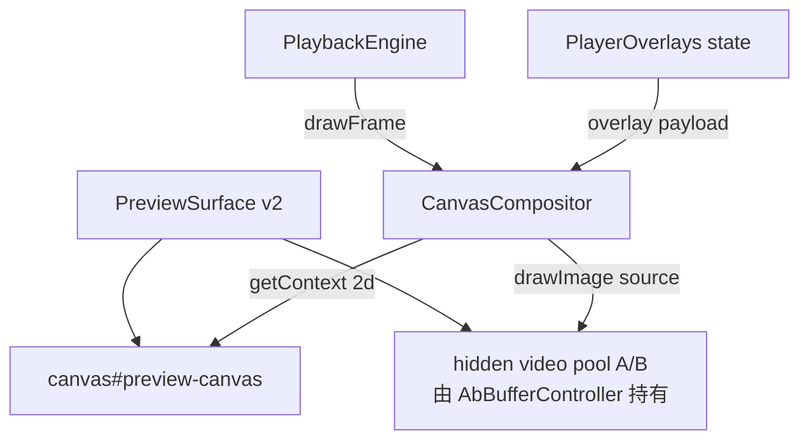

# Spec 03：Canvas 预览合成器

> 关联：[`master-plan.md`](../master-plan.md)、[`01-architecture-refactor.md`](01-architecture-refactor.md)、[`02-playback-state-machine.md`](02-playback-state-machine.md)
> 阶段：Phase 1（必做）
> 状态：草案

## 一、目的（Purpose）

实现 `CanvasCompositor`：在 `PlaybackClock` 每个 rAF tick 中，把当前 active `<video>` 的当前帧、图片叠加层、字幕层、视频比例边框统一绘制到一个 `<canvas>` 上。目的是：

- **消除 sequence 边界闪屏**：切 sequence 时只切换"绘制来源"，不切 `<video>.src` 也不重渲 DOM，画面零空帧。
- **统一图像处理边界**：图片叠加 / 字幕 / 比例裁切都在 canvas 层完成，避免现状中"DOM 叠层 + 比例 cssClass + ImageOverlay 元素"的多层抖动。
- **稳定布局**：`<canvas>` 尺寸由比例固定，不随 `<video>` intrinsic size 变化，根治"src 清空 → intrinsic size 变 0 → 布局抖动"现状。

## 二、范围

### 范围内

- 实现 `CanvasCompositor` 类（spec 01 中接口的真实实现）。
- 实现 `PreviewSurface.tsx`（v2 分支）：渲染 `<canvas>` + 一组隐藏 `<video>`（受 `AbBufferController` 控制）；管理 canvas DPR、resize、destroy 生命周期。
- 在 canvas 上绘制叠加层：图片叠加（已有 `ImageOverlay` 行为）、字幕、可选 watermark。
- 提供"截屏当前帧"接口，供封面工具复用（现状 `captureFrameToCanvas` 的替代）。

### 范围外

- A/B Buffer 内部预热机制（spec 04）。
- 视频解码或 WebCodecs（D10 不引入）。
- 字幕渲染引擎本身（沿用现有字幕数据源）。
- 导出阶段的最终视频合成（仍走后端 ffmpeg）。

## 三、组件结构



## 四、接口（Interfaces）

### 4.1 `CanvasCompositor`

> **与 spec 01 接口的关系**：spec 01 中 `ICanvasCompositor` 给出了最小骨架（`attach(canvas)` / `detach()` / `drawFrame(frame)`）。本 spec 在实现阶段对该接口做向后兼容扩展：
> - `attach` 增加可选 `viewport` 参数；不传时使用 canvas 当前物理像素并以 `'16:9'` 兜底。
> - 新增 `setOverlays` / `setLetterbox` / `setActiveSource` / `captureFrame` / `getStats` 方法。
> - 旧骨架调用方（spec 01 阶段的占位适配器）仅依赖三件套，保持可调用。

```
class CanvasCompositor implements ICanvasCompositor {
  constructor(options?: {
    targetFps?: number          // 默认 60；可降级 30
    backgroundColor?: string    // 默认 '#000000'
    useOffscreenIfAvailable?: boolean  // 默认 false（首期不开 OffscreenCanvas）
  })

  attach(canvas: HTMLCanvasElement, viewport?: ViewportSpec): void
  detach(): void

  setOverlays(overlays: OverlayPayload): void
  setLetterbox(viewport: ViewportSpec): void  // 比例切换时调用
  setActiveSource(video: HTMLVideoElement | null): void
    // 与 PreviewFrame.source 关系：setActiveSource 由 AbBufferController 在 swap 时主动
    // 通知，用于缓存当前活动元素引用（便于 captureFrame 等无 frame 入参的场景使用）；
    // drawFrame 仍以传入的 frame.source 为权威绘制来源，两者必须保持一致。

  drawFrame(frame: PreviewFrame): void  // 由 PlaybackEngine 每 tick 调用
  captureFrame(): { dataUrl: string; width: number; height: number }
  getStats(): { drawnFrames: number; droppedFrames: number; lastDrawMs: number }
}
```

### 4.2 类型

```
interface ViewportSpec {
  aspectRatioId: '16:9' | '9:16' | '4:3' | '1:1' | '21:9'
  // canvas 物理像素，由父容器 ResizeObserver 计算并乘以 devicePixelRatio
  pixelWidth: number
  pixelHeight: number
  // letterbox 颜色
  backgroundColor: string
}

interface OverlayPayload {
  images: ImageOverlayItem[]    // 已有 ImagePosition 类型
  subtitles: SubtitleItem[]     // 已有字幕数据
  watermark?: WatermarkItem
}

interface SubtitleItem {
  text: string
  startTime: number       // composition time
  endTime: number
  style: SubtitleStyle    // 字体/颜色/大小/边框
  anchor: 'bottom' | 'top' | 'custom'
  customPosition?: { x: number; y: number }   // 0..1 归一化
}
```

## 五、行为（Behaviour）

### 5.1 attach 与初始化

1. 取 canvas 物理像素：`pixelWidth = clientWidth * devicePixelRatio`，同 height。
2. `canvas.width / height` 设为物理像素；CSS `width / height` 由父容器 layout 决定。
3. 创建 2D context：`willReadFrequently=false`，开 `imageSmoothingQuality='high'`。
4. 监听父容器 `ResizeObserver`，尺寸变化时重设 canvas 物理像素 + 触发一次 redraw。

### 5.2 drawFrame 主流程

每个 tick：

```
function drawFrame(frame: PreviewFrame):
  if !ctx || !canvas: return
  startMs = performance.now()
  fillBackground(viewport.backgroundColor)
  if frame.source && frame.source.readyState >= HAVE_CURRENT_DATA:
    drawVideoLetterboxed(frame.source, viewport)
  else:
    keepLastFrame()   # 保留上一帧像素，不黑屏
  drawSubtitlesAt(frame.compositionTime)
  drawImageOverlays(frame.compositionTime)
  drawWatermark()
  stats.drawnFrames++
  stats.lastDrawMs = performance.now() - startMs
  if stats.lastDrawMs > 12: stats.droppedFrames++  # 单帧超过 12ms 视为接近预算上限
```

**关键细节**：
- `drawVideoLetterboxed` 用 `drawImage(video, dx, dy, dw, dh)` 在视频本身分辨率基础上 letterbox 到 viewport。
- `keepLastFrame()` 不主动清画布——只有 `fillBackground` 步骤会被跳过，由前一帧保留。该路径仅在 `frame.source` 暂时不可用（A/B 切换瞬间）触发，时长 < 1 帧。
- 字幕 / 图片在合成 video 帧之后绘制，确保叠在画面上方。

### 5.3 比例切换

- 接收 `setLetterbox(viewport)`：重设 viewport，下一帧使用新尺寸。
- 不需要重创 canvas / context；只是改变 letterbox 计算。

### 5.4 active source 切换（A/B 边界）

- `AbBufferController` 在 swap 时调用 `compositor.setActiveSource(newVideo)`。
- 同一 rAF tick 内 `drawFrame` 已使用 `newVideo`；前一帧的像素仍在 canvas 上，新帧覆盖前一帧 → 不黑屏。
- swap 必须在 newVideo `readyState ≥ HAVE_CURRENT_DATA` 之后调用（由 AbBufferController 保证）。

### 5.5 截帧

- `captureFrame()`：
  - 不调用 `video.pause()`；直接读 `canvas.toDataURL('image/png')`。
  - 用于封面工具（替代现状的 `captureFrameToCanvas`）。
  - 返回当前 canvas 物理像素尺寸。

### 5.6 暂停态

- 暂停时 Engine 不调用 `drawFrame`；canvas 保留上一帧不变。
- 用户拖动光标进入 `seeking` 时：
  - active video seek 完成后 Engine 调用一次 `drawFrame(frameAt(t))` 立即刷新一帧。
  - 拖动过程中 ruler 已显示用户期望位置（不依赖画面），画面在 seek 完成时跟上即可。

### 5.7 降级与性能保护

- 自适应：监测每 1s 的 `droppedFrames`，若 > 20% → 降级 `targetFps = 30`（rAF 内隔帧 draw）。
- 严重降级：连续 3s droppedFrames > 50% → 触发 `onDegrade('low-fps')` 事件，Engine 可显示提示但不强制改 flag。
- canvas 物理像素硬上限 1920×1080；高 DPR + 大窗口时按比例缩放，导出仍取原片。

### 5.8 销毁

- `detach()`：
  - 取消 ResizeObserver。
  - 释放 2D context（清空 canvas，置 `width=0` 触发驱动释放）。
  - 不卸载 `<canvas>` DOM 节点（由 React 负责）。

## 六、PreviewSurface 组件

`PreviewSurface.tsx`（v2 分支）：

```
<PreviewSurface
  variant="v2"
  aspectRatioId={selectedAspectRatioId}
  overlays={overlays}                  // 来自 PlayerOverlays state
  compositor={compositorInstance}      // 由 VideoPlayerPanel 持有
  abBufferVideoRefs={[refA, refB]}     // 隐藏 <video> 池
/>
```

行为：
- 渲染 `<canvas ref={canvasRef} />`，包裹在 `aspect-{ratio}` 容器中。
- 渲染两个 `<video ref={refA} hidden muted playsInline preload="auto" />` 和 `<video ref={refB} ... />`。
- `useEffect` mount 时 `compositor.attach(canvas, viewport)`；unmount 时 `compositor.detach()`。
- `useEffect` 依赖 `aspectRatioId` 变化 → `compositor.setLetterbox(...)`。
- 不直接 setState 任何与帧相关的状态。

`PreviewSurface.tsx`（legacy 分支）：保持 spec 01 已抽出的旧路径，使用单个 `<video>` 与现状逻辑。

## 七、数据形态（Data Shapes）

无新数据库 / API 字段。`OverlayPayload` 来自既有 `ImagePosition`、字幕数据源。

## 八、性能预算

- 单 tick 绘制（1080p、3 张图片叠加、字幕一行）目标 ≤ 4ms。
- canvas 物理像素 ≤ 1920×1080；DPR > 2 时仍按 2 截断。
- `getStats()` 暴露给遥测（spec 08），上报 drawn / dropped。

## 九、测试

- `src/components/video/playback/__tests__/CanvasCompositor.test.ts`
  - mock `<canvas>` 2D context；断言 `drawImage` 调用顺序：fill → video → subtitles → images
  - `setActiveSource(null)` 不清画面（不调用 `fillRect`）
  - DPR=2 时 canvas.width/height 正确缩放
- `src/components/video/components/VideoPlayerPanel/__tests__/PreviewSurface.v2.test.tsx`
  - mount/unmount 时 compositor.attach/detach 调用对称
  - aspectRatioId 变化触发 setLetterbox

集成测试由 spec 02、04 的端到端用例覆盖。

## 十、Open Questions

1. **字幕渲染**：是否完全在 canvas 上画？复杂字幕（HTML 富文本）画起来困难，倾向"简单字幕直接 canvas 画文本；HTML 富文本走 DOM 叠在 canvas 上方"。本 spec 默认简单字幕走 canvas，复杂场景留口。
2. **是否首期使用 OffscreenCanvas + Web Worker？** 倾向：不开。主线程 60fps 实测应该够；若实测瓶颈再 Phase 2 引入。
3. **图片叠加交互（拖动 / 调整大小）**：现状是 DOM 层 `ImageOverlay` + 边框 handle。Canvas 内绘制图像后，交互层（handle）仍保留 DOM 在 canvas 上方，绘制由 canvas 负责。
4. **画质 vs 性能**：`imageSmoothingQuality='high'` 在低端机型可能拖慢；探测降级时是否同时降到 'medium'？建议是。

## 十一、参考

- [`master-plan.md`](../master-plan.md) §4.2（CanvasCompositor 职责）、§5（D1/D11 决策）
- [`02-playback-state-machine.md`](02-playback-state-machine.md) §5.1 / §5.3（drawFrame 时机）
- 现状：`VideoPlayerPanel.tsx` 中的 `captureFrameToCanvas`、`canvasRef`、`ImageOverlay` 用法（将被替代/集成）
- 现状：`src/components/video/components/VideoCoverModal/components/CoverPreview.tsx`（截帧消费方）
