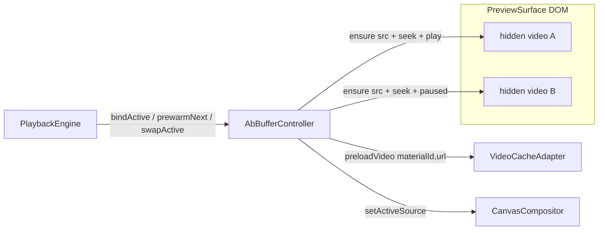
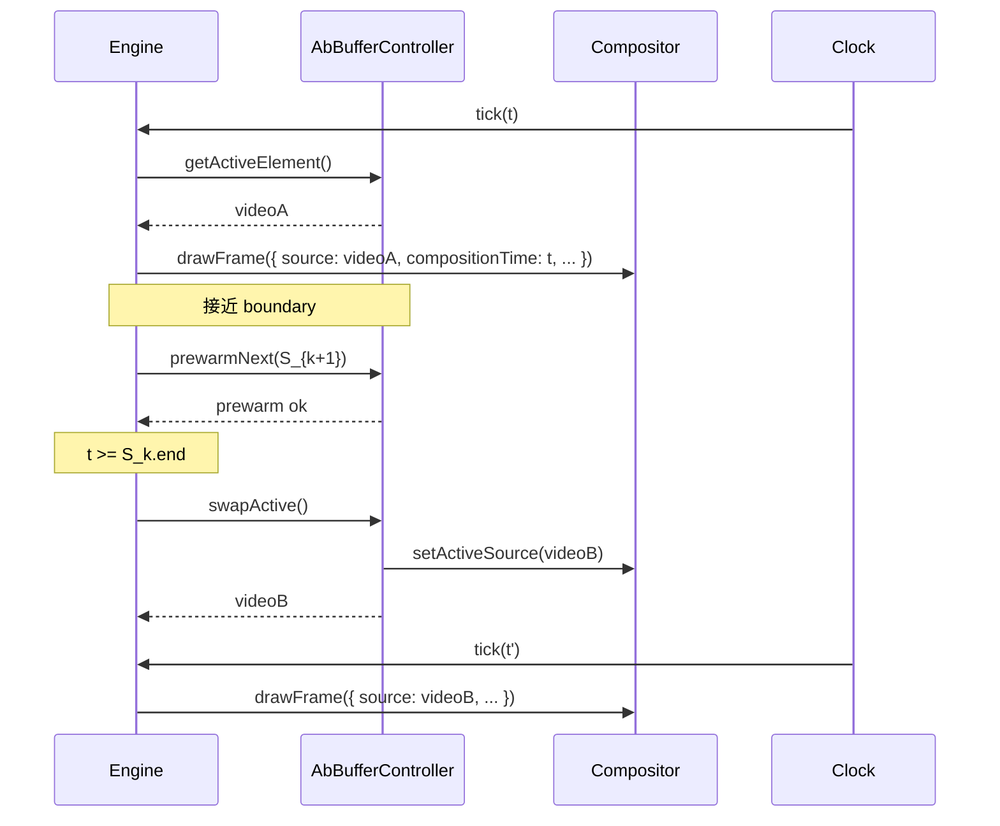

# Spec 04：A/B 双缓冲与预加载策略

> 关联：[`master-plan.md`](../master-plan.md)、[`02-playback-state-machine.md`](02-playback-state-machine.md)、[`03-canvas-compositor.md`](03-canvas-compositor.md)
> 阶段：Phase 1（必做）
> 状态：草案

## 一、目的（Purpose）

实现 `AbBufferController`：以两个隐藏 `<video>` 元素 A / B 交替承担当前与下一 sequence 的解码，配合 `VideoCacheAdapter` 实现：

- **零感知边界切换**：当前 sequence 即将结束前 ≥ PREWARM_LEAD 秒，B 已 `seek 到下一 sequence 起点 + readyState ≥ 3`；boundary 帧 Engine 调用 `swapActive()`，A → B 切换在同一 rAF tick 完成。
- **快速 seek**：用户拖动到非活动 sequence 时，复用 B（如已预热）或重置 A，避免每次都重新 attach src。
- **窗口式预取**：以当前时间为中心，预取附近 N 个 sequence 的 metadata + 头部 1–2s 字节，让首播无延迟。

## 二、范围

### 范围内

- 实现 `AbBufferController` 类。
- 与 `VideoCacheAdapter` 协作的窗口式预取调度（拓宽现有 LRU 缓存策略）。
- 与 `PlaybackEngine` 的协议（bindActive / prewarmNext / swapActive / releaseAll）。
- 单/多 sequence 与短 clip 的退化策略。

### 范围外

- 远端 URL 同源代理重写（spec 05/07 提供）。
- 后端 preview proxy 转码（spec 06）。
- `<video>` 元素的 DOM 渲染：由 spec 03 的 `PreviewSurface` 负责。

## 三、A/B Buffer 模型



### 3.1 角色（role）

- 任意时刻 A 与 B 各持有一个 role：`active` / `prewarm` / `idle`。
- 当前播放 sequence 由 `active` 元素承担；下一 sequence（如已知）由 `prewarm` 元素承担。
- swap 时 role 翻转：旧 active → idle / 重用为新 prewarm；旧 prewarm → active。

### 3.2 元素属性约束

每个 buffer 元素**初始挂载属性**：
- `muted=true`（DOM 默认；运行时由 §5.6 音频策略动态翻转：active=非 muted、prewarm/idle=muted）
- `playsInline=true`
- `preload='auto'`
- `controls=false`，CSS `display=none` 或 `position:absolute; opacity:0; pointer-events:none`
- 不直接显示在 DOM 中；画面由 CanvasCompositor 通过 `drawImage(videoEl)` 抽取

## 四、接口（Interfaces）

> **与 spec 01 接口的关系**：spec 01 中 `IAbBufferController` 给出了最小骨架（`bindActive` / `prewarmNext` / `getActiveElement` / `releaseAll`）。本 spec 在实现阶段对该接口做向后兼容扩展：
> - 新增 `swapActive(): HTMLVideoElement`：boundary 帧由 Engine 调用，同 tick 内翻转 active/prewarm role。
> - 新增 `getPrewarmElement(): HTMLVideoElement | null`：便于 Engine / 测试探测预热态。
> 旧骨架调用方（spec 01 阶段的占位适配器）仅依赖四件套，保持可调用。

```
class AbBufferController implements IAbBufferController {
  constructor(deps: {
    videoCache: IVideoCachePort,      // 扩展自现有 VideoCacheAdapter
    refA: React.RefObject<HTMLVideoElement>,
    refB: React.RefObject<HTMLVideoElement>,
    compositor: ICanvasCompositor,    // swap 时通知 setActiveSource
    options?: {
      prewarmLeadSec?: number         // 默认 1.0
      maxSeekMsBeforeForceRebind?: number  // 默认 500
      shortClipThresholdSec?: number  // 默认 1.5（短于此则不使用 prewarm）
    }
  })

  // 把指定 sequence 装到 active buffer，seek 到 localTime。
  // 解决 Promise 后 caller 可立即调用 play()。
  bindActive(sequenceId: string, localTime: number): Promise<HTMLVideoElement>

  // 预热下一个 sequence 到 prewarm buffer：set src → seek 到起点 → wait readyState>=3
  prewarmNext(sequenceId: string): Promise<void>

  // 当前帧切换：prewarm → active，旧 active 退化为可复用 idle
  // Engine 在 boundary 帧调用；同 tick 内必须返回新 active 元素
  swapActive(): HTMLVideoElement

  getActiveElement(): HTMLVideoElement | null
  getPrewarmElement(): HTMLVideoElement | null
  releaseAll(): void   // unmount / dispose 调用，pause + remove src + clear cache hold
}
```

## 五、行为（Behaviour）

### 5.1 bindActive 流程

```
bindActive(sequenceId, localTime):
  S = lookupSequence(sequenceId)
  url = effectivePreviewUrl(S)        # 由 spec 07 的 selectPlaybackUrl + proxy rewrite 决定

  candidate = pickBufferForActive(S)   # 优先复用 prewarm（src 匹配），否则用 idle，最后 fallback A
  if candidate.src !== url:
    candidate.src = url
    wait_for_event(candidate, 'loadedmetadata')   # 或超时 1s
  candidate.currentTime = clamp(localTime, 0, S.duration)
  wait_for_event(candidate, 'seeked')              # 或超时 maxSeekMsBeforeForceRebind
  if not seeked_in_time:
    # 重建：移除 src 重设
    candidate.removeAttribute('src')
    candidate.load()
    candidate.src = url
    wait_for_event(candidate, 'loadedmetadata')
    candidate.currentTime = clamp(localTime, ...)
    wait_for_event(candidate, 'seeked')
  assign role(candidate, 'active')
  compositor.setActiveSource(candidate)
  videoCache.markUsed(sequenceId)
  return candidate
```

要点：
- 超时降级是为了避免远端长卡或某些浏览器在 `currentTime=0` 不触发 seeked 的 bug。
- `effectivePreviewUrl` 由 spec 07 给出，本 spec 直接调用。

### 5.2 prewarmNext 流程

```
prewarmNext(sequenceId):
  if S.duration < shortClipThresholdSec: return  # 太短不值得预热
  buf = pickBufferForPrewarm()  # 取另一个非 active 元素
  if buf.src !== url:
    buf.src = url
    wait_for_event(buf, 'loadedmetadata')
  buf.currentTime = 0
  wait_for_event(buf, 'seeked')
  # 不调用 play()；等待 swap 时由 Engine 触发
  buf.pause()
  videoCache.preloadVideo(S.id, url)  # 同时让 VideoCacheAdapter 在 LRU 中标记
  assign role(buf, 'prewarm')
```

### 5.3 swapActive（边界切换）

```
swapActive():
  prewarm = current prewarm buffer
  if !prewarm or prewarm.readyState < HAVE_FUTURE_DATA:
    # 退化：prewarm 未就绪 → 走 bindActive 串行
    return bindActive(nextSequence.id, 0)
  active = current active buffer
  prewarm.play()                # 启动新 active 解码
  compositor.setActiveSource(prewarm)
  active.pause()                # 旧 active 释放解码
  swap roles
  return new active (= prewarm)
```

关键：
- `setActiveSource` 在 `prewarm.play()` 之后立刻调用；CanvasCompositor 下一 rAF tick 即用新元素绘制。
- 不在 swap 内执行 src 卸载（释放交给后台 idle）。
- 与 spec 02 §5.3 协议对齐：spec 02 时序图中描述的 `ensurePrewarmed(S_{k+1})` 即对应本 spec 的 `prewarmNext(S_{k+1}.id)`（由 Engine 在 `compositionTime ≥ S_k.end - PREWARM_LEAD` 时提前调用，见 spec 02 §5.1 step 5）；boundary 帧统一通过 `swapActive()` 完成切换，未就绪时由本 spec §5.3 的退化分支兜底，无需 Engine 额外判断。
- 与 spec 03 §5.4 协议对齐：spec 03 要求 swap 前 `newVideo.readyState ≥ HAVE_CURRENT_DATA`（≥ 2）；本 spec 收紧到 `HAVE_FUTURE_DATA`（≥ 3），属于更严格的兼容约束。

### 5.4 idle 元素回收

- swap 后旧 active 变成 idle。
- 若 timeline 后续可能"回退"播放：保留 src，currentTime 不动；下次 bindActive 命中可省一次 load。
- 若内存压力（`VideoCacheAdapter` 报警）：清 idle 元素的 src（`removeAttribute('src'); load()`）。

### 5.5 短 clip 与单 video 情况

- `duration < shortClipThresholdSec`（默认 1.5s）：
  - 不调用 `prewarmNext`；boundary 直接调用 `bindActive` 串行切换。
  - 短 clip 拼接通常出现在快速剪辑场景，允许 1–2 帧黑闪（可由 keepLastFrame 缓解）。
- 单 sequence 预览（`compositionPlayback` 仅一段）：
  - 只用 A，不调用 prewarm。
  - boundary = composition end → Engine 直接进 `ended`。

### 5.6 音频策略

- A/B Buffer 元素 **统一 muted**。
- 实际音频走 active 元素的副本或独立 `<audio>` 池（沿用现状）。
  - 默认实现：active 元素**取消 muted**，由 Engine 控制 volume。
  - swap 时：新 active 先 muted 接管画面，1 帧后取消 muted；旧 active 立即 muted；交叉 < 16ms，听感平滑。
- 后续 Phase 2 可换成 WebAudio mixer，与画面解耦。

### 5.7 与 VideoCacheAdapter 协作

`VideoCacheAdapter` 现状（spec 07 会扩展）：
- LRU 容量从 20 提到 32（覆盖 16:9 + 9:16 + 短视频常见组合）。
- 新增 `markUsed(materialId)` 更新 LRU 时间戳。
- 新增 `preloadSequenceWindow(materials: Array<{id, url, priority}>)` 由 Engine 在 phase=preparing/playing 时调度。

预热窗口策略：
- 以当前 sequenceIndex 为中心，预取 `[k-1, k, k+1, k+2]` 的 metadata + 头部 1s。
- 远端素材（spec 05 代理）优先级高于本地。

### 5.8 错误与重试

- `bindActive` 超时（默认 5s）→ throw `BufferError('bind-timeout', sequenceId)`；Engine 接收后进入 `stalled`。
- `prewarmNext` 失败 → 不抛错（best effort）；Engine 在 boundary 退化到 `bindActive`。
- 元素 `error` 事件 → 标记元素失败，重建（remove src + load + reassign）一次；再失败 → 抛错。

## 六、PreviewFrame 与 source 同步



## 七、内存与并发

- 同一项目活跃 buffer 数 = 2（A、B）+ 最多 1 个 idle src 持有。
- VideoCacheAdapter 仍持有 LRU 中的"未挂载到 DOM 但已创建"的 video element（最多 32）；元素物理存在于 adapter 内部的隐藏容器（非 PreviewSurface DOM）。
- 同时只允许 1 个 `bindActive`、1 个 `prewarmNext` 在飞；新调用若已存在同 buffer 飞行任务，取消旧任务。

## 八、测试

- `src/components/video/playback/__tests__/AbBufferController.test.ts`
  - bindActive 成功路径
  - prewarmNext 成功路径
  - swapActive 在 prewarm ready 时：< 1 tick 切换
  - swapActive 在 prewarm 未就绪：fallback 到 bindActive
  - 短 clip 跳过 prewarm
  - error 重建一次后成功 / 二次失败抛错
- `src/components/video/playback/__tests__/abBuffer.integration.test.ts`
  - 与 mock VideoCacheAdapter 协作的 window prefetch 调用
- 性能基准（手动）：
  - 10 sequence 拼接 10s 视频，boundary 闪屏目视不可见

## 九、Open Questions

1. **`prewarmLeadSec`** 默认 1.0s 是否够？低端机型 + 4K 可能不够，建议接入降级表（依据测得 `bindActive` P95 自适应到 1.5s/2s）。
2. **第三个 buffer C 是否值得？** 用于 random seek 跨多个 sequence 的场景。倾向不增加：seek 走 bindActive 重用 A 即可；保留 future hook。
3. **音频切换毛刺**：默认策略是否需要交叉淡入淡出（fade 30ms）？倾向保留 spec 11/后续工作；首期接受瞬间 mute 切换。
4. **`HAVE_FUTURE_DATA`（readyState=3）够用还是要 `HAVE_ENOUGH_DATA`（4）？** 倾向 3 即开始 play，剩余缓冲由网络补；如观察到立即 stalled 再提升到 4。

## 十、参考

- [`master-plan.md`](../master-plan.md) §5（D4 决策）、§7（R2 短 clip 风险）
- [`02-playback-state-machine.md`](02-playback-state-machine.md) §5.1 / §5.3（边界切换交互）
- [`03-canvas-compositor.md`](03-canvas-compositor.md) §5.4（setActiveSource 协议）
- 现状：`src/components/video/timeline/infrastructure/VideoCacheAdapter.ts`（LRU = 20，sameOriginOnly=true，本 spec 配套扩展由 spec 07 提供）
- 现状：`VideoPlayerPanel.tsx` 中的 `transitionIdRef`、`isSeekingRef`、`pendingCompositionSeekRef`、`releaseSeekLock`（本 spec 上线后退役）
