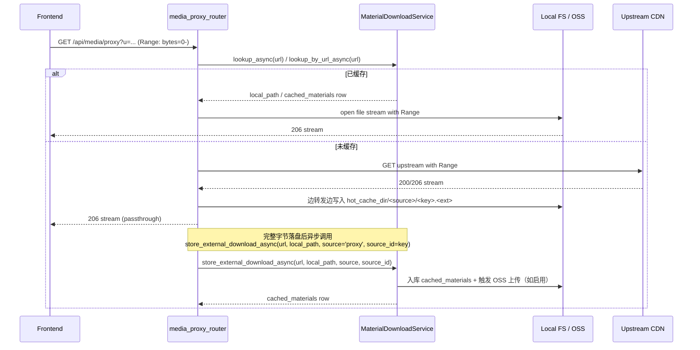

# Spec 05：后端远端素材同源代理

> 关联：[`master-plan.md`](../master-plan.md)、[`07-frontend-cache-integration.md`](07-frontend-cache-integration.md)
> 阶段：Phase 1（必做）
> 状态：草案

## 一、目的（Purpose）

为远端素材（Pexels / Unsplash / ARK / 任意 HTTPS）提供同源、支持 Range 的流式代理端点 `/api/media/proxy`，从而：

- **解决跨域**：浏览器 `<video>.crossOrigin` 与 Range 请求在第三方 CDN 上不稳定，统一改为同源即可。
- **降低首字节延迟**：首次代理把素材落到阿里云 OSS（同区域），后续命中 OSS。
- **复用现有缓存**：与 `cached_materials` 表融合，与 `material_svc.store_external_download_async` 协同。
- **稳定字节流**：保证 `Accept-Ranges: bytes`，让浏览器 `<video>` 在 seek 时只下载需要的字节段。

## 二、范围

### 范围内

- 新增路由：`backend-services/basic-service/app/routers/media_proxy_router.py`，挂载到 `/api/media`。
- 新增服务：`app/services/media_proxy_service.py`。
- 路由：
  - `GET /api/media/proxy?u=<encoded_url>&material_id=<optional>`：代理拉取，支持 Range。
  - `GET /api/media/proxy/status?u=<encoded_url>`：返回缓存状态、字节进度。
- 与 `MaterialDownloadService`（`app/services/material_download_service.py`，CLAUDE.md 中俗称 `material_svc`）协作：若 `material_id` 命中且本地或 OSS 已有副本 → 直接流式转发；未命中则边代理边缓存。
- 安全：白名单域名（Pexels CDN、ARK / 火山域、Unsplash、用户库自有上传 OSS 域），防 SSRF。
- 配置：`config/media-proxy-config.yaml`。

### 范围外

- 转码（spec 06 负责）。
- 前端缓存集成与 URL 重写（spec 07）。
- 数据库 schema 变更（沿用现有 `cached_materials`，必要时仅加一个 `proxy_status` 字段）。

## 三、接口（Interfaces）

### 3.1 `GET /api/media/proxy`

**Query params**

| 参数 | 必填 | 说明 |
|------|------|------|
| `u` | 是 | URL-encoded 的原始远端 URL。需通过白名单校验 |
| `material_id` | 否 | 已知 `cached_materials.id`；提供时跳过 URL 查找直接读表 |
| `quality` | 否 | `original`（默认）。`preview` 由 spec 06 处理，本端点拒绝该值 |

**响应**

- `200 OK`（无 Range）或 `206 Partial Content`（有 Range）。
- Headers：
  - `Content-Type`：从源响应继承（`video/mp4` / `image/jpeg` 等），未知则 sniff。
  - `Accept-Ranges: bytes`
  - `Content-Length` / `Content-Range`：按规范。
  - `Cache-Control: public, max-age=86400`。
  - `X-Proxy-Cache: hit | miss | partial`。
  - `X-Material-Id: <uuid>`（若命中或 ingest 成功）。
- 体：流式（chunked transfer）。

**错误响应**

| HTTP | error_code | 含义 |
|------|------------|------|
| 400 | `proxy.invalid_url` | URL 解析失败 |
| 403 | `proxy.domain_not_allowed` | 域名不在白名单 |
| 413 | `proxy.payload_too_large` | 上游 `Content-Length` 或累计字节超过 `max_size_mb` |
| 502 | `proxy.upstream_error` | 上游返回 5xx 或网络错误 |
| 504 | `proxy.upstream_timeout` | 上游 30s 内未首字节 |

### 3.2 `GET /api/media/proxy/status`

**响应**（`200 OK`）

```
{
  success: true,
  data: {
    cache_state: 'absent' | 'partial' | 'cached',
    bytes_cached: number,
    bytes_total: number | null,
    last_updated: ISO8601 | null,
    material_id: string | null
  }
}
```

## 四、行为（Behaviour）

### 4.1 总体流程



### 4.2 缓存键（cache key）

- 主键：`sha256(normalized_url)` 取前 16 字节 hex 编码（32 字符）作为 `proxy_cache_key`，可放入现有 `source_id String(128)`。
- `normalized_url = url.lower().strip().split('?')[0]`（去 query；除非属于白名单"必须保留 query"的源，如带签名的 ARK 临时 URL → 见 4.5）。
- **`source` 选择**：若调用方传入 `material_id`，直接以其 `(source, source_id)` 复用现有行；否则按 URL host 做启发式归类：
  - host 匹配 `*.pexels.com` → `source='pexels'`、`source_id=<已知 pexelsId>`（若可从 path 抽取，否则降级 `generic`）。
  - host 匹配 ARK / 火山域 → `source='ark'`，`source_id=<ARK task_id from path>`。
  - 其余 → `source='generic'`，`source_id=sha256(normalized_url)[:32]`。
- 现有表约束 `UniqueConstraint(source, source_id)` 必须保持；`generic + sha256` 命名空间与 Pexels/ARK 等命名空间天然不冲突。
- 若 host 可归类但 path 抽不出 id（罕见），fallback 到 `generic + sha256`，记 warn 日志。

### 4.3 白名单与签名 URL 处理

- 配置文件 `media-proxy-config.yaml`：
  ```
  allowed_domains:
    - "*.pexels.com"
    - "*.unsplash.com"
    - "*.volcengineapi.com"
    - "ark-content-generation*.tos-cn-*.volces.com"
    - "*.aliyuncs.com"
    # 用户上传 OSS 域，运维填入
  signed_url_domains:
    - "ark-content-generation*.tos-cn-*.volces.com"   # 带短期签名
  fetch_timeout_seconds: 30
  max_size_mb: 1024            # 单文件上限
  concurrent_downloads: 16
  hot_cache_dir: "static/uploads/cached_materials"   # 沿用现状
  ```
- 对 `signed_url_domains` 中的源，缓存 key 仅基于 path + ARK task_id（从 url path 提取），忽略签名 query，避免每次签名变化都重新拉。

### 4.4 Range 支持

- 收到 Range 时：
  - 命中本地缓存：直接对本地文件做 Range I/O，返回 206。
  - 命中 OSS：使用 OSS Range API，直接转发字节流。
  - 未命中：上游有 Range 支持 → 透传 Range 头，并把字节并行写到本地缓存（双流）；上游无 Range → 改请求全量；前端会收到 200（非 206），不影响播放但 seek 性能下降。

### 4.5 并发与去重

- 同一 `proxy_cache_key` 同时只允许一个上游全量拉取：服务内维护 `dict[str, asyncio.Lock]`（弱引用 + 用完即清），单进程 worker 范围内有效。
- 其他并发请求 `await lock.acquire()` 前快速 polling 部分文件大小，写入达到阈值（如 256KB）即开始读取已落盘字节并跟随尾部增长（tail-follow）；落盘完成后转为正常 Range I/O。
- 多 worker 场景（uvicorn `--workers>1`）：进程间无共享锁，最坏情况是每个进程独立拉一次；通过 `cached_materials` 入库后的查表去重，避免长期重复。

### 4.6 安全与 SSRF 防护

- URL scheme 必须 `https`（`http` 仅在 dev 配置 `enable_http: true` 时允许）。
- 主机白名单匹配（4.3 节 `allowed_domains`），通配符仅允许左前缀（`*.domain` / `prefix*.suffix`），不允许裸 `*`。
- DNS 解析后 IP 不在私有/保留网段（10/8、172.16/12、192.168/16、127/8、169.254/16、0.0.0.0/8、IPv6 ::1、fc00::/7、fe80::/10）。**解析与连接均使用同一 IP**（拒绝 DNS rebinding：解析一次后传给 httpx 使用该 IP，Host 头保留原始）。
- 上游重定向：默认 `follow_redirects=False`；如需跟随，按相同白名单 + IP 规则重新校验，最多 3 跳。
- 总下载大小硬上限 `max_size_mb`；超过即中断并标记 `proxy_status=error`，返回 413。
- 速率限制：单 IP 100 req/min（per-user 限流见 §9 Q4）。
- 仅响应 `GET`/`HEAD`，禁止透传 `Authorization`、`Cookie` 等敏感请求头到上游。

### 4.7 与 material_svc 协同

- 现状：`MaterialDownloadService.store_external_download_async(url, local_path, source, source_id)`（`app/services/material_download_service.py`）接收**已落地到磁盘的文件路径**，将其登记进 `cached_materials` 表；OSS 上传由该服务内部按 `OSS_ENABLED` 决定。
- 本 spec 复用：
  - 优先用 `lookup_async` / `lookup_by_url_async` 命中 `cached_materials.local_path`，直接走本地 Range I/O。
  - 未命中时上游字节 → 边转发边管道写盘到 `hot_cache_dir/<source>/<source_id>.<ext>`；**字节流结束并校验大小后**再以 `local_path` 调用 `store_external_download_async`，不阻塞响应。
  - 中途客户端断开 → 删除未完成的临时文件并将 `proxy_status` 置为 `partial` / `error`，下次请求重新拉取。
- `local_url`（前端可用）：返回 header `X-Material-Local-Url`，规则按 CLAUDE.md：`"/api/storage/files/cached_materials/" + source + "/" + basename(local_path)`。前端可选择把同一段后续请求直接换为该路径，绕开代理层。

## 五、配置（Config）

`backend-services/basic-service/config/media-proxy-config.yaml`：

```
proxy:
  allowed_domains: [...]
  signed_url_domains: [...]
  fetch_timeout_seconds: 30
  upstream_connect_timeout_seconds: 5
  max_size_mb: 1024
  concurrent_downloads: 16
  hot_cache_dir: "static/uploads/cached_materials"
  enable_http: false           # dev only
  per_ip_rate_limit_per_min: 100

oss:
  enabled_via: "OSS_ENABLED"  # 沿用现有变量
  bucket_subprefix: "media-proxy-cache/"
```

环境变量覆盖：`MEDIA_PROXY_MAX_SIZE_MB`、`MEDIA_PROXY_CONCURRENT_DOWNLOADS`。

## 六、数据形态（Data Shapes）

`cached_materials` 表新增可选字段（Alembic 迁移）：

| 字段 | 类型 | 说明 |
|------|------|------|
| `proxy_status` | enum(`absent`, `partial`, `cached`, `error`) | 当前代理缓存状态 |
| `proxy_last_updated` | timestamp | 最近一次写入时间 |
| `proxy_bytes_cached` | bigint | 本地已写入字节数（partial 时有意义） |

迁移：`alembic/versions/xxxx_add_media_proxy_status.py`。

不修改已有字段。

## 七、性能与容量

- 单 worker 并发拉取上限：`concurrent_downloads`（默认 16，由 `QueueManager` 限流）。
- 单文件上限：`max_size_mb` MB（默认 1024）。
- OSS 缓存超期回收：不在本 spec；可配合现有清理任务（如有）或后续 ops 工作。
- 预期 RTT：同区 OSS 命中 P95 < 200ms；首次拉取（首字节）< 800ms（master-plan 验收指标）。

## 八、测试

- `tests/test_media_proxy.py`
  - 正常 200 / 206 流式
  - Range 请求精确返回 bytes
  - 未知 host → 403
  - 私有 IP → 403
  - 超大文件 → 413（或流中断 + 截断）
  - 并发同 key 仅 1 个上游
  - 缓存命中复用本地文件
- `tests/test_media_proxy_integration.py`（mock httpx + 本地 FS）
  - 完整 cache miss → store_external_download_async → cached 路径

## 九、Open Questions

1. **OSS 上传策略**：是先落本地 FS 再异步上 OSS（现状模式），还是直接 stream 上 OSS？倾向沿用现状（本地 FS 优先，OSS 异步备份）。
2. **签名 URL TTL 过期**：ARK 任务签名 URL 有效期短；若本地已缓存，无需再次签名，但若用户复制旧链接发到他人电脑触发首次代理 → 上游已 403。建议：前端在 ingest 时立刻调用 `/api/media/proxy` 触发首次缓存，未来一律走本地。
3. **`X-Material-Local-Url` 是否必要**：spec 07 中前端 `selectPlaybackUrl` 可直接读 `/api/material/lookup` 返回的 `local_url`，不必依赖 header。倾向保留 header 作为优化路径，spec 07 选择最简方案。
4. **速率限制是否细分 user**：目前按 IP；登录用户 + 高频代理可能误伤。可后续扩展为 per-user。

## 十、参考

- [`master-plan.md`](../master-plan.md) §4.2（media_proxy_router 职责）、§5（D5 决策）、§7（R4 / R9 风险）
- CLAUDE.md：缓存远程素材现状（`cached_materials` 表、`material_svc.store_external_download_async`）
- 现状：`app/routers/material_router.py`（ingest / lookup 端点）
- 现状：`app/services/material_download_service.py`（CLAUDE.md 俗称 `material_svc`）
