# Spec 06：后端低清预览代理（Preview Proxy）转码

> 关联：[`master-plan.md`](../master-plan.md)、[`05-backend-media-proxy.md`](05-backend-media-proxy.md)、[`07-frontend-cache-integration.md`](07-frontend-cache-integration.md)
> 阶段：Phase 2（推荐）
> 状态：草案

## 一、目的（Purpose）

为高码率 / 高分辨率素材（4K、HEVC、≥ 20Mbps H.264 等）按需生成 **低清预览代理**（480p / ~1Mbps / H.264 baseline / fragmented MP4，moov 前置），存于阿里云 OSS，供前端预览路径优先使用：

- 高码率原片解码会被浏览器/显卡瓶颈拖慢，导致 60fps 不稳；预览代理可瞬间起播、稳定 60fps。
- 导出（export）仍走原片，画质不受影响（master-plan D7）。
- 与 spec 05 的同源代理协作：预览代理同样通过 `/api/media/proxy?u=...` 路径可访问，前端不需要感知"代理 URL 还是原 URL"。

## 二、范围

### 范围内

- 新增路由：`backend-services/basic-service/app/routers/preview_proxy_router.py`，挂载到 `/api/media/preview-proxy`。
- 新增服务：`app/services/preview_proxy_service.py`（基于 FFmpeg 异步转码任务）。
- 新增队列与状态管理：`preview_proxies` 任务记录（可附加在 `cached_materials` 表或独立子表）。
- 与 `material_download_service` 协作：转码完成后回写 `cached_materials.preview_proxy_local_url` / `preview_proxy_oss_url` / `preview_proxy_status`（字段定义见 §六，与 spec 05 新增的 `proxy_*` 字段命名空间不冲突）。
- 新增配置：`config/preview-proxy-config.yaml`。
- 端点：
  - `POST /api/media/preview-proxy`：请求为指定 material 生成 preview proxy（幂等，可指定档位）。
  - `GET /api/media/preview-proxy/status?material_id=...`：查询任务进度。
  - `GET /api/media/preview-proxy/file?material_id=...`：下载已生成的 preview proxy（302 → OSS 或直接流式）。

### 范围外

- 原片同源代理（spec 05）。
- 前端 URL 选择策略（spec 07）。
- 多档位（720p / 1080p 预览）—— 首期只 480p。

## 三、接口（Interfaces）

### 3.1 `POST /api/media/preview-proxy`

**Request body**

```
{
  material_id: string,            // cached_materials.id 或新 ingest 的 id
  source_url?: string,            // 必填若 material 未入库；本端点会先 trigger ingest
  profile?: 'preview-480p'        // 默认 'preview-480p'
  priority?: 'normal' | 'high'    // 默认 normal
}
```

**Response**（`202 Accepted`）

```
{
  success: true,
  data: {
    task_id: string,
    material_id: string,
    profile: 'preview-480p',
    status: 'queued' | 'running' | 'cached' | 'failed',
    preview_proxy_url: string | null,   // 若已存在直接返回
  }
}
```

幂等：若 `(material_id, profile)` 已存在且 status=`cached` → 直接返回 `cached`，不重转码。

### 3.2 `GET /api/media/preview-proxy/status`

**Query**：`material_id`、可选 `profile`

**Response**

```
{
  success: true,
  data: {
    material_id: string,
    profile: string,
    status: 'absent' | 'queued' | 'running' | 'cached' | 'failed',
    progress_percent: number,             // 0..100
    last_error: string | null,
    preview_proxy_url: string | null,     // OSS public URL 或同源 /api/media/proxy?u=...
    transcoded_at: ISO8601 | null,
    duration_sec: number | null,
    bytes: number | null
  }
}
```

### 3.3 `GET /api/media/preview-proxy/file`

- 若已生成：301/302 → `cached_materials.preview_proxy_local_url`（同源），或代理 OSS。
- 未生成：返回 404 + `error_code='preview_proxy.not_ready'`。

## 四、行为（Behaviour）

### 4.1 总体流程

```mermaid
sequenceDiagram
  participant FE as Frontend
  participant PP as preview_proxy_router
  participant PS as preview_proxy_service
  participant Q as QueueManager(preview)
  participant FF as ffmpeg subprocess
  participant CACHE as Local FS + OSS

  FE->>PP: POST /api/media/preview-proxy { material_id }
  PP->>PS: ensure_or_enqueue(material_id, profile)
  alt 已 cached
    PS-->>PP: { status: cached, url }
    PP-->>FE: 202 { status: cached, url }
  else 未生成
    PS->>Q: submit task
    PS-->>PP: { task_id, status: queued }
    PP-->>FE: 202 { task_id, status: queued }
    Q->>FF: ffmpeg -i <input> [filters] <output.mp4>
    FF-->>Q: progress (-progress pipe)
    FF-->>Q: exit 0
    Q->>CACHE: 写本地 preview-proxies/<material_id>/480p.mp4
    Q->>CACHE: 上传 OSS preview-proxies/<material_id>/480p.mp4
    Q->>PS: callback(success, url, duration, bytes)
    PS->>DB: update cached_materials.preview_proxy_* fields
  end
```



### 4.2 FFmpeg 转码参数（profile=`preview-480p`）

```
ffmpeg -i <input>
  -vf "scale='if(gt(iw,ih),854,-2)':'if(gt(iw,ih),-2,854)'"  # 长边 ≤ 854 (480p 长边)
  -c:v libx264 -profile:v baseline -level 3.1
  -preset veryfast
  -crf 28
  -maxrate 1200k -bufsize 2400k
  -movflags +empty_moov+frag_keyframe+default_base_moof
  -frag_duration 1000000              # 1s 分片（微秒）
  -g 60 -keyint_min 60 -sc_threshold 0
  -c:a aac -b:a 96k -ar 44100 -ac 2
  -threads 2
  -y <output.mp4>
```

要点：
- **fragmented MP4（fMP4）**：`empty_moov+frag_keyframe+default_base_moof` 即可让 moov 置首并产出小分片；fMP4 不需要也不兼容 `+faststart`（faststart 是非分片 MP4 的二次拷贝优化，对 fMP4 输出无意义且会被 muxer 忽略）。
- `-frag_duration 1000000` + `-g 60 -sc_threshold 0`：固定 GOP，保证每个分片以关键帧起始，HTTP Range 拖动定位准确。
- baseline / level 3.1 + AAC：最大兼容性（Safari/iOS、低端 Android）。
- `-threads 2`：限制单任务 CPU，控制并发资源。
- `-crf 28 + maxrate 1.2Mbps`：约 480p 视觉体面。

### 4.3 队列与并发

- 复用现有 `QueueManager`（CLAUDE.md 描述）。
- 配置：
  - `max_concurrent_transcode`：默认 2（CPU 密集），可调。
  - `task_timeout_seconds`：默认 600（10 分钟）。
  - `poll_interval_seconds`：默认 1。
- 优先级：`high` 任务插队（front of queue），但不打断正在跑的任务。
- 失败重试：失败一次自动重试一次；二次失败标记 `failed`，记录 `last_error`。

### 4.4 进度上报

- ffmpeg `-progress pipe:1` 输出键值对（`out_time_ms`、`frame`、`speed`、`progress`）。
- 服务每 1s 解析并更新 `cached_materials.preview_proxy_progress`（百分比 = `out_time_ms / duration_ms`）。

### 4.5 触发策略（与前端协作）

- 前端在用户首次把素材添加到 timeline 时调用 POST 触发（spec 07）。
- 后台空闲时不主动批量转码（防止资源浪费）。
- 同 material 多次 POST 视为幂等。

### 4.6 输出存储

- 本地：`static/uploads/preview-proxies/<material_id>/480p.mp4`（沿用 STORAGE_ROOT 体系）。
- OSS：若 `OSS_ENABLED=true`，上传到 bucket `preview-proxies/<material_id>/480p.mp4`，记录 `cached_materials.preview_proxy_oss_url`。
- 前端访问优先级：`preview_proxy_local_url`（同源最快）→ `preview_proxy_oss_url`（边缘 CDN）→ fallback 到 spec 05 的 `/api/media/proxy?u=<oss_url>`。

### 4.7 失败 / fallback

- 转码失败 → 前端 status 收到 `failed` → spec 07 把该 material 标记 `preview_quality='original_only'`，预览直接走 spec 05 原片代理。
- 严重错误（ffmpeg 不在 PATH、磁盘满）→ 全局 alert + 返回 503。

## 五、配置（Config）

`backend-services/basic-service/config/preview-proxy-config.yaml`：

```
preview_proxy:
  enabled: true
  default_profile: "preview-480p"
  max_concurrent_transcode: 2
  task_timeout_seconds: 600
  poll_interval_seconds: 1
  ffmpeg_binary: "ffmpeg"
  output_dir: "static/uploads/preview-proxies"
  retain_days: 30                # 后续 cleanup 任务参考
  retry_max: 1

profiles:
  preview-480p:
    video_codec: "libx264"
    profile: "baseline"
    level: "3.1"
    long_side_px: 854
    crf: 28
    maxrate_kbps: 1200
    bufsize_kbps: 2400
    gop: 60
    audio_codec: "aac"
    audio_bitrate_kbps: 96
    movflags: "+empty_moov+frag_keyframe+default_base_moof"
    frag_duration_us: 1000000
    sc_threshold: 0
```

环境变量覆盖：

- `PREVIEW_PROXY_MAX_CONCURRENT`
- `PREVIEW_PROXY_TIMEOUT_SECONDS`
- `PREVIEW_PROXY_ENABLED`

## 六、数据形态（Data Shapes）

`cached_materials` 表新增字段（Alembic 迁移）：

| 字段 | 类型 | 说明 |
|------|------|------|
| `preview_proxy_status` | enum(`absent`, `queued`, `running`, `cached`, `failed`) | 转码状态 |
| `preview_proxy_profile` | string | 当前生成的档位（首期固定 `preview-480p`） |
| `preview_proxy_local_url` | string nullable | 同源路径（如 `/api/storage/files/preview-proxies/<id>/480p.mp4`） |
| `preview_proxy_oss_url` | string nullable | OSS 公网 URL |
| `preview_proxy_progress` | int 0..100 | 转码进度 |
| `preview_proxy_bytes` | bigint nullable | 输出文件大小 |
| `preview_proxy_duration_sec` | float nullable | 输出时长 |
| `preview_proxy_last_error` | text nullable | 失败原因 |
| `preview_proxy_transcoded_at` | timestamp nullable | 完成时间 |

迁移：`alembic/versions/xxxx_add_preview_proxy_fields.py`。

### 6.1 现有 `/api/material/lookup` 响应扩展（与 spec 07 协同）

现有 `material_router.py` 的 lookup/ingest 端点需把新字段一并序列化到响应 JSON（前端 `MediaProxyClient` 不再单独反查 DB）：

| 响应字段 | DB 字段 |
|----------|---------|
| `preview_proxy_status` | `cached_materials.preview_proxy_status` |
| `preview_proxy_local_url` | `cached_materials.preview_proxy_local_url` |
| `preview_proxy_oss_url` | `cached_materials.preview_proxy_oss_url` |
| `preview_proxy_progress` | `cached_materials.preview_proxy_progress` |

`proxy_status`（spec 05）字段同理一并返回。本 spec 视为 lookup/ingest 响应的小幅扩展，TODO 06 包含改造任务。

## 七、性能与容量

- 单任务 CPU：2 核（受 `-threads 2` 限制）。
- 单任务峰值内存：< 600MB。
- 假设 2 并发，单机 4 vCPU：稳态吞吐约 1× 实时 / 任务（依赖输入码率）。
- 1080p 30s 视频转码典型耗时：3–8s（veryfast）。
- OSS 上传：480p 30s 视频约 4MB，国内同区域 < 500ms。

## 八、测试

- `tests/test_preview_proxy_service.py`
  - 单任务成功路径（mock ffmpeg subprocess）
  - 进度解析正确
  - 失败重试一次后回退到 `failed`
  - 幂等：同 material 二次提交直接返回 cached
- `tests/test_preview_proxy_router.py`
  - POST → 202 + status=queued
  - GET status 在 running / cached / failed 三态
  - GET file 在 not_ready 时 404
- 端到端（手动 / CI 可选）：
  - 真实 ffmpeg + 小样本 1080p → 输出 480p 可用、可在 Chrome `<video>` 播放、Range 200/206 OK

## 九、Open Questions

1. **是否首期上多档位（720p / 1080p）？** 倾向不上；先 480p 验证收益，根据数据决定。
2. **HEVC 输入与硬件加速**：服务器若装了 NVIDIA + ffmpeg with nvenc，是否优先用 `h264_nvenc`？建议：配置中允许覆盖 `video_codec`，默认 `libx264`。
3. **DRM / 受保护输入**：本 spec 不处理（前端禁止把不可下载源加入 timeline）。
4. **音频归一化（loudnorm）**：首期不做，未来可加 `-af loudnorm`。
5. **保留期 30 天后**：清理任务由 ops 工作负责；本 spec 仅在表中记录 `transcoded_at`，给清理任务用。

## 十、参考

- [`master-plan.md`](../master-plan.md) §4.2（preview_proxy_service 职责）、§5（D6/D7 决策）、§9 阶段划分
- [`05-backend-media-proxy.md`](05-backend-media-proxy.md) §四（与原片代理协同）
- CLAUDE.md：FFmpeg 依赖、QueueManager、`config/` YAML 加载约定、storyboard-config 异步队列模式
- 现状：`app/services/material_download_service.py`、`app/services/storyboard_*` 服务的异步任务模式可借鉴
