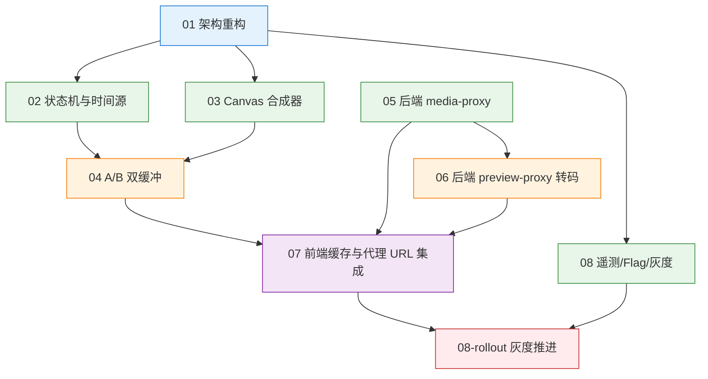

# Task Orchestration — 视频编辑器播放流畅度优化

> Related: [`master-plan.md`](master-plan.md), all `specs/*.md`, all `todos/*.md`

## 1. 依赖图（Dependency Graph）



- 颜色 = `parallel_group`：
  - **A**（蓝）：基础骨架，必须先落地，单任务。
  - **B**（绿）：与 A 完成后并行启动；组内任务相互无依赖。
  - **C**（橙）：B 中前置任务完成后启动；组内任务相互无依赖。
  - **D**（紫）：所有上游完成后的集成任务。
  - **E**（红）：端到端可验证后才能启动；灰度上线。
- 实线 = 强依赖（前者完成后才能启动后者）。
- 节点编号与 `todos/0X-*.md`、`specs/0X-*.md` 一一对应。

## 2. 执行阶段（Execution Phases）

并发上限：单 phase 内最多 5 个 agent 同时在飞（master-plan §9 推荐）。

| Phase | 任务 | 并行度 | 描述 |
|-------|------|-------:|------|
| **Phase 1：骨架** | T01 | 1 | 拆 VideoPlayerPanel + 建 playback/ 目录 + Feature flag 工具 |
| **Phase 2：核心系统并行开发** | T02 / T03 / T05 / T08-A（埋点 + flag scaffold） | 4 | 状态机、Canvas、后端代理、遥测/Flag 同步推进。互不依赖 |
| **Phase 3：集成层** | T04 / T06 | 2 | A/B Buffer 需要 T02+T03；preview-proxy 后端转码需要 T05 |
| **Phase 4：前端最终集成** | T07 | 1 | 把前端 v2 栈与后端代理 / 转码端点对接 |
| **Phase 5：端到端验收与灰度** | T08-B（rollout） | 1 | 内部 dogfood → 5% → 25% → 100% |

预计跨度（粗估，按团队规模可调）：

- Phase 1：2 天（1 人）
- Phase 2：5–7 天（最多 4 人并行）
- Phase 3：3–4 天（2 人并行）
- Phase 4：3–4 天（1 人）
- Phase 5：约 3 周（自然时间，含灰度观察）

## 3. 关键路径（Critical Path）

```
T01 → T02 → T04 → T07 → T08-B
```

- 瓶颈任务：**T02（状态机）** 与 **T04（A/B Buffer）**。两者都是高复杂度内部模块；任何一个延误都会顺延整个项目。
- 次瓶颈：**T05 后端代理**。如果与 T02/T03 同步开始，不会成为关键路径；如果延后启动，会变成 T07 的瓶颈。
- 建议把团队最强的 2 人放在 T02 与 T04 上。

## 4. Agent 分工建议（Agent Assignments）

> 本规划仅出文档，不直接执行；以下分工面向后续将本规划交给一个 dev skill 或人工团队接手时使用。

推荐 Agent 数：**5 个并行 agent（Phase 2 高峰时）**。

| Agent | 主责 TODO | 备用支援 |
|-------|----------|---------|
| Agent FE-1（前端架构主） | T01 → T02 → T07 | T04 review |
| Agent FE-2（前端渲染） | T03 → T04 | T07 集成 |
| Agent BE-1（后端代理） | T05 → T06 | T08 后端端点 |
| Agent QA/Telemetry | T08-A 埋点 + flag scaffold | 跨 spec 集成测试 |
| Agent Ops/Rollout | T08-B 灰度推进 | 监控告警接入 |

协调说明：

- **同步点 1**（Phase 1 → Phase 2）：T01 PR 合并后，FE-1/FE-2/BE-1/QA 同时启动。
- **同步点 2**（Phase 2 → Phase 3）：T02 与 T03 同时 ready 后，FE-2 启动 T04；T05 ready 后 BE-1 启动 T06。
- **同步点 3**（Phase 3 → Phase 4）：T04、T05、T06 全部 ready，FE-1 启动 T07。
- **同步点 4**（Phase 4 → Phase 5）：T07 端到端跑通 + 验收指标 P50/P95 达标，Ops 启动 T08-B。
- 每个 PR 评审必须由非主责 agent 至少 1 人完成。

## 5. Context Files（每个 agent 必读）

### 5.1 全局必读（所有 agent）

- `master-plan.md`（项目总览 + 决策 + 风险）
- 对应的 `specs/0X-*.md` 与 `todos/0X-*.md`
- `CLAUDE.md`（项目结构与 clean-code 阈值）

### 5.2 按任务聚焦的代码现状文件

| TODO | 必读现状文件 |
|------|--------------|
| T01 | `src/components/video/components/VideoPlayerPanel/VideoPlayerPanel.tsx` 全文；`src/components/video/hooks/useVideoPlayback.ts`；`src/components/video/hooks/useVideoCache.ts` |
| T02 | `src/components/video/timeline/store/slices/timelineSlice.ts`、`useTimelineStore.ts`；`src/components/video/utils/timelineMapping.ts`；现状 VideoPlayerPanel 中的 `handleTimeUpdate` / `isSeekingRef` / `seekLockGenerationRef` |
| T03 | `src/components/video/components/VideoPlayerPanel/VideoPlayerPanel.tsx` 中的 `captureFrameToCanvas` / `canvasRef`；`src/components/video/components/VideoCoverModal/components/CoverPreview.tsx` |
| T04 | `src/components/video/timeline/infrastructure/VideoCacheAdapter.ts`；`src/components/video/timeline/domain/ports.ts`；现状 VideoPlayerPanel 中的 transitionIdRef / pendingCompositionSeekRef / releaseSeekLock |
| T05 | `backend-services/basic-service/app/services/material_download_service.py`；`app/routers/material_router.py`（如已存在）；`app/models/db_models.py` 中 `cached_materials` 表；`app/main.py` 路由注册位置；现有 `oss_*` 服务（如有） |
| T06 | 同 T05 + `backend-services/basic-service/config/storyboard-config.yaml`（队列模式参考）；`app/services/queue_manager.py`（如有）；`app/services/storyboard_*.py`（异步任务参考） |
| T07 | `src/components/video/lib/selectPlaybackUrl.ts`；`src/components/video/timeline/infrastructure/RemoteMaterialPrefetchAdapter.ts`；`src/components/video/hooks/useRemoteMaterialPrefetch.ts`、`useMaterialManagement.ts` |
| T08 | `src/components/video/utils/logger.ts`（VideoEditingLogger）；`backend-services/basic-service/logs/app.log`；`app/routers/`（现有 router 命名风格） |

## 6. 验收门槛（Acceptance Gates）

每个 phase 结束需满足才可推进：

| Phase | 进入下一 phase 的必要条件 |
|-------|------------|
| Phase 1 → 2 | T01 PR 合并；`VideoPlayerPanel.tsx` 行数 ≤ 600；flag off 路径下所有现有测试通过 |
| Phase 2 → 3 | T02 集成测试 `playheadNoRegression` 通过；T03 单 tick `lastDrawMs` 性能基线达标；T05 代理端点单测 + 集成测试通过；T08-A 埋点接入 PlaybackEngine、CanvasCompositor 等并能上报 |
| Phase 3 → 4 | T04 boundary 切换闪屏目视不可见（手测录屏对比）；T06 真实 ffmpeg 端到端转 480p 可播 |
| Phase 4 → 5 | T07 端到端混合素材（本地 + Pexels + ARK）流畅播放；master-plan §2.1 全部定量验收指标在 dogfood 用户群达标 |
| Phase 5 退出 | rolloutPercent=100% 持续 1 周无回滚事件；legacy 路径保留 2 个版本后清理 |

## 7. 风险与备份计划（关联 master-plan §7）

- **R1 Canvas CPU 占用高**：T03 内置自适应降级（30fps fallback）。若在低端机型仍超预算，Phase 2 引入 OffscreenCanvas + Web Worker。
- **R3 后端转码堆积**：Phase 1 不依赖 T06；T07 在 T06 上线前 fallback 到 T05 原片代理。
- **R6 重构期回归**：Feature flag 隔离 + legacy 路径保留 + 每个 PR 强制跑现有 `playheadResume.test.tsx` 等回归套件。
- **关键路径延误**：T02 / T04 是关键路径，若任一延误超过 3 天，可暂停 T08-A 让 QA 支援，或把 T03 的"自适应降级"延后到 Phase 3 末尾以加速。

## 8. 交付物清单（Deliverables）

完成时本规划目录将产出：

```
docs/plans/video-editor-playback-optimization/
├── master-plan.md
├── task-orchestration.md   ← 本文件
├── specs/
│   ├── 01-architecture-refactor.md
│   ├── 02-playback-state-machine.md
│   ├── 03-canvas-compositor.md
│   ├── 04-ab-buffer-preload.md
│   ├── 05-backend-media-proxy.md
│   ├── 06-backend-preview-proxy-transcode.md
│   ├── 07-frontend-cache-integration.md
│   └── 08-telemetry-feature-flag-rollout.md
└── todos/
    ├── 01-architecture-refactor.md
    ├── 02-playback-state-machine.md
    ├── 03-canvas-compositor.md
    ├── 04-ab-buffer-preload.md
    ├── 05-backend-media-proxy.md
    ├── 06-backend-preview-proxy-transcode.md
    ├── 07-frontend-cache-integration.md
    └── 08-telemetry-feature-flag-rollout.md
```

实施期间将额外交付：

- `rollout-playbook.md`（T08-B 启动时）
- 数据库迁移：`alembic/versions/xxxx_add_media_proxy_status.py`、`xxxx_add_preview_proxy_fields.py`
- 配置文件：`config/media-proxy-config.yaml`、`config/preview-proxy-config.yaml`
- 环境变量模板：更新 `env.template`、`.env.local.template`

---

> Orchestration v1。如在实施中发现实际依赖与本表不符，请把变更同步回此处与 `master-plan.md` §6.4 依赖图。
