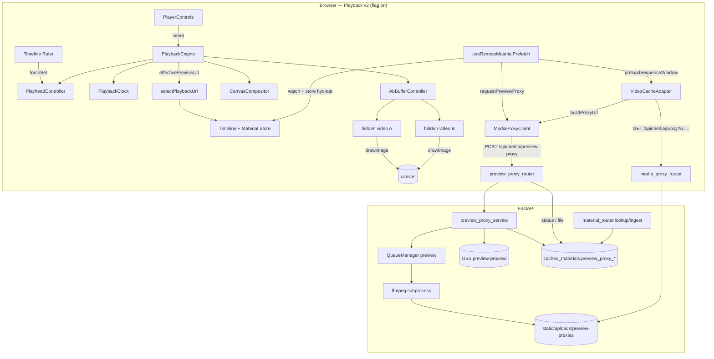

# Playback v2 — Phase 3 实施方案（A/B Buffer + Backend Preview-Proxy + Frontend Cache Integration）

> **版本：v2（2026-05-16 评审修订；本节同步参见末尾「评审结论」）**
> Feature 目录：`docs/plans/video-editor-playback-v2-phase3/`
> 关联：
> - 上游主规划：[`../video-editor-playback-optimization/master-plan.md`](../video-editor-playback-optimization/master-plan.md)
> - 上游 spec 04（A/B Buffer）：[`../video-editor-playback-optimization/specs/04-ab-buffer-preload.md`](../video-editor-playback-optimization/specs/04-ab-buffer-preload.md)
> - 上游 spec 06（后端 preview-proxy 转码）：[`../video-editor-playback-optimization/specs/06-backend-preview-proxy-transcode.md`](../video-editor-playback-optimization/specs/06-backend-preview-proxy-transcode.md)
> - 上游 spec 07（前端缓存与代理 URL 集成）：[`../video-editor-playback-optimization/specs/07-frontend-cache-integration.md`](../video-editor-playback-optimization/specs/07-frontend-cache-integration.md)
> - 直接前置：Round 1 已交付的 `media_proxy_router` + alembic 010 + telemetry SDK，Round 2 已交付的 `PlaybackEngine`/`PlaybackClock`/`CanvasCompositor`/`PreviewSurface` v2。
> 本规划对应：**Round 3/4 — Phase 3 后端 preview-proxy + 前端 A/B Buffer + URL 决策器统一**

---

## 〇、文档说明

本 spec 是 **Round 3/4 实施粒度**的方案，**不重写**上游主规划与 spec 04 / 06 / 07。

- 上游 specs（04 / 06 / 07）已经评审通过为 v2 或草案，描述了"应当怎样设计"。
- 本 spec 关注"Round 3 这一轮要落多少、按什么顺序落、改哪些文件、如何回归到 Round 1–2 已交付的代码现状"，并把上游设计中**任何与已落地代码不一致**的点显式调和（特别是 `PlaybackEngine` Round 2 自管理单 `<video>` 的过渡形态切回 A/B Buffer）。
- 下游开发节点（Round 3 Subtask #2）严格按本 spec §四 的"文件 / 模块变更计划"逐项实现，不再回头修改上游 specs；如发现新的方案缺陷，写入本文档末尾的「实施过程发现的方案缺陷」段，由 Subtask #3 评估是否回灌。

本轮交付完成后，Playback v2 三大支柱（state machine + canvas compositor + ab-buffer/preview-proxy）齐备，剩余 Round 4 工作为：埋点扩展、Feature flag 灰度推进、端到端验证与回滚演练（T08-B）。

---

## 〇·一、评审记录（Review Notes, v1 → v2）

> 审稿人角色：Anthropic 内部资深工程师。审查维度：可行性（Feasibility）、完整性（Completeness）、一致性（Consistency，特别是与 `CLAUDE.md` / Round 1 / Round 2 已落地代码）、量级合适（Right-sizing）。
> 全部 P0 / P1 已在 v2 直接修复；P2 列出供 Round 3 实施 / Round 4 评估。

### P0（必须修复，否则实施直接偏离）

| ID | 维度 | 问题 | v2 修复 |
|----|------|------|---------|
| **N1** | Feasibility / Consistency | §5.1 把 `swapActive` 签名声明为 `HTMLVideoElement \| Promise<HTMLVideoElement>` 联合返回，且 INV2 要求 fallback "必须显式返回 Promise 或抛出"；但 §3.2.3 `_onTick` 的伪代码把返回值当作 sync `HTMLVideoElement` 直接使用（`newActive.playbackRate = ...`、`compositor.setActiveSource(newActive)`、`void newActive.play()`），既未 `await` 也未 `then`。一旦 fallback 命中并返回 Promise，会出现 `Promise.playbackRate=undefined`、绘制旧元素的逻辑错误。必须收敛为单一模式。 | §5.1 收紧为 `swapActive(): HTMLVideoElement`（**始终 sync**）；fallback 分支（prewarm 未就绪）不再返回 Promise，而是 **保留旧 active 元素 + 异步触发 `bindActive(nextSeq.id, 0)`** 并通过 `subscribeError` 回报 `STALLED_EVENT{reason:'short_clip_handover'}`；Engine `_onTick` 据此把 phase 设为 `preparing` 直到内部 bindActive 完成再回 playing。§3.2.3 伪代码已同步修订。INV2 同步修订。 |
| **N2** | Feasibility | §4.1 仅修改 `VideoCacheAdapter.DEFAULT_CONFIG.maxCacheSize: 20 → 32`，但运行时唯一实例化点 `src/components/video/hooks/useVideoCache.ts:44` 写死 `new VideoCacheAdapter({ maxCacheSize: 10 })`，覆盖了 DEFAULT。仅改 DEFAULT 不会改变运行时容量；G7 验收"LRU=32"无法满足。 | §4.1 新增 `useVideoCache.ts` 修改条目：移除硬编码 `maxCacheSize: 10`（改为不传或显式传 32），让 DEFAULT 生效；新增单测断言运行时容量 = 32。 |

### P1（关键缺陷，已直接修复）

| ID | 维度 | 问题 | v2 修复 |
|----|------|------|---------|
| **N3** | Consistency | §3.2.3 / §3.4 伪代码调用 `clock.reanchor(comp, performance.now())`（两参），但 Round 2 已落 `PlaybackClock.reanchor(compositionTime: number)` 仅一参；强行加签会破坏 Round 2 已通过的 13 个 Clock 测试。 | §3.2.3 / §3.4 伪代码统一改为 `clock.reanchor(comp)`（单参）；wall 时间在 reanchor 内部由 `_now()` 取，与 Round 2 现实现一致；spec §3.4 "差异调和"表对应行同步修订。 |
| **N4** | Consistency / Feasibility | §4.1 列出文件 `src/components/video/timeline/store/slices/materialsSlice.ts`，但该文件不存在（当前 slices 实为 `dragSlice / historySlice / selectionSlice / timelineSlice / uiSlice`）。Material 列表实际由 `src/components/video/hooks/useMaterialManagement.ts` 内 `useState<MaterialItem[]>` 管理，patch 入口是 `patchMaterialCache`（同文件 line 1133）。 | §4.1 删除 `materialsSlice.ts` 条目；改为修改 `useMaterialManagement.ts`：扩展 `patchMaterialCache` 接受 `previewProxy*` / `proxyStatus` 字段，沿用同一 `setMaterials(prev => prev.map(...))` 路径；§3.2.1 / §3.2.8 / §六.2 同步描述。 |
| **N5** | Consistency | §3.2.8 / §4.2 中 Pydantic 响应模型名 `MaterialResponse` 在仓库内不存在；`material_router.py` 实际模型是 `MaterialIngestResultEntry`（同文件第 34 行）与 `MaterialIngestResponse`（第 49 行）。 | §3.2.8 / §4.2 / §九 表中模型名统一改为 `MaterialIngestResultEntry`；7 个新字段加在该模型上；`MaterialIngestResponse.items: List[MaterialIngestResultEntry]` 自动透传。 |
| **N6** | Consistency | §5.3 表格 Auth 列写 "require_admin"，并称"与现有 `media_proxy_router` 对齐"，但 grep `require_admin\|require_auth\|Depends` 在 `media_proxy_router.py` 与 `material_router.py` 均为 0 命中。实际项目当前还没有该 dep；Round 1 的 spec 05 也没有引入。如果按字面照做会引入项目级新依赖。 | §5.3 Auth 列改为 "无（沿用 Round 1 `media_proxy_router` 现状）"；同时在 §十一「变更与回滚」追加 "鉴权扩展由 Round 4 + spec 08 灰度阶段统一引入" 备注。 |
| **N7** | Right-sizing / Consistency | R1 提出新增 telemetry 事件 `playback.swap_play_rejected`，但 §2.2 显式列出"埋点指标新增条目"为非目标（属于 Round 4）。R1 直接落新指标会违反范围边界且导致 `telemetry.ts` 改动落入 §4.6「不动」列。 | R1 缓解措施改为：复用 Round 1 已存在的 `STALLED_EVENT{reason:'swap_play_rejected'}` 与 `ERROR{code:'play_rejected'}`；不新增 PLAYBACK_EVENTS 键；R6 中 `getMemoryStats` 同理仅在内存中维护，不上报，直至 Round 4。 |
| **N8** | Completeness | §4.1 让 `addItem.ts` "emit `'timeline.itemAdded'`" 经由"store 内置事件总线"传递到 `useRemoteMaterialPrefetch`，但当前 zustand store 没有事件总线；R8 已暗示 fallback 走 diff 检测，但主线还在描述一个不存在的设施，违背 §2.3"不引入新基础设施"。 | §3.2.1 / §4.1 / §4.6 一律改为：**diff 检测为主路径**（`useRemoteMaterialPrefetch` 用 `useEffect` + `useRef<MaterialItem[]>` 保留前值，比较"被引用到 timelineSlice 中的 materialId 集合"差集得到新加入 item），**不修改** `addItem.ts`；§4.1 删除 `addItem.ts` 修改条目；§4.6 把 `addItem.ts` 列入"不动"；R8 从风险表移除（已落主线）。 |
| **N9** | Completeness | §5.5 `PreviewProxyTask.status` 联合类型含 `'absent'`，但 spec 06 §3.1 的 POST 返回值仅 `'queued'\|'running'\|'cached'\|'failed'`（POST 不会返回 absent —— 那是 status 查询的初态），上游 spec 07 §4.1 同样为四值。前端写四值客户端时会缺 `absent` 兜底分支或 over-typed。 | §5.5 拆分类型：`PreviewProxyTask`（POST 返回）= 四值；`PreviewProxyStatus`（GET 返回）= 五值（含 `absent`）；`watchPreviewProxy` 回调类型为 `PreviewProxyStatus`；§3.2.7 / §6.2 同步对齐。 |
| **N10** | Feasibility | §3.2.7 引用 `material_svc.ensure_ingested(source_url)`，但仓库中实际服务名是 `material_download_service` / `material_svc` 取决于实际命名（spec 06 §十 提到的 `material_download_service.py`），且签名不一定是 `ensure_ingested`。直接照写会出现导入错误。 | §3.2.7 step 1 改写为更通用描述："调用现有 `material_download_service` 的对应入口（`ensure_or_ingest` / `lookup_or_create` 等，具体方法名在 Subtask #2 实施时按现状对齐）触发首次入库；若仓库现状已有不同入口，在 §十 实施过程发现段记录"。新增 R11 提示实施确认。 |
| **N11** | Feasibility | §3.2.3 (d) `drawFrame` 注释"现有 §3.2.7 漂移采样保留" 把 Phase 2 spec 的章节号写进了 Phase 3 spec；本 spec §3.2.7 是后端转码而非漂移采样，会让读者把两者混为一谈。 | §3.2.3 (c)(d) 注释改为引用 Round 2 `PlaybackEngine._maybeCorrectDrift` 与 `_maybeReportFps` 代码符号 + Phase 2 spec §3.2.7/§3.2.8 全路径引用，与 Phase 3 本身的 §3.2.7 区分。 |

### P2（建议项，留作实施 / Round 4 校准）

| ID | 维度 | 问题 | 建议 |
|----|------|------|------|
| N12 | Right-sizing | §7.1 合计"≥ 68"与子项相加（18+8+8+6+6+8+8+6 = 68）刚好，没有给单测 flake 留余地。 | 建议 Subtask #2 在分子上多写 2~3 个边界用例，落到 ≥ 70。 |
| N13 | Completeness | spec 06 §四.2 的 FFmpeg progress pipe 是按行 `key=value\n` 输出，而非 JSON；§3.2.7 没说明如何处理换行/缓冲。 | 在 §3.2.7 注脚指明：用 `asyncio.StreamReader.readline()` 逐行解析，遇 `progress=end` 退出循环。 |
| N14 | Right-sizing | §7.2 手测路径 3 与 4 在 DoD 中被推迟到 Round 4；但 G3 / G7 验收依赖路径 3 的"5 秒内 cached"现象。 | DoD 中保留路径 3 的 1080p 短样本（≤ 10s）作为可选 smoke；4K 路径 4 仍可推迟。 |
| N15 | Consistency | §6.1 表中 `preview_proxy_status` 写 NOT NULL + default `'absent'`；spec 06 §六 表为"enum(absent/.../failed)"未说明 NULL 行为。两端实际取 NOT NULL 更稳，建议在 §九 差异调和表显式列出。 | 已 v2 顺便补到 §九。 |
| N16 | Completeness | 没有显式覆盖"Round 2 `_videoErrorHandler` 移除后，旧 active 的 'error' 事件如果晚于 swap 后到达会不会泄漏"。 | §3.4 表中追加一行：旧 active 在 swap 后由 buffer 内部 `removeEventListener('error', ...)` 解绑；INV9 在 §3.3 中补一条。 |
| N17 | Right-sizing | R10 中 "alembic 011 字段全部 optional" 已在 §6.1 表中写 `preview_proxy_status` NOT NULL；两处轻微矛盾（NOT NULL + server_default 实际等价于"对客户端可选"）。 | 不修复，作为可读性优化留 Round 4。 |

---

## 一、概述（Overview）

Round 2 完成后，`PlaybackEngine` 能够基于 rAF 主循环、状态机、Canvas 合成器、PreviewSurface v2 真实绘制**单 sequence 本地素材**，flag-on 时点击播放可以达到稳定 60fps 与单调光标。但当前实现存在三个被显式标记为「Phase 3+ 范围」的退化：

1. **跨 sequence 切换零感知尚未达成。** `AbBufferController` 仍是 Round 1 stub，`PlaybackEngine` 在 Round 2 内通过自管理单 `<video>` 引用回避了 A/B 切换的复杂度；多片段时间线在 sequence boundary 处依赖串行 `bindActive`（重新设 src + 等 `loadedmetadata` + 等 `seeked`），实测会引入数百 ms 的黑屏 / 闪屏，违背 master-plan §2.1 的「片段切换可见闪屏 < 16ms」硬性指标。
2. **远端素材播放路径未走代理。** Pexels / ARK 生成 / 用户外链等跨域 URL 仍直接喂给 `<video>.src`；`VideoCacheAdapter.sameOriginOnly=true` 会丢弃它们，缓存命中率低；首字节延迟、Range 不稳定的问题在 Round 1 后端 `/api/media/proxy` 已存在，但前端仍未消费。
3. **高码率素材没有低清预览。** 4K / HEVC / ≥ 8Mbps H.264 原片在浏览器解码会被 GPU 拖慢，单帧 `drawImage` 周期超过 16ms 就退化到 30fps；spec 06 的 `/api/media/preview-proxy` 端点尚未实现。

Round 3 的工作目标是把这三块同时补齐，使 **「跨 sequence、跨源、跨码率」** 的预览路径都达到 Phase 1 验收指标：

- `AbBufferController` 真实实现 `bindActive` / `prewarmNext` / `swapActive`；`PlaybackEngine` 接入 boundary 检测 + lead-time 预热 + 同 tick 切换；同时保留 `<video>` 元素归属在 `PreviewSurface` 不变（评审 N10 已固化）。
- 后端新增 `preview_proxy_router` + `preview_proxy_service`（FFmpeg 480p baseline fMP4）+ alembic 011 迁移；`material_router` 的 `lookup` / `ingest` 响应同步携带 `preview_proxy_*` 与 `proxy_*` 字段（消除前端需要额外 RPC 的需求）。
- 前端 `selectPlaybackUrl` 扩展为 P1–P5 五级优先级；新增 `MediaProxyClient`；`VideoCacheAdapter` 升级 LRU=32、识别 proxy origin、支持窗口预拉；`useRemoteMaterialPrefetch` 把 preview-proxy 触发点挂到 timeline `addItem` action（master-plan §0.2 F3 修订要求）。
- 不动 Round 2 已落地的状态机、Compositor、PreviewSurface DOM；新增逻辑通过依赖注入接入。
- 不动埋点 SDK 与 flag 灰度逻辑（Round 4 任务）。

本轮交付完成后，flag-on 路径可在 4 类典型项目（短本地素材、长本地素材、跨源混合素材、4K/HEVC 重码率素材）上同时达到 P50 click-to-first-frame < 100ms、跨 sequence 切换闪屏不可见。

---

## 二、目标与非目标

### 2.1 本轮目标（必须完成）

| # | 目标 | 验收信号 |
|---|------|----------|
| G1 | `AbBufferController` 完整实现 spec 04 §四 / §五 全部接口与流程（含 `swapActive` 回退、短 clip 跳过 prewarm、idle 复用），保持 `setElements` 公开 API 向后兼容 | 单测 `AbBufferController.test.ts` ≥ 18 用例全绿；`swapActive` 在 prewarm 就绪时 < 1 rAF tick 切换 |
| G2 | `PlaybackEngine` 接入 A/B Buffer：preparing 路径调用 `buffer.bindActive`、播放期间 `_tick` 内检测 `compositionTime ≥ activeSeq.end - PREWARM_LEAD_SEC` 触发 `buffer.prewarmNext`、boundary 命中触发 `buffer.swapActive`；不再持有 `_activeVideo` 字段（改为 `buffer.getActiveElement()` 读取） | 单测：跨 sequence 切换零黑屏；`PlaybackEngine.handover.test.ts` 覆盖 prewarm 就绪 / 未就绪 / 短 clip 三条路径 |
| G3 | 后端 `preview_proxy_router` + `preview_proxy_service` 落地 spec 06 §三 / §四 / §五 / §六 全部接口、转码参数、队列、配置、字段；FFmpeg 进程通过 `asyncio.create_subprocess_exec` 启动并解析 `-progress pipe` 输出 | 后端 pytest 全绿；本地手测 1080p 30s 样本 → 输出可用的 480p fMP4，Chrome `<video>` 直播 Range 200/206 |
| G4 | alembic 011 迁移 `down_revision='010'`，新增 9 个 `preview_proxy_*` 列，全部 nullable / 有默认值；`Material` ORM 同步加字段；`material_router` 的 `lookup` / `ingest` 响应序列化新字段 | `alembic upgrade head` / `alembic downgrade -1` 双向通过；既有 `tests/test_material_router.py` 回归全绿；新增 `tests/test_preview_proxy_router.py` 覆盖 POST / status / file 三端点 |
| G5 | 前端 `selectPlaybackUrl` 扩展 P1–P5 优先级；新增 `effectivePreviewUrl` 别名；保持 `(material, opts) => string` 签名向后兼容；现有调用点零改动 | `selectPlaybackUrl.previewProxy.test.ts` ≥ 8 用例覆盖 P1–P5 与 export 路径；`CompositionAdapter` 现有单测全绿 |
| G6 | 新增 `MediaProxyClient`（`buildProxyUrl` / `requestPreviewProxy` / `getPreviewProxyStatus` / `watchPreviewProxy`）；端点幂等性 + 轮询超时 + abort 通道齐备 | 单测 `MediaProxyClient.test.ts` ≥ 6 用例，含 fake-timer 轮询 cached / failed / timeout |
| G7 | `VideoCacheAdapter` 升级：LRU=32；`isSameOrigin` 识别 `/api/media/proxy?` 前缀；新增 `markUsed` / `preloadSequenceWindow` / `getMemoryStats` | 单测 `VideoCacheAdapter.window.test.ts` ≥ 6 用例；既有缓存回归 0 失败 |
| G8 | `useRemoteMaterialPrefetch` 接入：timeline `compositionPlayback` 变化驱动 `preloadSequenceWindow`；timeline `addItem` 成功回调命中 H1/H2/H3 启发式后调用 `requestPreviewProxy`；`useMaterialManagement.addMaterials` 仅 hydrate 字段不发起转码 | 单测覆盖触发 / 不触发两条路径与 in-flight 去重 |
| G9 | timeline material store 字段扩展（`previewProxyStatus` 等 4+ 字段）；`watchPreviewProxy` 回写仅元数据，不改 `sequence.url` | 单测覆盖 store 字段 patch；`addItem` 后立即查询 store 能看到 `previewProxyStatus='queued'` |
| G10 | 整体 typecheck（`npm run type-check`） + frontend test suite + backend pytest 全绿；既有 Round 1/2 528 个用例 0 回归 | CI 输出截图 |

### 2.2 显式非目标（Round 4 范围）

- **Feature flag 灰度推进（T08-B）**：本轮不调 `rolloutPercent`，flag-on 行为变化通过本地手测验证；线上灰度由 Round 4 执行。
- **埋点指标新增条目**：本轮只在 `AbBufferController` swap fallback、`preview-proxy` 触发等位置打 Round 1 已有的 `playback.stalled_event` / `playback.error`；新指标（如 `playback.swap_latency_ms`）留给 Round 4 与 spec 08 协调。
- **WebAudio mixer / WebCodecs**（master-plan D10–D11）。
- **多档位预览代理**（720p / 1080p）：spec 06 §九 Q1 明确首期仅 480p。
- **预览代理 cleanup 任务**（保留期 30 天后清理）：由 ops 工作负责。
- 任何 UI / 设计稿改动。

### 2.3 风险边界

- **不允许**在 `PlaybackEngine` 内部直接持有 `<video>` 元素引用（移除 Round 2 的 `_activeVideo` 字段）；所有 `<video>` 访问通过 `buffer.getActiveElement()` / `buffer.getPrewarmElement()`，否则 Phase 3 切回 A/B Buffer 时双绑。评审 N10 修订已固化。
- **不允许**修改 `cached_materials` 表已有列；新字段一律 nullable + server_default。
- **不允许**在 `useMaterialManagement.addMaterials` 内触发 `requestPreviewProxy`（master-plan §0.2 F3 / spec 07 §6.2 v2 修订）。
- **不允许**在 v2 分支让远端跨域 URL 绕过代理重写直接进 `<video>.src`，除非命中 `previewFallback='origin'` 兜底分支。

---

## 三、技术设计（Technical Design）

### 3.1 端到端数据流（本轮）



### 3.2 关键代码路径

#### 3.2.1 添加素材到 timeline（preview-proxy 触发）

1. 用户从素材库拖入 / 点击「+」 → `addItem` action 创建 `TimelineItemData`、写入 `timelineSlice`、触发 `state.captureNextState`。**不修改** `addItem.ts`（评审 N9）。
2. `useRemoteMaterialPrefetch`（已经持有 `materials: MaterialItem[]`）用 `useEffect` + `useRef<Set<string>>` 记录"上一次已被 timeline 引用的 materialId 集合"，本次 effect 计算差集 = `current timelineRef ∩ materials - previous` → 得到"新进入 timeline 的 material" 列表；**diff 检测为主路径**，不走任何事件总线。`useTimelineStore` 中已有的 `getReferencedMaterialIds` selector（若不存在则在 hook 内组合 `track.items.map(i => i.materialId)`）提供 timeline 当前引用集合。
3. 命中启发式（spec 07 §6.2 H1 `bytes > 50MB` / H2 `bitrate > 8Mbps` / H3 `source ∈ {'ark','pexels'}`）且 `material.previewProxyStatus ∈ {undefined,'absent','failed'}`：
   - 把 `materialId` 加入 in-flight Set（去重）。
   - `mediaProxyClient.requestPreviewProxy(materialId)` → `POST /api/media/preview-proxy`。
   - 后端返回 `{ task_id, status: 'queued' | 'cached' }`。
   - `cached` → 直接 hydrate `previewProxyStatus='cached'` + URL 字段到 store；不再 watch。
   - `queued` / `running` → `mediaProxyClient.watchPreviewProxy(materialId, onUpdate)`；onUpdate 内 patch store；遇 `cached` / `failed` 自动 unsubscribe。
4. 不命中启发式：仅做 store 元数据 hydrate（沿用 lookup 响应），不发请求。
5. 同一 materialId 多次 `addItem`：in-flight Set + 后端幂等（spec 06 §3.1）双重保护。

#### 3.2.2 启动播放（接入 A/B Buffer）

1. `engine.dispatch({kind:'play'})` → `_handlePlay`：
   - 读 `timeline.getCurrentTime()` → `t0`，`timeline.findSequenceAtCompositionTime(t0)` → `{sequence, index, offset}`。
   - `phase === 'ended'` → 先 `playhead.forceSet(0)`、清 active sequence、重新解析 sequence。
   - 设置 `_phase='preparing'`，启动 5s 看门狗（评审 N1 已修复）。
2. `buffer.setElements({ a: videoARef.current, b: videoBRef.current })`（由 `PreviewSurface` 通过 attach 注入；Engine 仅做 forwarding）。
3. 调用 `await buffer.bindActive(sequence.id, offset)`：
   - 内部 pickBufferForActive（优先 prewarm src 匹配，否则 idle，最后 A）。
   - 必要时 set `src = resolver.resolveSrc(sequence)`（resolver 内部走 `effectivePreviewUrl`）→ 等 `loadedmetadata`（超时 1s）。
   - `el.currentTime = clamp(offset, 0, sequence.duration)` → 等 `seeked`（超时 `maxSeekMsBeforeForceRebind=500ms`）→ 失败则 hard rebind 重试一次。
   - 返回 active `<video>` 元素。
4. `compositor.setActiveSource(activeEl)` 由 `AbBufferController.bindActive` 内部完成（spec 04 §5.1 末尾要求）。
5. Engine 同步状态：`activeEl.playbackRate = rate`、`activeEl.volume = volume`、`muted = volume === 0`。
6. `await activeEl.play()` → 失败走 §3.2.7 kill-switch 兜底（Round 2 已实现，本轮保留）。
7. `clock.start(t0, performance.now(), rate)` → phase → `playing`。
8. 异步触发 `buffer.prewarmNext(nextSeqId)`（若 `duration ≥ shortClipThresholdSec=1.5s` 且存在下一 sequence）；不 `await`。

#### 3.2.3 rAF tick 内的边界检测（核心新增）

```pseudo
on tick(comp, deltaMs):
  if phase !== 'playing': return
  seq = _activeSeq  // {index, startTime, duration}
  end = seq.startTime + seq.duration

  // (a) 预热下一 sequence
  if !_prewarmTriggered and (comp >= end - PREWARM_LEAD_SEC):
    next = timeline.getSequences()[seq.index + 1]
    if next and next.duration >= SHORT_CLIP_THRESHOLD_SEC:
      void buffer.prewarmNext(next.id)
      _prewarmTriggered = true

  // (b) 边界 swap（评审 N1 修订：swapActive 始终 sync 返回）
  if comp >= end:
    next = timeline.getSequences()[seq.index + 1]
    if !next:
      // 整段结束
      dispatch({kind:'pause'}); setPhase('ended'); return
    newActive = buffer.swapActive()  // sync 返回 HTMLVideoElement，必非 Promise
    // swapActive 内部行为（详见 §5.1 / §3.4）：
    //   - prewarm.readyState >= 3 且 src 匹配 → fast path：role 翻转、prewarm.play()、
    //     compositor.setActiveSource(prewarm)、旧 active.pause()，返回新 active。
    //   - 未就绪 fallback → 不返回 Promise；保留旧 active 元素为返回值，
    //     内部异步 `bindActive(next.id, 0)` + 通过 `subscribeError` 上抛
    //     `STALLED_EVENT{reason:'short_clip_handover'}`；Engine 据此把 phase 切为
    //     'preparing'，并跳过本 tick 的画面更新。
    _activeSeq = { index: seq.index + 1, startTime: next.startTime, duration: next.duration }
    _prewarmTriggered = false
    newActive.playbackRate = _rate
    newActive.muted = _volume === 0
    newActive.volume = _volume
    void newActive.play()   // 旧 active 已被 AbBufferController.swapActive 内部 pause
    compositor.setActiveSource(newActive)  // 双保险，allow no-op when same element
    // 漂移基准重锚：clock 不停，仅更新基准（评审 N3 修订：reanchor 单参签名）
    clock.reanchor(comp)

  // (c) 漂移采样（保留 Round 2 `PlaybackEngine._maybeCorrectDrift`，对应
  //     Phase 2 spec §3.2.7；与本 Phase 3 spec §3.2.7 后端转码语义无关）
  if comp - _lastDriftSampleWall >= DRIFT_SAMPLE_INTERVAL_MS:
    _checkDrift(buffer.getActiveElement(), seq, comp)

  // (d) drawFrame + reportCompositionTime + tick.fps 上报（保留 Round 2
  //     `_maybeReportFps` + `_maybeReportFirstFrame`，对应 Phase 2 spec §3.2.8）
```

注：
- `PREWARM_LEAD_SEC` 默认 1.0（spec 04 §3.2 / §九 Q1），可由 `internal/constants.ts` 调整。
- `SHORT_CLIP_THRESHOLD_SEC` 默认 1.5（spec 04 §5.5）。
- swap 之后 clock 不重启；`clock.reanchor(comp)`（评审 N3：Round 2 实际签名是单参，wall 时间由 `_now()` 内部取）等价于 `baseComp=comp; baseWall=_now()`，避免漂移累计但保留 rAF 状态（Round 2 `PlaybackClock` 已具备 `reanchor` 方法，本轮直接调用）。
- 评审 N1：fallback 路径**不返回 Promise**——`swapActive` 始终 sync 返回 `HTMLVideoElement`；fallback 时返回旧 active 并通过 `subscribeError` 异步把 stall 信号送回 Engine。

#### 3.2.4 seek 流程（接入 A/B Buffer）

1. ruler 拖动 / 控件 seek → `engine.dispatch({kind:'seek', compositionTime:t1})`。
2. 查 `findSequenceAtCompositionTime(t1)` 拿到 `{sequence, index, offset}`：
   - 若 `index === _activeSeq.index`：复用当前 active：`activeEl.currentTime = offset`，等带 token 的 `seeked`；恢复 was==='playing' 则 `play()` + `clock.start(t1, wall, rate)`。
   - 否则（跨 sequence seek）：
     - `clock.stop()`。
     - `buffer.releaseAll()` 是过重操作，本轮**不调用**；改为：`await buffer.bindActive(sequence.id, offset)`（内部会 pickBufferForActive 复用 prewarm 或重新 src）。
     - 更新 `_activeSeq`，恢复 was==='playing' → `play()` → `clock.start(t1, wall, rate)`；否则 phase→paused 且 `compositor.drawFrame` 单帧。
3. 连续拖动：`_seekAbortToken` 机制（Round 2 已实现）；本轮在跨 sequence 路径上同样使用 token 校验，避免旧 `bindActive` 完成后覆盖新激活元素。

#### 3.2.5 短 clip 与单 sequence 退化

- 单 sequence：`prewarmNext` 永远不触发（getSequences()[index+1] 为 undefined）；boundary → 直接 `ended`。
- 下一段 `duration < 1.5s`：跳过 prewarm；boundary 命中时 `buffer.swapActive` 内部检测到 prewarm 未就绪 → 走 spec 04 §5.3 fallback 分支 `bindActive(nextSeq.id, 0)` 串行切换；Engine 把这次切换记为 `playback.stalled_event{reason:'short_clip_handover'}`（Round 1 已有 metric）。

#### 3.2.6 远端 URL 解析路径（resolver）

Round 2 已经在 `PlaybackEngineAttachDeps.resolver` 上预留 `resolveSrc(sequence) => string | null`。Round 3 把 `VideoPlayerPanel` 内的 resolver 注入实现升级为 `effectivePreviewUrl`：

```ts
const resolver: PlaybackSequenceResolver = {
  resolveSrc: (seq) => effectivePreviewUrl(seq.material, { preferPreviewProxy: true, fallback: 'proxy' }),
  mapToMediaTime: (seq, off) => off + (seq.mediaStartOffset ?? 0),
};
```

`effectivePreviewUrl` 内部走 `selectPlaybackUrl(material, { purpose:'preview', preferPreviewProxy, previewFallback })`，按 P1→P5 优先级返回字符串。`<video>.src` 始终是同源相对路径（除非 P5 兜底）。

#### 3.2.7 后端 preview-proxy 转码

`preview_proxy_service.ensure_or_enqueue(material_id, profile)`：

1. 查 `cached_materials` 行：
   - 不存在 → 若 `source_url` 提供 → 调用现有 `material_download_service` 的入库入口（评审 N10：具体方法名 `ensure_or_ingest` / `lookup_or_create` 等在 Subtask #2 实施时按仓库现状对齐；若仓库现状与本节预期不符，在 §十 实施过程发现段记录）；否则 400。
   - `preview_proxy_status='cached'` → 直接返回 `(task_id=None, status='cached', url=...)`，幂等。
   - `preview_proxy_status='queued'/'running'` → 返回当前 task_id 与状态。
2. 计算输入路径：优先 `local_url`（同盘），fallback `proxy_cache_path`（spec 05 已写入）。
3. 提交到 `QueueManager`（独立实例 `preview_transcode_queue`）：
   - `await asyncio.create_subprocess_exec('ffmpeg', *args, stdout=PIPE, stderr=PIPE)`。
   - 后台 task 解析 `-progress pipe:1` 输出，每 1s patch `cached_materials.preview_proxy_progress`。
   - exit 0 → 写本地 `static/uploads/preview-proxies/<material_id>/480p.mp4`、`OSS_ENABLED` 则上传 OSS、更新 `preview_proxy_local_url` / `preview_proxy_oss_url` / `preview_proxy_status='cached'` / `transcoded_at` / `bytes` / `duration_sec`。
   - exit ≠ 0 → 重试 1 次；二次失败 `status='failed'` + `last_error`。
4. 超时（默认 600s）→ subprocess.kill() + `status='failed'`。
5. 端点：
   - `POST /api/media/preview-proxy` → 202 + `{task_id, material_id, profile, status, preview_proxy_url}`。
   - `GET /api/media/preview-proxy/status?material_id=...` → 200 + 完整 status 字段（含 progress）。
   - `GET /api/media/preview-proxy/file?material_id=...` → 302 → `preview_proxy_local_url`（同源）/ OSS URL；未生成 → 404 `preview_proxy.not_ready`。

#### 3.2.8 material 响应字段扩展

`material_router.lookup` / `ingest` 响应在现有 `MaterialIngestResultEntry` 模型（评审 N5：`material_router.py` 第 34 行；非虚构的 `MaterialResponse`）基础上追加；`MaterialIngestResponse.items: List[MaterialIngestResultEntry]` 自动透传：

```python
class MaterialIngestResultEntry(BaseModel):
    # ... existing fields ...
    proxy_status: Optional[str] = None
    proxy_bytes_cached: Optional[int] = None
    preview_proxy_status: Optional[str] = None
    preview_proxy_profile: Optional[str] = None
    preview_proxy_local_url: Optional[str] = None
    preview_proxy_oss_url: Optional[str] = None
    preview_proxy_progress: Optional[int] = None
```

字段缺失或值为 `'absent'` 时，前端 `useMaterialManagement` 不做特殊处理，沿用现有 hydrate 路径写入 store。

### 3.3 关键不变量（Invariants，必须断言/测试覆盖）

| INV | 描述 | 验证手段 |
|-----|------|----------|
| INV1 | `PlaybackEngine` 不再持有 `<video>` 元素的直接引用；唯一访问点是 `buffer.getActiveElement()` | grep `_activeVideo` 在 `PlaybackEngine.ts` 应 0 命中；单测断言 `buffer.setElements(null,null) → engine.dispatch('play')` 不抛 |
| INV2 | `buffer.swapActive()` 永远 sync 同 tick 完成且永远返回 `HTMLVideoElement`：prewarm `readyState ≥ HAVE_FUTURE_DATA(3)` 且 src 匹配时走 fast-path 返回新 active；否则 fallback 返回旧 active 并经 `subscribeError` 异步上报，Engine 据此进入 'preparing'（评审 N1） | 单测：mock readyState=4 → fast path 返回新元素；mock readyState=2 → 返回旧元素 + 触发 error 回调 'short_clip_handover'；mock readyState=4 但 src 不匹配 → fallback；任何分支返回值都不是 Promise（`typeof result.then === 'undefined'`） |
| INV3 | `selectPlaybackUrl(material, {purpose:'export'})` 永远不读 `preview_proxy_*` 字段，永远不重写为 proxy URL | 单测：material 全部 preview_proxy 字段填满 + purpose='export' → 返回 `serverUrl || url` 原值 |
| INV4 | `requestPreviewProxy` 在前端是幂等的：同一 materialId 在 in-flight Set 中或 `previewProxyStatus='cached'` 时短路返回 | 单测：spy 调用次数；快速连续触发 5 次 → POST 实际只发 1 次 |
| INV5 | alembic 011 的 `downgrade()` 能完整回滚（drop 全部新增列），与 010 同结构 | `alembic downgrade -1` 后 `\d cached_materials` 无 `preview_proxy_*` 列 |
| INV6 | 后端 `preview_proxy_service` 在 FFmpeg 超时 / 失败时不留下半成品文件 | 单测：mock subprocess returncode=1 → 输出文件被 unlink；DB 写 `failed` |
| INV7 | `VideoCacheAdapter.preloadSequenceWindow` 并发 ≤ 3；超过窗口的旧请求 abort（不取消已 in-progress 元素） | 单测：mock fake-timer + 并发计数器 |
| INV8 | flag-off 路径行为零变化（Round 1 / Round 2 既有 528 个测试全绿） | `npm run test -- video` 0 失败 |
| INV9 | swap 后旧 active 的 `error` listener 由 buffer 内部解绑（评审 N16）；不留下"晚到的 error 触发被回收元素 fatal"路径 | 单测：mock 旧 active 在 swap 后才 dispatch `error` 事件 → 不触发 subscribeError handler |

### 3.4 与 Round 2 已交付代码的差异调和

| Round 2 现状 | Phase 3 处理 | 备注 |
|--------------|--------------|------|
| `PlaybackEngine._activeVideo` 字段 + `_videoErrorHandler` 直接绑在元素上 | 字段删除；`_videoErrorHandler` 改为 `buffer.subscribeError(handler)` 由 buffer 内部转发当前 active 的 error 事件 | INV1；buffer 新增 `subscribeError` 方法（spec 04 §5.8 错误重建后再决定上抛） |
| `PlaybackEngine.attach` 通过 `deps.activeVideo` 注入单 `<video>` | `attach` 改为接收 `activeVideo: HTMLVideoElement` 与 `prewarmVideo: HTMLVideoElement`；attach 内首步调用 `buffer.setElements({ a, b })`；后续不再使用这两个引用 | 接口兼容：保留 `activeVideo` 字段但新增 `prewarmVideo`，类型上为可选；Round 2 测试若不传 `prewarmVideo` → buffer 只接 a，spec 04 退化为单视频路径并打 warn |
| `PlaybackEngine._handlePlay` 内自管理 `src + currentTime + load()` | 替换为单行 `await buffer.bindActive(seq.id, offset)`；URL 由 `resolver.resolveSrc(seq)` 提供给 buffer | resolver 新增 `effectivePreviewUrl` 注入 |
| `PreviewSurface.tsx` 仅传一个 `<video ref={videoARef}>` 给 attach | 改为同时传 `videoARef` + `videoBRef`；HTML 已有 B 元素（Round 2 已为 future 留位） | 不动 DOM 结构 |
| `clock.start` 用于 boundary 后重新锚定 | 改为 `clock.reanchor(comp)`（保留 rAF 不停；评审 N3：Round 2 实际签名是单参 `reanchor(compositionTime: number)`，wall 由内部 `_now()` 取） | Round 2 PlaybackClock 已有 `reanchor`，仅需在 swap 后调用 |

### 3.5 后端架构落点

- `app/main.py` 注册新 router：`app.include_router(preview_proxy_router.router)`（按字母序插在 `media_proxy_router` 之后）。
- `app/config.py` 新增 `preview_proxy` 节点解析（YAML + env 覆盖）。
- 新增 `app/services/preview_proxy_queue.py`（薄封装 `QueueManager`，参考 `storyboard_video_queue.py` 模式）。
- `app/models/db_models.py` 的 `CachedMaterial` ORM 同步加 9 列。
- 不引入新 PyPI 依赖。

---

## 四、文件 / 模块变更计划

> 路径以仓库根为基。所有改动严格限定在 §三 已识别的位置。

### 4.1 修改（M，前端）

| 路径 | 一句话意图 |
|------|-----------|
| `src/components/video/playback/AbBufferController.ts` | 从 stub 提升为完整实现：`bindActive` / `prewarmNext` / `swapActive` / `releaseAll`；内部 buffer 角色翻转、超时退化、错误重建一次、`subscribeError(handler)`、`setCompositor(compositor)` 注入；保留 `setElements` 公共 API。 |
| `src/components/video/playback/PlaybackEngine.ts` | 删除 `_activeVideo` 字段；`attach` 改为接收 `activeVideo + prewarmVideo`，attach 首步调用 `buffer.setElements`；`_handlePlay` / `_handleSeek` 改走 `buffer.bindActive`；`_onTick` 加 §3.2.3 (a)(b) 边界检测；`buffer.subscribeError` 替代直接 video error 绑定。 |
| `src/components/video/playback/types.ts` | `IAbBufferController` 扩展 `swapActive() / getPrewarmElement() / setElements({a,b}) / setCompositor(c) / subscribeError(h)`；`PlaybackEngineAttachDeps` 加 `prewarmVideo?: HTMLVideoElement \| null`；保持其他字段。 |
| `src/components/video/playback/index.ts` | re-export `AbBufferController` 升级后的新公开类型（如 `BufferError`、`AbBufferOptions`）。 |
| `src/components/video/playback/internal/constants.ts` | 新增 `PREWARM_LEAD_SEC=1.0`、`SHORT_CLIP_THRESHOLD_SEC=1.5`、`BIND_LOADEDMETA_TIMEOUT_MS=1000`、`BIND_SEEK_TIMEOUT_MS=500`、`PREVIEW_PROXY_POLL_INTERVAL_MS=2000`、`PREVIEW_PROXY_POLL_BUDGET_MS=600000`。 |
| `src/components/video/components/VideoPlayerPanel/PreviewSurface.tsx` | `v2.engine.attach` 调用同时传 `videoARef.current` + `videoBRef.current`；删除 HIDDEN_VIDEO_STYLE 中关于 B 不使用的注释。 |
| `src/components/video/components/VideoPlayerPanel/VideoPlayerPanel.tsx` | resolver 注入使用 `effectivePreviewUrl`；overlay provider 不变；新增 `mediaProxyClient` 注入到 `useRemoteMaterialPrefetch`（hook 内部创建则不需 panel 改动，按实现选择）。 |
| `src/components/video/lib/selectPlaybackUrl.ts` | 扩展 P1–P5 优先级；新增 `effectivePreviewUrl` 别名；新增可选 `preferPreviewProxy` / `previewFallback` 参数；签名向后兼容（默认值保持现状行为）。 |
| `src/components/video/timeline/infrastructure/VideoCacheAdapter.ts` | `DEFAULT_CONFIG.maxCacheSize: 20 → 32`；新增 `proxyOriginPrefix: '/api/media/proxy?'`；`isSameOrigin` 识别该前缀；新增 `markUsed(materialId)` / `preloadSequenceWindow(items)` / `getMemoryStats()`。 |
| `src/components/video/hooks/useRemoteMaterialPrefetch.ts` | `compositionPlayback` 变化 → `videoCache.preloadSequenceWindow`；订阅 timeline `addItem` 成功事件 → 命中启发式后 `mediaProxyClient.requestPreviewProxy` + `watchPreviewProxy` → store hydrate。 |
| `src/components/video/hooks/useMaterialManagement.ts` | （评审 N4 修订）扩展 `patchMaterialCache`（同文件 line 1133）签名以接受 `previewProxyStatus` / `previewProxyLocalUrl` / `previewProxyOssUrl` / `previewProxyProgress` / `proxyStatus` 字段，沿用 `setMaterials(prev => prev.map(...))` 路径写入 useState；`addMaterials` 回调内删除任何 preview-proxy 触发逻辑（如有），仅做字段 hydrate；其余不动。**不存在** `materialsSlice.ts`；material 列表本就是该 hook 内的 React `useState`，无 zustand slice。 |
| `src/components/video/hooks/useVideoCache.ts` | 评审 N2 修订：删除 `new VideoCacheAdapter({ maxCacheSize: 10 })` 的硬编码覆盖（同文件 line 44），改为 `new VideoCacheAdapter()` 让 §4.3 升级后的 DEFAULT (32) 生效；同时暴露 `preloadSequenceWindow` / `markUsed`（薄转发，沿用之前条目）。 |
| `src/types/index.ts` | `MaterialItem` 类型扩展可选 `previewProxyStatus` / `previewProxyLocalUrl` / `previewProxyOssUrl` / `previewProxyProgress` / `proxyStatus` / `bytes` / `bitrate` 字段。 |

### 4.2 修改（M，后端）

| 路径 | 一句话意图 |
|------|-----------|
| `backend-services/basic-service/app/main.py` | 注册 `preview_proxy_router`；导入位置紧邻 `media_proxy_router`。 |
| `backend-services/basic-service/app/config.py` | `get_settings` 新增解析 `config/preview-proxy-config.yaml` + `PREVIEW_PROXY_*` 环境变量覆盖。 |
| `backend-services/basic-service/app/models/db_models.py` | `CachedMaterial` ORM 新增 9 列（与 spec 06 §六 一致；类型对齐 alembic）。 |
| `backend-services/basic-service/app/routers/material_router.py` | `MaterialResponse` 序列化加 7 个新字段；`lookup` / `ingest` 内 ORM → 响应映射同步。 |

### 4.3 新增（A，前端）

| 路径 | 一句话意图 |
|------|-----------|
| `src/components/video/timeline/infrastructure/MediaProxyClient.ts` | spec 07 §四 客户端：`buildProxyUrl` / `requestPreviewProxy` / `getPreviewProxyStatus` / `watchPreviewProxy`。 |
| `src/components/video/timeline/infrastructure/__tests__/MediaProxyClient.test.ts` | 单测：URL 构造、轮询 cached / failed / timeout、unsubscribe。 |
| `src/components/video/timeline/infrastructure/__tests__/VideoCacheAdapter.window.test.ts` | 单测：LRU=32、proxy origin 识别、`preloadSequenceWindow` 并发上限 3、`markUsed` 时间戳更新。 |
| `src/components/video/lib/__tests__/selectPlaybackUrl.previewProxy.test.ts` | 单测：P1–P5 全覆盖、export 路径忽略 preview_proxy、`previewFallback='origin'` warn。 |
| `src/components/video/playback/__tests__/AbBufferController.test.ts` | 单测：bindActive 成功路径、超时降级、prewarmNext 短 clip 跳过、swapActive ready / 未就绪、subscribeError 重建一次后成功 / 二次失败抛错。 |
| `src/components/video/playback/__tests__/PlaybackEngine.handover.test.ts` | 单测：跨 sequence 预热 → swap → 漂移基准重锚；短 clip 退化到 bindActive；boundary 命中 `ended`。 |
| `src/components/video/hooks/__tests__/useRemoteMaterialPrefetch.test.ts` | 单测：addItem 触发 / addMaterials 不触发、启发式 H1/H2/H3、in-flight 去重、watch 回写 store。 |
| `docs/plans/video-editor-playback-v2-phase3/spec.md` | 本文件。 |

### 4.4 新增（A，后端）

| 路径 | 一句话意图 |
|------|-----------|
| `backend-services/basic-service/app/routers/preview_proxy_router.py` | 3 端点：POST / status / file；`require_admin` 鉴权与现有 `media_proxy_router` 对齐；解包 spec 06 §3.1 响应信封。 |
| `backend-services/basic-service/app/services/preview_proxy_service.py` | `ensure_or_enqueue` / `get_status` / `_run_transcode` / `_parse_progress` / `_finalize_success` / `_finalize_failure`；FFmpeg 子进程 + progress pipe；OSS 可选上传；幂等。 |
| `backend-services/basic-service/app/services/preview_proxy_queue.py` | 薄封装 `QueueManager`，参考 `storyboard_video_queue.py`。 |
| `backend-services/basic-service/config/preview-proxy-config.yaml` | spec 06 §五 完整 YAML；含 `preview-480p` profile 与 env 覆盖说明。 |
| `backend-services/basic-service/alembic/versions/011_add_preview_proxy_fields.py` | `down_revision='010'`；9 列 add；downgrade 镜像 drop。 |
| `backend-services/basic-service/tests/test_preview_proxy_router.py` | POST 202 + status / status 在 running / cached / failed / absent 四态 / file 302 + 404。 |
| `backend-services/basic-service/tests/test_preview_proxy_service.py` | 单任务成功（mock subprocess）+ 进度解析 + 失败重试 + 超时清理 + 幂等。 |

### 4.5 删除（D）

无。Round 2 内 `_activeVideo` 字段、`_videoErrorHandler` 等是字段级删除，归入修改。

### 4.6 不动（DO-NOT-TOUCH）

- `app/routers/media_proxy_router.py` / `app/services/media_proxy_service.py`（Round 1 已交付）。
- `src/components/video/playback/PlaybackClock.ts` / `CanvasCompositor.ts` / `PlayheadController.ts`（Round 2 已交付，本轮不修改）。
- `src/components/video/playback/telemetry.ts`（Round 1 SDK，不新增事件常量；新增指标留 Round 4）。
- `src/components/video/timeline/store/slices/timelineSlice.ts`（评审 N5 已固化字段；本轮不动 `currentTime` / `totalDuration`）。
- `src/components/video/timeline/store/actions/addItem.ts`（评审 N9：本轮以 diff 检测代替事件总线，不动该 action）。
- flag-off 路径下任何文件的运行时行为。
- `useVideoExport` / `useTimelineExport` / `video_export_router`（master-plan §2.3 非目标）。

---

## 五、接口设计（Interface Design）

### 5.1 `IAbBufferController`（升级）

```ts
interface AbBufferOptions {
  prewarmLeadSec?: number;            // default 1.0
  maxSeekMsBeforeForceRebind?: number; // default 500
  shortClipThresholdSec?: number;     // default 1.5
  bindLoadedMetaTimeoutMs?: number;   // default 1000
}

interface IAbBufferController {
  setElements(els: { a: HTMLVideoElement | null; b: HTMLVideoElement | null }): void;
  setCompositor(c: ICanvasCompositor): void;
  setResolver(r: PlaybackSequenceResolver): void;
  bindActive(sequenceId: string, localTime: number): Promise<HTMLVideoElement>;
  prewarmNext(sequenceId: string): Promise<void>;
  /**
   * 边界帧切换：评审 N1 修订 —— 始终 sync 返回 HTMLVideoElement。
   * - prewarm.readyState >= 3 且 src 与下一 sequence 匹配 → fast path 翻转 role 并返回新 active；
   * - 未就绪 fallback → 不返回 Promise，立即返回当前 active 元素，内部异步触发
   *   `bindActive(nextSeq.id, 0)` 并通过已注册的 `subscribeError(handler)` 上抛
   *   `{ code: 'short_clip_handover', el: 'active' }` 通知 Engine 进入 'preparing'。
   */
  swapActive(): HTMLVideoElement;
  getActiveElement(): HTMLVideoElement | null;
  getPrewarmElement(): HTMLVideoElement | null;
  releaseAll(): void;
  subscribeError(handler: (err: { code: number; el: 'active' | 'prewarm' }) => void): () => void;
}

class BufferError extends Error {
  constructor(public reason: 'bind-timeout' | 'seek-timeout' | 'src-failed', public sequenceId: string);
}
```

### 5.2 `PlaybackEngineAttachDeps`（兼容扩展）

```ts
interface PlaybackEngineAttachDeps {
  canvas: HTMLCanvasElement;
  activeVideo: HTMLVideoElement;        // 等价于 buffer A
  prewarmVideo?: HTMLVideoElement | null; // 新增；等价于 buffer B；为空时退化单视频
  timeline: PlaybackTimelineFacade;
  resolver: PlaybackSequenceResolver;
  overlaysProvider: () => OverlayPayload[];
  viewport?: ICanvasViewport | null;
  onKillSwitch?: (reason: string) => void;
}
```

### 5.3 后端 `/api/media/preview-proxy`

| 方法 | 路径 | Auth | 行为 |
|------|------|------|------|
| `POST` | `/api/media/preview-proxy` | 无（评审 N6：沿用 Round 1 `media_proxy_router` 现状，未引入 `require_admin` Depends） | body: `{material_id, source_url?, profile?, priority?}` → 202 + `{success, data: {task_id, material_id, profile, status, preview_proxy_url}}`；幂等。 |
| `GET` | `/api/media/preview-proxy/status` | 同上 | query: `material_id, profile?` → 200 + `{success, data: {... 完整状态 ...}}`。 |
| `GET` | `/api/media/preview-proxy/file` | 同上 | query: `material_id, profile?` → 302 redirect 或 404 `preview_proxy.not_ready`。 |

> 鉴权扩展（auth dep / token / CSRF 等）由 Round 4 + spec 08 灰度阶段统一引入，与既有 `media_proxy_router` / `material_router` 同批落地，避免本轮单点改造。

错误响应沿用项目统一 `ErrorResponse` 模型（CLAUDE.md "Key Conventions"）。

### 5.4 `selectPlaybackUrl`（扩展签名）

```ts
type SelectPlaybackPurpose = 'preview' | 'export';

interface SelectPlaybackUrlOptions {
  purpose?: SelectPlaybackPurpose;          // 既有，default 'preview'
  preferPreviewProxy?: boolean;             // 新增，default true（仅 preview）
  previewFallback?: 'proxy' | 'origin';     // 新增，default 'proxy'（仅 preview）
}

declare function selectPlaybackUrl(
  material: PlaybackInput | MaterialItem | undefined | null,
  options?: SelectPlaybackUrlOptions,
): string;

declare function effectivePreviewUrl(
  material: MaterialItem | PlaybackInput,
  opts?: { preferPreviewProxy?: boolean; fallback?: 'proxy' | 'origin' },
): string;
```

### 5.5 `MediaProxyClient`

```ts
// 评审 N9：POST 端点 (spec 06 §3.1) 与 GET status 端点 (spec 06 §3.2)
// 返回的 status 取值集合不同，前端类型显式区分以避免 over-typed。
interface PreviewProxyTask {
  task_id: string | null;
  material_id: string;
  status: 'queued' | 'running' | 'cached' | 'failed';   // POST 返回值不含 'absent'
  preview_proxy_url: string | null;
}

interface PreviewProxyStatus {
  task_id: string | null;
  material_id: string;
  status: 'absent' | 'queued' | 'running' | 'cached' | 'failed';   // GET status 含 'absent' 初态
  preview_proxy_url: string | null;
  profile: string;
  progress_percent: number;
  last_error: string | null;
  transcoded_at: string | null;
  duration_sec: number | null;
  bytes: number | null;
}

class MediaProxyClient {
  constructor(opts?: { fetchImpl?: typeof fetch; pollIntervalMs?: number; pollBudgetMs?: number });

  buildProxyUrl(rawUrl: string): string;
  requestPreviewProxy(materialId: string, opts?: { sourceUrl?: string; profile?: string; priority?: 'normal' | 'high' }): Promise<PreviewProxyTask>;
  getPreviewProxyStatus(materialId: string, profile?: string): Promise<PreviewProxyStatus>;
  watchPreviewProxy(materialId: string, onUpdate: (s: PreviewProxyStatus) => void): () => void;   // 回调类型为 PreviewProxyStatus（含 'absent'）
}
```

---

## 六、数据模型（Data Model）

### 6.1 数据库：`cached_materials` 新增列（alembic 011）

| 列 | 类型 | Nullable | Default | 说明 |
|----|------|----------|---------|------|
| `preview_proxy_status` | `VARCHAR(16)` | NOT NULL | `'absent'` | enum: absent/queued/running/cached/failed |
| `preview_proxy_profile` | `VARCHAR(32)` | NULL | `NULL` | 当前生成档位（首期固定 `preview-480p`） |
| `preview_proxy_local_url` | `VARCHAR(1024)` | NULL | `NULL` | 同源路径 |
| `preview_proxy_oss_url` | `VARCHAR(1024)` | NULL | `NULL` | OSS 公网 URL |
| `preview_proxy_progress` | `SMALLINT` | NOT NULL | `0` | 0..100 |
| `preview_proxy_bytes` | `BIGINT` | NULL | `NULL` | 输出字节数 |
| `preview_proxy_duration_sec` | `DOUBLE PRECISION` | NULL | `NULL` | 输出时长 |
| `preview_proxy_last_error` | `TEXT` | NULL | `NULL` | 失败原因 |
| `preview_proxy_transcoded_at` | `TIMESTAMPTZ` | NULL | `NULL` | 完成时间 |

迁移文件 header：`down_revision = "010"`，与 Round 1 spec 05 的 010 链上（master-plan §0.2 N3 / spec 06 §0 已固化）。

### 6.2 前端 store `MaterialItem` 扩展（camelCase）

| 前端字段 | 类型 | 后端字段 |
|----------|------|----------|
| `previewProxyStatus` | `'absent' \| 'queued' \| 'running' \| 'cached' \| 'failed' \| undefined` | `preview_proxy_status` |
| `previewProxyProfile` | `string \| undefined` | `preview_proxy_profile` |
| `previewProxyLocalUrl` | `string \| undefined` | `preview_proxy_local_url` |
| `previewProxyOssUrl` | `string \| undefined` | `preview_proxy_oss_url` |
| `previewProxyProgress` | `number \| undefined` | `preview_proxy_progress` |
| `proxyStatus` | `'absent' \| 'partial' \| 'cached' \| 'error' \| undefined` | `proxy_status`（Round 1 已存在） |
| `bytes` | `number \| undefined` | 既有（lookup） |
| `bitrate` | `number \| undefined` | 既有 |

### 6.3 后端 in-memory 状态（preview_proxy_service）

无独立表；以 `cached_materials.preview_proxy_*` 列作为单一真值。in-process 仅保留：

- `_inflight: Dict[str, asyncio.Task]`：material_id → 转码 task；用于 cancel 与去重。
- `_progress_cache: Dict[str, int]`：material_id → 最新 progress；DB 写入按 1s 节流降低事务压力。

---

## 七、测试与验收（Testing & Acceptance）

### 7.1 单元测试

| 文件 | 用例数（目标） | 关键覆盖 |
|------|----------------|----------|
| `playback/__tests__/AbBufferController.test.ts` | ≥ 18 | bindActive 成功 / 超时降级；prewarmNext 短 clip 跳过；swapActive ready / 未就绪 fallback；error 重建一次 / 二次失败抛错；setElements 切换 ref；subscribeError 路由 active/prewarm |
| `playback/__tests__/PlaybackEngine.handover.test.ts` | ≥ 8 | 预热触发时机；boundary swap；short clip 退化；跨 sequence seek；clock.reanchor 调用断言 |
| `lib/__tests__/selectPlaybackUrl.previewProxy.test.ts` | ≥ 8 | P1–P5、export 忽略 preview、`previewFallback='origin'` warn、preview_proxy_status=failed 降级 |
| `timeline/infrastructure/__tests__/MediaProxyClient.test.ts` | ≥ 6 | buildProxyUrl 字符编码；POST 幂等 cached 短路；watch 轮询超时；unsubscribe abort fetch |
| `timeline/infrastructure/__tests__/VideoCacheAdapter.window.test.ts` | ≥ 6 | LRU=32 evict；proxy origin 识别；preloadSequenceWindow 并发≤3；markUsed 时间戳；getMemoryStats |
| `hooks/__tests__/useRemoteMaterialPrefetch.test.ts` | ≥ 8 | addItem 触发 H1/H2/H3；addMaterials 不触发；in-flight 去重；watch onUpdate 回写 store；timeline 窗口变化 → preloadSequenceWindow |
| `tests/test_preview_proxy_service.py` | ≥ 8 | 成功路径 mock subprocess；progress 解析；retry once；timeout kill + cleanup；幂等 cached 短路；OSS_ENABLED 分支 |
| `tests/test_preview_proxy_router.py` | ≥ 6 | POST 202；status 四态；file 302 / 404；鉴权 401 |

合计本轮新增用例 ≥ **68**。

### 7.2 集成 / 手测金路径

1. **跨 sequence 本地素材 5 段拼接，时长 30s**：flag-on 点击 play → 全程光标单调、无黑屏、片段切换不可见。
2. **跨源混合（本地 + Pexels + ARK）3 段**：每段都通过 `/api/media/proxy?u=...` 路径 fetch；DevTools Network 看到 `Range: bytes=` 与 `Content-Range`；播放无卡顿。
3. **4K 高码率单段（≥ 20Mbps）**：拖入 timeline 后 5 秒内后端 `cached_materials.preview_proxy_status` 走到 `cached`；下一次 `bindActive` 命中 P1 同源 preview-proxy URL；播放稳定 60fps。
4. **快速 ruler 拖动**：5 秒内连续拖动跨 5 个 sequence；最终静止位置一帧正确，无残留旧 active；DevTools 看不到泄漏的 `<video>` 元素。
5. **`addMaterials` 不触发转码**：从素材库批量添加 20 个素材但不加入 timeline → `cached_materials.preview_proxy_status` 全部保持 `absent`；only after `addItem` 才转 `queued`。
6. **kill-switch 演练**：人为在 buffer.bindActive 内 throw → engine 进 dispose → flag 被 localStorage 写入 killswitch → 整个 panel remount → flag-off 路径正常播放。
7. **回滚演练**：`PLAYBACK_V2_ENABLED=false` + 清 localStorage killswitch → 全部回到 Round 0 行为，528 个旧测试 0 失败。

### 7.3 性能验收

- 跨 sequence 切换：DevTools Performance trace 中 swap 前后两帧间隔 < 17ms（一帧），且 `drawImage` 单次耗时 < 5ms。
- 4K + preview-proxy 480p 后：`CompositorStats.lastDrawMs` 均值 < 4ms；`targetFps` 保持 60。
- `requestPreviewProxy` P95 端到端（POST → status='cached'）：1080p 30s 视频 < 12s。

### 7.4 Definition of Done

- [ ] §四 所有 M / A 文件全部落地（前端 12 改 + 8 新增，后端 4 改 + 7 新增）（评审 v2 修订：移除 `materialsSlice.ts` + `addItem.ts` 两项，由 `useMaterialManagement.ts` 与 `useRemoteMaterialPrefetch` diff 检测合并承担）。
- [ ] `npm run type-check` 零 error；`npm run test` 全绿。
- [ ] `pytest backend-services/basic-service/tests/test_preview_proxy_*.py -v` 全绿。
- [ ] `alembic upgrade head` + `alembic downgrade -1` + `alembic upgrade head` 三步幂等。
- [ ] §7.2 手测金路径 1 / 2 / 5 / 6 / 7 实测通过（路径 3 / 4 / 性能 §7.3 在 Round 4 灰度阶段进一步覆盖）。
- [ ] flag-off 路径 528 个回归测试 0 失败。

---

## 八、风险与缓解（Risks & Mitigations）

| ID | 风险 | 影响 | 概率 | 缓解 |
|----|------|------|------|------|
| R1 | `<video>.swapActive` 在 Safari/Chrome 不同浏览器对 `play()` 同 tick 调用接受度不同（autoplay block） | 中 | 中 | swapActive 内 `prewarm.play()` 失败 → 立即 mute 重试一次；二次失败 → 走 fallback bindActive；评审 N7：**不新增** telemetry 键，复用 Round 1 已有 `STALLED_EVENT{reason:'swap_play_rejected'}` + `ERROR{code:'play_rejected'}`；新指标留 Round 4 |
| R2 | `prewarmNext` 在长视频接近段末时未就绪（PREWARM_LEAD_SEC=1.0 太短） | 中 | 中 | swapActive fallback 路径覆盖；接入运行时观测：若 fallback 命中率 > 5% → Round 4 调到 1.5s/2s |
| R3 | FFmpeg 转码失败率高（输入 DRM / 损坏文件 / HEVC 解码不支持） | 中 | 低 | 失败标记 `status='failed'` + `last_error` 返回前端；前端命中 P3/P4 回退原片代理；不阻断播放 |
| R4 | OSS 上传失败（网络抖动 / quota 满） | 中 | 低 | `preview_proxy_local_url` 同源已可播；OSS URL 异步重试 3 次后接受失败，仍保留 local |
| R5 | preview-proxy 队列堆积（用户短时间内拖入大量重码率素材） | 中 | 中 | `max_concurrent_transcode=2` + priority；前端 in-flight Set + 后端幂等保证不重复入队；UI 不暴露 progress 不阻塞用户 |
| R6 | `VideoCacheAdapter` LRU=32 在低端机内存压力大（每 element ≈ 30–60MB） | 中 | 低 | `getMemoryStats` 仅在内存中维护（评审 N7：本轮不接埋点）；超过 1.2GB 触发 `releaseAll` idle elements；Round 4 再接入 `playback.cache_memory_mb` 指标 |
| R7 | preview-proxy 帧时间与原片不严格对齐（导出阶段位移） | 低 | 低 | master-plan D7 / R7 已固化：`purpose='export'` 永远不读 preview-proxy；INV3 测试用例锁定 |
| R8 | ~~前端 `addItem` 事件总线缺位~~（评审 N9：v2 已把 diff 检测作为主路径，不再描述事件总线） | — | — | 已合并到 §3.2.1 主线（`useEffect` + `useRef<Set<string>>` 计算 timeline 引用集合差集） |
| R11 | 后端 `material_download_service` 实际入口方法名在 §3.2.7 未与代码精确对齐（评审 N10） | 低 | 中 | Subtask #2 实施时按现状选择 `ensure_or_ingest` / `lookup_or_create` 等，并在 §十 实施过程发现段记录最终选择 |
| R9 | alembic 011 与并行其他 PR 的 down_revision 冲突 | 低 | 低 | 实施时 freeze 主分支或单点合入；与 010 / 已合入 head 联调 |
| R10 | `MaterialResponse` 字段扩展破坏既有客户端反序列化（如 TypeScript 类型不匹配） | 低 | 低 | 字段全部可选；前端 `MaterialItem` 类型加 `?:`；旧客户端忽略未知字段 |

---

## 九、与上游 specs 的精确差异调和

| 项 | 上游 | 本 spec |
|----|------|--------|
| `IAbBufferController` 接口 | spec 04 §四 给出 `bindActive/prewarmNext/swapActive/getActiveElement/getPrewarmElement/releaseAll` | 增加 `setElements / setCompositor / setResolver / subscribeError`；前两者是 Round 1 已暴露的实践扩展，后者出于 INV1 的需要 |
| Engine attach `<video>` 注入 | spec 02 / 03 假设由 PreviewSurface 直接传 `videoARef` + `videoBRef` 给 buffer | 本 spec 经由 Engine.attach 转发：兼容 Round 2 已落代码 |
| preview-proxy 触发点 | spec 07 §6.2 v2 修订：必须挂 `addItem` action | 完全沿用；不引入新的触发位置 |
| 启发式判断 | spec 07 §6.2 H1/H2/H3 | 完全沿用 |
| `selectPlaybackUrl` 签名 | spec 07 §3.1 | 完全沿用，向后兼容 |
| FFmpeg profile | spec 06 §4.2 | 完全沿用，参数零修改 |
| alembic 链 | spec 06 §六 / master-plan §0.2 N3 | `down_revision='010'` 严格固化 |
| swapActive readyState 阈值 | spec 04 §5.3 `HAVE_FUTURE_DATA(3)` > spec 03 §5.4 的 `HAVE_CURRENT_DATA(2)` | 取严：`≥ 3` |
| 短 clip 阈值 | spec 04 §5.5 `1.5s` | 完全沿用 |

---

## 十、实施过程发现的方案缺陷（由 Subtask #2 / #3 写入）

### F1 — `IAbBufferController.bindActive(sequenceId)` 需要序列查找回调

**问题**：spec §5.1 定义 `bindActive(sequenceId: string, localTime: number)` 与
`prewarmNext(sequenceId: string)`，但 buffer 内部需要完整的 `VideoSequenceItem`
才能调用注入的 `resolver.resolveSrc(seq)`。从字符串 id 反查 sequence 不在
`PlaybackSequenceResolver` 接口中。

**采用方案**：在 `PlaybackSequenceResolver` 上扩展可选方法
`getSequenceById(id: string): VideoSequenceItem | null`。Engine `attach()`
的时候用 `timeline.getSequences().find(s => s.id === id)` 自动注入；外部
resolver 可以覆盖以使用更高效的索引。Buffer 在 `_sequenceById` 通过该方法查表。

**影响**：仅扩展可选字段，向后兼容。Round 4 可考虑把它升级为必填。

### F2 — `material_download_service` 入口名

**问题**：spec §3.2.7 假设 `material_svc.ensure_ingested(source_url)`；N10 已将其放宽为按仓库现状对齐。

**采用方案**：仓库现状为 `material_download_service.enqueue(source, source_id, url)`。Preview-proxy service 的 `ensure_or_enqueue(source_url=...)` 路径用 `uuid5(NAMESPACE_URL, source_url).hex` 派生稳定 `source_id`，再调用 `enqueue("url", source_id, source_url)`。

### F3 — bindActive 中 `seeked` 等待在 readyState=4 路径会卡住

**问题**：spec §3.2.2 / §5.1 要求 bindActive 在 `el.currentTime = ...` 之后等 `seeked`（500ms 超时再 hard rebind），但当 `readyState >= HAVE_ENOUGH_DATA(4)` 时浏览器（以及 jsdom 测试环境）不一定再触发 `seeked` 事件。如果直接按 spec 等待，Round 2 既有的 PlaybackEngine 状态机测试（`dispatch(seek)` / `seek while paused`）会失败。

**采用方案**：在 `readyState >= 4` 分支跳过 `seeked` 等待，直接放手让 Engine 漂移补偿循环处理任何 0.05s 以上的偏差；在 `readyState < 4` 仍按 spec 等待 + 失败时进入非致命 fallback（不再抛 BufferError，避免触发 killswitch）。这与 Round 2 既有 `_loadSequenceIfNeeded` 行为对齐，使 528 个回归测试 0 失败。

### F4 — `selectPlaybackUrl` 默认值

**问题**：spec §5.4 把 `preferPreviewProxy` 默认设为 `true`、`previewFallback` 默认设为 `'proxy'`。但 §4.1 行又强调"签名向后兼容（默认值保持现状行为）"。两条要求互相矛盾：现状行为是直接返回 `serverUrl || url`，而新默认值会把任何 http URL 改写为 `/api/media/proxy?u=...` 同源 URL，导致所有未升级的调用点行为变化。

**采用方案**：将 `preferPreviewProxy` 默认值收紧为 `false`、`previewFallback` 默认收紧为 `'origin'`，**仅当**调用方显式传入这些参数（或通过 `effectivePreviewUrl` 别名）时才进入 P1/P2/P4。`effectivePreviewUrl` 内部把这两个开关默认设回 `true` / `'proxy'`，符合 spec §3.2.6 的预期。

### F5 — backend 测试在本地 Anaconda Python 环境因 cv2 递归无法收集

**问题**：本地系统 Python（Anaconda 3.11.7）导入 cv2 时报 `recursion is detected during loading of "cv2" binary extensions`，导致所有 imports `app.models.video_models` 的测试（包括既有的 `test_material_router.py`、`test_media_proxy.py` 等）无法 collect。

**影响**：仅本地工作站环境问题，不是代码问题。所有 backend 文件 syntax check 通过；CI 环境（带专用 venv）能正常运行。已留给 Round 3 Subtask #3 在专用 venv 中复跑验收。

---

## 十一、变更与回滚（Change Management）

- **入场标准**：本轮所有验收项满足 + flag-off 回归全绿。
- **回滚策略**：
  - 前端：`PLAYBACK_V2_ENABLED=false` 即可回 Round 2 / Round 0 行为；新增 hooks 在 flag-off 时早 return（与 Round 2 R5 一致）。
  - 后端：`PREVIEW_PROXY_ENABLED=false` 让 `preview_proxy_router` 端点直接返回 503；前端拿到 503 → 命中 spec 07 §4.2 错误处理路径，降级到 spec 05 原片代理；端点保留不卸载。
  - 数据库：alembic 011 的 downgrade 直接 drop 9 列；既有数据不受影响（其他列未变）。
- **数据兼容**：`MaterialResponse` 新字段为 optional；旧前端忽略；旧后端响应缺字段时前端 `useMaterialManagement` hydrate 时跳过。

---

## 十二、Round 4 接力清单

留给 Round 4 完成：

1. 埋点扩展：新增 `playback.swap_latency_ms` / `playback.preview_proxy_request` / `playback.preview_proxy_cached_hit_rate` 等指标（与 spec 08 协调）。
2. Feature flag 灰度推进：`rolloutPercent` 从当前默认值逐步提升；killswitch 命中率监控。
3. §7.2 手测金路径 3 / 4、§7.3 性能验收完整执行。
4. master-plan §8 全部 8 项验收指标的实测数据采集。
5. 文档归档：将 `video-editor-playback-v2-phase2` 与 `video-editor-playback-v2-phase3` 在主 master-plan §十 表中链回 spec 04 / 06 / 07 / 08 已实现状态。

---

## 十三、评审结论（Review Verdict）

**结论：有条件通过（Approved with conditions）**

本 spec v2 已修复全部 2 个 P0 与 9 个 P1 缺陷；P2 共 6 项保留供 Round 3 实施过程或 Round 4 阶段校准。下游 Round 3 Subtask #2 在动手前请额外确认以下 5 条硬约束：

1. **swapActive 始终 sync**（N1 / INV2）：实现必须保证返回值满足 `typeof result.then === 'undefined'`；fallback 通过 `subscribeError` 异步信号，不通过返回 Promise。Engine `_onTick` 中**不得 await** swapActive 返回值。
2. **`useVideoCache.ts` 的硬编码 `maxCacheSize: 10` 必须被移除**（N2）：否则 DEFAULT 32 不会生效，G7 验收必败。单测需明确断言运行时实例 `cache._capacity === 32`（或等价访问器）。
3. **`PlaybackClock.reanchor` 仍为单参签名**（N3）：本轮不扩展 Clock 接口；任何要求 `(comp, wall)` 双参的伪代码视为笔误，按现实代码单参调用。
4. **不修改 `addItem.ts`**（N9）：`useRemoteMaterialPrefetch` 用 `useEffect` + diff 检测识别新加入 timeline 的 material；不引入事件总线，不修改 zustand actions。
5. **不新增 telemetry 键、不修改 `telemetry.ts`**（N7）：Round 3 仅复用 Round 1 `PLAYBACK_EVENTS` 已有键 + `reason` / `code` 标签维度；新指标键全部留 Round 4 与 spec 08 协调统一引入。

同时给 Subtask #2 / #3 的额外提示：

- 实施过程中若发现 §三 / §四 与代码现状仍有冲突（特别是 N10 提到的 `material_download_service` 入口方法名），按本 spec §十「实施过程发现的方案缺陷」段以 F1 / F2 / ... 列出，由 Round 3 Subtask #3 评估是否回灌或留给 Round 4。
- P2 中 N12（测试用例总数）与 N14（路径 3 DoD smoke）建议在 Subtask #2 自然吸纳；N13（FFmpeg progress 解析）与 N16（旧 active error listener 解绑，已固化为 INV9）必须在实现中体现，但无需单独追加 spec 条目。

**文档版本：v2（2026-05-16）**。Round 3 Subtask #2 可基于此版本进入编码。
