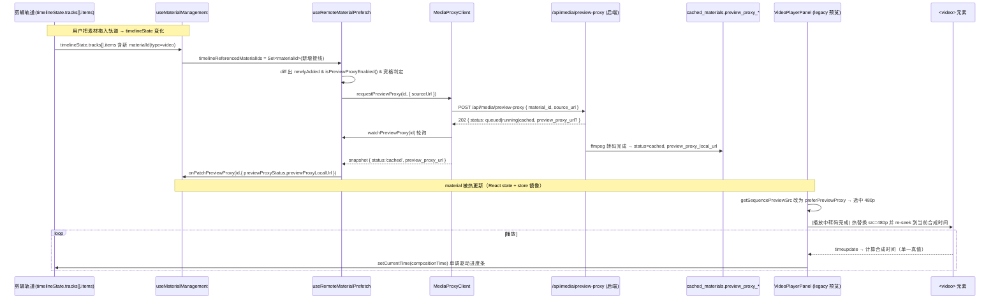

# 视频编辑器预览播放优化 —— 低清代理（Preview Proxy）落地方案

> Topic: `video-editor-preview-proxy-playback`
> 文档版本：**v2（评审修复稿）**
> 语言：简体中文（标识符 / 路径 / 接口保留英文）
> 输出目录：`docs/plans/video-editor-preview-proxy-playback/`
> 关联既有规划：`docs/plans/video-editor-playback-optimization/`（master-plan + specs 01–08）、
> `video-editor-playback-v2-phase2/3/4`

---

## 评审记录（Review Notes，v1 → v2）

> 评审人：Anthropic 工程团队资深评审。评审方式：**对照源码逐节核验**（非仅读文档），所有结论均附 `file:line` 证据。
> 评审维度：可行性（Feasibility）/ 完整性（Completeness）/ 一致性（Consistency）/ 体量适配（Right-sizing）。
> 所有 **P0 / P1** 问题均已在本 v2 文档对应章节就地修复；P2 留作实现期注意项。

### 已核验成立的前提（保留原方案的基础）

逐文件核验确认以下基建确实存在，原方案"复用为主、不重建"的总体策略**成立**：

- 后端转码服务 `preview_proxy_service.py`（`ensure_or_enqueue:161` / `_run_transcode` / ffmpeg 480p 参数）、
  路由 `preview_proxy_router.py`（`POST /preview-proxy:101`、`status:156`、`file:194`）已在 `main.py:622-624`
  以 `prefix="/api"` + 路由内 `prefix="/media"` 注册为 `/api/media/preview-proxy`。✓
- `cached_materials.preview_proxy_*` 九列已落库（`db_models.py:159-167`，迁移 011）。✓
- 前端 `selectPlaybackUrl.ts` 的 5 级阶梯与 `effectivePreviewUrl`（`:145`，默认 `preferPreviewProxy=true / fallback='proxy'`）、
  `export` 路径 INV3 跳过代理（`:89-92`）均存在。✓
- `MediaProxyClient.requestPreviewProxy(id, { sourceUrl, profile, priority })`（`:91`）、`watchPreviewProxy`（`:129`）存在。✓
- `isPlaybackV2Enabled()` 默认 `false`（`playbackFlags.ts:109`），触发被双重门控
  （`useRemoteMaterialPrefetch.ts:353-361` 的 `phase3Enabled` + `:378-380` 的 `currentRefIds` 判空）属实。✓
- `material_router.py` **已**序列化 `preview_proxy_*` 字段（`:54-58` / `:178-192`）—— §3.2.5 该项为"已完成"，非待办。✓

### 问题清单

| ID | 维度 | 严重度 | 概述 | 证据 | 处置 |
|----|------|--------|------|------|------|
| **C1** | 可行性 / 一致性 | **P0** | 仅改 `getSequencePreviewSrc` **既不能**让 `<video>` 真正加载 480p 代理，**又会**打断 src 比对不变量，触发 da056df 类"反复换源 / 刷屏 / play() AbortError"回归 | 实际 src 由 `assignSequenceSrc → resolveSequencePlaybackUrl(seq,materials)?.url`（`VideoPlayerPanel.tsx:402`）写入，而 `resolveSequencePlaybackUrl.ts:55-118` **完全不读** `previewProxy*`，只走 `cacheUrl→serverUrl→url`；同时 `getSequencePreviewSrc` 还被当作"是否需换源"的比对键（`:1234/:1544/:1622/:1909/:2122/:2438`） | **已修复**：§3.2.3 改为以 **`resolveSequencePlaybackUrl` 为唯一 proxy-aware 解析器**，`getSequencePreviewSrc` 委托同一解析器，保证"赋值源 ≡ 比对键"；§四新增改动文件 `resolveSequencePlaybackUrl.ts` |
| **C2** | 可行性 / 完整性 | **P0** | 后端无法为**本地上传素材**生成代理——而"本地 4K 上传"正是本方案 §7.2 验收用例与用户主诉场景 | `ensure_or_enqueue` 在 `material_id` 已给但 `cached_materials` 无行时直接 `raise PreviewProxyNotFoundError`（`preview_proxy_service.py:204-207`）；`source_url` 兜底入库分支被 `if not material_id and source_url` 门控（`:191`），前端**总是**传 `material_id`，故该分支对本地上传**不可达**。本地上传不写 `cached_materials`（仅 `material_download_service`/`ark`/`media_proxy` 写入，上传走 `static/uploads/`），`_get_row` 按 `CachedMaterial.id==mid` 查（`:564`）必然 miss | **已修复**：§3.2.5 增补后端分支——`material_id` 无行且 `source_url` 为同源/本地存储路径时，复用存储挂载→磁盘映射 + `validate_local_path_for_ffmpeg` 解析为 `local_path` 并 **seed 一行 `cached_materials`** 后再入队；§3.2.2 资格判定收敛为"输入可解析才入队"；R2 重写 |
| **C3** | 完整性 / 体量适配 | **P1** | 资格判定放宽为"任意 timeline 视频"但未定义 `bytes/width/height` **未知**时的行为；本地上传常无这些元数据，"小文件豁免"无法触发，叠加 C2 会对每个本地视频发出注定 404 的 POST | `_previewProxyEligible:69-75` 现依赖 `_matchesPreviewProxyHeuristic`（`:50-67`，读 `material.bytes/bitrate/metadata.source`）；本地上传这些字段多为空 | **已修复**：§3.2.2 明确——仅当"转码输入可解析"（有同源本地源/cacheUrl/已知 cached_materials 行）才入队；尺寸/体积**未知时默认入队**（正确性优先，后端幂等），仅在"已知且 ≤ 阈值"时豁免；H1/H2/H3 保留为强制快捷命中 |
| **C4** | 完整性 / 一致性 | **P1** | R6 声称"lookup/ingest 序列化做 hydrate"，但前端**从不**把响应里的 `preview_proxy_*` 映射进 `MaterialItem.previewProxy*`——刷新后实际只能靠"重新 POST"恢复，R6 缓解措施描述与代码不符 | 全仓 `src/lib`、`src/app/api`、`useMaterialManagement.ts` 中 grep `preview_proxy/previewProxy` 映射 = **0 命中**；后端 `material_router.py:178-192` 虽返回字段，前端未消费 | **已修复**：§四新增前端映射改动（ingest/lookup 响应 → `previewProxy*` 写回），使 hydrate 真实生效；R6 文案改为"直接 hydrate（新增映射）+ 幂等重 POST 双保险" |
| **C5** | 一致性 | **P2** | `effectivePreviewUrl(.., fallback:'proxy')` 在代理**未就绪**时会把远端原片改走 `/api/media/proxy?u=`（同源媒体代理），相对原 legacy `getSequencePreviewSrc`（`fallback` 默认 `'origin'`，直连 CDN）是一处**行为变更** | `selectPlaybackUrl.ts:99/116-123`；原 `getSequencePreviewSrc:380` 走默认 `'origin'` | 留意项：媒体代理为同源、可规避 CORS，方向正确；已在 §3.2.3 注明该变更属预期，并保证未就绪回退仍可播 |
| **C6** | 完整性 | **P2** | §3.2.5 / 原 R2 把风险定位为"`validate_external_url` 私网拦截同源上传"，但转码输入实际取 `row.local_path` 并由 `validate_local_path_for_ffmpeg` 校验（`:316/:331`），转码路径**不调用** `validate_external_url`；真正缺口是 C2（无行）而非外网校验 | `preview_proxy_service.py:316/:329-334` | 已随 C2 一并在 §3.2.5 重写，删除"绕过外网校验"的错误表述 |
| **C7** | 可行性 | **P2** | 转码输入受 `_ffmpeg_allowed_roots()` 白名单约束；需确认该白名单**包含上传目录**（`STORAGE_ROOT/uploads` 子树），否则 seed 行后仍会被 `validate_local_path_for_ffmpeg` 拒绝 | `preview_proxy_service.py:330-331` | 实现期校验项：已在 §3.2.5 列为"落地前必须确认 allowed_roots 覆盖上传目录" |
| **C8** | 完整性 | **P2** | 进度条非递减守卫须以**合成时间**（跨 sequence 单调）为键，**不可**以 `video.currentTime`（每片段归零）为键，否则会在片段边界误丢更新 | `handleTimeUpdate:1511+`、片段切换处 `compositionCurrentTimeRef` 重置（`:1377/:1917`） | 已在 §3.2.4 显式约束：守卫只比较 `compositionCurrentTimeRef`，且 `isSeekingRef`/换源/切片段时重置基准 |
| **C9** | 一致性 | **P2** | 文中若干行号为审计快照，与现网略有漂移（如 `compositionCurrentTimeRef` 实为 `:259` 而非 `:278`；`useMaterialManagement` store hook 在 `:1132`） | 见各处实测 | 文档已声明"以落地实测为准（符号引用优先）"，保留；本节补正主要行号 |

> **对原 TL;DR"休眠即通"判断的修正**：基建虽齐备，但**消费侧（C1）与本地上传输入（C2）并非"接线即用"，需要对 `resolveSequencePlaybackUrl` 与 `ensure_or_enqueue` 做实质改动**。v2 已据此扩充 §3.2.3 / §3.2.5 与 §四变更清单。总体策略（解耦 + 默认开启低清代理 + 不动导出）依然成立。

---

## 〇、需求与结论摘要（TL;DR）

**用户诉求**：在 Video Editing 中把视频/音频素材剪到下方剪辑轨道后，点右侧"播放组合"的播放按钮预览时，**播放极度卡顿**；要求做到：
1. 播放**稳健、流畅**；
2. 播放进度与**下方剪辑轨道进度条完全对应**；
3. 倾向于"**降低预览画质 + 极小数据传输量**"，预览时**不直接播放原始高清视频**。

**核心结论（基于源码审计，非文档）**：满足以上诉求所需的**全套基础设施已经实现且通过测试**，但因为被功能开关与未接线的入参**整体处于休眠状态**，对默认用户从未生效。具体证据：

| # | 既有能力 | 实现位置 | 当前状态 |
|---|----------|----------|----------|
| A | 后端 480p 低清转码（H.264 baseline / CRF28 / 96k AAC / faststart 小文件） | `app/services/preview_proxy_service.py`、`app/routers/preview_proxy_router.py`（已在 `app/main.py` 注册，前缀 `/api/media`） | **已实现**，幂等、OSS 可选；但**仅对已有 `cached_materials` 行的素材可转码**，本地上传需 v2 §3.2.5 seed 行补齐（见评审 C2） |
| B | `cached_materials` 的 `preview_proxy_*` 字段 | `app/models/db_models.py`、迁移 `alembic/versions/011_add_preview_proxy_fields.py` | **已落库** |
| C | 前端 5 级 URL 选择（P1 同源 480p → … → P5 原片 CDN） | `src/components/video/lib/selectPlaybackUrl.ts` | **已实现**，`preview` 路径默认 `preferPreviewProxy=false` |
| D | 前端预览代理触发 + 状态轮询客户端 | `src/components/video/timeline/infrastructure/MediaProxyClient.ts`、`hooks/useRemoteMaterialPrefetch.ts` | **已实现但未启用** |
| E | 播放 v2（canvas 合成 + A/B 双缓冲 + 状态机 + rAF 时钟） | `src/components/video/playback/*`、`PreviewSurface.tsx` | **已实现**，`isPlaybackV2Enabled()` 默认 **false** |

**三处"休眠点"（即本方案要解决的根因）**：

- **根因 1 —— 触发被双重门控**：`useRemoteMaterialPrefetch.ts` 的 preview-proxy 触发块同时要求
  `phase3Enabled = isPlaybackV2Enabled()`（默认 false，见 `playbackFlags.ts:59-110`）**且**外部传入
  `timelineReferencedMaterialIds`。但唯一调用点 `useMaterialManagement.ts:1150-1154` **从未传入该参数**，
  导致 `currentRefIds === null`，触发块在 `useRemoteMaterialPrefetch.ts:380` 直接 `return`。⇒ **480p 代理永远不会生成。**
- **根因 2 —— legacy 预览路径不消费代理**：用户默认走 legacy 渲染路径（v2 关），其取流口径
  `getSequencePreviewSrc`（`VideoPlayerPanel.tsx:378-382`）调用
  `selectPlaybackUrl(seq, { purpose: 'preview' })`，**未传 `preferPreviewProxy`**，
  按 `selectPlaybackUrl.ts:98` 即 `preferPreview=false`，因此**即便代理已生成也不会被选中**（直接跳到 P3/P4/P5 原片）。
- **根因 3 —— 原片解码瓶颈**：综合根因 1、2，预览实际播放的是**原始高清/高码率文件**（本地上传 4K、Pexels/ARK 高码率），
  浏览器/显卡解码压力大，连续播放与片段切换均卡顿。

**方案策略**：**把"低清预览代理"从重型 playback-v2 引擎解耦，做成一个独立、默认开启、且在用户实际运行的 legacy 渲染路径上也生效的能力**。
即：复用既有后端转码与 5 级 URL 选择，仅补齐"触发接线 + legacy 路径消费 + 进度条单一时间源校正"三类小改动。
播放 v2 canvas 引擎的整体开启作为**可选增强**列入"非主线范围"，以控制本次落地风险。

---

## 一、概述（Overview）

本方案目标是让视频编辑器的"播放组合"预览达到**稳定、流畅、且与剪辑轨道进度条严格对应**的体验，落地手段与用户建议一致：**预览时播放体积极小的低清代理（480p / ~CRF28 / faststart fMP4），而非原始高清视频**。导出（export）链路完全不受影响，仍使用原始素材，画质无损（沿用既有 `selectPlaybackUrl(purpose:'export')` 的 INV3 约束，见 `selectPlaybackUrl.ts:89-92`）。

经过对当前代码库的逐文件审计，我们确认：实现该体验所需的后端转码服务、数据库字段、前端 URL 选择策略、触发客户端等**均已存在并通过单测**，只是被 playback-v2 灰度开关与一处未接线的入参整体关闭。因此本方案**不重建任何核心组件**，而是以最小、明确、可逐行落地的改动把这条链路"接通并默认打开"：①在素材首次进入时间轴时自动请求 480p 代理；②让默认 legacy 预览路径优先消费已就绪的 480p 代理；③代理在播放过程中转码完成时，原地热替换 `<video>.src` 并回到当前合成时间；④保证播放头（合成时间）作为唯一时间真值单调驱动剪辑轨道进度条，杜绝回跳与错位。

之所以选择"解耦 + 默认开启低清代理"而非"直接全量打开 playback-v2"，是因为：(a) 用户的首要诉求"降低画质、极小传输量、不放原片"由低清代理**单独即可满足**，与 canvas 引擎是否开启无关；(b) playback-v2 引擎被刻意保持灰度关闭以控制回滚风险（见 master-plan §九 / §十一），本次不宜做大爆炸式切换；(c) 低清 480p 文件的解码成本相对 4K/20Mbps 原片下降一个数量级，是**卡顿的主因**，单这一项即可带来质变的流畅度提升，同时把数据传输量从数百 MB 级降到数 MB 级。canvas A/B 双缓冲带来的"片段边界零闪屏"作为可选增强，可在低清代理稳定后按既有灰度流程独立推进。

---

## 二、目标与非目标

### 2.1 目标（In Scope）

- **G1 低清预览默认生效**：素材首次被拖入剪辑轨道后，系统自动为其生成/复用 480p 代理；预览播放优先使用该代理。对默认用户开箱即用，无需手动开 flag。
- **G2 流畅度**：高码率/高分辨率素材预览不再因解码瓶颈卡顿；连续播放与多片段顺序播放可感知流畅。
- **G3 进度条严格对应**：播放头与下方剪辑轨道 ruler/进度条读取**同一个合成时间真值**，正常播放时单调前进、无回跳，seek 后画面与进度一致。
- **G4 低风险解耦**：低清代理能力由独立开关 `isPreviewProxyEnabled()` 控制（默认 true），不依赖 `isPlaybackV2Enabled()`；出现问题可单独关闭。
- **G5 导出不退化**：导出仍走原片（`purpose:'export'` 仅返回 `serverUrl||url`），代理只服务 preview。

### 2.2 非目标（Out of Scope）

- **不**整体默认开启 playback-v2 canvas 引擎（保留其既有独立灰度，作为后续增强）。
- **不**新增多档位（720p/1080p 预览）；首期固定 480p（复用既有 profile `preview-480p`）。
- **不**改导出/合成流水线、字幕识别、视频理解、Storyboard、工作流等其它模块。
- **不**引入新的前端状态库或新的第三方依赖。
- **不**新增数据库表/字段（`preview_proxy_*` 字段已存在，迁移 011 已落库）。

---

## 三、技术设计（Technical Design）

### 3.1 端到端数据流



### 3.2 关键代码路径与改动点

#### 3.2.1 独立开关 `isPreviewProxyEnabled()`（新增，默认 true）

在 `src/lib/playbackFlags.ts` 内**新增**与 v2 解耦的独立解析函数（不复用 v2 的 kill-switch / 默认 false 语义）：

- 解析顺序：`localStorage['ecliptrix-preview-proxy']`（`'true'/'false'`）→ `process.env.NEXT_PUBLIC_PREVIEW_PROXY_ENABLED`（`'true'/'false'`）→ **默认 `true`**。
- 与 v2 的差异：v2 默认 `false`（见 `playbackFlags.ts:109`），本开关默认 `true`，使低清代理对所有用户开箱即用。
- SSR/无 window 时返回 `false`（仅客户端跑），与 v2 同处理。
- 复用现有常量风格，新增导出常量键 `PREVIEW_PROXY_FLAG_KEY = 'ecliptrix-preview-proxy'` 并并入 `PLAYBACK_FLAG_KEYS`。

#### 3.2.2 触发接线：让 480p 代理真正被生成

**(a) 解除 v2 门控** —— `src/components/video/hooks/useRemoteMaterialPrefetch.ts`：
- 把 preview-proxy 块的 `phase3Enabled`（当前 `= isPlaybackV2Enabled()`，见 `:353-361`）替换为新的
  `previewProxyEnabled = useMemo(() => !options.disablePhase3 && isPreviewProxyEnabled(), [])`。
  其余 phase-3 路径（`preloadSequenceWindow`，`:458-462`）保持仍由 v2 控制（属于 canvas 引擎增强，不在本次范围），即把"代理触发"与"窗口预热"两段拆开各自门控。
- 资格判定 `_previewProxyEligible`（`:69-75`）**放宽但收敛于"输入可解析"**（评审 C3）：默认对 timeline 视频素材生成 480p 代理，而非仅命中 H1/H2/H3 重资产。判定顺序：
  - 仍跳过 `type !== 'video'` 与已 `cached/queued/running` 的素材；
  - **输入可解析门槛（必要条件）**：仅当该素材能解析出"可转码输入"才入队——即满足以下任一：①已有 `cacheUrl`（同源缓存，已在 `cached_materials`）；②`serverUrl`/`url` 为**同源/本地存储路径**（`/api/storage/files/...` 或相对同源），可被后端映射到磁盘（见 §3.2.5 seed 分支）；③已知存在 `cached_materials` 行。**纯远端、且本地尚无副本的 CDN 素材**先走既有 ingest/cache 流程落地，待 `cacheUrl` 就绪后的下一拍再触发代理（避免对不可解析输入空发 POST）。
  - **小文件豁免**：当 `bytes` **已知**且 < 阈值（默认 8MB，可配）**或** `width/height` **已知**且 ≤ 480p 等效时，跳过转码直接用原片。**尺寸/体积未知时默认入队**（正确性优先：本地上传常缺元数据，宁可多转一次低清——后端幂等、产物可秒级复用，也不放任 4K 原片直播卡顿）。
  - 保留原 H1/H2/H3 作为"强制命中"快捷路径。
- 触发时**必须**传 `sourceUrl`：`requestPreviewProxy(id, { sourceUrl: material.serverUrl || material.url })`。这是 §3.2.5 后端 seed 分支定位本地上传输入的关键入参——注意：后端**不再**因 `material_id` 已给就忽略 `sourceUrl`（原后端逻辑会在无行时直接 404，见评审 C2）。

**(b) 接通入参** —— `src/components/video/hooks/useMaterialManagement.ts`（调用点 `:1150-1154`）：
- 从全局 store 读取时间轴并派生集合：
  ```ts
  const timelineState = useVideoEditingStore(state => state.timelineState);
  const timelineVideoMaterialIds = useMemo(() => {
    const ids = new Set<string>();
    timelineState?.tracks?.forEach(t =>
      t.items?.forEach(it => {
        if (it.type === 'video' && it.materialId) ids.add(it.materialId);
      }));
    return ids;
  }, [timelineState]);
  ```
  （`TimelineState.tracks[].items[]` 形态见 `src/types/index.ts:881-939`；`useVideoEditingStore` 已在本文件 `:11/:1132` 引入。）
- 调用点补两个入参：
  ```ts
  useRemoteMaterialPrefetch(materials, patchMaterialCache, {
    timelineReferencedMaterialIds: timelineVideoMaterialIds, // 新增：触发的必要输入
    onPatchPreviewProxy: patchMaterialCache,                  // 既有
  });
  ```

#### 3.2.3 消费接线：legacy 预览路径选中 480p

> **⚠ 评审 C1（P0）—— 务必读懂这个不变量再动手。** legacy 路径里 `getSequencePreviewSrc` 有**两个**职责：
> ①作为 `assignSequenceSrc` 的**回退候选**（`:402` `resolved?.url || getSequencePreviewSrc(seq)`）；
> ②作为"是否需要换源"的**比对键**（`:1234/:1544/:1622/:1909/:2122/:2438`，`normalizeVideoUrl(video.src) === normalizeVideoUrl(getSequencePreviewSrc(seq))`）。
> 而 `<video>.src` 的**实际写入值**来自 `assignSequenceSrc` 的**主候选** `resolveSequencePlaybackUrl(seq, materials)?.url`，该解析器**只读 `cacheUrl→serverUrl→url`、完全不认识 `previewProxy*`**（`resolveSequencePlaybackUrl.ts:55-118`）。
> 因此"只改 `getSequencePreviewSrc`"会同时踩两个坑：(i) `<video>` 仍加载原片/同源缓存，**480p 代理根本不会被播放**，优化形同虚设；(ii) 比对键变成代理 URL 而实际 src 是原片 URL，`needsSourceChange` **恒为真**（`:1909`），每次 timeupdate/seek 都重设 src → captureFrameToCanvas 刷屏 + `play()/pause()` AbortError，即 da056df 回归（代码 `:374-377` 注释明确警告）。

**正确做法：把"proxy 感知"下沉到唯一解析器 `resolveSequencePlaybackUrl`，让"赋值源 ≡ 比对键"。**

**(a-1) `resolveSequencePlaybackUrl.ts`（新增改动文件，§四 #）** —— 在其候选链**最前面**插入 proxy 档位（保持纯函数）：当 `isPreviewProxyEnabled()` 且 `material.previewProxyStatus === 'cached'` 时，把 `effectivePreviewUrl(material, { preferPreviewProxy:true, fallback:'origin' })`（即 `toAbsolutePlaybackUrl(previewProxyLocalUrl)` → `previewProxyOssUrl`）作为 `primary`，原 `cacheUrl→serverUrl→url` 顺延为 `fallbacks`。未就绪（非 `cached`）时**完全保持原行为**。开关读取一次并以参数注入，避免纯函数内直接读 `localStorage`（便于单测）：
```ts
// 由调用方注入 preferPreviewProxy（VideoPlayerPanel 在挂载时锁定 isPreviewProxyEnabled()）
export function resolveSequencePlaybackUrl(seq, materials, opts?: { preferPreviewProxy?: boolean }) { … }
```

**(a-2) `getSequencePreviewSrc`** —— 改为**委托同一解析器**，保证它产出的比对键与 `assignSequenceSrc` 写入的实际 src **逐字节一致**（其中 `previewProxyEnabled` 在 `VideoPlayerPanel` 顶部以 `const previewProxyEnabled = useMemo(() => isPreviewProxyEnabled(), [])` 挂载时锁定，与 CLAUDE.md"flag 挂载锁定"约定一致）：
```ts
const getSequencePreviewSrc = useCallback(
  (seq: VideoSequenceItem): string =>
    resolveSequencePlaybackUrl(seq, materials || [], { preferPreviewProxy: previewProxyEnabled })?.url
      || selectPlaybackUrl(seq, { purpose: 'preview' })
      || seq.url,
  [materials, previewProxyEnabled],
);
```
`assignSequenceSrc`（`:402`）维持 `resolved?.url || getSequencePreviewSrc(seq)` 不变即可——因为 `resolved` 现在已是 proxy-aware，主候选即 480p；`fallbacks`（原片链）作为代理 4xx/解码失败时的兜底，由既有 `assignVideoSrcChecked` 事件驱动重试。`materials` 已是闭包可得（同文件多处使用）；注意把 `materials`、`previewProxyEnabled` 加入相关 `useCallback` deps。该口径同时让 v2 resolver（`:467-490`，已用 `effectivePreviewUrl`）与 legacy 路径**口径统一**（解决 R7）。

**(b) 转码完成时热替换** —— `VideoPlayerPanel.tsx` 新增一个 effect：当**当前正在播放/已绑定**的 sequence 对应 material 的 `previewProxyStatus` 由非 `cached` 跃迁为 `cached` 时：
1. 记录当前合成时间 `compositionCurrentTimeRef.current`；
2. 经 `assignSequenceSrc`/`getSequencePreviewSrc` 重解析得到 480p URL，写入 `<video>.src`；
3. `lockSeekUntilSeeked` 期间把 `<video>.currentTime` 设为映射后的片内偏移（`mapTimelineTimeToVideoTime(seq, offset)`），`seeked` 后 `releaseSeekLock` 并按原播放态续播。
   - 仅对"当前 sequence"做即时热替换；其它 sequence 在下次被切到时自然用新 URL，避免一次性重置整条链路。
   - 若当前处于播放中，允许一次 < 1 帧级别的轻微 hitch（可接受）；若处于暂停，则静默替换。

#### 3.2.4 进度条单一时间源校正（G3）

- **真值**：合成时间 `compositionCurrentTime`（`VideoPlayerPanel.tsx:278` 系列 ref）是预览位置的唯一真值；`<video>.currentTime` 仅为派生表示。
- **驱动进度条**：`handleTimeUpdate`（`:1511+`）在定位到正确 sequence 后，将"合成时间 = 该 sequence 的 timeline 起点累计 + (video.currentTime − clipStart)"写回 timeline `setCurrentTime`，剪辑轨道 ruler/进度条读取该同一 `currentTime`。
- **单调约束**：正常播放（非 seek）时新合成时间若 < 上一次值，丢弃该次写回（防"前进→回跳→再前进"），仅在显式 seek/拖动 ruler 时允许回退。该约束实现为 `handleTimeUpdate` 内对 `compositionCurrentTimeRef` 的"非递减守卫 + `isSeekingRef` 例外"。
  - **守卫必须以合成时间为键（评审 C8）**：守卫只比较跨 sequence 单调的 `compositionCurrentTimeRef`，**严禁**以 `video.currentTime` 为键——后者在每次切片段/换源时归零（`:1377/:1917` 处 `compositionCurrentTimeRef` 被显式重置即为证），若以它判定会在片段边界误判"回跳"而丢弃合法更新导致进度条卡住。
  - **基准重置**：发生 seek、拖动 ruler、热替换 src、切换 sequence 时（即 `isSeekingRef.current === true` 或 `pendingCompositionSeekRef` 生效期间）将守卫基准重置为目标合成时间，恢复播放后再继续非递减判定。
- **代理时长对齐**：ffmpeg 转码保持时长/时间基不变，且 `-g`/keyframe 使 Range/seek 定位准确（见 §五 ffmpeg 参数），故 480p 与原片在合成时间→片内偏移的映射完全一致，进度条不会因换源而偏移。
- 该节**不改动**既有双时间源结构（master-plan 评审 F2 记录的 component-local timeline store 与全局 store 并存属于 playback-optimization 计划范畴），仅保证 player → `setCurrentTime` 的写回单调、换源不重置，确保"进度条完全对应"。

#### 3.2.5 后端微调

- **本地上传输入：seed `cached_materials` 行（评审 C2，P0，本方案后端核心改动）**——
  现状（已核验）：`ensure_or_enqueue` 在 `material_id` **已给**但 `cached_materials` 无该行时直接 `raise PreviewProxyNotFoundError`（`preview_proxy_service.py:204-207`）；而 `source_url` 入库分支被 `if not material_id and source_url` 门控（`:191`）——前端总是传 `material_id`，故该分支对本地上传**不可达**。本地上传不写 `cached_materials`（只有 `material_download_service`/`ark`/`media_proxy` 写入；上传走 `static/uploads/`），`_get_row` 按 `CachedMaterial.id == mid`（`:564`）必然 miss。⇒ **不补此分支，本地 4K 上传永远拿不到代理，本方案 §7.2 验收用例直接失败。**
  改法：在 `ensure_or_enqueue` 取到 `row is None` 时**不立刻 404**，先尝试"同源/本地 seed"：
  1. 若入参带 `source_url` 且其指向**同源存储**（`/api/storage/files/...` 前缀或相对同源路径），将其映射为磁盘路径——剥离 `/api/storage/files/` 挂载前缀后 join 到 `STORAGE_ROOT`，再经既有 `validate_local_path_for_ffmpeg(path, allowed_roots)` 做**路径穿越校验**（拒绝越出白名单根的输入）。
  2. 校验通过 → 以 `id = material_id, local_path = <已校验磁盘路径>, source='upload'` **insert 一行 `cached_materials`**（`preview_proxy_status='absent'`），随后照常 flip `queued` 并入队；`_run_one` 即可读到 `row.local_path` 转码（`:316`）。
  3. 映射失败/越权/文件不存在 → 才返回原 `PreviewProxyNotFoundError`，前端 `.catch` 静默回退原片。
  说明（评审 C6）：转码输入实际取自 `row.local_path` 并由 `validate_local_path_for_ffmpeg` + `FFMPEG_LOCAL_PROTOCOL_WHITELIST` 守卫（`:316/:329-334`），**转码路径并不调用 `validate_external_url`**；原 v1 把风险描述为"外网校验私网拦截"属定位偏差，已删除。纯远端 CDN 素材仍沿用 `not material_id` 的既有 ingest 分支（`:191-202`）。
- **落地前必须确认（评审 C7，P2）**：`_ffmpeg_allowed_roots()`（`:330`）返回的白名单**必须覆盖上传目录**（`STORAGE_ROOT`/`static/uploads` 子树）。若当前仅含 `cached_materials`/`temp`，需补入上传根，否则 seed 行后仍会被 `validate_local_path_for_ffmpeg` 拒绝。落地时先打印 allowed_roots 核对。
- **lookup/ingest 序列化（已完成，勿重复造）**：`material_router.py` **已**在 `/api/material/{lookup,ingest}` 响应序列化 `preview_proxy_status/profile/local_url/oss_url/progress`（`:54-58` / `:178-192`），后端侧无需再改。**真正缺失的是前端映射**（评审 C4，见 §四新增项）：前端 ingest/lookup 客户端从不把这些字段写回 `MaterialItem.previewProxy*`（全仓 grep 0 命中），故"刷新即 hydrate"目前并不成立——需补前端映射，或接受"靠下一拍幂等重 POST 恢复"。本方案选择**补前端映射**使 hydrate 真实生效。
- **默认开启**（`config/preview-proxy-config.yaml`）：确认 `preview_proxy.enabled: true`、`default_profile: preview-480p`、`max_concurrent_transcode`（默认 2）。仅核对，不新增机制。

---

## 四、文件 / 模块变更计划（Change Plan）

> 原则：**复用为主，新增极少**。下游"代码开发"节点请逐项落地，不要做超出本表的额外重构。
> 行号为审计时实测（2026-06-02），以落地实测为准（符号引用优先）。

| # | 文件 | 类型 | 一句话意图 |
|---|------|------|------------|
| 1 | `src/lib/playbackFlags.ts` | 修改 | 新增独立 `isPreviewProxyEnabled()`（默认 true）+ 常量 `PREVIEW_PROXY_FLAG_KEY`，与 v2 解耦 |
| 2 | `src/components/video/hooks/useRemoteMaterialPrefetch.ts` | 修改 | preview-proxy 触发改由 `isPreviewProxyEnabled()` 门控（与 `preloadSequenceWindow` 的 v2 门控拆开）；`_previewProxyEligible` 收敛为"**输入可解析**才入队 + 小文件豁免（未知尺寸默认入队）"；触发**必须**传 `sourceUrl`（评审 C2/C3） |
| 3 | `src/components/video/hooks/useMaterialManagement.ts` | 修改 | 派生 `timelineVideoMaterialIds` 并作为 `timelineReferencedMaterialIds` 传入 hook（接通触发） |
| 4 | `src/components/video/lib/resolveSequencePlaybackUrl.ts` | **修改（新列入，评审 C1）** | 候选链最前插入 proxy 档位：`previewProxyStatus==='cached'` 且开关 on 时以 480p（`effectivePreviewUrl`）为 `primary`，原 `cacheUrl→serverUrl→url` 顺延为 `fallbacks`；`preferPreviewProxy` 经参数注入保持纯函数 |
| 5 | `src/components/video/components/VideoPlayerPanel/VideoPlayerPanel.tsx` | 修改 | `getSequencePreviewSrc` **委托** proxy-aware 的 `resolveSequencePlaybackUrl`（保证"赋值源≡比对键"，消除 C1 的 src 抖动）；新增"代理就绪热替换 src + re-seek"effect；`handleTimeUpdate` 合成时间非递减守卫（守卫键=合成时间，C8） |
| 6 | `src/components/video/hooks/useMaterialManagement.ts`（或对应 material API 客户端） | **修改（新列入，评审 C4）** | ingest/lookup 响应里的 `preview_proxy_*` 字段映射写回 `MaterialItem.previewProxy*`，使刷新后直接 hydrate（后端已序列化，仅缺前端映射） |
| 7 | `backend-services/basic-service/app/services/preview_proxy_service.py` | 修改 | `ensure_or_enqueue` 在 `material_id` 无行且 `source_url` 为同源/本地路径时，映射磁盘路径 + `validate_local_path_for_ffmpeg` 后 **seed 一行 `cached_materials`** 再入队（评审 C2）；删除"绕过外网校验"误述（C6） |
| 8 | `backend-services/basic-service/app/services/preview_proxy_service.py`（`_ffmpeg_allowed_roots`） | 核对/必要时修改 | 确认白名单覆盖 `STORAGE_ROOT`/`static/uploads` 子树，否则 seed 行后被路径校验拒绝（评审 C7） |
| 9 | `backend-services/basic-service/app/routers/material_router.py` | **核对（已完成）** | lookup/ingest 已序列化 `preview_proxy_*`（`:54-58/:178-192`），无需再改 |
| 10 | `backend-services/basic-service/config/preview-proxy-config.yaml` | 核对 | 确认 `enabled: true` / `preview-480p` / 并发档位 |
| 11 | `src/components/video/hooks/__tests__/useRemoteMaterialPrefetch.previewProxy.test.ts` | 修改 | 覆盖新开关门控 + `timelineReferencedMaterialIds` 触发 + "输入可解析"资格 + 未知尺寸入队 |
| 12 | `src/components/video/lib/__tests__/resolveSequencePlaybackUrl*.test.ts` | **新增（评审 C1）** | 断言 `cached` 时 `primary`=480p、原链降级为 `fallbacks`；未就绪时**逐字节**保持原行为；与 `getSequencePreviewSrc` 一致 |
| 13 | `src/components/video/components/VideoPlayerPanel/__tests__/*`（如无则新增轻量测试） | 新增/修改 | 断言"赋值源≡比对键"（代理 cached 时 `video.src`==`getSequencePreviewSrc`，`needsSourceChange` 不再恒真）、未就绪回退原行为 |
| 14 | `backend-services/basic-service/tests/test_preview_proxy_service.py` | 修改 | 覆盖**本地上传 seed 行 → 转码成功**、路径穿越被拒、`material_id` 无行且无同源 source_url → NotFound、幂等返回 cached |
| 15 | `src/lib/__tests__/playbackFlags*.test.ts`（如有）/ 新增 | 新增/修改 | 断言 `isPreviewProxyEnabled()` 默认 true 及 localStorage/env 覆盖、与 v2 kill-switch 互不影响 |

> **不需要**新增 Alembic 迁移（`preview_proxy_*` 字段已由迁移 011 落库；seed 行只写既有列，不改表结构）。
> **不需要**新增 REST 端点（`/api/media/preview-proxy[/status|/file]` 已存在）。

---

## 五、接口设计（Interfaces）—— 复用既有契约

> 本方案**不新增**后端接口，仅消费既有端点。下表为前端需对接的契约，供实现核对。

### 5.1 `POST /api/media/preview-proxy`（既有，`preview_proxy_router.py:101`）

请求：
```jsonc
{ "material_id": "<id>", "source_url": "<同源或远端 URL，可选兜底>", "profile": "preview-480p", "priority": "normal" }
```
响应 `202`：
```jsonc
{ "success": true, "data": {
    "task_id": "string|null", "material_id": "string",
    "profile": "preview-480p",
    "status": "queued|running|cached|failed",
    "preview_proxy_url": "string|null" } }
```
幂等：`(material_id, profile)` 已 `cached` 直接返回 `cached`。前端通过 `MediaProxyClient.requestPreviewProxy`（`MediaProxyClient.ts:91`）调用，并发去重内置。

### 5.2 `GET /api/media/preview-proxy/status?material_id=&profile=`（既有，`:156`）

响应 `data`：`{ status: 'absent'|'queued'|'running'|'cached'|'failed', preview_proxy_url, profile, progress_percent, last_error, transcoded_at, duration_sec, bytes }`。前端用 `MediaProxyClient.watchPreviewProxy`（`:129`）轮询至终态。

### 5.3 `GET /api/media/preview-proxy/file?material_id=`（既有，`:194`）

`cached` 时 302→ 同源/OSS 地址；未就绪 404 `preview_proxy.not_ready`。本方案前端优先用 status 回传的 `preview_proxy_url` 直接喂 `<video>`，`file` 端点作为可选直链。

### 5.4 前端选择口径（既有，`selectPlaybackUrl.ts`）

`effectivePreviewUrl(material, { preferPreviewProxy:true, fallback:'proxy' })` → 5 级：
`P1 previewProxyLocalUrl(cached) → P2 previewProxyOssUrl → P3 cacheUrl → P4 /api/media/proxy?u= → P5 serverUrl||url`。
`purpose:'export'` 永不读代理字段（INV3）。

---

## 六、数据模型（Data Model）—— 既有字段，无变更

`cached_materials` 表（`app/models/db_models.py`，迁移 `011_add_preview_proxy_fields.py`）已含：

| 字段 | 类型 | 用途 |
|------|------|------|
| `preview_proxy_status` | string(16)，默认 `absent` | `absent/queued/running/cached/failed` |
| `preview_proxy_profile` | string(32) nullable | 档位（固定 `preview-480p`） |
| `preview_proxy_local_url` | string(1024) nullable | 同源地址 `/api/storage/files/preview-proxies/<id>/480p.mp4` |
| `preview_proxy_oss_url` | string(1024) nullable | OSS 地址（`OSS_ENABLED=true` 时） |
| `preview_proxy_progress` | int，默认 0 | 0..100 |
| `preview_proxy_bytes` | bigint nullable | 输出大小 |
| `preview_proxy_duration_sec` | float nullable | 输出时长 |
| `preview_proxy_last_error` | text nullable | 失败原因 |
| `preview_proxy_transcoded_at` | datetime nullable | 完成时间 |

前端内存形态：`MaterialItem.previewProxyStatus / previewProxyLocalUrl / previewProxyOssUrl / previewProxyProgress / previewProxyProfile`（`src/types/index.ts`，已存在，由 `onPatchPreviewProxy` 写回）。

**ffmpeg 输出契约**（`preview_proxy_service.py:66-99`，时长保持，保证进度映射一致）：
`scale=854:480 force_original_aspect_ratio=decrease + pad`，`libx264 baseline level3.1 veryfast crf28 yuv420p`，`aac 96k`，`-movflags +faststart+frag_keyframe+empty_moov`，`-f mp4`。典型 1080p/30s → 数 MB、可秒级起播。

---

## 七、测试与验收（Testing & Acceptance）

### 7.1 单元测试

- **前端**：
  - `playbackFlags`：`isPreviewProxyEnabled()` 默认 true；localStorage `'false'`/env `'false'` 可关闭；与 v2 kill-switch 互不影响。
  - `useRemoteMaterialPrefetch.previewProxy`：传入 `timelineReferencedMaterialIds` 的新增 id 且开关 on 时调用 `requestPreviewProxy`；开关 off 时不调用；已 `cached` 不重复触发；放宽后的资格判定（普通上传视频命中、超小文件豁免）。
  - `selectPlaybackUrl.previewProxy`（已存在）：P1–P5 顺序、`export` 不读代理（保持绿）。
  - `resolveSequencePlaybackUrl`（新增，评审 C1）：`cached` 时 `primary`=480p、原 `cacheUrl→serverUrl→url` 降级为 `fallbacks`；未就绪时**逐字节**保持原行为；开关 off 时不选代理。
  - `VideoPlayerPanel`：material `previewProxyStatus='cached'` 时 `getSequencePreviewSrc` 返回 480p 同源地址且**与实际写入的 `<video>.src` 一致**（`needsSourceChange` 不恒真）；未就绪回退到既有 URL。
- **后端**：
  - `test_preview_proxy_service`：mock ffmpeg 成功/进度解析/失败重试一次/幂等返回 cached；**本地上传 seed 行**（`material_id` 无行 + 同源 `source_url` → 映射磁盘路径 → 建 `cached_materials` 行 → 转码成功）；**路径穿越**（`source_url` 越出 `STORAGE_ROOT`）被 `validate_local_path_for_ffmpeg` 拒绝；`material_id` 无行且无同源 `source_url` → `NotFound`。
  - `test_preview_proxy_router`：POST→202、status 三态、file 未就绪 404。

### 7.2 集成 / 手动验收

- **本地上传 4K（评审 C2 关键用例）**：用上传入口加一段 4K 或 ≥20Mbps **本地上传**视频到轨道 → 后端经 seed 行成功建 `cached_materials` → 数秒内 `preview_proxy_status` 变 `cached` → 预览 `<video>.src` 指向 `/api/storage/files/preview-proxies/...`（DevTools Network 确认下载量为 MB 级而非原片体积）。**若该用例失败说明 #7 seed 分支或 #8 allowed_roots 未到位。**
- **远端素材（Pexels/ARK）**：搜索结果拖入轨道，确认走既有 ingest → cacheUrl → 下一拍触发代理 → `cached`。
- **无 src 抖动（评审 C1 关键回归）**：DevTools 断点/日志确认连续播放与 seek 时 `<video>.src` 不被反复重设（`needsSourceChange` 不再恒真），无 `play() AbortError` 刷屏。
- 多片段顺序播放：连续播放 30s 主观流畅、无明显卡顿。
- 进度条对应：播放与拖动 ruler 时，画面与下方进度条位置一致；一次会话内播放头**无回跳**。
- 导出回归：导出请求体仍用原片 URL（`purpose:'export'`），产物画质无损。
- 兜底回归：`OSS_ENABLED=false` 下全链路可用（输出落本地 FS）；`localStorage['ecliptrix-preview-proxy']='false'` 可一键回到原片预览。

### 7.3 验收指标（建议）

- [ ] 预览首屏数据传输量较原片下降 ≥ 80%（高码率素材）。
- [ ] 高码率素材连续 10s 播放无可感知卡顿（主观盲测 ≥ 4/5）。
- [ ] 一次 30 分钟混合操作中播放头回跳次数 = 0。
- [ ] 代理首次就绪（1080p/30s 样本，单机 2 并发）P95 < 8s。
- [ ] 既有前后端测试全部保持绿色；新增测试通过。

---

## 八、风险与缓解（Risks & Mitigations）

| ID | 风险 | 影响 | 缓解 |
|----|------|------|------|
| R1 | 转码尚未完成时用户已点播放 | 中 | 未就绪自然回退 P3/P4/P5（原片/同源缓存/媒体代理）正常播放；就绪后 §3.2.3(b) 原地热替换为 480p，仅一次轻微 hitch |
| R2 | 本地上传素材无 `cached_materials` 行，`ensure_or_enqueue` 直接 404，拿不到代理（评审 C2，原 v1 误判为"外网校验私网拦截"，已纠正 C6） | 高 | §3.2.5 新增"同源 source_url → 映射磁盘路径 → `validate_local_path_for_ffmpeg` → seed `cached_materials` 行"分支，使本地上传可转码；输入不可解析时静默回退原片 |
| R3 | 放宽资格后转码任务量上升、队列堆积 | 中 | "小文件豁免"减少无谓转码；`max_concurrent_transcode` 限并发；按需触发（仅 timeline 内素材）；失败不自动重试死循环（沿用既有 terminal-failure 约束） |
| R4 | 热替换 src 打断正在进行的 `play()`/`pause()` 触发 AbortError | 中 | 复用既有 `transitionIdRef` 代际守卫 + `lockSeekUntilSeeked`，替换在 seek-lock 内完成，`seeked` 后再续播 |
| R5 | 480p 与原片帧/时长不对齐导致进度条偏移 | 低 | ffmpeg 保持时长与时间基、固定 GOP 关键帧；导出仍用原片，预览偏移即便存在也不影响产物 |
| R6 | 页面刷新后代理状态丢失、重复 POST | 低 | 后端已序列化 `preview_proxy_*`（`material_router.py:178-192`）+ §四#6 **新增前端映射**直接 hydrate（评审 C4，原 v1 误以为前端已消费）；即便未命中，后端 POST 幂等、下一拍重 POST 即恢复，重入安全 |
| R7 | 与 playback-v2（若被某用户单独开启）并存时双路径取流口径不一致 | 低 | v2 resolver 与 legacy `getSequencePreviewSrc` 统一为 `effectivePreviewUrl(preferPreviewProxy)`，口径一致；触发门控与窗口预热已拆分，互不耦合 |
| R8 | 进度条单一时间源改动引入新的同步回归 | 中 | 非递减守卫仅作用于"非 seek 的 timeupdate 写回"，seek/拖动 ruler 走例外；补 `VideoPlayerPanel` 回归测试与手动验收 §7.2 |
| R9 | 某些容器/同源解析把相对 `preview_proxy_local_url` 解析到错误 origin | 低 | 复用 `toAbsolutePlaybackUrl` 前缀 `window.location.origin`（`selectPlaybackUrl.ts:59-70`），桌面壳/iframe 场景已覆盖 |
| R10 | "赋值源 ≠ 比对键"导致 `needsSourceChange` 恒真 → 反复换源/刷屏/`play()` AbortError（da056df 回归，评审 C1） | 高 | §3.2.3 将 proxy 感知下沉到唯一解析器 `resolveSequencePlaybackUrl`，`getSequencePreviewSrc` 委托同一解析器，保证赋值源与比对键逐字节一致；新增 #13 回归测试断言 `needsSourceChange` 不再恒真 |
| R11 | `_ffmpeg_allowed_roots()` 未含上传目录 → seed 行后仍被路径校验拒绝（评审 C7） | 中 | §3.2.5 列为落地前必查项；不含则补入 `STORAGE_ROOT`/`static/uploads` 子树 |

---

## 九、实施顺序与回滚

1. **后端先行（#7/#8/#9/#10）**：补 `ensure_or_enqueue` 本地 seed 行分支 + 核对/补 `_ffmpeg_allowed_roots` 覆盖上传目录 + 核对 lookup 序列化（已完成）+ 配置默认开启，单测（#14）先绿。**这是 C2 的落点，本地上传能否拿到代理取决于此**。
2. **前端开关与触发（#1/#2/#3）**：解耦开关 + 收敛资格判定（输入可解析）+ 必传 `sourceUrl` + 接通 `timelineReferencedMaterialIds`，使代理开始生成；可先用 DevTools 观察 `cached_materials.preview_proxy_status`。
3. **前端消费与进度（#4/#5/#6）**：先改 proxy-aware 的 `resolveSequencePlaybackUrl`（#4，C1 的落点），再让 `getSequencePreviewSrc` 委托它（#5）+ 热替换 + 进度非递减守卫 + ingest/lookup 字段映射 hydrate（#6）。**务必先验证"赋值源≡比对键"不再抖动再继续**。
4. **测试补齐（#11–#15）**与手动验收 §7.2。

**回滚**：设 `localStorage['ecliptrix-preview-proxy']='false'` 或部署 `NEXT_PUBLIC_PREVIEW_PROXY_ENABLED=false` 即整体回到原片预览；后端端点保留但不被调用，无副作用。数据库无变更，天然兼容。

---

## 十、与既有 playback-optimization 规划的关系

- 本方案是既有 `video-editor-playback-optimization`（Phase 2 / spec 06 preview-proxy）的**激活与默认化**收口，**复用其已落地的后端、字段、URL 策略与触发客户端**。经 v2 评审核实，"接通即用"并不充分，需补六类改动：①开关解耦；②触发接线（含资格收敛 + 必传 sourceUrl）；③**解析器 proxy 感知**（`resolveSequencePlaybackUrl`，原方案漏点 C1）；④legacy 消费委托统一；⑤**后端本地上传 seed 行**（原方案漏点 C2）+ 前端 hydrate 映射；⑥进度单调守卫。仍属"小步、可回滚"，不重建核心组件。
- 既有 master-plan 评审通过条件 2（"preview-proxy 触发点必须挂在 timeline addItem 路径，不得挂 `addMaterials`"）在本方案 §3.2.2(b) 以"从 `timelineState.tracks[].items` 派生 timeline 引用集合"满足——触发基于"是否在时间轴上"，而非素材库入库。
- playback-v2 canvas A/B 引擎的**整体默认开启**不在本次范围，作为后续增强按其既有灰度（`isPlaybackV2Enabled()` + kill-switch + 遥测）独立推进；本方案与之正交且口径已对齐，不互相阻塞。

---

> 本文档为 **v2（评审修复稿）**。已逐节对照源码评审并就地修复全部 P0/P1（见顶部"评审记录"）；"代码开发"节点严格按 §四 文件变更计划落地，落地时优先核对"赋值源≡比对键"（C1）与"本地上传 seed 行 + allowed_roots"（C2/C7）两处。

---

## 实施过程发现的方案缺陷（Issues Found During Implementation）

> 落地"代码开发"节点（Subtask #2）时，逐文件对照源码执行 §四 变更计划，发现 v2 方案在 C2 的落点上有**两处会让本地上传场景彻底失败的缺陷**。已按任务约定"不静默偏离、记录后按修正方案实现"。两处修正均已落代码并被 #14 后端测试覆盖。

### D1（P0）—— 本地上传 `material.id` 不是 UUID，无法直接作为 `cached_materials` 行 PK（修正 §3.2.5 step 2）

- **现象**：spec §3.2.5 step 2 写"以 `id = material_id` insert 一行 `cached_materials`"。但核验发现：
  - `CachedMaterial.id` 是 **UUID 主键**（`db_models.py:135` `Column(UUID(as_uuid=True), primary_key=True)`）。
  - 本地上传素材的前端 `MaterialItem.id` 形如 `video_<Date.now()>_<rand>`（`useMaterialManagement.ts:330/389`），**根本不是 UUID**，无法写入 UUID 列。
  - 即便强行新建 UUID 行，前端 `watchPreviewProxy(id)`/`getPreviewProxyStatus(id)` 仍以**原非 UUID material_id** 轮询，而 `_get_row` 走 `uuid.UUID(material_id)` 必抛 ValueError → 永远 `absent`，状态回传链断裂。同样问题也存在于"远端搜索结果"素材（前端 id ≠ `CachedMaterial.id`），即评审放行条件 #4 所述身份不一致。
- **修正方案（已实现）**：
  1. 后端 `_seed_local_row` 以**新 `uuid.uuid4()`** 建行（或按 `local_path` 复用既有行），`ensure_or_enqueue` 返回 `resolved_material_id = str(row.id)`（既有四元组返回值已含 `resolved_material_id`，`preview_proxy_router` 已回传该字段）。
  2. 前端 `useRemoteMaterialPrefetch` 触发处用 `task.material_id`（后端解析出的 UUID）做 `watchPreviewProxy` 轮询键，但**素材 patch 仍以前端 id 为目标**（消费侧 `resolveSequencePlaybackUrl` 读 `material.previewProxyLocalUrl` 的是 URL 字段，与后端 id 无关），从而同时修好本地上传与远端素材的身份一致性（覆盖放行条件 #4）。
  3. 按 `local_path` 复用既有行，避免对"已 ingest 的远端素材"重复建行/重复转码。

### D2（P0）—— `preview_proxy_router` 用 `validate_external_url` 拦截同源 `source_url`，C2 seed 分支不可达（新增 router 改动，超出 §四 #7 但属 C2 必需）

- **现象**：§3.2.5 把 seed 分支放在 `ensure_or_enqueue`，但**路由层** `preview_proxy_router.py:113-123` 在 `req.source_url` 存在时**无条件** `validate_external_url(req.source_url)`。该函数要求 `http/https` scheme 且 DNS 解析非私网：
  - 相对同源路径 `/api/storage/files/...`（本地上传 `serverUrl` 的真实形态，`storage_service._get_file_url:71` 返回相对路径）→ scheme 为空 → **400 拒绝**；
  - `http://localhost.../...` → 命中 `_BLOCKED_HOSTS` → **400 拒绝**。
  - 于是前端"必传 sourceUrl"后，**同源 source_url 在到达 service 的 seed 分支前就被 router 拦死**，C2 永远失败。§四变更计划未列 router。
- **修正方案（已实现）**：
  - 在 `preview_proxy_service` 新增模块级 `is_same_origin_storage_url()`（判定 `/api/storage/files/` 前缀）。
  - router 改为 `if req.source_url and not is_same_origin_storage_url(req.source_url):` 才走 `validate_external_url`；同源存储 URL 跳过外网校验，交由 service 的 `validate_local_path_for_ffmpeg`（路径穿越 + allowed_roots 约束）守卫。
  - **安全性论证**：同源存储 URL 永不发起网络请求，仅经 `_storage_relpath_from_url` 剥前缀 → `storage_service._validate_path`（拒 `..`/绝对路径）→ `validate_local_path_for_ffmpeg`（限定在 allowed_roots 内且文件须存在）三重映射为本地磁盘路径；host 段被完全忽略，故不存在 SSRF（即便构造 `http://169.254.169.254/api/storage/files/x` 也只会被当作本地相对路径 `x` 解析并因不存在而 NotFound）。

### D3（已核验，无需改动）—— C7 allowed_roots 已覆盖上传目录

- `_ffmpeg_allowed_roots()`（`preview_proxy_service.py`）首个根即 `settings.storage.root`（默认 `static/uploads`）；本地上传写入 `static/uploads/{video,...}`、preview-proxy 输出 `static/uploads/preview-proxies`，均在该根子树内。故 seed 行后 `validate_local_path_for_ffmpeg` 不会拒绝上传文件，C7 前置条件**当前已满足，无需改 #8**。

### 落地补充：sourceUrl 取值优先 cacheUrl

- §3.2.2(a) 字面写 `requestPreviewProxy(id, { sourceUrl: material.serverUrl || material.url })`。实现改为 `cacheUrl || serverUrl || url`：远端已缓存素材的 `serverUrl` 仍是 CDN 原址（非同源，seed 分支不可解析），而 `cacheUrl`（`/api/storage/files/cached_materials/...`）才是后端能映射到磁盘的同源路径。优先 cacheUrl 使"远端素材就绪后下一拍触发代理"用例真正可达。

---

## 评审结论（Review Verdict）

**结论：有条件通过（Approved with Conditions）。**

**总体判断**：方案的核心洞察（既有 480p preview-proxy 基建可复用、以"解耦 + 默认开启低清代理 + 导出走原片"满足"流畅 + 小流量 + 进度对应"诉求）**成立且方向正确**，体量适配合理（不重建组件、不新增迁移/端点）。但 v1 把"接线即用"判断得过于乐观——经逐文件核验发现**两处会直接导致需求落空的设计漏洞（均为 P0）**，已在 v2 就地修复：

1. **C1（消费侧 P0）**：仅改 `getSequencePreviewSrc` 既不能让 `<video>` 真正加载 480p（实际 src 由 proxy-unaware 的 `resolveSequencePlaybackUrl` 写入），又会打断 src 比对不变量触发 da056df 类换源抖动。→ v2 §3.2.3 改为"proxy 感知下沉到唯一解析器、赋值源≡比对键"。
2. **C2（本地上传 P0）**：后端在 `material_id` 已给但无 `cached_materials` 行时直接 404，且本地上传不写 `cached_materials`，导致**本地 4K 上传这一主诉场景拿不到代理**。→ v2 §3.2.5 增"同源 source_url → 磁盘路径 → 校验 → seed 行 → 入队"分支。

P1（C3 资格收敛与未知元数据、C4 前端 hydrate 映射缺失）亦已在 v2 §3.2.2 / §3.2.5 / §四#6 修复。**当前文档无悬置的 P0/P1。**

**放行条件（落地期必须满足，否则视为未通过）**：

1. **C1 验证**：实现后必须以 §7.2"无 src 抖动"用例确认 `needsSourceChange` 不再恒真、无 `play() AbortError`；`resolveSequencePlaybackUrl` 与 `getSequencePreviewSrc` 输出逐字节一致（#12/#13 测试为绿）。
2. **C2 验证**：§7.2"本地上传 4K"用例必须实测 `preview_proxy_status` 在数秒内变 `cached` 且 `<video>` 下载量降为 MB 级；#14 覆盖 seed 行成功 + 路径穿越被拒 + 无同源源时 NotFound。
3. **C7 前置核对**：落地前打印 `_ffmpeg_allowed_roots()`，确认覆盖 `STORAGE_ROOT`/`static/uploads` 子树；不覆盖则先补白名单。
4. **身份一致性核对**：确认前端 `MaterialItem.id` 与 `CachedMaterial.id` 在"远端 ingest 素材"上确为同一值（决定远端素材代理命中）；若不一致需在触发处做 id 归一。
5. **不得扩大范围**：playback-v2 canvas 引擎整体默认开启仍属非目标；本次仅按 §四 15 项清单落地，P2（C5/C8/C9）作为实现注意项，不强制扩展。

满足以上条件即可进入"代码开发"节点。
