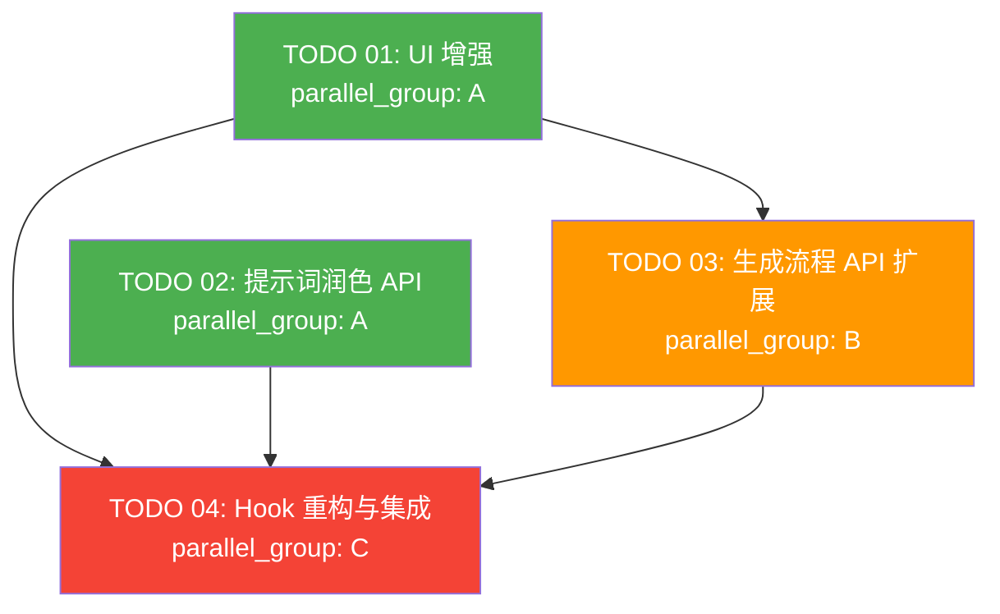

# Task Orchestration: 视频脚本生成面板增强

## 1. 依赖关系图



## 2. 执行阶段

### Phase 1（无依赖，可并行）

| 任务 | Agent | 预计复杂度 |
|------|-------|-----------|
| TODO 01: UI 增强 | Agent 1 | 中 |
| TODO 02: 提示词润色 API | Agent 2 | 低 |

### Phase 2（依赖 Phase 1）

| 任务 | Agent | 依赖 |
|------|-------|------|
| TODO 03: 生成流程 API 扩展 | Agent 1 | TODO 01 |

### Phase 3（依赖 Phase 1 + Phase 2）

| 任务 | Agent | 依赖 |
|------|-------|------|
| TODO 04: Hook 重构与集成 | Agent 1 | TODO 01, 02, 03 |

## 3. 关键路径

```
TODO 01 → TODO 03 → TODO 04
```

**瓶颈任务**：TODO 04（Hook 重构与集成）— 依赖所有前置任务，且工作量最大（17 个子任务）。

## 4. Agent 分配

**推荐 Agent 数量：2**

| Agent | Phase 1 | Phase 2 | Phase 3 |
|-------|---------|---------|---------|
| Agent 1 | TODO 01: UI 增强 | TODO 03: API 扩展 | TODO 04: Hook 集成 |
| Agent 2 | TODO 02: 润色 API | — | — |

**协调说明**：
- Phase 1 中两个 Agent 并行工作，互不依赖
- Agent 2 在 Phase 1 完成后即可释放
- Agent 1 串行执行 Phase 1 → 2 → 3
- TODO 04 是集成任务，需要在所有前置任务的代码基础上工作

## 5. Context Files（每个 Agent 必读）

### 所有 Agent 共同必读

| 文件 | 用途 |
|------|------|
| `docs/plans/video-script-generation-panel/master-plan.md` | 项目全局设计 |
| `src/types/index.ts` | 类型定义 |
| `src/lib/i18n.ts` | 国际化文件 |

### Agent 1（UI + API 扩展 + Hook 集成）

| 文件 | 用途 |
|------|------|
| `docs/plans/video-script-generation-panel/specs/01-ui-enhancement.md` | UI 规格 |
| `docs/plans/video-script-generation-panel/specs/03-generation-flow.md` | 生成流程规格 |
| `docs/plans/video-script-generation-panel/specs/04-hook-refactoring.md` | Hook 规格 |
| `src/components/video/components/VideoUnderstandingScriptModal.tsx` | 现有 Modal 组件 |
| `src/components/video/components/VideoUnderstandingScriptProgressModal.tsx` | 现有进度 Modal |
| `src/components/video/hooks/useVideoUnderstandingScript.ts` | 现有视频理解 Hook |
| `src/components/video/hooks/useScriptGeneration.ts` | 现有脚本生成 Hook |
| `src/components/video/hooks/useConvertToScript.ts` | 现有转换 Hook |
| `src/app/api/ai-video-script-generation/route.ts` | AI 视频脚本 API |
| `src/app/api/video-understanding-script/route.ts` | 视频理解脚本 API |
| `src/app/api/video-script-generation/route.ts` | 文本脚本 API |

### Agent 2（提示词润色 API）

| 文件 | 用途 |
|------|------|
| `docs/plans/video-script-generation-panel/specs/02-prompt-polish-api.md` | 润色 API 规格 |
| `src/app/api/chat/route.ts` | 参考：现有 LLM 调用方式 |
| `src/app/api/video-script-generation/route.ts` | 参考：现有 API 结构 |
| `src/lib/api/` | API 客户端目录 |
