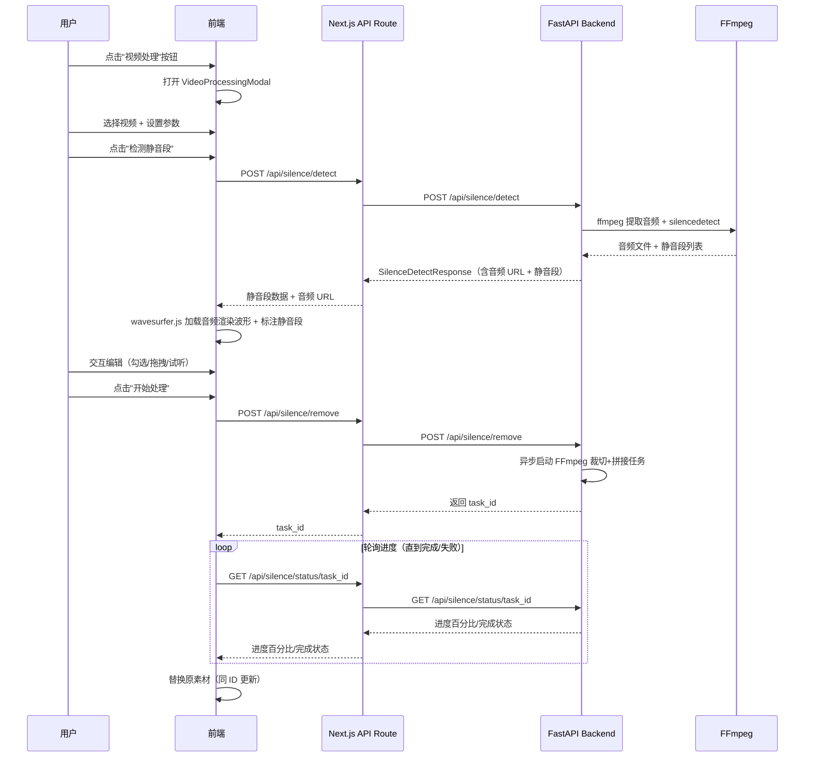

# Master Plan: 视频切气口（静音段移除）

## 1. 概述

在素材管理面板（MaterialsPanel）下方新增"视频处理"按钮，点击后弹出一个带页签的弹窗。第一个页签实现"切气口"功能：自动检测口播视频中语音间的无效静音段，提供可视化预览和交互编辑，处理后替换原视频素材。

## 2. 目标

- **核心目标**：让用户能一键或半自动地移除口播视频中无用的静音间隔
- **用户体验目标**：提供 wavesurfer.js 波形可视化 + 静音段标记，支持勾选/拖拽/试听三种交互方式
- **技术目标**：基于 FFmpeg silencedetect 实现后端静音检测，后端完成视频裁切拼接，前端仅负责 UI 和预览

## 3. 范围

### In Scope

- "视频处理"按钮（素材面板底部）
- 带页签的弹窗框架（目前仅"切气口"页签）
- 弹窗内视频选择器（从已有素材选择）
- 后端静音检测 API（FFmpeg silencedetect，纯音量阈值）
- 前端 wavesurfer.js 波形可视化 + 静音段标注
- 静音段交互：勾选/取消、拖拽边界调整、播放试听
- 参数预设方案（宽松/标准/激进）+ 可展开自定义参数
- 自定义参数：音量阈值(dB)、最小静音时长(ms)、保留间隔时长(ms)
- 后端视频处理 API（裁切 + 拼接，保留少量间隔）
- 处理进度实时反馈（轮询后端 status 接口）+ 弹窗可最小化为浮动进度指示器
- 处理完成后替换原素材（保持同 ID，更新 URL，时间线引用自动同步——复用 WatermarkRemovalModal 的 handleWatermarkRemoved 模式）
- 视频时长限制：最长 30 分钟

### Out of Scope

- 其他视频处理页签（降噪、变速等）
- AI 语音活动检测（VAD）
- 前端视频处理（WebCodecs/FFmpeg.wasm）
- 远程 GPU 服务器处理
- 批量视频处理

## 4. 架构设计

### 4.1 前端架构

```
MaterialsPanel (已有)
└── "视频处理" 按钮 (新增，面板底部)
    └── VideoProcessingModal (新增弹窗)
        ├── Tab: "切气口" (SilenceRemovalTab)
        │   ├── VideoSelector (从素材面板选择视频)
        │   ├── ParameterPanel (预设选择 + 自定义参数)
        │   ├── WaveformPreview (wavesurfer.js 波形 + 静音段标注)
        │   │   ├── 静音段高亮区域
        │   │   ├── 勾选/取消 checkbox
        │   │   ├── 可拖拽边界手柄
        │   │   └── 播放试听控制
        │   ├── SilenceSegmentList (静音段列表，同步波形)
        │   ├── ProcessingControls (开始处理/取消)
        │   └── ProcessingProgress (进度条 + 可最小化为浮动指示器)
        └── (仅"切气口"页签，暂无其他页签)
```

### 4.2 后端架构

```
新增 Router: silence_removal_router.py (prefix="/silence", 挂载 prefix="/api")
  POST /api/silence/detect      → 检测静音段 + 返回音频波形 URL
  POST /api/silence/remove      → 执行移除并生成新视频
  GET  /api/silence/status/{id} → 查询处理进度

新增 Service: silence_removal_service.py
  ├── detect_silence()          → FFmpeg 提取音频 + silencedetect → 返回静音段列表 + 音频文件 URL
  ├── remove_silence()          → FFmpeg 裁切+拼接 → 生成新视频
  └── get_progress()            → 查询异步任务进度

新增 Models: silence_removal_models.py
  ├── SilenceDetectRequest      → 视频路径 + 检测参数
  ├── SilenceDetectResponse     → 静音段列表 [{start, end, duration}] + 音频 URL（供 wavesurfer.js 使用）
  ├── SilenceRemoveRequest      → 视频路径 + 要移除的静音段 + 保留间隔参数
  ├── SilenceRemoveAccepted     → task_id（异步任务已接受）
  ├── SilenceRemoveResponse     → 处理后视频路径 + 处理统计（最终结果）
  └── SilenceProgressResponse   → 任务状态（pending/processing/completed/failed）+ 进度百分比
```

### 4.3 数据流



### 4.4 设计决策

| 决策 | 选择 | 理由 |
|------|------|------|
| 静音检测算法 | FFmpeg silencedetect | 简单可靠，无额外依赖，项目已有 FFmpeg |
| 波形可视化 | wavesurfer.js | 成熟库，支持区域标注、播放、缩放等 |
| 处理位置 | 全部后端 | 视频拼接计算密集，FFmpeg 后端更高效 |
| 过渡方式 | 保留少量间隔 | 保持自然节奏，避免口播听感突兀 |
| 导出方式 | 替换原素材 | 复用去水印逻辑（同 ID 更新），时间线自动同步 |
| 参数方案 | 预设+自定义 | 降低新手门槛，满足专业用户需求 |
| 波形数据来源 | 后端提取音频轨道，前端通过 URL 加载 | 避免传输完整视频到前端，wavesurfer.js 只需音频 |
| 异步处理 | POST 返回 task_id + 轮询 status | 复用项目已有的异步任务模式（参考 ark_video_router） |

## 5. 依赖

### 前端依赖
- **wavesurfer.js** (新增)：音频波形可视化库
- **wavesurfer.js regions plugin**：区域标注/拖拽交互

### 后端依赖
- **FFmpeg** (已有)：silencedetect 滤镜 + 视频裁切拼接
- **aiofiles** (已有)：异步文件操作

### 项目内部依赖
- `MaterialsPanel` 组件（新增"视频处理"按钮入口，弹窗在此挂载）
- 素材替换逻辑（复用 `handleWatermarkRemoved` 的同 ID 更新模式）
- 存储服务（`static/audio/` 存放提取的音频，`static/video/` 存放处理后视频）
- Next.js API 代理路由（新增 `src/app/api/silence/` 三个路由，代理到 `BACKEND_URL`）
- `main.py` 路由注册（新增 `silence_removal_router`，`prefix="/api"`）

## 6. 风险

| 风险 | 影响 | 缓解措施 |
|------|------|----------|
| 30 分钟视频处理时间过长 | 用户等待体验差 | 异步处理 + 进度反馈 + 可最小化弹窗 |
| silencedetect 精度不足 | 误删有效内容或遗漏静音段 | 提供预设+自定义参数，预览确认后再处理 |
| wavesurfer.js 大文件性能 | 长视频波形渲染卡顿 | 后端提取低码率音频（如 mono 64kbps MP3），wavesurfer.js 加载轻量音频文件 |
| 前端内存占用 | 30 分钟音频加载可能耗大量内存 | 后端提取压缩音频轨道（非完整视频），控制音频文件体积 |
| 视频编码兼容性 | 不同编码格式处理失败 | FFmpeg 统一转码，处理前校验格式 |

## 7. 文件结构（目录参考）

### 新增前端文件
```
src/components/video/components/VideoProcessingModal/
  index.ts                          # 导出入口
  VideoProcessingModal.tsx          # 视频处理弹窗主组件（含页签框架）
  SilenceRemovalTab.tsx             # 切气口页签（含参数面板）
  WaveformPreview.tsx               # wavesurfer.js 波形预览 + 静音段标注/交互
  SilenceSegmentList.tsx            # 静音段列表组件（与波形联动）
  ProcessingProgress.tsx            # 处理进度组件（含最小化为浮动指示器逻辑）

src/app/api/silence/
  detect/route.ts                   # 静音检测代理路由 → BACKEND_URL/api/silence/detect
  remove/route.ts                   # 静音移除代理路由 → BACKEND_URL/api/silence/remove
  status/[taskId]/route.ts          # 处理进度查询代理路由 → BACKEND_URL/api/silence/status/{taskId}
```

注：VideoProcessingModal 作为独立子目录，遵循 WatermarkRemovalModal 的组织方式。弹窗在 MaterialsPanel 中挂载。

### 新增后端文件
```
backend-services/basic-service/app/
  routers/silence_removal_router.py   # 路由层
  services/silence_removal_service.py # 服务层
  models/silence_removal_models.py    # 数据模型
```

## 8. Spec 文件目录

| Spec | 内容 |
|------|------|
| `specs/01-backend-silence-detection.md` | 后端静音检测服务 + API |
| `specs/02-backend-silence-removal.md` | 后端视频处理服务 + API |
| `specs/03-frontend-modal-waveform.md` | 前端弹窗 + 波形预览 + 交互 |
| `specs/04-frontend-integration.md` | 前端集成（素材替换 + 进度 + 最小化） |
