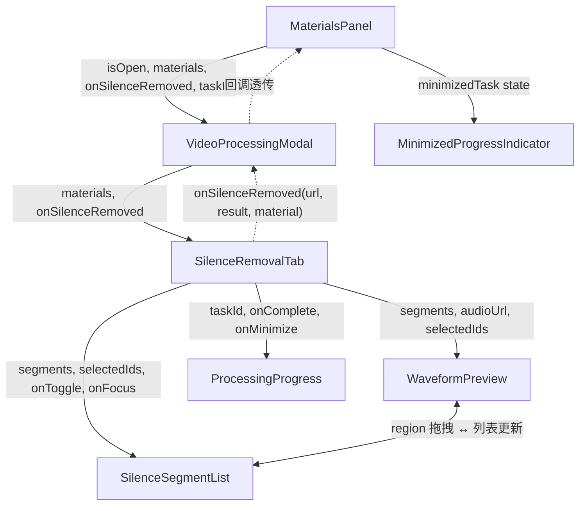

# Spec 04: 前端集成（素材替换 + 进度 + 最小化）

## 1. 概述

实现前端的处理进度展示、弹窗最小化为浮动指示器、处理完成后素材替换，以及 MaterialsPanel 中"视频处理"按钮的集成。

## 2. MaterialsPanel 集成

### 2.1 "视频处理"按钮

```
位置：MaterialsPanel 底部按钮区域（与现有的 "AI视频"/"AI图片" 等功能按钮同层级）

UI:
  - 按钮文字："视频处理"
  - 图标：剪刀/处理类图标
  - 样式：与现有底部按钮风格一致
  - 点击 → 打开 VideoProcessingModal

修改文件：MaterialsPanel.tsx
  - 在底部按钮区域新增按钮
  - 新增 state: isVideoProcessingOpen: boolean
  - 渲染 <VideoProcessingModal> 条件挂载
  - 传递 materials（仅 type="video" 的素材）、addOrReplaceMaterial 和 taskId
  - 参考 WatermarkRemovalModal 的挂载模式（同文件中已有完整示例）
```

### 2.2 VideoProcessingModal 挂载

```
<VideoProcessingModal
  isOpen={isVideoProcessingOpen}
  onClose={() => setIsVideoProcessingOpen(false)}
  materials={materials.filter(m => m.type === 'video')}
  onSilenceRemoved={handleSilenceRemoved}
  taskId={taskId}
/>

handleSilenceRemoved 逻辑（参考同文件中 handleWatermarkRemoved 的实现模式）:
  - 接收 (processedVideoUrl: string, result: SilenceRemoveResult, originalMaterial: MaterialItem)
  - 构造完整的 MaterialItem 对象（保持原有 ID）
  - 调用 addOrReplaceMaterial(newMaterial) 进行同 ID 替换
  - 更新字段：url, serverUrl, duration, createdAt, metadata
  - 素材 metadata 中添加:
    - isSilenceRemoved: true
    - originalVideoUrl: 原始视频 URL
    - silenceRemovedAt: ISO 时间戳
    - removedSegments: 移除的段数
    - timeSaved: 节省的秒数
    - source: 'silence-removed'

注：WatermarkRemovalModal 使用 onWatermarkRemoved(processedVideoUrl, originalMaterial) 回调，
内部由 MaterialsPanel 的 handleWatermarkRemoved 构造 newMaterial 并调用 addOrReplaceMaterial。
此处遵循相同模式。
```

## 3. ProcessingProgress 组件

### 3.1 弹窗内进度显示

```
Props:
  taskId: string                                      # 后端返回的异步任务 ID
  videoName: string
  onComplete: (result: SilenceRemoveResult) => void   # result 含 video_url, original_duration, new_duration, removed_count, time_saved
  onError: (error: string) => void
  onMinimize: () => void
  loggingTaskId: string                               # 日志用的项目 taskId（与 MaterialsPanel 传入的 taskId 一致）

State:
  progress: number (0-100)
  status: "pending" | "processing" | "completed" | "failed"
  message: string
  result: SilenceRemoveResult | null

UI 布局:
  - 视频名称显示
  - 环形或条形进度条（动画）
  - 当前阶段文字（如 "正在裁切片段 3/12..."）
  - 进度百分比
  - 预估剩余时间（基于已用时间和进度推算）
  - "最小化" 按钮 → 调用 onMinimize
  - "取消" 按钮（前端停止轮询并关闭弹窗；注意：后端 Spec 02 未定义 cancel API，后端任务会继续执行直至完成）

进度轮询:
  - 使用 setInterval 每 1.5 秒轮询一次 GET /api/silence/status/{taskId}
  - 更新 progress、status、message
  - status=completed → 调用 onComplete(result)
  - status=failed → 调用 onError(error)
  - 组件卸载时清除 interval
```

### 3.2 完成状态展示

```
status=completed 时显示:
  - 成功图标 + "处理完成"
  - 统计卡片:
    - 原时长 → 新时长
    - 移除了 N 个静音段
    - 节省了 X 秒 (Y%)
  - "完成" 按钮 → 执行素材替换 + 关闭弹窗
  - 处理后视频预览播放器（可选，点击播放预览）
```

## 4. 浮动进度指示器（最小化状态）

### 4.1 MinimizedProgressIndicator

```
位置：屏幕右下角浮动（fixed 定位）
触发：用户在 ProcessingProgress 中点击"最小化"

State（提升到 MaterialsPanel，与 WatermarkRemovalModal 等弹窗状态同层级管理）:
  minimizedTask: {
    taskId: string
    videoName: string
    progress: number
    status: string
  } | null

UI:
  - 固定在右下角的小卡片（z-index 高于其他元素）
  - 宽度约 260px
  - 内容：
    - 视频名称（截断显示）
    - 小型进度条
    - 进度百分比文字
    - 点击 → 重新打开 VideoProcessingModal（恢复到 processing 状态）
  - 完成时:
    - 进度条变为绿色
    - 显示"处理完成"
    - 点击 → 打开弹窗显示结果
  - 失败时:
    - 进度条变为红色
    - 显示"处理失败"
    - 点击 → 打开弹窗显示错误

进度同步:
  - 最小化后继续轮询进度（由指示器组件负责）
  - 恢复弹窗时，将当前进度状态传回弹窗
  - 使用 React state 提升确保数据共享
```

### 4.2 状态流转

```
弹窗打开 + processing
  → 用户点最小化 → 弹窗关闭，浮动指示器出现（继续轮询）
  → 用户点浮动指示器 → 弹窗打开，浮动指示器消失（弹窗接管轮询）
  → 处理完成 → 浮动指示器变绿
  → 用户点击 → 弹窗打开显示完成结果

弹窗打开 + processing
  → 处理完成 → 直接在弹窗显示完成结果
  → 无需浮动指示器
```

## 5. 素材替换流程

```
处理完成后的替换逻辑：

SilenceRemovalTab 侧：
1. 接收 result: { video_url, original_duration, new_duration, removed_count, time_saved }
2. 调用 onSilenceRemoved(result.video_url, result, selectedVideo)
   将结果和原始素材传回 MaterialsPanel

MaterialsPanel 侧（handleSilenceRemoved）：
3. 构造完整的 MaterialItem 对象（保持 selectedVideo.id 不变）:
   newMaterial = {
     ...originalMaterial,
     id: originalMaterial.id,
     name: `${原名称}_静音移除.mp4`,
     url: result.video_url,
     serverUrl: result.video_url,
     duration: result.new_duration,
     createdAt: new Date(),
     metadata: {
       ...originalMaterial.metadata,
       isSilenceRemoved: true,
       originalVideoUrl: originalMaterial.url,
       silenceRemovedAt: new Date().toISOString(),
       removedSegments: result.removed_count,
       timeSaved: result.time_saved,
       source: 'silence-removed'
     }
   }
4. 调用 addOrReplaceMaterial(newMaterial)
5. 素材列表中该视频的 URL 和时长更新
6. 如果该视频已在时间线中使用，时间线中的引用也自动更新
   （因为是同 ID 替换，时间线通过 ID 引用素材，URL 变更自动生效）

参考模式：同文件中 handleWatermarkRemoved 的完整实现
```

## 6. API 调用封装

```
在 SilenceRemovalTab 中封装以下 API 调用函数:

detectSilence(videoUrl, params):
  POST /api/silence/detect
  body: { video_url, noise_threshold, min_silence_duration }
  注意：min_silence_duration 需从前端 ms 转换为 seconds（Spec 03 ParameterPanel 使用 ms，Spec 01 API 使用 seconds）
  返回: SilenceDetectResponse

removeSilence(videoUrl, segments, options):
  POST /api/silence/remove
  body: { video_url, segments_to_remove, preserved_gap, fade_duration }
  注意：preserved_gap 需从前端 ms 转换为 seconds（Spec 03 ParameterPanel 使用 ms，Spec 02 API 使用 seconds）
  fade_duration 使用后端默认值 0.05s（前端不暴露此参数）
  返回: SilenceRemoveAccepted { task_id }

checkProgress(taskId):
  GET /api/silence/status/{taskId}
  返回: SilenceProgressResponse

错误处理:
  - 网络错误 → 显示通知 + 允许重试
  - 后端错误 → 显示 error_code 对应的中文提示
  - 超时处理 → 轮询超过 30 分钟仍未完成 → 提示可能失败
```

## 7. 组件通信总结



## 8. 边界情况处理

```
- 弹窗关闭时正在处理：提示"视频正在处理中，关闭后将自动最小化到后台"，自动切换到浮动指示器
- 弹窗关闭时正在检测：取消检测请求（AbortController）
- 素材列表为空（无视频素材）：显示空状态提示"暂无视频素材，请先上传视频"
- 选中的视频在处理过程中被删除：处理完成后检查素材是否仍存在，不存在则作为新素材添加
- 处理完成后弹窗已关闭且已最小化：浮动指示器显示完成状态，点击可查看结果
- 网络断开：轮询失败后重试 3 次，仍失败则暂停轮询，显示"网络异常"，网络恢复后自动重试
```
