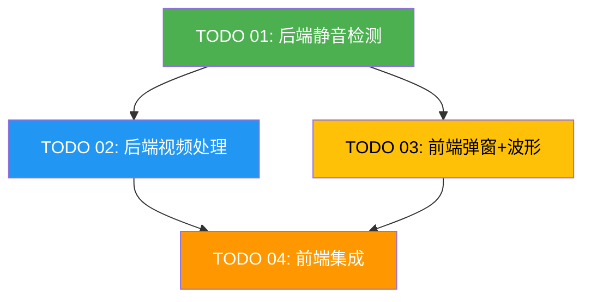

# Task Orchestration: 视频切气口（静音段移除）

## 1. 依赖关系图



**颜色说明：** 绿色 = Phase 1 无前置依赖，黄色 = Phase 1 骨架并行 + Phase 2 联调（依赖 Phase 1 的 API），蓝色 = Phase 2（依赖 Phase 1），橙色 = Phase 3（依赖 Phase 1+2）

## 2. 执行阶段

### Phase 1: 基础层（无前置依赖，可并行）

| 任务 | 智能体 | 预估复杂度 | 说明 |
|------|--------|-----------|------|
| TODO 01: 后端静音检测 | `dev-01` | 中 | 模型 + 服务 + 路由 + FFmpeg 检测 + Next.js 代理 |
| TODO 03: 前端弹窗+波形（骨架部分） | `dev-02` | 高 | 弹窗框架 + VideoSelector + ParameterPanel + wavesurfer.js 集成 + SilenceSegmentList |

**注意：** TODO 03 依赖 TODO 01 的 detect API（`depends_on: [01]`），但其大部分 UI 组件（弹窗骨架、VideoSelector、ParameterPanel、SilenceSegmentList、WaveformPreview 基础渲染）可在 Phase 1 使用 mock 数据并行开发。波形交互的真实数据联调在 Phase 2 由 dev-02 完成。

**Phase 1 完成条件：**
- 后端 `POST /api/silence/detect` 可正常调用，返回静音段列表和音频 URL
- 前端弹窗骨架就绪，所有子组件（VideoSelector, ParameterPanel, WaveformPreview, SilenceSegmentList）UI 完成
- Next.js 代理路由 `detect` 就绪

### Phase 2: 功能层（依赖 Phase 1）

| 任务 | 智能体 | 预估复杂度 | 说明 |
|------|--------|-----------|------|
| TODO 02: 后端视频处理 | `dev-03` | 高 | 异步任务管理 + FFmpeg 裁切拼接 + 保留间隔算法 + 进度追踪 + Next.js 代理 |
| TODO 03 联调: 波形真实数据对接 | `dev-02` | 低 | 将 Phase 1 的 mock 数据替换为 TODO 01 的真实 detect API 调用，验证波形渲染和交互 |

**注意：** dev-01 在 Phase 2 中空闲，可协助 dev-03 进行后端视频处理的联调测试或 code review。

**Phase 2 完成条件：**
- 后端 `POST /api/silence/remove` 可正常调用，返回 task_id
- 后端 `GET /api/silence/status/{id}` 可正常返回进度
- 视频裁切拼接输出正确，保留间隔逻辑正确
- Next.js 代理路由 `remove` 和 `status` 就绪
- TODO 03 波形组件使用真实 detect API 数据正常渲染和交互

### Phase 3: 集成层（依赖 Phase 1+2）

| 任务 | 智能体 | 预估复杂度 | 说明 |
|------|--------|-----------|------|
| TODO 04: 前端集成 | `dev-04` | 中 | MaterialsPanel 按钮 + ProcessingProgress + 浮动指示器 + 素材替换 + 边界情况 |

**Phase 3 完成条件：**
- MaterialsPanel 中"视频处理"按钮可用
- 端到端流程通：选择视频 → 检测 → 预览编辑 → 处理 → 替换素材
- 浮动进度指示器工作正常
- 边界情况处理到位

## 3. 关键路径

```
TODO 01 (后端检测) → TODO 02 (后端处理) → TODO 04 (前端集成)
```

**瓶颈任务：** TODO 02（后端视频处理）是关键路径上复杂度最高的任务，涉及异步任务管理、FFmpeg 多步处理、保留间隔算法。

**并行优化：** TODO 03（前端弹窗）与 TODO 01 并行，缩短总体开发时间。

## 4. 智能体分配

### 推荐配置：4 个开发智能体

| 智能体 | 角色 | 任务分配 | Phase |
|--------|------|----------|-------|
| `dev-01` | 后端开发 | TODO 01: 后端静音检测 | 1（Phase 2 空闲，协助 dev-03 review/测试） |
| `dev-02` | 前端开发 | TODO 03: 前端弹窗+波形（骨架 + 联调） | 1 + 2 |
| `dev-03` | 后端开发 | TODO 02: 后端视频处理 | 2 |
| `dev-04` | 前端开发 | TODO 04: 前端集成 | 3 |

### 协调要点

1. **dev-01 → dev-03 接口：** `SilenceDetectResponse` 的数据结构（静音段列表格式），`silence_removal_models.py` 文件共享
2. **dev-01 → dev-02 接口：** `SilenceDetectResponse` 中的音频 URL 格式，前端 API 调用方式
3. **dev-02 → dev-04 接口：** wavesurfer.js 波形组件的 ref 和状态管理方式
4. **dev-03 → dev-04 接口：** `SilenceProgressResponse` 的 status 字段枚举值，轮询机制
5. **所有 → dev-04：** 素材替换回调的参数格式（onSilenceRemoved 签名）

### 三权分立团队（tripower 模式）

| 角色 | 智能体 | 说明 |
|------|--------|------|
| 开发 | `dev-01` ~ `dev-04` | 4 个开发智能体，按 Phase 分配 |
| 审查 | `reviewer-01`, `reviewer-02` | 2 个审查智能体（1:2 比例） |
| 测试 | `tester-01` | 1 个测试智能体 |
| 监察 | `inspector` | 1 个监察智能体（全局） |

**总计：** 8 个智能体角色，Phase 1 并行 2 个开发 + 审查/测试按需启动

## 5. 上下文文件

### 所有智能体必读

- `docs/plans/video-silence-removal/master-plan.md`
- `docs/plans/video-silence-removal/task-orchestration.md`（本文件）

### 按任务分配

| 智能体 | 必读 Spec | 必读 TODO | 项目参考文件 |
|--------|-----------|-----------|-------------|
| dev-01 | `specs/01-backend-silence-detection.md` | `todos/01-*.md` | `app/models/base_models.py`, `app/routers/video_router.py`（路由模式参考）, `app/services/video_composition_service.py`（FFmpeg 使用参考）, `src/app/api/video/watermark-removal/route.ts`（代理路由参考） |
| dev-02 | `specs/03-frontend-modal-waveform.md` | `todos/03-*.md` | `src/components/video/components/MaterialsPanel/MaterialsPanel.tsx`（现有面板）, `src/components/video/components/WatermarkRemovalModal/`（弹窗模式参考）, `src/types/index.ts`（MaterialItem 类型） |
| dev-03 | `specs/01-*`, `specs/02-backend-silence-removal.md` | `todos/02-*.md` | `app/services/silence_removal_service.py`（由 dev-01 创建）, `app/models/silence_removal_models.py`（由 dev-01 创建）, `app/routers/ark_video_router.py`（异步任务模式参考） |
| dev-04 | `specs/03-*`, `specs/04-frontend-integration.md` | `todos/04-*.md` | `src/components/video/components/MaterialsPanel/MaterialsPanel.tsx`（要修改的文件）, 由 dev-02 创建的所有 VideoProcessingModal 组件, `src/components/video/components/WatermarkRemovalModal/WatermarkRemovalModal.tsx`（handleWatermarkRemoved 参考） |

## 6. 远程服务器配置

**服务器信息：**
- **Name:** dev-server
- **Host:** 192.168.1.7
- **Port:** 22
- **Username:** kt
- **Auth:** SSH key（运行时确认路径）
- **Purpose:** dev_and_test

**同步策略：** test_only — 开发在本地进行，测试阶段同步到远程服务器验证 FFmpeg 处理结果。

**智能体服务器使用：**

| 智能体 | 服务器操作 | 说明 |
|--------|-----------|------|
| dev-01, dev-03 | 不使用 | 后端开发在本地完成 |
| dev-02, dev-04 | 不使用 | 前端开发在本地完成 |
| tester-01 | SSH 测试 | 可选：在远程服务器测试 FFmpeg 处理流程（利用 GPU 加速） |
