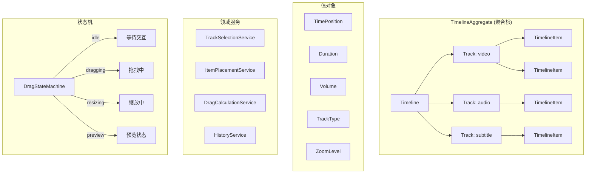
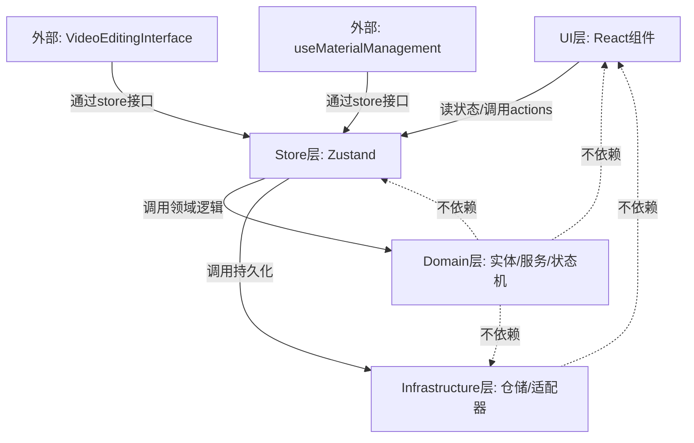
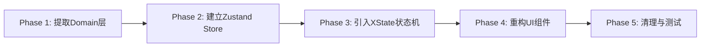

# Video Timeline DDD 重构 — Master Plan

## 1. 项目概述

### 1.1 目标

将 Ecliptrix 视频编辑器的轨道面板（Timeline Panel）核心代码从当前的"大组件+hooks"架构重构为简化三层 DDD 架构，在 **不改变任何现有功能** 的前提下，实现：

- 业务逻辑与 UI 渲染的完全解耦
- 可测试的纯领域逻辑层
- 清晰的状态管理边界（Zustand store）
- 拖拽交互的状态机化（XState）
- 消除 4+ 层 prop drilling

### 1.2 重构范围

**包含（In Scope）：**

| 文件 | 行数 | 职责 |
|------|------|------|
| `TimelinePanel.tsx` | 2,641 | 轨道面板根容器、状态管理、历史记录、操作派发 |
| `TrackContainer.tsx` | 617 | 轨道渲染、滚动同步 |
| `Track.tsx` | 601 | 单轨道渲染、拖放区 |
| `TimelineItem.tsx` | 608 | 时间线片段、拖拽/缩放交互 |
| `TimelineToolbar.tsx` | 370 | 工具栏 UI |
| `TimelineRuler.tsx` | 376 | 标尺和播放头 |
| `VolumeSlider.tsx` | 233 | 音量控制弹出层 |
| `SentenceSegmentBar.tsx` | 142 | 句子级音频可视化 |
| `useTimelineComposition.ts` | 490 | 时间线→视频/音频序列提取 |
| `useTimelineExport.ts` | 132 | JSON 导出 |
| `timelineExportService.ts` | ~200 | 导出序列化服务 |
| `VideoCache.ts` | ~150 | 视频预加载缓存 |
| 相关类型定义 | ~800 | `types/index.ts` + `videoEditingTypes.ts` 中的 Timeline 相关类型 |

**不包含（Out of Scope）：**

- `VideoEditingInterface.tsx`（父容器，仅调整其对 TimelinePanel 的调用方式）
- `ScriptPanel.tsx`（脚本面板）
- `useMaterialManagement.ts`（素材管理，仅定义其与 Timeline 领域的接口边界）
- `useVideoExport.ts`（视频合成导出，仅定义接口）
- `useVideoSearch.ts`、`useVideoAnalysis.ts` 等搜索/分析 hooks
- 后端代码

## 2. 架构设计

### 2.1 目标架构：简化三层 DDD

```
┌─────────────────────────────────────────────────────┐
│                    UI 层 (React)                     │
│  TimelinePanel / Track / TimelineItem / Toolbar ...  │
│  ─ 纯渲染 + 事件绑定                                  │
│  ─ 从 Zustand store 读取状态                          │
│  ─ 调用 Application 层的 actions/commands             │
└──────────────────────┬──────────────────────────────┘
                       │ 调用
┌──────────────────────▼──────────────────────────────┐
│              Domain 层 (纯 TypeScript)               │
│  ─ 实体: Timeline, Track, TimelineItem               │
│  ─ 值对象: TimePosition, Duration, Volume            │
│  ─ 领域服务: TrackSelectionService,                   │
│    ItemPlacementService, DragCalculationService      │
│  ─ 聚合根: TimelineAggregate                         │
│  ─ 状态机: DragStateMachine (XState)                 │
│  ─ 命令: AddItemCommand, MoveItemCommand, ...        │
│  ─ Zustand Store (状态容器 + Application 逻辑)        │
└──────────────────────┬──────────────────────────────┘
                       │ 依赖倒置
┌──────────────────────▼──────────────────────────────┐
│           Infrastructure 层 (外部交互)               │
│  ─ TimelineRepository (JSON 导出/导入持久化)          │
│  ─ VideoCacheAdapter (视频预加载)                     │
│  ─ CompositionAdapter (时间线→合成序列转换)           │
│  ─ API 客户端适配器                                   │
└─────────────────────────────────────────────────────┘
```

### 2.2 核心设计决策

| 决策项 | 选择 | 理由 |
|--------|------|------|
| 分层模式 | 简化三层 DDD | 前端场景不需要完整四层，减少抽象层次 |
| 状态管理 | Zustand | 轻量、支持 store 切片、与 DDD 领域模型契合度高 |
| Undo/Redo | 保持快照机制 | 现有机制稳定可靠，仅做封装提取 |
| 拖拽交互 | XState 状态机 | 清晰的状态流转（idle→dragging→preview→committed） |
| 类型管理 | 按 Domain 分散 + 分层定义 | Domain 层定义核心实体类型，UI 层定义 Props 类型 |
| 迁移策略 | 先提取后重组 | 风险最低，可逐步验证 |

### 2.3 领域模型



### 2.4 聚合根边界

**TimelineAggregate** 是唯一的聚合根，封装以下不变量：

1. Track 内的 items 不能时间重叠（同一轨道内）
2. Item 的 startTime >= 0
3. totalDuration = max(所有 item 的 endTime)
4. Track 类型决定可接受的 item 类型
5. 锁定的 Track 不接受任何修改操作

### 2.5 Zustand Store 切片设计

```
useTimelineStore
├── timelineSlice      // Timeline 核心状态 (tracks, items, currentTime, zoom...)
├── selectionSlice     // 选中状态 (selectedItems, activeTool)
├── historySlice       // Undo/Redo 历史 (history[], historyIndex)
├── dragSlice          // 拖拽状态 (XState machine state)
└── uiSlice            // UI 专用状态 (scrollLeft, dragPreview, isExporting...)
```

## 3. 目标目录结构

```
src/components/video/timeline/
├── domain/                          # Domain 层
│   ├── entities/
│   │   ├── Timeline.ts              # Timeline 实体
│   │   ├── Track.ts                 # Track 实体
│   │   └── TimelineItem.ts          # TimelineItem 实体
│   ├── value-objects/
│   │   ├── TimePosition.ts          # 时间位置值对象
│   │   ├── Duration.ts              # 时长值对象
│   │   ├── Volume.ts                # 音量值对象
│   │   └── TrackType.ts             # 轨道类型枚举
│   ├── services/
│   │   ├── TrackSelectionService.ts  # 轨道选择算法
│   │   ├── ItemPlacementService.ts   # Item 放置/冲突检测
│   │   ├── DragCalculationService.ts # 拖拽位移计算
│   │   └── HistoryService.ts         # Undo/Redo 快照管理
│   ├── aggregates/
│   │   └── TimelineAggregate.ts      # 聚合根 — 封装所有状态变更
│   ├── machines/
│   │   └── dragMachine.ts            # XState 拖拽状态机
│   └── types.ts                      # Domain 层类型定义
│
├── store/                           # Zustand Store (Application 层)
│   ├── useTimelineStore.ts          # 组合 store
│   ├── slices/
│   │   ├── timelineSlice.ts         # 核心时间线状态
│   │   ├── selectionSlice.ts        # 选中/工具状态
│   │   ├── historySlice.ts          # 历史记录状态
│   │   ├── dragSlice.ts             # 拖拽状态
│   │   └── uiSlice.ts              # UI 状态
│   └── actions/
│       ├── addItem.ts               # 添加素材到轨道
│       ├── moveItem.ts              # 移动片段
│       ├── resizeItem.ts            # 缩放片段
│       ├── removeItem.ts            # 删除片段
│       ├── trackActions.ts          # 轨道操作 (mute/lock/volume)
│       └── historyActions.ts        # undo/redo
│
├── infrastructure/                  # Infrastructure 层
│   ├── TimelineRepository.ts        # JSON 导出/导入
│   ├── VideoCacheAdapter.ts         # 视频预加载适配器
│   └── CompositionAdapter.ts        # 合成序列转换适配器
│
├── components/                      # UI 层 (瘦组件)
│   ├── TimelinePanel.tsx            # 重构后的根容器（瘦）
│   ├── TrackContainer.tsx           # 轨道容器
│   ├── Track.tsx                    # 单轨道
│   ├── TimelineItem.tsx             # 片段
│   ├── TimelineToolbar.tsx          # 工具栏
│   ├── TimelineRuler.tsx            # 标尺
│   ├── VolumeSlider.tsx             # 音量滑块
│   └── SentenceSegmentBar.tsx       # 句段可视化
│
├── __tests__/                       # 测试
│   ├── domain/                      # Domain 层单元测试
│   │   ├── TimelineAggregate.test.ts
│   │   ├── TrackSelectionService.test.ts
│   │   ├── ItemPlacementService.test.ts
│   │   ├── DragCalculationService.test.ts
│   │   └── dragMachine.test.ts
│   └── store/                       # Store 集成测试
│       ├── timelineSlice.test.ts
│       └── actions.test.ts
│
└── index.ts                         # 公共导出
```

## 4. 依赖关系



**依赖规则：**
- Domain 层 **零外部依赖**（纯 TypeScript，不依赖 React/Zustand/XState runtime 以外的库）
- XState 是 Domain 层唯一的外部依赖（状态机定义是领域逻辑的一部分）
- Store 层依赖 Domain 层（调用实体方法和服务）
- UI 层依赖 Store 层（通过 hooks 读取状态、派发 actions）
- Infrastructure 层被 Store 层调用（依赖倒置，Store 持有接口引用）

## 5. 风险评估

| 风险 | 影响 | 缓解措施 |
|------|------|---------|
| 重构过程中功能回退 | 高 | 先提取后重组策略；每步验证 UI 行为不变 |
| Zustand 迁移引入状态同步问题 | 中 | 先建 store，再逐组件切换；保留旧代码可回退 |
| XState 增加包体积 | 低 | XState v5 支持 tree-shaking，仅引入核心模块 |
| 与 VideoEditingInterface 的接口变更 | 中 | 定义清晰的 store 接口层，父组件通过 store 交互 |
| prop drilling 移除后组件测试方式变化 | 低 | 组件测试通过 mock store 进行 |

## 6. 迁移策略（先提取后重组）



1. **Phase 1**：从现有代码中提取纯业务逻辑到 `domain/` 目录
2. **Phase 2**：创建 Zustand store，将 useState 状态迁移到 store
3. **Phase 3**：用 XState 状态机替换手动拖拽状态管理
4. **Phase 4**：瘦化 UI 组件，从 store 读取状态
5. **Phase 5**：删除旧代码、补充测试、验证功能完整性

## 7. 新增依赖

| 包 | 版本 | 用途 | 大小影响 |
|----|------|------|---------|
| `zustand` | ^5.x | 状态管理 | ~2KB gzipped |
| `xstate` | ^5.x | 拖拽状态机 | ~10KB gzipped (tree-shakable) |

## 8. Spec 文件索引

| 编号 | Spec 文件 | 内容 |
|------|-----------|------|
| 01 | `specs/01-domain-entities-and-value-objects.md` | 实体、值对象、聚合根的详细设计 |
| 02 | `specs/02-domain-services.md` | 领域服务（轨道选择、放置计算、拖拽计算、历史管理） |
| 03 | `specs/03-drag-state-machine.md` | XState 拖拽状态机设计 |
| 04 | `specs/04-zustand-store.md` | Zustand store 切片设计和 actions |
| 05 | `specs/05-ui-components-refactor.md` | UI 组件瘦化和 store 接入 |
| 06 | `specs/06-infrastructure-adapters.md` | Repository 和 Adapter 设计 |
| 07 | `specs/07-integration-and-testing.md` | 集成策略、测试计划、迁移验证 |
