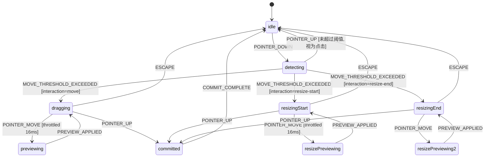

# Spec 03: 拖拽状态机

## 1. 概述

使用 XState v5 定义拖拽交互的有限状态机，替代 TimelineItem.tsx 中手动管理的 `isDragging` / `isResizing` 状态和分散的 mousedown/mousemove/mouseup 事件处理。

**目标文件位置：** `src/components/video/timeline/domain/machines/dragMachine.ts`

## 2. 状态图



## 3. 状态定义

```
States:
  idle          — 无拖拽交互进行中
  detecting     — pointer down 已触发，等待判断是点击还是拖拽
  dragging      — 正在拖动片段（移动位置）
  resizingStart — 正在从左边缘缩放
  resizingEnd   — 正在从右边缘缩放
  previewing    — 拖拽预览帧（节流后的中间状态）
  committed     — 拖拽完成，等待状态提交
```

## 4. 事件定义

```
Events:
  POINTER_DOWN {
    itemId: string
    trackId: string
    clientX: number
    clientY: number
    relativeX: number        // 相对于 item 左边缘的 x 坐标
    itemWidth: number        // item 的当前像素宽度
    originalStartTime: number
    originalDuration: number
  }

  POINTER_MOVE {
    clientX: number
    clientY: number
    deltaX: number           // 相对于 down 点的总位移
  }

  POINTER_UP {
    clientX: number
    clientY: number
  }

  ESCAPE {}                  // 取消操作，恢复原始状态

  PREVIEW_APPLIED {}         // 预览已渲染，可接受下一帧

  COMMIT_COMPLETE {}         // store 已提交最终状态
```

## 5. Context (状态机上下文)

```
DragContext {
  // 目标
  itemId: string | null
  trackId: string | null

  // 原始状态（用于 ESC 恢复）
  originalStartTime: number
  originalDuration: number

  // 交互类型
  interactionType: 'move' | 'resize-start' | 'resize-end' | null

  // 指针状态
  pointerDownPosition: { x: number, y: number } | null
  currentDelta: { x: number, y: number }

  // 计算结果（预览值）
  previewStartTime: number | null
  previewDuration: number | null

  // 配置
  moveThreshold: number      // 像素, 默认 3, 超过此值才算拖拽
  throttleMs: number         // 默认 16 (60fps)
}
```

## 6. Guards (守卫条件)

```
Guards:
  isMoveInteraction(context, event):
    DragCalculationService.detectInteractionType(
      event.relativeX, event.itemWidth
    ) === 'move'

  isResizeStartInteraction(context, event):
    DragCalculationService.detectInteractionType(...) === 'resize-start'

  isResizeEndInteraction(context, event):
    DragCalculationService.detectInteractionType(...) === 'resize-end'

  exceedsThreshold(context, event):
    Math.abs(event.deltaX) > context.moveThreshold ||
    Math.abs(event.deltaY) > context.moveThreshold

  isWithinThreshold(context, event):
    !exceedsThreshold
```

## 7. Actions (副作用)

```
Actions:
  capturePointerDown(context, event):
    context.itemId = event.itemId
    context.trackId = event.trackId
    context.originalStartTime = event.originalStartTime
    context.originalDuration = event.originalDuration
    context.pointerDownPosition = { x: event.clientX, y: event.clientY }
    context.interactionType = DragCalculationService.detectInteractionType(
      event.relativeX, event.itemWidth
    )

  calculateMovePreview(context, event):
    使用 DragCalculationService.calculateMovePosition()
    context.previewStartTime = result.value
    context.currentDelta = { x: event.deltaX, y: 0 }

  calculateResizePreview(context, event):
    使用 DragCalculationService.calculateResizePosition()
    context.previewStartTime = result.startTime.value
    context.previewDuration = result.duration.value
    context.currentDelta = { x: event.deltaX, y: 0 }

  resetContext(context):
    将所有字段重置为初始值

  restoreOriginal(context):
    context.previewStartTime = context.originalStartTime
    context.previewDuration = context.originalDuration
    // ESC 恢复时使用
```

## 8. 与 Zustand Store 的集成

状态机实例存储在 Zustand `dragSlice` 中：

```
dragSlice {
  // XState actor 引用
  dragActor: ActorRef | null

  // 便捷查询（从 machine snapshot 派生）
  isDragging: boolean
  isResizing: boolean
  dragPreview: {
    itemId: string
    startTime: number
    duration: number
  } | null

  // Actions
  startDrag(event: PointerDownEvent) → void
    // 创建/启动 dragActor, 发送 POINTER_DOWN

  updateDrag(event: PointerMoveEvent) → void
    // 发送 POINTER_MOVE 到 dragActor

  endDrag(event: PointerUpEvent) → void
    // 发送 POINTER_UP 到 dragActor
    // 如果进入 committed 状态 → 调用 timelineSlice 的 moveItem/resizeItem
    // 然后发送 COMMIT_COMPLETE

  cancelDrag() → void
    // 发送 ESCAPE
}
```

## 9. UI 层接入

TimelineItem 组件从繁重的事件处理简化为：

```
// Before (TimelineItem.tsx ~200 行事件处理)
onMouseDown → 检测交互类型 → 注册 mousemove/mouseup → 计算位移 → 更新状态...

// After (简化为 3 行调用)
onPointerDown → store.startDrag(event)
// mousemove/mouseup 由全局 listener 处理:
onPointerMove → store.updateDrag(event)
onPointerUp → store.endDrag(event)
```

全局事件监听器注册在 TimelinePanel 或 TrackContainer 层级，避免每个 TimelineItem 重复注册。

## 10. 节流策略

当前代码使用 16ms 节流（60fps）进行拖拽更新。状态机中通过以下方式保持：

```
方案: 在 POINTER_MOVE 事件发送端节流（UI层），而非状态机内部
原因: 状态机保持纯逻辑，节流是 UI 层关注点

UI 层:
  const throttledMove = throttle((e) => {
    store.updateDrag({ clientX: e.clientX, deltaX: e.clientX - downX })
  }, 16)
```

## 11. 素材拖入（Material Drop）状态机

除了 item 拖拽/缩放，素材从面板拖入轨道也需要状态管理。这是独立的状态机：

```
MaterialDropMachine:
  idle → dragOver (素材进入轨道区域)
  dragOver → dropped (放下素材)
  dragOver → idle (离开轨道区域)
  dropped → idle (item 创建完成)

Context:
  materialType: string | null
  targetTrackId: string | null
  isCompatible: boolean

与 Track 组件的 onDragOver/onDrop 事件对应。
```

此状态机相对简单，可以内联在 dragSlice 中或使用独立 machine。
