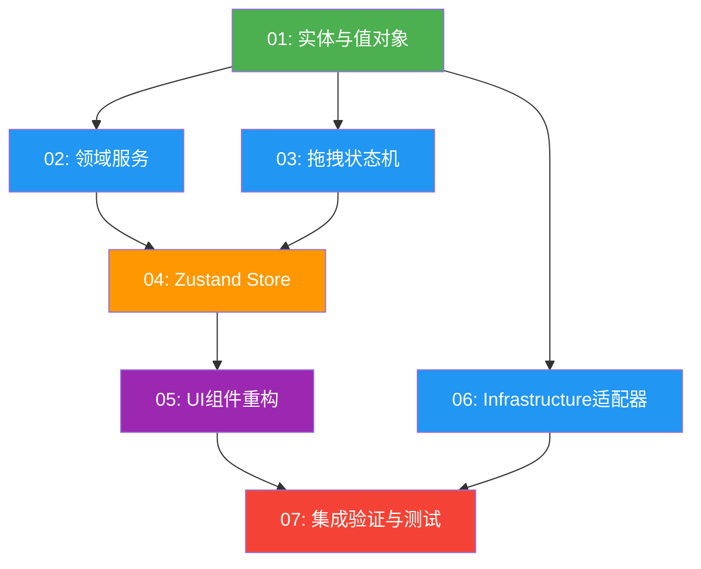

# Task Orchestration — Video Timeline DDD 重构

## 1. 依赖图



## 2. 执行阶段

### Phase 1 — 基础层 (无依赖)

| 任务 | 并行组 | 预计工作量 |
|------|--------|-----------|
| TODO 01: 实体与值对象 | A | 大 — 11个子任务，核心模型 |

Phase 1 仅有 TODO 01，是所有后续任务的基础。

### Phase 2 — Domain 完善 (依赖 Phase 1)

| 任务 | 并行组 | 预计工作量 |
|------|--------|-----------|
| TODO 02: 领域服务 | B | 中 — 5个服务 |
| TODO 03: 拖拽状态机 | B | 中 — 状态机定义 |
| TODO 06: Infrastructure 适配器 | B | 中 — 3个适配器 |

Phase 2 的三个任务可以 **完全并行**，它们仅依赖 Phase 1 的产出，互不依赖。

### Phase 3 — Store 层 (依赖 Phase 2 的 02, 03)

| 任务 | 并行组 | 预计工作量 |
|------|--------|-----------|
| TODO 04: Zustand Store | C | 大 — 5个slice + 6个action + 组合store |

Phase 3 需要 TODO 02（领域服务）和 TODO 03（状态机）完成后才能开始。TODO 06 不阻塞此阶段。

### Phase 4 — UI 重构 (依赖 Phase 3)

| 任务 | 并行组 | 预计工作量 |
|------|--------|-----------|
| TODO 05: UI 组件重构 | D | 大 — 8个组件重构 + 1个父组件调整 |

Phase 4 需要 Store 完全就绪。组件按 叶→根 顺序重构（SentenceSegmentBar → TimelineItem → Track → ... → TimelinePanel）。

### Phase 5 — 验证与清理 (依赖 Phase 4 + 06)

| 任务 | 并行组 | 预计工作量 |
|------|--------|-----------|
| TODO 07: 集成验证与测试 | E | 大 — 测试编写 + 清理 + 验证 |

Phase 5 需要所有前置任务完成。

## 3. 关键路径

```
01 → 02 → 04 → 05 → 07
     (或)
01 → 03 → 04 → 05 → 07
```

**瓶颈任务：**
- **TODO 01 (实体与值对象)**: 所有后续任务的基础，必须首先完成
- **TODO 04 (Zustand Store)**: 需要等待 02 和 03，是 Phase 2→3 的汇聚点
- **TODO 05 (UI 组件重构)**: 最大改动量，涉及现有文件修改

## 4. Agent 分配建议

| Agent | 分配任务 | Phase | 说明 |
|-------|---------|-------|------|
| eng-01 | TODO 01: 实体与值对象 | 1 | 核心基础，独立完成 |
| eng-02 | TODO 02: 领域服务 | 2 | 依赖 01 产出 |
| eng-03 | TODO 03: 拖拽状态机 + TODO 06: Infrastructure | 2 | 两个较小任务合并 |
| eng-01 | TODO 04: Zustand Store | 3 | 复用 eng-01（熟悉实体层） |
| eng-02 | TODO 05: UI 组件重构 (叶子组件) | 4 | SentenceSegmentBar → TimelineItem → Track |
| eng-03 | TODO 05: UI 组件重构 (容器组件) | 4 | TimelineRuler → TimelineToolbar → TrackContainer → TimelinePanel |
| eng-01 | TODO 07: 集成验证与测试 | 5 | 编写测试和最终验证 |

**推荐 Agent 数量：3 个**

Phase 1: 1 agent 工作
Phase 2: 3 agents 并行
Phase 3: 1 agent 工作（等待 Phase 2 汇聚）
Phase 4: 2 agents 并行（按组件拆分）
Phase 5: 1 agent 工作

## 5. 每个 Agent 的 Context Files（必读文件）

### 所有 Agent 共享必读

```
docs/plans/video-timeline-ddd-refactor/master-plan.md
docs/plans/video-timeline-ddd-refactor/task-orchestration.md
src/types/index.ts (TimelineState, Track, TimelineItem 类型定义, lines 465-650)
src/components/video/types/videoEditingTypes.ts
```

### Agent: TODO 01 (实体与值对象)

```
# 规格
docs/plans/video-timeline-ddd-refactor/specs/01-domain-entities-and-value-objects.md
docs/plans/video-timeline-ddd-refactor/todos/01-domain-entities-and-value-objects.md

# 现有代码参考（提取逻辑来源）
src/components/video/timeline/Track.tsx (lines 73-88, 素材兼容性规则)
src/components/video/timeline/TimelineItem.tsx (lines 1-50, 类型和常量)
src/components/video/timeline/TimelinePanel.tsx (lines 1-100, 状态类型)
```

### Agent: TODO 02 (领域服务)

```
# 规格
docs/plans/video-timeline-ddd-refactor/specs/02-domain-services.md
docs/plans/video-timeline-ddd-refactor/todos/02-domain-services.md

# 现有代码参考
src/components/video/timeline/TimelinePanel.tsx (lines 334-695, 历史/素材处理)
src/components/video/timeline/TimelineItem.tsx (lines 28-200, 拖拽计算)

# 依赖（Phase 1 产出）
src/components/video/timeline/domain/entities/
src/components/video/timeline/domain/value-objects/
src/components/video/timeline/domain/types.ts
```

### Agent: TODO 03 (拖拽状态机)

```
# 规格
docs/plans/video-timeline-ddd-refactor/specs/03-drag-state-machine.md
docs/plans/video-timeline-ddd-refactor/todos/03-drag-state-machine.md

# 现有代码参考
src/components/video/timeline/TimelineItem.tsx (完整文件, 拖拽事件处理)

# 依赖
src/components/video/timeline/domain/value-objects/
src/components/video/timeline/domain/types.ts
```

### Agent: TODO 04 (Zustand Store)

```
# 规格
docs/plans/video-timeline-ddd-refactor/specs/04-zustand-store.md
docs/plans/video-timeline-ddd-refactor/todos/04-zustand-store.md

# 现有代码参考
src/components/video/timeline/TimelinePanel.tsx (完整文件, 所有状态管理)

# 依赖
src/components/video/timeline/domain/ (所有 Phase 1-2 产出)
```

### Agent: TODO 05 (UI 组件重构)

```
# 规格
docs/plans/video-timeline-ddd-refactor/specs/05-ui-components-refactor.md
docs/plans/video-timeline-ddd-refactor/todos/05-ui-components-refactor.md

# 现有代码参考（需要重构的文件）
src/components/video/timeline/TimelinePanel.tsx
src/components/video/timeline/TrackContainer.tsx
src/components/video/timeline/Track.tsx
src/components/video/timeline/TimelineItem.tsx
src/components/video/timeline/TimelineToolbar.tsx
src/components/video/timeline/TimelineRuler.tsx
src/components/video/timeline/VolumeSlider.tsx
src/components/video/timeline/SentenceSegmentBar.tsx
src/components/video/VideoEditingInterface.tsx (调整调用方式)

# 依赖
src/components/video/timeline/store/ (Phase 3 产出)
src/components/video/timeline/domain/ (Phase 1-2 产出)
```

### Agent: TODO 06 (Infrastructure 适配器)

```
# 规格
docs/plans/video-timeline-ddd-refactor/specs/06-infrastructure-adapters.md
docs/plans/video-timeline-ddd-refactor/todos/06-infrastructure-adapters.md

# 现有代码参考
src/components/video/services/timelineExportService.ts
src/components/video/services/VideoCache.ts
src/components/video/hooks/useTimelineComposition.ts
src/components/video/hooks/useTimelineExport.ts

# 依赖
src/components/video/timeline/domain/types.ts
```

### Agent: TODO 07 (集成验证)

```
# 规格
docs/plans/video-timeline-ddd-refactor/specs/07-integration-and-testing.md
docs/plans/video-timeline-ddd-refactor/todos/07-integration-and-testing.md

# 需要验证的所有产出
src/components/video/timeline/domain/
src/components/video/timeline/store/
src/components/video/timeline/components/
src/components/video/timeline/infrastructure/
```

## 6. 协调注意事项

1. **Phase 1→2 交接：** TODO 01 完成后，确认 `domain/types.ts` 和所有实体/值对象的导出接口稳定，再启动 Phase 2 的三个并行任务。

2. **Phase 2→3 汇聚：** TODO 04 (Store) 依赖 02 和 03，但不依赖 06。只需等待 02 和 03 完成即可启动 Phase 3。

3. **Phase 4 组件拆分：** TODO 05 可以拆分给两个 agent，按 叶子组件/容器组件 分工。两个 agent 需要协调 `TimelinePanel.tsx` 的修改（最后由一个 agent 统一处理）。

4. **类型兼容性：** 整个重构过程中，Domain 层的 `toPlainObject()` 输出必须与现有 `src/types/index.ts` 中的接口兼容。任何类型变更都需要同步到消费方。

5. **npm install 时序：** `zustand` 和 `xstate` 的安装应在 Phase 2 开始前完成（Phase 1 期间执行），避免多个 agent 并发安装。
