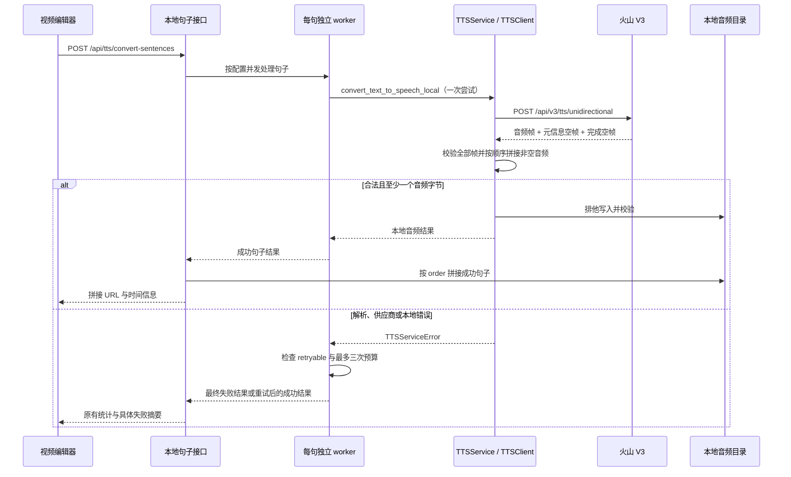

# 视频编辑语音合成：火山空数据帧与逐句重试修复方案

版本：v2（方案评审与修复）

日期：2026-09-18

基线：`1120e7f7db80553625823a3a3ed3ebd979f04b7c`

功能目录：`docs/plans/volcano-tts-null-frame-fix/`

**目标：** 使桌面视频编辑接受火山 V3 合法的空数据元信息帧和完成帧，保存已完整校验的音频，并让逐句合成遵守既有错误重试策略。

**架构：** 在 Python 供应商适配层修正帧字段校验，在句子调度层消费 `TTSServiceError`，复用现有文件校验、错误分类与并发拼接链路。逐句结果增加可选诊断字段，既有界面通过 `message` 获得简洁、具体的失败原因。

**技术栈：** Electron、Next.js 15、React 19、TypeScript、FastAPI、Pydantic、Python `requests`、`ThreadPoolExecutor`、本地文件存储、pytest、Vitest。

**交付边界：** 本节点只写设计文档，不修改实现、测试、用户配置或打包目录，不执行提交。下游工程师按照本文实施；需要逐项执行指导时可使用 `superpowers:executing-plans`。文中“新增”“修改”“通过”除明确写为已验证的内容外，均指下游实施要求。

## 评审记录

评审日期：2026-09-18。范围为本方案及其引用的当前工作区源码；按可行性、完整性、一致性和范围适当性逐节核对。未发现 P0；发现的 2 项 P1 和 4 项 P2 均已在正文修订，以下“已修复”仅指设计问题已关闭，不表示源码已实现。

| 编号 | 严重级别 | 问题与代码依据 | 正文修复及验收 | 状态 |
| --- | --- | --- | --- | --- |
| DR01 | P1 | 第4.6节假定失败结果的 `error` 总是安全文案，但 `convert_sentence_batch` 的 future 异常分支仍拼接 `str(e)`，且将 `order` 设为 -1。直接追加该字段会把原始异常扩大暴露到界面，并破坏“按 order 取首个失败”的承诺。 | 第4.5–4.6节明确 future 与原句对应、使用统一安全失败结果；摘要由已知错误码重新生成，未知码使用固定兜底；新增 R13。 | 已修复 |
| DR02 | P1 | 第4.7节仅约束尝试失败 / 等待日志；原 worker 的开始、尝试和成功日志用 f-string 直接输出无格式约束的 `sentence_id`。仅修正失败日志仍会泄漏被填入标识符的文本、路径或凭据。 | 第4.7节覆盖整个 worker 及新增汇总异常分支；所有保留的日志仅输出安全标识和白名单字段；R12 覆盖成功与失败、INFO / DEBUG 渲染文本。 | 已修复 |
| DR03 | P2 | 第8.1节对新测试文件没有明确设置 `MOCK_MODE=False`；只构造 `__new__` 对象不能隔离 router 的模块级实例，R10/R11 也未写明路由挂载前缀。并发测试按全局响应顺序分配故障会依赖线程时序。 | 第8.1、8.3节补充每个新夹具的模式、注入位置、`/api` 前缀、按请求文本分配模拟响应及有超时的同步；不修改全局 conftest。 | 已修复 |
| DR04 | P2 | HTTPException 的 400/422 与其他状态分支、两个并发失败的次数隔离缺少明确验收；已有矩阵仅笼统涵盖参数错误及一成功一失败。 | 扩展 R09，新增 R14，固定零与未知 attempts、固定文案及零重试。 | 已修复 |
| DR05 | P2 | 发布验收缺少回退规则；三次请求预算容易被误读为总耗时上限，现有 requests 超时和线程池退出并不构成严格截止时间。 | 第8.5、9节明确原有截止时间限制和整包回退方式，不引入取消机制、迁移或配置开关。 | 已修复 |
| DR06 | P2 | 文末仍要求核实节点0，且“篇幅超过任务要求”不能替代本节点 v2 / 评审结论验收；本文未跟踪时 `git diff --check` 不检查其内容。 | 第2.2、8.4、10、11节区分上游证据和本轮评审，补充未跟踪文档直接检查及节点1上报要求。 | 已修复 |

逐节结论：第1–3节的故障定位和修复范围与当前桌面架构一致；第4节的 nullable data、完整响应校验与单层三次预算可在现有栈内实现，已修正错误汇总和日志遗漏；第5–7节继续复用现有错误模型，保持七个实施文件和可选字段兼容性；第8节补齐可重复的夹具和边界验收；第9–11节保留既有架构限制并澄清发布与证据边界。无需新依赖、数据库变更或 UI 重构。

评审证据：从未修改的源码通过 AST 提取 worker 与批量汇总方法，在内存替身中复现不可重试错误调用三次、等待 `[2, 4]`，以及原始句子标识进入实际渲染日志；注入 future 异常后，确认 v1 的直接追加规则会把异常原文带入顶层摘要。验证未访问网络、未创建音频，结果已登记到本节点运行日志。

## 1. 概述

Ecliptrix 是单用户 Electron 桌面应用。Electron 启动本机 FastAPI 后端和 Next.js 服务，视频编辑页面通过 Next.js API 代理调用后端的语音功能。当前故障发生在收到供应商响应之后：火山已经返回音频分片，随后返回 `data: null` 的元信息帧和成功完成帧；后端把这些合法空值当成字段类型错误，整次解析失败，已有音频无法进入保存步骤。用户在编辑器看到合成失败，无法获得旁白素材。

句子级接口还有第二个问题。底层已将无效响应、凭据错误、余额不足等归类为不可自动重试，逐句服务却捕获所有异常后继续调用，最多尝试三次并等待两次。修复需要同时恢复正常音频输出、停止无意义的重复请求，并保留超时、网络故障及临时限流的有限重试。成功体验继续沿用现有素材导入、时长更新和句子时间信息；失败体验通过既有提示展示明确原因，不新增弹窗或设置步骤。

本方案将兼容性边界限定在当前 V3 HTTP 单向分行 JSON 响应，不切换供应商、资源 ID、音色或请求协议。真正损坏的帧、非法 Base64、非成功业务码及整份响应没有音频的情况仍然失败。解析器必须处理全部非空行之后才能返回音频，继续保留排他创建、文件校验和失败清理机制，避免把部分音频或错误响应当成可用素材。

## 2. 现状、证据与根因

### 2.1 已阅读的项目约定

已读取根目录 `README.md`、`CLAUDE.md` 和 `.claude-index/index.md`，并以当前源码核对索引信息。工作区未发现适用于本次路径的 `AGENTS.md`。项目采用 Router → Service → 外部 API / 本地存储的分层；SQLite 启动建表，不使用迁移服务；当前任务不涉及数据库。生成音频通过 `audio_generated_dir()` 定位到持久可写目录，不能改为桌面安装目录。

`CLAUDE.md` 要求每项错误修复附带行为回归测试，日志不包含密钥、请求全文或异常原文。本次只在受影响的服务方法内修正日志格式，不修改全局日志设施。新辅助函数遵守单一职责、类型标注、最多五个参数及六十行以内的约定；原有 `_convert_single_sentence` 参数签名为兼容线程池调用保留，并加注释说明既有签名例外。

上游设计开始时，`git status --short` 仅有用户已有的未跟踪诊断目录 `.bug-diagnosis/336be7e1-d7df-4fc8-b994-2b80f45c9128/`。本轮评审开始时另有上游新增的本文，已跟踪文件没有差异。诊断目录是输入证据，不属于此次设计或后续实现的提交清单。

### 2.2 现场证据与上游设计节点复现

用户诊断报告的“2026-09-18 新失败复查”记录：同一请求收到六个 JSON 帧，前四帧 `code=0` 且携带音频字符串，第五帧 `code=0,data=null` 并带有 `sentence`，第六帧 `code=20000000,message=OK,data=null`。旧的资源权限错误属于先前诊断，不能据此推断当前故障仍由鉴权引起。

上游设计节点通过 Python AST 从当前源文件提取未修改的方法，在隔离命名空间中执行，未导入会初始化业务服务的模块，未请求火山、未创建音频。结果如下；本轮新增验证另见“评审记录”：

| 离线验证 | 实际结果 | 结论 |
| --- | --- | --- |
| `_validate_frame({code: 0, data: 有效字符串})` | 校验通过 | 普通音频帧路径正常 |
| `_validate_frame({code: 0, data: None, sentence: {}})` | 抛出 `ValueError` | 元信息帧被误拒绝 |
| `_validate_frame({code: 20000000, message: OK, data: None})` | 抛出 `ValueError` | 完成帧被误拒绝 |
| 实际句子 worker 收到带 `retryable=False` 的模拟异常 | 调用三次，模拟等待 `[2, 4]` 秒 | 外层未消费重试标记 |
| 标准 `logging.LogRecord` 接收无占位符消息与字典参数 | 渲染后只有消息，无字典字段 | 当前错误详情未输出 |

这些验证确认现有故障，不表示实现已修复。没有运行本轮实现回归测试或桌面构建；共享黑板中先前任务的测试数量不作为本轮通过证据。

### 2.3 关键代码路径

下表行号是当前基线的定位提示，实施时以符号为准。

| 路径与符号 | 现有职责及问题 |
| --- | --- |
| `src/components/video/ScriptPanel.tsx`：句子合成处理逻辑，约 1390–1635 行 | 调用句子 API；成功后使用拼接 URL，失败时展示 `response.message` |
| `src/lib/api/tts.ts::convertSentencesToSpeech` | 通过 `http.post` 调用接口，超时为 300000 ms |
| `src/app/api/tts/convert-sentences/route.ts` | 透传到后端 `/api/tts/convert-sentences` |
| `backend-services/basic-service/app/routers/tts_router.py::convert_sentence_batch_text_to_speech` | 返回 `SentenceBatchTTSResponse`，HTTP 200 不代表业务成功 |
| `backend-services/basic-service/app/services/sentence_tts_service.py::SentenceTTSService._convert_single_sentence`，约 89 行起 | 每句独立调用 local 合成，当前所有异常都重试三次 |
| `backend-services/basic-service/app/services/tts_service.py::TTSService.convert_text_to_speech_local` | 每次调用只允许一次底层尝试，已负责输出文件检查 |
| 同文件 `TTSService._synthesize_with_retries` | 已根据 `error_details.retryable` 决定是否重试；普通合成最多三次 |
| 同文件 `TTSClient._parse_response` / `_validate_frame`，约 126 / 157 行 | 分行解码；`message` 和 `data` 被错误地统一要求为字符串 |
| 同文件 `TTSClient._write_audio` | 完整解析后排他写文件，flush、fsync、读取校验，失败只清理本次创建文件 |
| `backend-services/basic-service/app/services/tts_errors.py` | 已有错误分类、安全摘要、不可变详情和 `with_attempts()`，应复用 |

## 3. 方案选择与范围

采用“最小字段兼容修复 + 句子层结构化重试”的方案。空值是合法的无音频载荷，跳过该帧的音频追加；实际音频载荷继续严格校验。句子服务保留调度权，消费底层已经分类的异常，在一个重试预算内返回最终结果。

备选方案一是忽略所有异常帧，只要得到部分音频就成功。这会吞掉后续业务拒绝和损坏数据，无法保证素材完整性，拒绝采用。备选方案二是迁移到 SSE、WebSocket 或重写成异步流客户端。它会同时改变请求格式、取消语义、线程和连接管理，无法针对当前明确根因收敛验证，本轮不采用。

本轮明确不修改 `tts_errors.py` 的错误码与分类表、不处理历史 `header.code/header.message` 包装格式、不修复全局 logger、不重构句子接口的同步线程池调度、不改变拼接算法与单句临时文件清理政策。上述相邻问题记录在风险节，不能在实施时默默扩大修复范围。

## 4. 技术设计

### 4.1 完整调用时序



### 4.2 帧契约与空值处理

当前端点是 `https://openspeech.bytedance.com/api/v3/tts/unidirectional`。继续用 `requests.post` 获取完整响应，以 `response.text.splitlines()` 读取逐行 JSON。用户描述中的 `data: null` 指 JSON 对象字段，不是 SSE 的 `data:` 行前缀。不得为本次修复增加 SSE 前缀剥离或忽略无法解析的行。

保持 `_validate_frame(frame: object) -> int` 签名，并按以下顺序校验：

1. 顶层必须是 `dict`，否则抛出 `ValueError`。
2. `code` 接受整数和满足现有正则 `-?[0-9]+` 的十进制字符串；后者转为整数。拒绝布尔值、浮点数、空值、缺失值、带空格或十六进制的字符串。
3. `message` 可以缺失；存在时必须是字符串，包括空字符串。没有当前证据支持 `message=null`，因此继续拒绝该值。
4. `data` 可以缺失，可以为 `None`，也可以是字符串。其余值全部拒绝，包括 `False`、`0`、列表和对象；不可用真值判断代替类型校验。
5. 额外元信息字段，例如 `sentence`、时间戳、用量字段，保持忽略，不校验其结构、不转成音频、不写入日志或持久模型。返回规范化后的 `code`。

替换原来遍历 `('message', 'data')` 的联合字符串检查即可。修改后 `_parse_response` 继续先校验帧、再判断业务码、最后读取音频：

| 帧 / 字段条件 | 必须执行的行为 |
| --- | --- |
| 空行、纯空白行 | 跳过 |
| `code` 为 `0` 或 `20000000`，`data` 缺失、null 或空字符串 | 不追加音频，继续检查下一行 |
| 成功业务码，`data` 为非空字符串 | 使用 `base64.b64decode(data, validate=True)`，按响应顺序追加字节 |
| 非成功整数业务码，`data` 为 null 或缺失 | 调用既有 `provider_failure(frame, context)`，保留真实错误分类 |
| 非成功业务码，`data` 为字符串 | 仍先抛业务错误，不把错误帧里的字符串解码为音频 |
| 非对象、坏 JSON、非法字段类型或非法 Base64 | `TTS_INVALID_RESPONSE`，不可重试 |
| 所有合法帧检查完后，音频字节总数为零 | `TTS_INVALID_RESPONSE`，不可重试 |

不在遇到第一帧音频、空元信息帧或 `20000000` 时提前 `return` / `break`。比如“合法音频 → 成功完成帧 → 错误帧”仍然失败，不能掩盖尾部错误。一个成功完成帧若包含合法非空音频字符串，沿用既有解码规则，避免遗漏最后分片。

本次保持已有兼容性：没有 `20000000`、但 HTTP 请求正常完成、全部行合法且有音频的响应仍可成功。现有大量用例只提供一个音频帧，新增强制终止帧会形成独立协议变更。代价是无法仅凭当前格式识别“连接正常结束但供应商漏发尾部音频”的情况，见风险节。传输层抛出的 timeout / request exception 继续走已有错误分类。

### 4.3 音频保存边界

`_parse_response` 只返回内存中的 `bytes`，不写文件。`synthesize_speech` 仅在解析返回成功后调用 `_write_audio`。保持现有 `open(..., 'xb')`、`fsync`、大小及可读性检查，不增设边收边写或遇错保存部分音频的分支。

文件清理由拥有写入过程的 `TTSClient` / `TTSService` 负责。已有输出路径冲突必须在调用供应商前失败，不能覆盖、清空或删除已有文件。坏帧、空音频、业务拒绝都不得产生新的输出文件。写入失败只能清理本次成功创建的目标，其他句子与已有素材不受影响。

### 4.4 逐句重试的唯一预算

在 `sentence_tts_service.py` 中从 `app.services.tts_errors` 导入 `TTSServiceError`、`make_tts_error` 和 `safe_identifier`，从 `fastapi` 导入 `HTTPException`。将 worker 内的 `max_retries` 改称 `max_attempts`，固定为 `3`；它表示总尝试次数，即首次调用加最多两次重试。继续调用 `convert_text_to_speech_local`，不得改成自身已重试三次的 `convert_text_to_speech`，不得再包一层整批重试。

一次句子任务维护局部状态：`started`、从 1 开始的 `attempt`、初始为零的累计 `provider_attempts: Optional[int]`。不将失败对象或计数存放在共享 `self` 字段。错误详情已经是不可变 Pydantic 模型，不能原地赋值。累计值为整数时调用 `with_attempts(provider_attempts)` 创建新异常；累计值未知时，用 `TTSServiceError(failure.error_code, failure.error_details.model_copy(update={'attempts': None}))` 创建副本，避免向现有仅标注整数参数的 `with_attempts()` 传入空值。无需为此修改公共错误模块。

重试决策固定为：

```text
收到本次错误 → 转成 TTSServiceError → 累计已知供应商调用次数
    → 记录安全诊断
    → retryable 为 false：立即返回该句失败
    → attempt 已达到 3：立即返回该句失败
    → 否则等待 2 * attempt 秒，再进行下一次调用
```

| 错误情形 | 策略 | 三次均失败时的等待 |
| --- | --- | --- |
| `TTS_INVALID_RESPONSE`、无效参数、未配置、凭据或权限错误、余额或额度不足、音色不可用 | 一次错误即返回，不自动重复 | 无 |
| `TTS_LOCAL_IO_ERROR`、无法识别的本地异常 | 一次错误即返回 | 无 |
| `TTS_TIMEOUT`、`TTS_NETWORK_ERROR`、`TTS_RATE_LIMITED` | 按现有 `retryable=True`，最多三次 | 2 秒、4 秒 |
| `provider_failure` 分类为临时 5xx，`retryable=True` | 最多三次，不自行重做分类 | 2 秒、4 秒 |
| 泛化供应商错误或带明确非重试语义的 5xx | 以错误详情为准，不能只按 HTTP 状态重试 | 由标记决定 |

最后一次失败后不得再 sleep；首个不可重试失败后也不得 sleep。第二次发生不同错误时，最终结果保留第二次的错误码、请求 ID、供应商消息和 `retryable`，不能回填第一次的原因。

计数规则：底层 local 调用的错误详情中，`attempts=0` 表示预检失败，`attempts=1` 表示本次已调用一次供应商。将每次已知值累加；任一次为 `None`，累计值从此为 `None`，不要用 worker 循环次数伪造实际调用数。例如，timeout(1) 后 auth(1) 返回 auth、attempts=2；timeout(1) 后本地路径冲突(0) 返回 I/O、attempts=1。首次缺配置为 attempts=0。未知非结构化异常的调用数没有可靠依据，返回 `None`。

### 4.5 worker 拆分与错误结果

拆分 `_convert_single_sentence` 内当前超过六十行的逻辑，并提取第4.6节需要的安全摘要助手。批量方法仅调整结果汇总、future 与原句的对应关系及既有异常分支，其他拼接和线程池调度逻辑不做顺带重构。辅助函数均留在同一服务文件内：

| 辅助符号 | 输入与返回 | 确定职责 |
| --- | --- | --- |
| `_convert_sentence_attempt` | `self, sentence: SentenceTTSRequest, options: dict` → `Dict[str, Any]` | 构造既有时间戳与 UUID 单句文件名，向 local 方法传递参数，返回已校验结果；本身不循环重试 |
| `_successful_sentence` | `sentence, result: dict, elapsed: float` → `SentenceTTSResult` | 复制 `sentence_id/order` 与 local 方法返回的 `audio_url/duration/file_size`，设置 `success=True` |
| `_failed_sentence` | `sentence, failure: TTSServiceError, elapsed: Optional[float]` → `SentenceTTSResult` | 设置 `success=False`、安全 `error`、`error_code`、`error_details`，不提供音频字段；只有无法取得单句耗时的 future 异常兜底传 `None` |
| `_accumulate_attempts` | `total: Optional[int], current: Optional[int]` → `Optional[int]` | 任一未知则返回 `None`，否则相加；不改变传入详情 |
| `_sentence_failure_summary` | `results: List[SentenceTTSResult]` → `Optional[str]` | 选择最小 order 的失败结果，用既有错误码表产生固定安全摘要；没有失败时返回 `None` |

`options` 的键固定为 `voice_type`、`speed_ratio`、`segment_id`、`task_id`，由兼容入口一次构建。`_convert_sentence_attempt` 保留当前输出命名约定，显式传 `output_path`，并保留传给底层的组合段落 ID。底层 `_convert_audio` 已校验文件存在、非空和可读取，因此删除 worker 内重复的存在/空文件检查与通用异常清理。这样 worker 无须判断自己是否拥有失败文件，也不会为本地验证失败再次合成。成功结果消费 `TTSService` 的既有可信返回契约，测试必须模拟该完整契约。

异常处理顺序固定为 `TTSServiceError`、`HTTPException`、`Exception`。对结构化错误原样保留详情，仅更新累计 attempts。对 HTTP 400 / 422 映射为 `TTS_INVALID_REQUEST`、source=`local`、attempts=0；本调用链中的这两个状态来自调用供应商前的文本预检。其他 `HTTPException` 和未知异常映射为 `TTS_UNKNOWN_ERROR`、source=`local`、attempts=None、retryable=False。不把 `str(e)`、`repr(e)` 或 `e.detail` 直接放入返回值或日志。

失败 `error` 使用 `failure.message`，不再拼接固定的“重试3次后失败”。实际次数由 `error_details.attempts` 表达，日志另有 `worker_attempt` 表达外层次数。耗时使用 `time.monotonic()` 的差值，避免系统时间调整导致负数；文件名时间戳继续使用 `time.time()`。

### 4.6 批量汇总与现有交互

`convert_sentence_batch` 仍按 `order` 排列结果，仍只拼接成功句子，不因某句失败重跑其他句子。保持当前总体成功条件：`failed_sentences == 0` 且 `concatenated_audio_url is not None`。

收集结果时，`future_to_sentence` 的值保存原始 `SentenceTTSRequest`，不只保存 ID；提交参数、线程数量、`as_completed` 和既有超时设置保持不变。如果已完成 future 在 `result()` 或结果处理阶段抛出普通异常，用该原句和 `make_tts_error('TTS_UNKNOWN_ERROR', 'local', None)` 调用 `_failed_sentence`，`elapsed=None`。这样原 `sentence_id/order` 保留，错误文案固定，`attempts=None`、`retryable=False`；不猜测已调用次数、不触发补偿重试、不回显 `str(e)`，也不把配置的超时秒数伪装成实际处理耗时。这仅替换已有的单个 future 异常分支，不改变整批超时和线程池退出行为。

构造最终 `message` 时，保留“句子级语音转换完成，成功 X/Y 个句子”的统计；若存在失败结果，调用 `_sentence_failure_summary` 追加按 `order` 排列后的第一条失败原因。安全摘要通过 `make_tts_error(result.error_code or 'TTS_UNKNOWN_ERROR').message` 生成；未知码由既有错误模块归一化为固定兜底。不得直接拼接 `result.error`、`provider_message` 或异常文本，即使字段名声称是安全错误。全部成功时不追加错误。只有拼接失败而没有失败句子时，保持既有汇总行为，本轮不发明新的拼接错误分类。

编辑器已在失败分支使用 `response.message` 展示通知，因此不改 `ScriptPanel.tsx` 的交互结构、素材导入和时间轴状态。新方案能让不可重试问题及时结束，并在既有提示中显示原因。保持 `success=false` 时不把部分拼接文件自动导入为完整旁白的界面规则。

### 4.7 可观察性

调整范围为 `TTSService._synthesize_with_retries` 的失败日志、重写后的句子 worker 全部日志，以及第4.6节替换的单个 future 异常日志，不修改全局 logger 或其他业务的日志。worker 的开始、每次尝试、成功、失败和等待分支中，冗余日志可以删除；保留的日志必须全部使用安全字段，不能残留原有直接插入 `sentence.sentence_id` 的 f-string。使用标准 logging 的占位符参数，让当前 formatter 能渲染字段，例如：

```python
logger.warning(
    '句子语音合成失败 error_code=%s retryable=%s '
    'worker_attempt=%s provider_attempts=%s request_id=%s',
    failure.error_code,
    failure.error_details.retryable,
    attempt,
    failure.error_details.attempts,
    failure.error_details.request_id,
)
```

底层日志使用 `error_code`、`retryable`、`attempts`、`request_id`；句子层同时区分外层次数和累计供应商次数。在上面示例的句子日志中另加 `sentence_id=%s`，用 `safe_identifier(sentence.sentence_id, (self.tts_service.api_key, sentence.text), True)` 的结果作为该参数，不回显不合法标识符。开始、成功、失败及 future 异常分支均沿用此规则；成功日志只需安全句子标识、尝试序号、大小和耗时，不输出文件名或路径。等待日志使用同样的安全句子标识及数字 `retry_delay`、`next_attempt`。无需输出 `segment_id/task_id`；若保留，也必须先应用相同敏感值和标识格式过滤。不要格式化整份 `error_details` 或原始异常，不记录 API Key、文本、Base64、完整输出路径或供应商原始响应。

验证日志必须检查实际 `LogRecord.getMessage()` 或 `caplog.text`，不能只断言传给 mock logger 的字典中有字段。R12 对本节列出的调用范围启用 DEBUG 级别，覆盖成功、永久失败、重试后失败，分别把假凭据、完整请求文本、路径形状的值放入句子标识；安全过滤后只能输出空值或固定安全值。整批拼接、清理等未修改分支存在既有日志限制，不能把本次局部保证描述为全项目日志已脱敏。

## 5. 文件 / 模块变更计划

除本方案外，实施清单恰为以下七个文件；测试和接口文档也是必须交付的修改。

| 操作 | 完整仓库路径 | 一行意图 |
| --- | --- | --- |
| 上游新建，本节点修订 | `docs/plans/volcano-tts-null-frame-fix/spec.md` | v2 设计、评审记录与结论、验收矩阵和实施顺序 |
| 修改（下游） | `backend-services/basic-service/app/services/tts_service.py` | 分开校验 message 与 nullable data；修正底层失败日志格式 |
| 修改（下游） | `backend-services/basic-service/app/services/sentence_tts_service.py` | 有界结构化重试、局部计数、结果辅助函数、worker 全路径安全日志；future 兜底保留原句顺序并使用安全错误，按错误码生成首个失败摘要 |
| 修改（下游） | `backend-services/basic-service/app/models/tts_models.py` | 给 `SentenceTTSResult` 增加可选 `error_code` 和 `error_details` |
| 修改（下游） | `src/lib/api/tts.ts` | 对齐句子结果的可选诊断字段类型，复用 `TtsErrorDetails` |
| 修改（下游） | `backend-services/basic-service/tests/test_tts_error_details.py` | 增加真实帧序列及严格拒绝边界回归，保留既有负例 |
| 新建（下游） | `backend-services/basic-service/tests/test_sentence_tts_error_details.py` | 覆盖重试、调用次数、并发、序列化、接口与日志行为 |
| 修改（下游） | `backend-services/basic-service/docs/apis/sentence_tts_api.md` | 记录可选错误字段、有限重试和失败响应示例 |

不需要新运行时依赖、数据库表、配置开关、路由、桌面 IPC 或前端组件。`tts_errors.py`、`app/logger.py`、`tts_router.py`、Next.js 代理和打包脚本作为集成边界验证，不在修改清单中。

## 6. 接口设计

### 6.1 既有 HTTP 接口

保留如下接口签名和传输状态：

| 方法与路径 | 请求 / 响应 | 本次影响 |
| --- | --- | --- |
| `POST /api/tts/convert` | `TTSRequest` → `TTSResponse` 或 `TTSErrorResponse` | 合法空帧不再误失败；既有错误形状不变 |
| `POST /api/tts/convert-batch` | `BatchTTSRequest` → `BatchTTSResponse` | 共用底层解析器，间接受益；Next.js 的 `batch-convert` 别名保持现状 |
| `POST /api/tts/convert-sentences` | `SentenceBatchTTSRequest` → `SentenceBatchTTSResponse` | 每个失败句子可携带诊断字段；汇总 message 增加原因 |

有效业务请求仍可用 HTTP 200 返回 `success=false`；输入模型验证维持 FastAPI 原有 422 行为。不得仅凭 HTTP 状态判断合成成功。前端请求超时仍为 300000 ms，没有新增前端自动重试。外部供应商请求的 URL、X-Api-Key、X-Api-Resource-Id、X-Api-Connect-Id、30 秒 timeout 和请求体保持不变。

### 6.2 可选诊断字段

后端 `SentenceTTSResult` 增加：

```python
error_code: Optional[str] = None
error_details: Optional[TTSErrorDetails] = None
```

前端从 `@/lib/ttsErrors` 进行 type-only import，并在 `SentenceTTSResult` 中增加：

```typescript
error_code?: string | null;
error_details?: TtsErrorDetails | null;
```

`null` 是 Pydantic 当前响应序列化的合法值，旧服务也可能完全省略字段。不要新建一份 `TtsErrorDetails` 定义。成功句子中两者默认为空；旧字段 `error` 保留。`SentenceBatchTTSResponse` 顶层结构保持不变，不增加整批 attempts 或整批 retryable，避免误导调用者重试整个批次。

失败例子如下，数值仅用于展示契约，不是本节点运行结果：

```json
{
  "success": false,
  "message": "句子级语音转换完成，成功 0/1 个句子。语音服务返回了无效音频数据。",
  "segment_id": "segment-1",
  "total_sentences": 1,
  "successful_sentences": 0,
  "failed_sentences": 1,
  "total_processing_time": 0.25,
  "concatenated_audio_url": null,
  "total_duration": null,
  "concatenated_file_size": null,
  "sentence_results": [
    {
      "sentence_id": "sentence-1",
      "order": 0,
      "success": false,
      "audio_url": null,
      "duration": null,
      "file_size": null,
      "start_time": null,
      "end_time": null,
      "error": "语音服务返回了无效音频数据。",
      "error_code": "TTS_INVALID_RESPONSE",
      "error_details": {
        "source": "provider",
        "provider": "volcengine",
        "retryable": false,
        "attempts": 1
      },
      "processing_time": 0.25
    }
  ]
}
```

供应商错误的 `provider_code`、`provider_message`、`http_status`、`request_id` 仅使用既有错误对象提供的安全值。示例省略其他可空详情字段，实际序列化可以包含它们。最后一次失败仍为临时错误时，`retryable` 可以为 true，但本次 worker 已用完预算；该标记描述错误性质，不授权客户端自动重跑。

## 7. 数据模型与不变量

没有数据库模式或持久项目结构变更。新增的两个字段只存在于请求返回模型；若项目现有逻辑把句子结果保存在 JSON 中，它们作为可选附加属性兼容旧记录，无需迁移。

供应商帧是未信任的 JSON 值，不能先强制转换成字符串；`data=None` 表示当前帧没有音频。`chunks: list[bytes]` 是单次 HTTP 响应内的局部有序缓冲，不跨请求共享。worker 的 `provider_attempts` 也是单句局部状态，未知保持未知。

以下不变量由测试固定：

1. 返回成功音频必须至少含一个字节，并通过全部非空行校验。
2. 音频分片顺序与供应商响应顺序一致；空元信息不改变分片次序。
3. 无效帧不能因 `data` 为假值而绕过类型校验。
4. 任意非成功业务码都阻止该次音频落盘；不得用已收到音频覆盖错误结果。
5. 一次句子任务最多调用 local 方法三次，每次 local 最多一次供应商请求。
6. 不可重试错误不产生自动等待和后续调用；其他成功句子不受影响。
7. 公开 attempts 表示已确认供应商调用数，保留零和未知，不等同于外层循环索引。
8. 返回错误详情不修改原异常，多个并发句子不共享计数或诊断状态；单个 future 的普通异常兜底保留原句 ID 与 order，不返回原始异常。
9. 清理失败文件不能删除已有素材；不为本地写入或结果验证失败再次合成。
10. 整批只有在全部句子成功且拼接 URL 存在时标记成功，保持现有产品语义。
11. 首个失败摘要从已知错误码生成，不能把原始 `error` 或供应商消息直接提升为面向用户的顶层 message。

## 8. 测试与验收标准

### 8.1 测试隔离与夹具

复用 `test_tts_error_details.py` 的 `synthesis` fixture 和 `response()` 工厂。所有解析测试保持 `MOCK_MODE=False`，模拟 `requests.post` 的响应，避免 mock 模式绕过真实解析器。使用 `base64.b64encode(b'first')` 等确定性字节，不嵌入真实语音、凭据、生产文本或路径。

新增句子测试文件用 `TTSService.__new__` 和 `SentenceTTSService.__new__` 构造所需对象；只设置 api_key 假值、resource_id、audio_dir 与最小批处理配置。新文件自己的 fixture 也必须显式把 `app.services.tts_service.MOCK_MODE` 设为 `False`，不能依赖另一文件夹具或本机配置。`TTSService.audio_dir` 使用字符串、`SentenceTTSService.audio_dir` 使用同一个临时目录的 `Path`；配置至少含 `concurrent_threads`、`max_concurrent_threads`、`batch_timeout`、`request_timeout` 和 `limits.max_total_text_length`。

测试输出目录放在后端 `.pytest_cache` 下，使用自动清理的临时目录；不要使用系统临时目录保存本轮产物。mock duration 探测和存储服务以避免测试执行路径依赖 FFmpeg、数据库及网络。local 路径不得调用存储服务；若用例经过普通合成的存储分支，必须按真实调用位置模拟 `upload_file` / `upload_audio_file`，不能仅模拟其中一个就声称隔离完成。给 `requests.post` 设置明确 mock，未配置的请求立即抛出测试失败；并发场景按解析后的请求文本选择响应和统计次数，不用跨线程共享的顺序 `side_effect` 列表决定哪一句收到哪个错误。

R10/R11 在函数或 fixture 内导入现有 `tts_router`，随后使用 `monkeypatch.setattr(tts_router, 'sentence_tts_service', service)` 替换路由实际引用的模块级实例；仅构造新的服务对象不会自动替换路由对象，也不能用 `dependency_overrides` 替代此步骤。最小应用用 `app.include_router(tts_router.router, prefix='/api')`，请求 `/api/tts/convert-sentences`。现有模块导入仍可能执行初始化与 FFmpeg 可用性探测；它不属于被测合成调用，不得据 `__new__` 声称整个导入阶段无副作用。按项目测试环境加载模块，只对注入后的合成路径作请求数与写盘隔离断言，不引入替代生产模块的全局 stub。

所有重试等待使用 mock `time.sleep`，检查调用参数，不真实等待两秒、四秒。并发用例通过 `Event` / 可控 future 协调完成顺序，不能靠 sleep 猜时序；同步等待必须有短超时，在 `finally` 释放等待者，避免断言失败后线程池退出永久挂住。新文件不要从其他测试文件导入 fixture；在本文件定义局部 fixture，保持现有 `conftest.py` 不变。

### 8.2 帧解析回归矩阵

| 编号 | 测试行为 / 推荐名称 | 必须断言 |
| --- | --- | --- |
| P01 | `test_audio_metadata_null_and_terminal_null_are_saved` | 两个音频分片 + code=0/null/sentence + code=20000000/null；落盘字节等于原分片连接，post 一次 |
| P02 | `test_empty_control_frames_do_not_drop_adjacent_audio` | 缺失 data、null、空字符串、空行插在音频前后均可；至少一个音频分片时成功 |
| P03 | `test_null_only_response_is_not_audio` | 只有空元信息和结束帧时失败，无文件，attempts=1，retryable=False |
| P04 | `test_invalid_frame_after_audio_discards_response` | 在有效音频后参数化追加坏 JSON、非对象、非法 code、data 布尔/数字/数组/对象、非法 Base64；全部失败且无文件 |
| P05 | `test_business_error_with_null_data_preserves_reason` | 有音频后错误码 + data=null + insufficient balance，仍为余额错误且不保存 |
| P06 | `test_terminal_does_not_hide_following_error` | 音频 + 完成帧 + 错误帧，仍失败；完成帧不能提前结束校验 |
| P07 | `test_audio_without_terminal_keeps_existing_compatibility` | 单个合法音频帧仍成功；完成帧含音频时不会丢分片 |
| P08 | 保留十进制 code 与严格 message 校验 | `"0"`、`"20000000"` 接受；bool / float / `" 0"` 拒绝；message=null/对象仍拒绝 |
| P09 | 复用既有写入失败及路径冲突用例 | fsync 失败清理新文件；已存在文件字节不变；底层不重复调用 |

现有 `test_invalid_ndjson_never_produces_audio` 中的 `{code: 0, data: None}` 不能简单删除：单独一个空帧仍然没有音频，应继续失败。P01 / P02 才证明“合法空帧可以与音频共存”，P03 证明“允许空帧不等于允许空文件”。P04 必须把错误帧放在合法音频后，防止“忽略坏帧”实现侥幸通过只有空输出的负例。

### 8.3 重试、错误传递和批量行为矩阵

| 编号 | 测试行为 / 推荐名称 | 必须断言 |
| --- | --- | --- |
| R01 | `test_non_retryable_sentence_failure_stops_immediately` | 对无效响应、鉴权、余额、参数、本地 I/O 参数化；local 调用一次，sleep 零次，具体错误保留 |
| R02 | `test_transient_sentence_failure_uses_three_attempt_budget` | 连续 timeout/network/限流及可重试 provider error；三次调用、sleep=[2,4]、最终 attempts=3 |
| R03 | `test_second_attempt_success_stops_retrying` | 临时错误后成功；两次调用，只等待2秒，成功结果无失败字段，音频正确 |
| R04 | `test_last_error_controls_retry_and_diagnostics` | timeout 后 auth；两次调用只等2秒；保留后一次 request_id/code，attempts=2，retryable=False |
| R05 | `test_preflight_failure_does_not_count_provider_request` | 缺配置 / 输出冲突 attempts=0；另测 timeout(1) 后冲突(0) 累计仍为1 |
| R06 | `test_unknown_failure_is_safe_and_not_retried` | 含假密钥、文本或路径的 RuntimeError 不回显，未知 attempts=None，local 一次，无等待 |
| R07 | `test_attempt_aggregation_does_not_mutate_original_error` | 原异常 attempts 仍为1；返回新错误为累计值；遇到 None 后保持 None |
| R08 | `test_real_local_path_never_multiplies_sentence_retries` | 真实 worker → 真实 local → 模拟 requests.post；临时错误三次，永久错误一次，不能只 mock worker 内计数 |
| R09 | `test_sentence_failures_are_isolated_and_ordered` | 两句并发且完成顺序相反：一成功一永久失败，以及两句不同错误 / 不同累计次数两种场景；结果按 order，request_id、error_code、attempts 不串；成功句不重新生成 |
| R10 | `test_sentence_route_preserves_error_details` | 用最小 FastAPI + 现有 router 发请求；模型序列化后保留新字段，HTTP200/success=false，message 含第一句安全原因 |
| R11 | `test_null_frame_sequence_reaches_sentence_batch_success` | 两句均经过真实解析与写盘、模拟拼接；每句请求一次，成功2/2，拼接输入有序且有字节，总体success=true |
| R12 | `test_rendered_tts_logs_include_retry_decision` | 按第4.7节捕获 worker 全路径和底层失败日志；DEBUG 捕获含 INFO，覆盖成功与失败；含 error_code/retryable/尝试次数，请求 ID 为安全值，作为 sentence_id 注入的假密钥、文本和路径不出现 |
| R13 | `test_future_exception_and_summary_do_not_expose_raw_error` | 可控 future 抛含假凭据的 RuntimeError；保留原 sentence_id/order，固定 TTS_UNKNOWN_ERROR，attempts 与 processing_time 为 None，无重试；响应与实际日志无异常原文。另给摘要助手传 error 含假凭据的未知码结果，仍仅输出固定兜底；多失败时按 order 选择 |
| R14 | `test_http_exception_preflight_and_unknown_paths_are_not_retried` | local 抛 HTTP400/422 → TTS_INVALID_REQUEST、attempts=0；其他 HTTP 状态 → TTS_UNKNOWN_ERROR、attempts=None；均调用一次、sleep 零次，detail 中的假凭据不进入 error/message/日志 |

R11 的模拟拼接函数在返回前检查两个输入文件真实存在、字节正确，生成一个测试输出文件并设置时间信息；不得仅返回预设成功响应。它验证解析到句子汇总的贯通，不替代真实音频解码和播放验收。R10、R11 的最小 FastAPI 应用只 include 现有 TTS router，使用 `httpx.ASGITransport`，在测试中注入服务实例，不启动真实桌面服务。

### 8.4 实施后的命令与通过标准

以下命令由代码实施节点执行，本评审节点未执行这些回归。先确认使用已安装 `backend-services/basic-service/requirements.txt` 的 Python 环境；不要假设仓库有固定名为 venv 的目录。终端工作目录先切到 `backend-services/basic-service`，每条命令单独执行并检查退出码：

```powershell
python -m pytest tests/test_tts_error_details.py tests/test_sentence_tts_error_details.py -q
```

这是本次修复的硬门槛，所有 P / R 行对应的用例必须实际执行且通过，不得 skip 核心行为。新测试在修复前应分别因空帧拒绝和错误重复调用而失败；修复后同一用例通过。

随后在相同工作目录执行已有相邻回归：

```powershell
python -m pytest tests/test_batch_tts_error_details.py -q
```

从仓库根目录执行前端相关检查，确认类型和代理调用行为兼容：

```powershell
npm test -- src/lib/api/__tests__/tts.test.ts src/lib/__tests__/ttsErrors.test.ts src/lib/video-editing-agent/__tests__/ttsTools.errorPropagation.test.ts
```

```powershell
npm run type-check
```

前端本次只有可选类型扩展，不增加复刻 wrapper 的无效单测。若类型检查或相邻套件失败，保存真实结果并定位；不能引用历史黑板的“已知失败”数量直接豁免。本次变更涉及的用例必须通过，确属基线问题的失败需给出不受本次修改影响的证据。

最后检查代码差异和范围：

```powershell
git diff --check
```

```powershell
git status --short
```

评审节点的当前验收另行进行：确认本文存在且非忽略、版本为 v2、顶部有“评审记录”、末尾有“评审结论”，评审表内每项 P0/P1 都有正文修复和对应验收，不存在未解决项。直接读取并检查本文的 UTF-8、行尾空白、冲突标记和章节完整性；本文当前未跟踪，单独执行 `git diff --check` 不能证明它的格式正确。对照评审开始时的 HEAD、已跟踪差异与未跟踪输入文件摘要，确认仅本文发生变化；不暂存、不提交。逻辑记录使用 `logic --none`，说明本节点只评审和修订设计。

### 8.5 桌面业务验收

代码完成后的业务验收应使用加载了新后端的桌面开发实例或新构建包。已有运行中的安装包不会因源码修改自动更新；必须在记录中标明使用的版本和构建方式。若需要打包，使用既有 `desktop` 工作目录的 `npm run build:dir` 与 `node scripts/smoke-test.js`，不直接修改 release 中的 Python 文件。

选择两句短文本触发视频编辑中的语音合成，确认一次合成操作完成、生成可播放的完整拼接旁白、素材加入一次、时长大于零、句子时间区间有序。确认合法 null 控制帧不会产生 `TTS_INVALID_RESPONSE`。用离线模拟服务注入永久错误，验证提示包含具体原因且没有2秒/4秒重试；注入临时错误，验证有界恢复且不会重复加入素材。

真实供应商验收仅使用现有已配置账户做最小请求并单独记录请求次数、播放结果；自动测试不得使用真实服务。若实施环境无法开展真实播放验证，结论必须写成“离线回归通过，真实桌面播放未验证”，不能将伪音频字节的回归通过写成最终声音质量验收。

发布时记录桌面包版本、构建对应的源码版本及关键后端文件摘要，使现场能确认加载的解析器属于本次修复。若新包出现回归，停止继续触发合成，退出桌面应用后通过既有安装流程恢复先前已知可运行的整包；不手改安装目录中的 Python 文件，不回滚或删除用户素材、配置与 SQLite 数据。本次没有持久数据迁移或新配置开关，因此无需数据库降级。整包回退只用于隔离新回归，不代表旧包的 null 帧故障得到修复。

## 9. 风险与缓解

| 风险 | 影响 | 缓解和固定决策 |
| --- | --- | --- |
| 过度放宽类型 | 数字、对象或坏数据被误当成功 | 只新增缺失 / null 的合法载荷语义；非字符串非空值一律拒绝 |
| 用音频存在覆盖错误 | 错误尾帧导致部分旁白误保存 | 全部非空行检查完成才返回 bytes，P04 / P05 / P06 固定 |
| 双层重试放大供应商次数 | 费用与等待增长 | local 内层维持一次，worker 最多三次，以 requests.post 实际次数验证 |
| 错误摘要与 attempts 不准确 | 提示仍称重试三次或展示旧原因 | 固定安全文案，累计真实调用数，未知使用 null，保留最终错误详情 |
| 并发共享异常 | 不同句子的诊断串写 | worker 局部状态与不可变详情，R07 / R09 验证 |
| 日志泄漏或字段继续消失 | 无法定位问题或暴露输入 | 占位符输出白名单字段，测试实际渲染文本而非 mock 参数 |
| 旧异常被提升到批量摘要 | future 异常原文可能包含输入或凭据 | 单个 future 使用统一失败结果并保留原顺序；摘要从错误码重建，未知固定兜底，R13 验证 |
| 没有强制终止帧 | 正常 HTTP EOF 下的语义截断仍可能漏检 | 保留现有兼容策略；终止帧强制化需要另行定义协议迁移与测试 |
| `message=null` 或新的错误包装 | 其他未观察到的合法格式仍可能失败 | 本轮不猜测支持；保留失败记录，后续按具体响应脱敏证据扩展 |
| 现有同步句子路由阻塞事件循环 | 长批次期间本机服务响应受影响 | 记录为既有架构限制；本轮不改变调度与取消语义 |
| 请求次数有限但总耗时无硬截止 | requests 的 30 秒设置和线程池退出不能保证整批在前端 300 秒以内结束；客户端超时不等于后端已停止 | 三次预算只限定自动调用次数与 `[2,4]` 等待；不承诺最大墙钟时间，不自动重跑整批，取消与总截止时间另行设计 |
| 拼接失败后的清理政策 | 现有实现可能清理已成功的单句文件 | 本轮不扩大为素材生命周期修复；不得声称已解决拼接失败恢复 |
| 既有单句 URL 在批处理结束后被清理 | 不能承诺所有单句 URL 长期可播放 | 用户消费继续以拼接 URL 和时间信息为准；本次不改变单句生命周期 |
| 非 worker 的既有错误与日志分支 | 整批验证、全局超时、拼接和清理分支仍使用部分旧文案与日志方式 | 本次保证第4.5–4.7节明确的分支；不宣称所有批量异常都已结构化或全链路日志均已脱敏，不在本轮扩为调度和日志重构 |
| 开发源码与运行包版本不同 | 测试通过但用户仍运行旧解析器 | 桌面验收记录后端版本，使用新构建；不手工改发布副本 |
| 历史鉴权故障与当前解析故障混淆 | 误改资源配置且无法修复根因 | 本次不更换凭据、资源或音色；现场证据仅证明被测请求鉴权成功 |

## 10. 实施顺序与完成判定

1. 核对工作区及本文版本。保留用户现有未跟踪诊断目录，确认实施范围是第5节七个文件。
2. 在现有解析测试中增加 P01–P08；运行新增用例，记录旧代码对合法 null 序列的失败。不要为写负例删除现有空音频保护。
3. 分开 message 与 data 字段检查，保持解析器顺序、完整扫描和写盘边界；重跑解析测试，确认正负例同时满足。
4. 在 Python 与 TypeScript 的句子结果模型中增加两个可选字段，再编写 worker 失败、重试计数与实际请求数用例。修复前记录重复调用等失败原因。
5. 按第4.4–4.6节拆分 worker，消费结构化错误和累计次数，移除固定重试文案；future 保留原句对象，异常使用安全结果；首个失败摘要由错误码生成。保持原输出命名、并发和拼接规则。
6. 修正第4.7节列出的底层失败、worker 全路径和单个 future 异常日志，补齐真实日志渲染、接口序列化与两句贯通用例。检查 error 对象是否被修改、永久错误是否仍然 sleep，开始与成功日志是否残留原始标识。
7. 更新句子 API 文档，解释可选诊断字段、零与未知 attempts、retryable 的含义，以及整批不可自动重试的边界。
8. 执行第8.4节检查并保存结果。若需要桌面包，使用既有打包流程验证第8.5节，记录真实验证范围。
9. 逐项对照 P01–P09、R01–R14 和数据不变量，检查变更只涉及清单文件。下游如遇方案缺陷，在本文追加“实施过程发现的方案缺陷”并说明具体证据；不可默默改变验收定义。

本评审节点（节点1）的完成条件为：本文已保存为 v2，顶部和末尾分别有评审记录与评审结论，所有 P0/P1 设计问题已在正文修复，当前源码与既有诊断输入保持原状，评审验证已记录。全部完成后使用任务工具上报，检查成功返回，再查询 `status` 核实 `index=1` 的状态为 `completed`。上游节点0的设计完成状态不作为本节点上报依据。实现完成与真实故障修复属于后续节点，不能提前宣称。

## 11. 依据与适用限制

项目依据是本仓库 `README.md`、`CLAUDE.md`、第2.3节当前源码，以及 `.bug-diagnosis/336be7e1-d7df-4fc8-b994-2b80f45c9128/report.md` 的最新复查记录。报告中的现场供应商结果是已有诊断证据，本节点未重新执行付费请求。

上游设计节点记录：字节跳动官方示例将其 SSE 示例指向火山 V3 HTTP Chunked / SSE 文档，但示例使用带 `/sse` 后缀的端点，因此不直接作为当前分行 JSON 解析规则。[字节跳动官方示例](https://github.com/bytedance/agentkit-samples/blob/main/skills/byted-text-to-speech/scripts/text_to_speech.py)

上游设计节点尝试访问[火山 V3 文档](https://www.volcengine.com/docs/6561/1598757)未能读取正文，本评审不把该链接视为已核验的协议证据，也未重新请求外部文档或供应商。nullable data 的修复依据是用户提供的实际六帧记录、当前源码及无网络离线复现；不据此扩大到其他协议或供应商。

## 评审结论

**通过。** v2 已直接修复 2 项 P1 和 4 项 P2 设计问题，未发现 P0，未解决 P0/P1 数量为零。方案保留 nullable data 的最小兼容修复、完整帧校验与唯一重试预算，补齐安全摘要、worker 日志、异常顺序和可执行验收，符合现有 Electron / Next.js / FastAPI 架构，七个实施文件的范围适当。

本结论批准进入代码实施，不能作为功能已经修复或桌面播放已经验证的证明。后续实施应执行 P01–P09、R01–R14 及第8.4节回归，并如实记录第8.5节桌面验证和发布范围；本评审节点仅修改本文，不修改源码、不提交 Git。

## 12. 最终代码审查与验证

审查日期：2026-09-18。节点3对照 v2 逐项审查上一节点的实现、测试与接口文档，未发现需要修正的本次实现问题；保留七个实施文件，并将本节作为最终审查记录。前面的“本节点只写设计”等限制描述对应设计或方案评审阶段，不代表本阶段尚未实施。

### 12.1 覆盖、回归风险与风格

| 文件 | 审查结论与证据 |
| --- | --- |
| `app/services/tts_service.py` | `message` 与 `data` 分开校验，仅放宽后者的缺失 / null；仍遍历全部非空行，校验业务码与 Base64，全部成功且有字节才写盘。P01–P09 覆盖合法空帧、尾部坏帧、尾部业务错误、空音频、旧协议兼容、写入失败与已有路径保护；失败日志使用占位符。 |
| `app/services/sentence_tts_service.py` | 每句局部计数，local 调用仍只有一次底层尝试；消费 `retryable`，最多三次，等待仅为 `[2,4]`；计数保留零与未知，复制错误详情。future 保留原句顺序，摘要按错误码生成。R01–R14 覆盖永久 / 临时错误、实际请求次数、并发隔离、日志、HTTP 异常和路由。 |
| `app/models/tts_models.py` | 新字段均可省略或为空，复用不可变 `TTSErrorDetails`；真实路由序列化测试验证失败诊断可达调用方。 |
| `src/lib/api/tts.ts` | 使用 type-only import 复用公共类型；两个新字段均兼容省略和 null，原调用路径不变；前端相关回归及类型检查通过。 |
| `tests/test_tts_error_details.py` | 新增有效音频之后的坏帧负例，保留原来的空响应与文件保护测试；没有通过删除严格校验来接受空帧。 |
| `tests/test_sentence_tts_error_details.py` | 显式关闭 mock 模式、模拟供应商和存储、使用仓库内自动清理目录；并发用例按文本分配响应并使用有超时的事件；路由用例走真实解析和写盘，拼接为替身。 |
| `docs/apis/sentence_tts_api.md` | 记录可选诊断、累计次数、单层预算、部分成功仍为业务失败，以及前端超时不等于取消；没有承诺严格墙钟截止时间。 |

表中后端相对路径均以 `backend-services/basic-service/` 为根。新辅助函数单一职责且不超过六十行，worker 为五十七行；既有位置参数与批量大方法的保留理由已在源码注释中说明。没有新增依赖、配置、数据库变更或前端交互改动。

### 12.2 本阶段重新执行的验证

| 验证 | 结果 |
| --- | --- |
| 核心后端：`test_tts_error_details.py`、`test_sentence_tts_error_details.py` | 155 passed，0 failed，退出码 0 |
| 相邻后端：`test_batch_tts_error_details.py` | 9 passed，0 failed，退出码 0 |
| 前端：API、错误模型、AI 剪辑工具错误传递三组测试 | 73 passed，0 failed，退出码 0 |
| `npm run type-check` | 退出码 0 |
| `npm run build` | 退出码 0，83 个静态页面生成完成；沿用项目构建配置，不作为独立 lint 验收 |
| 新回归对原故障的检出能力 | 仅在隔离测试进程中替换为基线 `1120e7f` 的两个旧方法；空帧成功用例及九种不可重试错误用例共 10 项全部按预期失败。同一组用例在上述当前实现回归中全部通过；磁盘源码未回退。 |

后端测试输出包含 27 条依赖弃用警告，没有失败或跳过核心用例。完整命令、退出码和日志归档至节点运行日志；测试与审计临时文件不纳入源码提交。

### 12.3 验证边界与提交范围

结论：**离线回归通过，真实桌面播放未验证。** 本阶段未请求真实火山服务、未打包或发布 Electron 安装包，不能将模拟音频字节和模拟拼接的成功等同于实际声音质量验收。第9节已记录的整批超时、单句临时文件生命周期和非 worker 既有日志限制仍然适用。

提交范围为第5节七个实施文件及本方案，共八个文件。用户原有 `.bug-diagnosis/336be7e1-d7df-4fc8-b994-2b80f45c9128/`、`.agentmesh/` 审计文件和构建输出均排除；精确暂存后核对文件集合，再提交并检查 `git log -1 --stat` 与剩余工作区状态。
