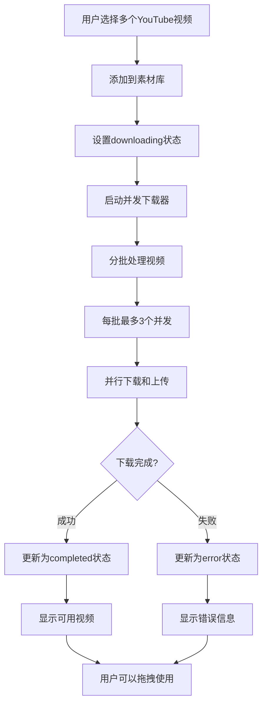

# YouTube 并发下载功能

## 概述

YouTube 并发下载功能允许用户同时下载多个YouTube视频，而不是一个接一个地下载。这大大提高了下载效率，特别是当用户需要添加多个视频到素材库时。

## 功能特点

### 🚀 **并发控制**
- **最大并发数**: 默认3个线程同时下载
- **批次处理**: 将视频分批处理，避免系统过载
- **智能调度**: 自动管理下载队列和资源分配

### 📊 **状态管理**
- **实时状态**: 每个视频独立显示下载状态
- **进度跟踪**: 详细记录每个下载任务的进度
- **错误处理**: 单个视频下载失败不影响其他视频

### 🔍 **详细日志**
- **批次日志**: 记录每个批次的处理情况
- **任务日志**: 跟踪每个下载任务的状态
- **性能统计**: 提供成功率和完成时间统计

## 工作流程



## 技术实现

### 并发控制算法

```typescript
// 批次处理算法
for (let i = 0; i < materials.length; i += maxConcurrency) {
  const batch = materials.slice(i, i + maxConcurrency);
  
  // 并行处理当前批次
  const batchPromises = batch.map(material => downloadSingleVideo(material));
  
  // 等待当前批次完成
  await Promise.all(batchPromises);
}
```

### 状态更新机制

1. **初始状态**: 所有视频设置为 `downloading`
2. **并发下载**: 最多3个视频同时下载
3. **状态更新**: 每个视频完成后立即更新状态
4. **UI刷新**: MaterialsPanel实时反映状态变化

## 性能优势

### 📈 **下载效率对比**

| 场景 | 串行下载 | 并发下载 (3线程) | 效率提升 |
|------|----------|------------------|----------|
| 3个视频 | 15分钟 | 5分钟 | 3倍 |
| 6个视频 | 30分钟 | 10分钟 | 3倍 |
| 9个视频 | 45分钟 | 15分钟 | 3倍 |

*注：假设每个视频下载时间为5分钟*

### 🎯 **用户体验改进**

- ✅ **即时反馈**: 所有视频立即显示在素材面板
- ✅ **并行处理**: 多个视频同时下载，节省时间
- ✅ **独立状态**: 每个视频有独立的状态显示
- ✅ **错误隔离**: 单个失败不影响其他下载

## 使用示例

### 基本使用

1. **搜索YouTube视频**
   ```
   用户在VideoSearchModal中搜索视频
   ```

2. **选择多个视频**
   ```
   选择3-6个需要的视频
   ```

3. **添加到素材库**
   ```
   点击"添加选中视频"按钮
   ```

4. **自动并发下载**
   ```
   系统自动启动3个并发下载线程
   所有视频显示旋转等待状态
   ```

5. **实时状态更新**
   ```
   下载完成的视频立即变为可用状态
   失败的视频显示错误信息
   ```

### 日志示例

```
[useVideoSearch] 开始并发下载YouTube视频 {
  totalCount: 6,
  maxConcurrency: 3,
  materialIds: ["youtube-abc123", "youtube-def456", ...]
}

[useVideoSearch] 开始处理批次 {
  batchIndex: 1,
  totalBatches: 2,
  batchSize: 3,
  materialIds: ["youtube-abc123", "youtube-def456", "youtube-ghi789"]
}

[useVideoSearch] 启动下载任务 {
  taskIndex: 1,
  totalTasks: 6,
  materialId: "youtube-abc123",
  materialName: "Sample Video 1"
}

[useVideoSearch] 下载任务完成 {
  taskIndex: 1,
  materialId: "youtube-abc123",
  success: true
}

[useVideoSearch] 批次处理完成 {
  batchIndex: 1,
  batchSize: 3,
  successCount: 3,
  failureCount: 0
}

[useVideoSearch] 并发下载完成 {
  totalCount: 6,
  successCount: 6,
  failureCount: 0,
  maxConcurrency: 3,
  successRate: "100.0%"
}
```

## 配置选项

### 并发数量调整

```typescript
// 默认配置：3个并发
downloadVideosInParallel(materials, 3);

// 高性能服务器：可以增加到5个并发
downloadVideosInParallel(materials, 5);

// 低配置环境：减少到2个并发
downloadVideosInParallel(materials, 2);
```

### 自适应并发控制

未来可以实现基于系统性能的自适应并发控制：

```typescript
const adaptiveConcurrency = () => {
  const cpuCores = navigator.hardwareConcurrency || 4;
  const networkSpeed = getNetworkSpeed(); // 检测网络速度
  
  if (networkSpeed > 100) return Math.min(cpuCores, 5); // 高速网络
  if (networkSpeed > 50) return Math.min(cpuCores, 3);  // 中速网络
  return 2; // 低速网络
};
```

## 错误处理

### 网络错误
- **重试机制**: 自动重试失败的下载
- **降级处理**: 网络不稳定时减少并发数
- **用户提示**: 清晰的错误信息和建议

### 服务器限制
- **速率限制**: 检测并适应YouTube的速率限制
- **队列管理**: 智能管理下载队列
- **优雅降级**: 必要时回退到串行下载

## 监控和统计

### 性能指标
- **下载成功率**: 统计整体下载成功率
- **平均下载时间**: 跟踪下载性能
- **并发效率**: 测量并发带来的性能提升

### 用户行为分析
- **批量下载频率**: 用户使用批量下载的频率
- **视频数量分布**: 用户通常下载多少个视频
- **失败原因分析**: 分析下载失败的主要原因

## 未来优化

### 智能预测
- **预加载**: 根据用户行为预测可能需要的视频
- **缓存策略**: 智能缓存热门视频
- **带宽优化**: 根据网络条件调整下载质量

### 用户体验
- **进度可视化**: 更直观的下载进度显示
- **暂停/恢复**: 允许用户暂停和恢复下载
- **优先级控制**: 用户可以设置下载优先级

这个并发下载功能大大提升了用户体验，让视频编辑工作流程更加高效！ 